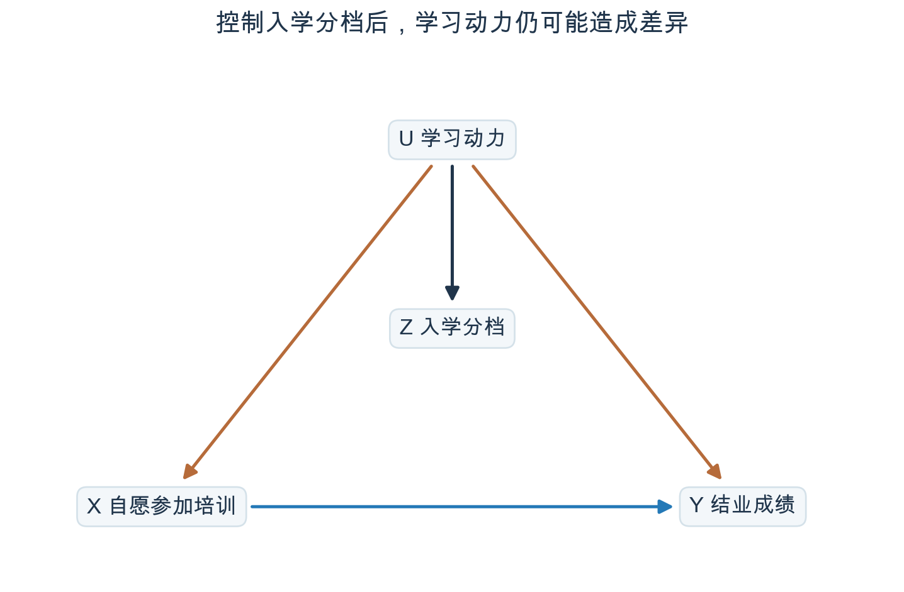
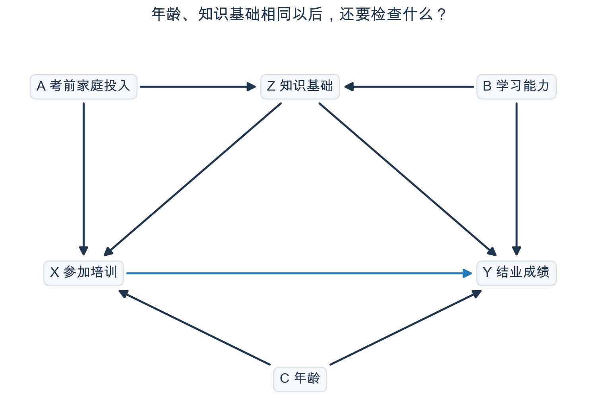
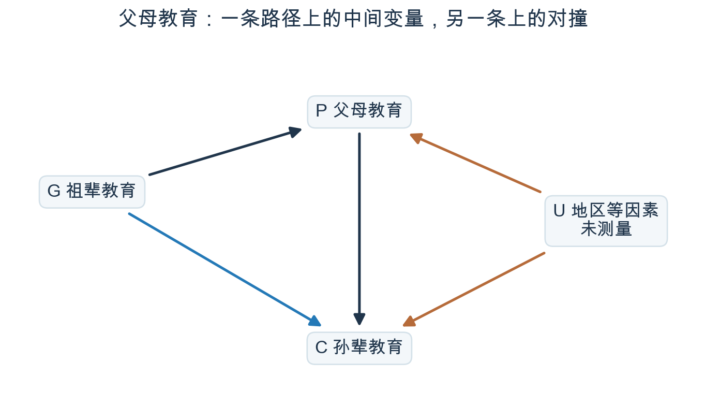
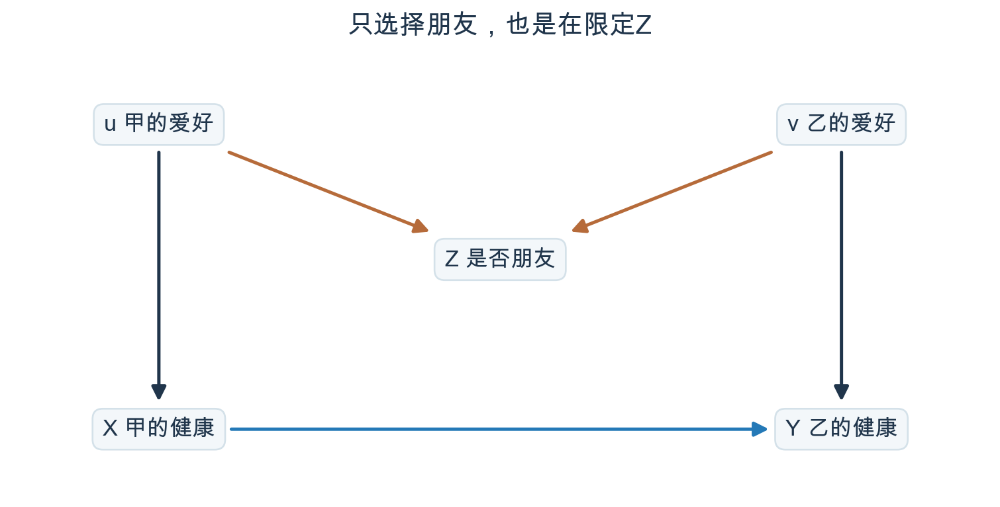
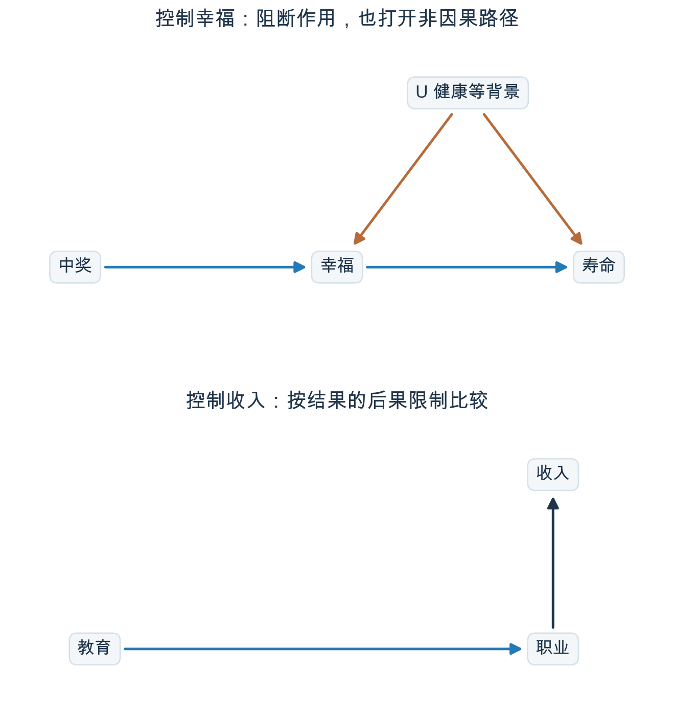
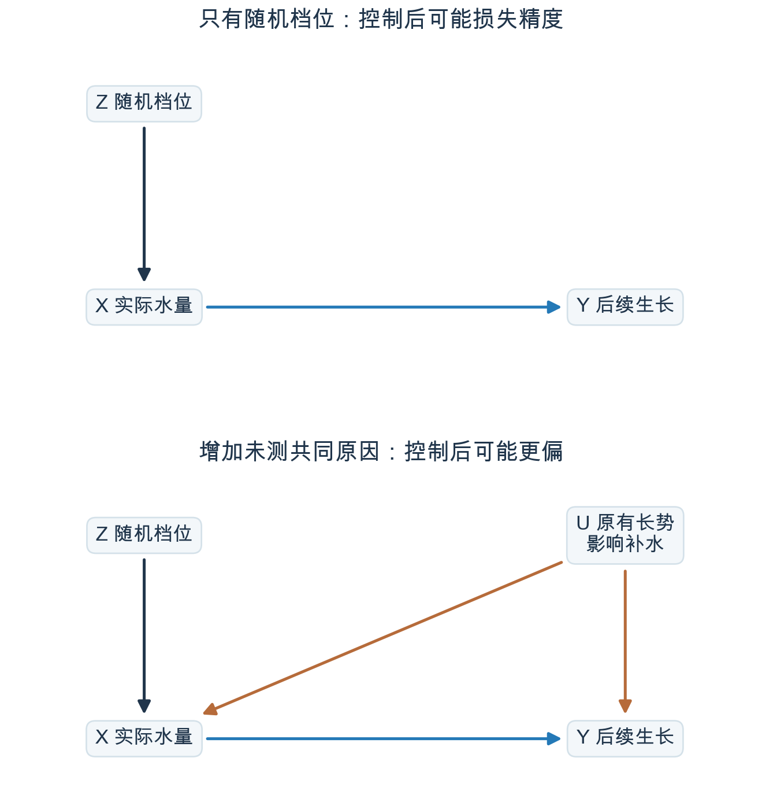
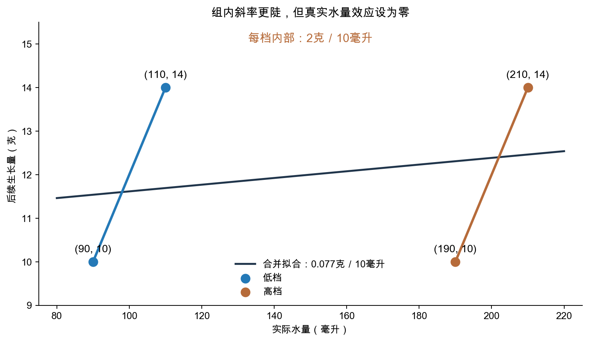
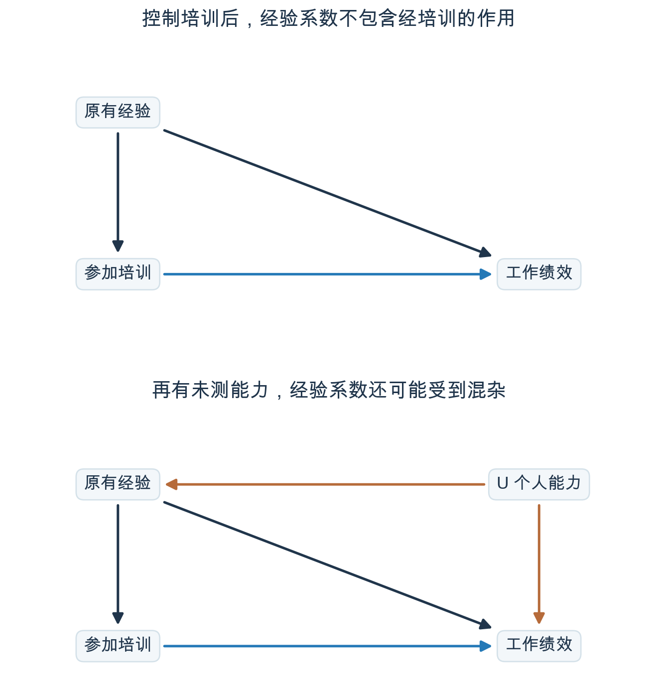

# 控制了谁，我们就在比较谁？｜Statistical Rethinking 精读06

> 明哥的微生物世界 · Statistical Rethinking 精读06
>
> 摘要：研究培训是否提高成绩，我们为什么要把学生分层比较？研究中奖是否影响寿命，又为什么不能只比较幸福程度相同的人？控制一个变量，改变的是参加比较的人，以及我们能从比较中得到的答案。

大家好，我是明哥。

分析数据时，我们经常说：“这个因素也可能有影响，把它控制一下。”

以培训为例，我们想知道它能让学生多考多少分。参加者原本的成绩更好，就需要处理这个起点差异；但培训之后增加的学习时间，可能正是培训起作用的过程。把这两种因素都塞进模型，回答的问题就会改变。

本文用“只在某个条件相同的人中比较”来理解控制变量。实际做回归时，通常不用真的把样本一一配对，而是由模型估计相同条件下的差异。读每个例子时，可以顺着三个问题往下看：**我们要研究谁对谁的作用？控制以后，改成比较哪些人？这样的比较排除了什么，又可能带入什么？**

这一篇沿着Richard McElreath的2023年第06讲《Good & Bad Controls》，先讨论怎样处理原有差异，再看控制中间变量和筛选样本会怎样改变比较，最后区分估计不稳定与估计有偏，并回到自己的实验设计。原课的三代教育、朋友与健康、彩票与寿命等例子会保留；培训和浇水是帮助理解的补充例子。文中表格均为教学设定，每个例子的关系和数字只适用于该段交代的规则。

## 一、按入学成绩分层，怎样比较培训组与未培训组？

学校想知道培训能否提高成绩，但报名是学生自己决定的。学习动力强的学生可能更愿意报名，平时也更认真，即使不参加培训，也可能考得更好。

所以，看到培训组分数高，我们需要分清：**有多少来自培训，有多少来自参加者原本就与未参加者不同？**

学习动力不容易直接测量。学校手头有一项培训前的记录：这些学生的入学考试成绩。我们可以先利用它，检查参加者是不是原本成绩就更好。

我们用200名学生的教学数据来看。入学成绩较高的100人中，有80人报名参加培训；成绩较低的100人中，只有20人参加。

高分档学生报名的比例更高。为什么更高，还要了解学生的学习动力和报名原因，可能是学习动机更高。

结业考试的平均分如下：

| 培训前的入学分档 | 参加培训：人数／结业平均分 | 未参加：人数／结业平均分 |
|---|---|---|
| 高分档 | 80人／90分 | 20人／80分 |
| 低分档 | 20人／60分 | 80人／50分 |

培训组的100人，平均成绩为（80×90＋20×60）÷100＝**84分**。未培训组的100人，平均为（20×80＋80×50）÷100＝**56分**。两组相差28分。

先看一个已经知道的差别：培训组有80名原本的高分学生，未培训组只有20名。高分档学生即使没有参加培训，结业平均分也比低分档高。直接比较84与56，就把两组在培训前的成绩构成不同也算进去了。

**先解决这一个问题：如果高分学生与高分学生比，低分学生与低分学生比，培训组还高多少分？**

- 高分档：参加者90分，未参加者80分，相差**10分**。
- 低分档：参加者60分，未参加者50分，也相差**10分**。

这一步就是按入学分档进行控制：先把高分档与高分档比，低分档与低分档比，减少两组高低分学生比例不同造成的干扰。

如果要把这两次比较合起来，就用同一个学生群体的构成计算。这200人中，高低档各占一半。将两组都换算为高低档各占50%，得到：

- 培训组调整后的平均分：90×50%＋60×50%＝**75分**。
- 未培训组调整后的平均分：80×50%＋50×50%＝**65分**。

这10分回答的是：**按原来200名学生的构成，让两组都由一半高分学生、一半低分学生组成，平均成绩还差多少？** 原来的28分把高低分学生比例不同也算进去了；分层再加权，排除了这部分构成差异。

但同一档内的学生仍然可能不同，所以这10分目前只能叫“调整后的成绩差异”。

同样处在高分档，学习动力更强的学生仍可能更愿意报名，结业前也复习得更认真。低分档内部也可能如此。入学成绩相近，并没有让学生的学习动力自动相同。

图1画出了需要考虑的一种关系：学习动力影响入学成绩，也可能同时影响报名和结业成绩。高分学生报名更多，可能正是因为这两件事都受到学习动力影响；仅凭报名比例，还不能认定入学成绩本身改变了报名决定。



*图1｜自愿报名的补充情景。学习动力既影响报名，也影响结业成绩；把入学分档固定住，仍没有处理这条联系。入学分档是我们已有的测量，不能完全代替对学习动力的了解。*

如果学校还记录了培训前的学习投入、备考习惯，就可以继续检查这些共同影响报名和成绩的因素。只有当需要处理的差异得到充分处理，同类学生中也确实有人参加、有人未参加时，才有依据把调整后的差异解释为培训效果。

**这一节先学会分层比较：让起点相近的学生彼此比较，再按目标人群的比例合起来。至于哪些起点差异必须处理，要靠对报名原因和成绩形成过程的了解。**

原课还用猎豹、狒狒和瞪羚解释“分开比较，再合起来算”的意义。在作者的示意情景中，猎豹存在时，狒狒受到威慑，较少追捕瞪羚；猎豹缺失时，狒狒的捕食作用更强。因此，判断一个保护区增加狒狒后会怎样，既要了解两种背景下的作用，也要知道这些背景在保护区中各占多少。培训例子里的50%与50%，同样是在说明：合并比较时，要明确代表的是哪一群学生。

## 二、因素更多时，为什么有时要控制三项？

如果同时知道学生的年龄、知识基础、家庭投入和学习能力，该怎样决定控制哪几项？

原课用图2演示多个因素相连时的调整方法。下面给图中的字母赋予具体含义，仍以培训为例。这是一个新的教学设定：只考虑以下列出的关系。

**年龄C。** 不同年龄的学生，参加培训的机会不同；年龄也影响他们学习和应试的表现。

**入学时的知识基础Z。** 在这些学生中，基础较好的人更有信心学会后续课程，因而更愿意报名培训；他们掌握后续知识也更容易，结业成绩往往更好。

**考前家庭投入A。** 家庭在入学前提供的学习时间、辅导等，会帮助孩子打好基础。投入较多的家庭，也更可能为孩子报名后续培训。

**学习能力B。** 能力影响入学时掌握了多少知识，也影响结业时的表现。

这是图2对应的简化情景。我们在这里假设考前家庭投入的后续作用，通过知识基础和培训参与体现；若现实中还有其他作用，就要补上相应箭头。



*图2｜保留原课第28—44页的箭头，用具体情景解释。A为考前家庭投入，B为学习能力，C为年龄，Z为入学时的知识基础，X为培训，Y为结业成绩。*

先让参加培训与未参加的人**年龄相同**。这样就不会把两组年龄不同带来的成绩差别，直接当成培训作用。

再让两组的**知识基础相同**。基础较好的人既更愿意报名，也更容易考好，把这一差别混进来，就会高估培训的作用。

接下来有一个容易忽略的变化：知识基础相同的人，家庭投入与学习能力的组合可能不同。

例如甲、乙已经掌握了相同的基础内容。甲得到的家庭辅导较多，乙得到的辅导较少；乙可能靠更强的学习能力，达到了与甲相同的程度。我们限定基础相同以后，就可能把“家庭投入较多、能力较弱”的学生，与“家庭投入较少、能力较强”的学生放在一起。

家庭投入较多，又更容易让学生报名培训；学习能力较强，则更容易让学生在结业时考好。于是，即使年龄和基础相同，参加者与未参加者之间仍可能存在能力差异。

我们原本想消除基础差异，却可能在基础相同的人中，让培训组与未培训组的能力不同。为此还要再加一步：**固定家庭投入，或者固定学习能力。** 在年龄、基础、家庭投入都相同的人中比较，家庭投入就不会再把培训参与与能力差异联系起来。也可以固定年龄、基础和能力，让结业成绩中来自能力的差别不再干扰比较。

这几步各自解决的问题，可以放在一起看：

| 比较时固定什么 | 解决什么，或还剩什么问题 |
|---|---|
| 年龄 | 排除年龄带来的报名与成绩差异 |
| 再固定知识基础 | 排除基础差异，但家庭投入与能力可能在同等基础下互相补偿 |
| 再固定家庭投入，或学习能力 | 截断这种补偿关系对培训与成绩比较的干扰 |

为什么还需要最后一步，可以用图中的“路径”检查。

例如，“培训←年龄→成绩”表示年龄分别影响培训和成绩，它可能让两者相关。从培训X出发，这条路的第一段是年龄指向培训，即C→X。这样从背后进入X、再连接到结果Y的路径，叫**后门路径**。路径可以逆着箭头找；它表达的是变量怎样联系起来，不是在说培训会反过来改变年龄。

图2共有五条后门路径，逐条检查如下：

| 路径 | 具体是什么关系 | 哪项控制会阻断它 |
|---|---|---|
| X←C→Y | 年龄同时影响培训和成绩 | 年龄C |
| X←Z→Y | 知识基础同时影响培训和成绩 | 知识基础Z |
| X←A→Z→Y | 家庭投入影响报名，也通过知识基础影响成绩 | 知识基础Z |
| X←Z←B→Y | 能力影响成绩，也通过知识基础影响培训参与 | 知识基础Z |
| X←A→Z←B→Y | 限定基础相同后，家庭投入和能力可能互相补偿 | 再控制家庭投入A或能力B |

所以，在这张图里，**年龄＋知识基础＋家庭投入**，或者**年龄＋知识基础＋学习能力**，都能阻断所有后门路径。

原课称它们为两个最小调整集合。“最小”是说，从任何一组再拿掉一项，都会留下未阻断的后门路径。经典后门准则还要求，所选变量不能是培训本身造成的后果。后面的例子会说明为什么要注意这一点。

## 三、父母都上过大学，为什么还可能比错？

这一节要研究祖辈教育对孙辈教育的总作用。容易出现的误操作是：为了让两家“条件相同”，先把父母学历固定住。

先区分两种帮助。祖辈可以帮助自己的孩子接受教育，父母再帮助孙辈；祖辈也可能直接帮助孙辈，例如给予学习支持或支付学费。前一种经过父母，后一种直接到孙辈。

如果问祖辈教育**一共有什么作用**，这两部分都要计算，这叫总效应。如果只想知道祖辈绕过父母、直接帮助孙辈的作用，就需要把两部分分开。

分析者很容易想到：“那就比较父母学历相同的家庭。”但父母学历是怎样形成的，也得考虑进去。

设想父母这一代居住的地区，其学校资源会影响父母的学历；孙辈也在这里长大，仍受当地教育条件影响。祖辈住在别处，没有共享这套教育条件。这是原课未测地区因素U的一种具体解释，见图3。



*图3｜据原课第46—49页重绘。G、P、C分别是祖辈、父母、孙辈教育；U是父母与孙辈共享的地区等条件。*

现在选出两个父母都上过大学的家庭：

- 甲家庭的祖辈支持较多，当地学校条件较差。
- 乙家庭的祖辈支持较少，当地学校条件较好。

两家父母达到了相同学历，但走到大学的条件不同。甲更多依靠家庭支持，乙更多受益于当地条件。

只比较父母学历相同的家庭，就可能把这两类家庭放在一起。等到孙辈上学时，当地条件仍然影响他们。甲家庭的孙辈如果表现较差，一部分原因可能是当地学校条件较差，却容易被分析记在“祖辈支持更多”这一边。

这就是控制父母学历带来的麻烦：它把祖辈通过父母传递的作用排除了，同时又让我们在不同地区条件的家庭之间比较祖辈。

图3中，父母教育在“祖辈→父母→孙辈”上是**中间变量，也叫中介变量**；在“祖辈→父母←地区条件→孙辈”上，又是两种原因的共同后果，也就是对撞节点。

因此，在这张图且地区条件没有测量的情况下，可以研究祖辈教育的总效应；若想得到直接作用，单纯控制父母教育还不够，还需要解决地区条件造成的比较偏差。

## 四、朋友健康相似，是因为朋友互相影响吗？

原课的下一个例子，关心一个人的健康会不会影响朋友的健康。比如甲开始坚持锻炼，是否带动乙也变得健康？

但有些朋友本来就都喜欢运动。他们可能因为共同爱好认识，各自的健康也受各自爱好影响。即使甲没有改变乙，两人的健康也可能相似。

先用一张表看看“挑选朋友”怎样改变比较。我们从人群中独立随机抽取两个人配成一对，暂时不要求两人认识。设定每个人有一半概率喜欢运动，按100对换算，四种配对各有25对。

再设定爱好相同的人更容易成为朋友：相同爱好的两类各留下20对，不同爱好的两类各留下5对。

| 两人的爱好 | 随机配对时 | 只留下朋友后 |
|---|---|---|
| 都喜欢运动 | 25对 | 20对 |
| 只有甲喜欢运动 | 25对 | 5对 |
| 只有乙喜欢运动 | 25对 | 5对 |
| 都不喜欢运动 | 25对 | 20对 |

随机配对时，甲喜欢运动的50对中，乙也喜欢运动的有25对，比例为25÷50＝**50%**。甲不喜欢运动的50对中，乙喜欢运动的也是25对，仍是**50%**。

也就是说，此时知道甲的爱好，没有改变乙喜欢运动的概率。这是这个教学设定中“两人的爱好独立”的含义。

只留下朋友以后，情况变了：

- 甲喜欢运动时，乙也喜欢运动的比例是20÷（20＋5）＝**80%**。
- 甲不喜欢运动时，乙喜欢运动的比例是5÷（5＋20）＝**20%**。

爱好相同的配对更容易被留下，因此朋友的爱好更相似。如果喜欢运动又使两个人各自更健康，那么仅仅因为这样选人，朋友之间就会出现健康关联。

图4把这几步连起来：“是否朋友”受甲、乙各自爱好影响，是一个对撞节点。只收集朋友数据，已经相当于控制了它。



*图4｜据原课第54—62页重绘。u、v为两人的爱好，Z为是否朋友，X、Y为两人的健康。X→Y是想研究的作用；上方的路径则可能因筛选朋友而引入额外关联。*

这里要分清两个研究范围。如果研究全部配对，就应保留相应的数据范围，不能为了让背景相似而只留下朋友。上表说明了这种筛选本身会引入什么关系；它还没有告诉我们朋友间影响有多大。

如果要研究朋友之间的影响，就需要在朋友样本内处理这条由爱好造成的联系。把“是否朋友”从回归公式里删掉没有用，因为不认识的配对在收集数据时已经被排除。删掉这一列，不能把那些配对补回来。

以调整甲的爱好为例，可以把朋友配对分成两层：一层中每一对的甲都喜欢运动，另一层中每一对的甲都不喜欢运动。**每层内部再比较：甲的健康程度不同时，乙的健康怎样变化。** 这里固定的是甲的爱好，并不要求一对朋友的爱好必须相同。

在图4只包含这些关系的设定下，按甲的爱好分层就能挡住上方的路径；按乙的爱好分层也可以。每层还要有不同健康程度可供比较。若现实中共同居住环境也影响交友和健康，还得把这部分关系补进去。朋友内的比较，回答的也只是这个朋友群体中的问题。

如果两人的爱好没有测量，共同居住环境等背景也不清楚，那么朋友健康相似，究竟有多少来自彼此影响，有多少来自原有相似，就很难从这批数据中分开。补充测量、改进取样与研究设计，比在现有回归中反复增删变量更有帮助。

这个例子提醒我们：**选择谁进入研究，本身就会改变变量之间的关系。**

## 五、只比较幸福相同的人，怎样把中奖的作用算反？

我们想知道：中奖一共会怎样影响寿命？原课用这个问题说明，处理发生以后产生的变量，也可能被错误地当成“需要排除的影响”。

我们先设定同一种彩票的购买者有相同中奖机会，结果由随机开奖决定。再假设中奖会让人更幸福，幸福会影响寿命；原有健康较好的人，也更容易感到幸福，而且寿命更长。

这样，幸福有两种来源：中奖带来的愉快，以及原有健康带来的良好状态，见图5上图。



*图5｜上图据原课第63—70页：中奖和原有健康U都影响幸福，U还影响寿命。下图据第74—76页：教育影响职业，职业影响收入。以下分别讨论控制幸福和控制收入会怎样改变比较。*

用四行假设数字演示。幸福评分和寿命值都只服务于算例，不用于预测现实中的寿命。

| 原有健康条件 | 是否中奖 | 幸福评分 | 预期寿命 |
|---|---|---|---|
| 较差 | 未中奖 | 4 | 70年 |
| 较差 | 中奖 | 6 | 72年 |
| 较好 | 未中奖 | 6 | 78年 |
| 较好 | 中奖 | 8 | 80年 |

表的生成规则是：中奖使幸福提高2分；健康较好也使幸福提高2分。幸福每提高1分，预期寿命增加1年；健康较好还通过幸福之外的途径增加6年寿命。

先比较原有健康相同的人。健康较差时，中奖与未中奖差72－70＝**2年**；健康较好时，差80－78＝**2年**。中奖在这个设定里的总作用都是增加2年。

若两类健康条件各占一半，随机开奖后，中奖和未中奖的人也按这个比例计算。中奖组平均（72＋80）÷2＝**76年**，未中奖组平均（70＋78）÷2＝**74年**，仍然差2年。

现在，分析者想排除幸福的影响，只留下幸福评分为6的人。请回看表格：评分4和8的两行被筛掉，剩下的是：

- 健康较差、中奖了的人，72年。
- 健康较好、没中奖的人，78年。

筛选后，中奖者的平均寿命反而短了**6年**。这个差别不能解释为中奖让寿命减少6年：原来比较的是两批健康构成相同的人，现在却拿健康较差的中奖者，去比健康较好的未中奖者。

之所以会这样，是因为幸福相同可以由不同条件凑成。健康较差的人靠中奖提高幸福，健康较好的人不用中奖也能达到同样评分。限定评分相同，就把这两类人挑到了一起。

因此，如果想研究中奖**一共带来什么变化**，幸福的变化也是作用的一部分，应保留它。控制幸福会挡住这部分作用，还会引入原有健康不同造成的差别。要进一步拆解幸福这条途径，需要对原有健康等共同原因作出额外处理。

原课第68页还把幸福对寿命的作用设为零。此时中奖本来没有总效应，按幸福分层仍可能产生负的估计。它说明即使某个作用根本不存在，错误的比较也能把它算出来。

作者随后用教育、价值观与收入提醒我们，同样的结构可能藏在看起来很正常的变量里：教育可能影响价值观，家庭背景也影响价值观，同时还影响收入。若把价值观固定住，就要检查是否因此让不同教育组的家庭背景变得不可比。

**另一种错误：研究职业变化，却只留下收入相同的人。**

图5下图里，收入处在职业之后。

研究问题是“教育是否改变了人们进入不同职业的机会”。设想教育使一些人从操作岗进入技术岗，而技术岗的收入较高。完整比较应当包括这些转入技术岗的人，因为他们的职业变化正是我们关心的结果。

如果分析时要求收入相近，比如只看月收入6000元附近的人，那些因教育进入较高收入技术岗的人，就可能被排除。我们把一部分职业已经改变的人筛走，再问教育有没有改变职业，得到的答案就会受这个筛选影响。

更极端地，假设每一种职业都有固定且不同的工资：限定同一收入，就等于限定同一职业。此时样本中的职业已经相同，无法再用它比较教育造成的职业差异。

现实中职业之间的收入有重叠，通常不会完全限制到同一职业。但这种控制仍然改变了比较范围。原课第76页的特定模拟中，加入结果的后果后，效应系数约缩小了一半。

**收入与职业密切相关，正是因为职业会影响收入。** 研究教育是否改变职业，却按收入筛掉职业已经改变的人，就删掉了本来要研究的一部分结果。

## 六、控制浇水档位，为什么会让结果更不稳定？

研究者想知道实际水量对植物生长的作用，于是把植物随机分成高、低两档，用水泵按档位浇水。这一节先设定没有影响水量与生长的共同原因，单看一个问题：把已经随机分配的档位再放进回归，会怎样改变估计？

低档实际浇90—110毫升，高档190—210毫升。同档内的小差异来自水泵的随机误差。设定档位本身不会影响植物，只有浇进去的水会影响生长，见图6上图。



*图6｜对应原课第77—81页，浇水为补充情景。上图：随机档位决定主要水量，同档内差异来自随机误差。下图：在另一种实验规则中，工作人员还会根据原有长势补水。两种情况分别在本节与下一节讨论。*

假设水量每增加10毫升，植物平均多长2克；即使水量一样，个体差异也会让生长量上下波动几克。

不控制档位时，可以利用高、低档之间约100毫升的水量差异。按照设定，预期生长差异是100÷10×2＝**20克**。几克的个体波动虽然存在，但相比20克的平均差异，比较容易分辨。

控制档位以后，就主要看同档内的差异。例如两株同属低档的植物，分别浇95与105毫升，只差10毫升，对应的平均生长差异只有**2克**。个体本身几克的波动，便很容易盖过这2克。

这里有一个容易疑惑的地方：高低档的数据不是都还在吗？

数据都在，但模型现在同时允许“档位”和“实际水量”解释生长差异。高档水更多，植物也长得更多，两项变量一起变化；模型需要利用同档内那些水量不同的植物，才能单独辨认水量的作用。

如果低档每株恰好100毫升，高档每株恰好200毫升，两项变量完全对应，就无法分别估计档位和水量的作用。同档还有少量水量波动时，可以估计，但结果更容易受植物个体差异干扰。

这就是本例中精度降低的原因：**可用于单独估计水量作用的差异变小，植物自身的波动仍然那么大。**

精度低，意味着换一批植物，估计更容易变来变去。例如真实作用是每10毫升增加2克，一组示意结果为1.8、2.2、2.0，另一组为0.5、3.5、2.0。两组平均都恰好是2，但后一组明显不稳定。这里仅用几项数字帮助区分稳定性与系统偏离；是否无偏，需要看重复抽样的长期平均。

原课称这种只影响处理、加入后却降低精度的变量为“精度寄生虫”。第78页的宽窄曲线比较的是多次模拟所得估计值的分布：更宽表示换一批数据，结果波动更大。

## 七、如果还漏测了原有长势，控制档位会怎样？

仍研究实际水量对生长的作用，但这次工作人员会看植物原有长势来调整水量，长势好的植物会得到更多水。档位依然随机分配，同档内多浇少浇的原因却变了。

两节的规则对照如下，不能把后一节当成前一节的另一种算法：

| 实验规则 | 上一节 | 本节 |
|---|---|---|
| 同档内水量为什么不同 | 水泵随机误差 | 工作人员根据原有长势调整 |
| 水量的真实作用 | 每10毫升增加2克生长量 | 水已足够，多浇水不再促进生长 |
| 原有长势是否混入水量比较 | 没有 | 有，而且未被记录 |

本节故意把水量的真实作用设为零，好检查分析会不会把原有长势的影响算成水量效果。

原有长势既影响工作人员浇多少水，也影响植物后面能长多少，但分析者没有记录它。图6下图中的U就是这个因素。

用四株教学植物表示这种情况：

| 档位 | 原有长势 | 实际水量 | 后续生长量 |
|---|---|---|---|
| 低档 | 较弱 | 90毫升 | 10克 |
| 低档 | 较强 | 110毫升 | 14克 |
| 高档 | 较弱 | 190毫升 | 10克 |
| 高档 | 较强 | 210毫升 | 14克 |

先看高、低档之间：平均水量分别是100与200毫升，平均生长却都是12克。水量差了100毫升，生长没有增加。

把浇水档位控制住，就是低档里的植物彼此比，高档里的植物彼此比。

先看低档的两株：一株浇了90毫升水，长了10克；另一株浇了110毫升水，长了14克。看起来，多浇20毫升，就多长了4克。高档的两株也呈现同样的差别。

**但多出来的4克，真是水浇得多带来的吗？**

按这个例子的设定，水已经足够，多浇水不会促进生长。那株植物之所以长得更多，是因为它原本长势就好；工作人员也正因为看到它长势好，才多给它浇了水。

如果没有记录原有长势，回归分析看到的就只是“水多了20毫升，生长量多了4克”，于是把这段差别算成了水的效果：每多浇10毫升，多长**2克**。

我们限定了浇水档位，却没有消除同一档内两株植物原本的差别。

图7把四株植物画出来。黑线使用全部数据，斜率约为每10毫升0.077克；两条彩线分别连接各档内的植物，斜率都是每10毫升2克。



*图7｜由上表计算。横轴为实际水量，纵轴为后续生长量。黑线为合并最小二乘拟合，彩线为分档拟合。设定的真实水量效应为零；四株植物只用于展示系数怎样变化，不作显著性检验。*

**这两个回归结果都不能当作水量的因果效应。** 合并拟合的0.077已经受到原有长势干扰；控制档位后的2，离真实的零更远。这叫**偏倚放大**。

随机档位原本提供了一大段与长势无关的水量差异。控制档位把这部分差异排除在主要比较之外，留下的水量差异却更多由原有长势决定。没有测到的长势，在剩下的比较中占了更大比重。

下面的R代码核对两个斜率。乘10，是把每毫升换成每10毫升：

```r
d <- data.frame(
  level = c(0, 0, 1, 1),
  water = c(90, 110, 190, 210),
  growth = c(10, 14, 10, 14)
)
coef(lm(growth ~ water, data = d))["water"] * 10
# 约0.077克／10毫升
coef(lm(growth ~ water + level, data = d))["water"] * 10
# 2克／10毫升
```

上一节的问题是水量差异变小以后，随机波动更容易干扰估计；这一节又多了未测的原有长势，控制档位还会让估计更偏。研究中因此需要问清楚：处理差异究竟由什么造成，控制以后还剩下什么差异？

## 八、同一张回归表里的系数，为什么含义不同？

公司想知道培训能提高多少工作绩效。经验多的员工通常工作更熟练，公司也更愿意把培训机会给经验多的人。

因此，经验影响绩效有两条途径：一条是工作更熟练，另一条是更容易参加培训，再从培训中获益。图8上图画出了这个补充例子。



*图8｜用于解释原课第98—105页。上图：经验影响培训和绩效。下图：增加未测能力U，它影响经验积累和绩效；培训机会仍只通过经验与U联系。*

要研究培训作用，可以在经验相同的人中比较是否参加培训。假设经验已经涵盖两组需要调整的差异，便可以拟合：

**工作绩效 ~ 参加培训 + 原有经验。**

这个模型会给出培训和经验各自的系数。它们对应的比较不同：

- 看培训系数时，固定经验，比较参加与未参加培训的人。
- 看经验系数时，固定培训状态，比较经验不同的人。

设定下面这些平均绩效和培训比例：

| 经验 | 未参加培训的绩效 | 参加培训的绩效 | 参加培训的比例 |
|---|---|---|---|
| 一年 | 50分 | 60分 | 20% |
| 两年 | 52分 | 62分 | 60% |

固定经验看培训：一年经验的人是60－50＝10分，两年经验的人是62－52＝10分，所以培训系数是**10分**。

固定培训看经验：都没参加时是52－50＝2分，都参加时是62－60＝2分，所以经验系数是**2分／年**。

但如果问“经验多一年，一共能改变多少绩效”，就要把培训机会的增加也算进去。

一年经验的人中，80%没参加、20%参加，平均绩效为50×80%＋60×20%＝**52分**。两年经验的人中，40%没参加、60%参加，平均为52×40%＋62×60%＝**58分**。

总共相差**6分**：2分来自经验本身的作用，4分来自培训比例提高，即（60%－20%）×10＝4分。这是按我们设定的因果关系计算的结果。

把三个数字对应的问题放在一起，就能看出为什么不能逐行照读回归表：

| 想问什么 | 比较时固定什么、允许什么变化 | 本例答案 |
|---|---|---|
| 培训有什么作用 | 经验相同，改变是否培训 | 10分 |
| 培训状态相同时，多一年经验怎样 | 固定是否培训，改变经验 | 2分 |
| 多一年经验一共带来什么 | 改变经验，也允许培训机会随之增加 | 6分 |

在这里预先设定的因果关系中，2分对应经验不经过培训的作用，6分才包含培训机会增加的作用。如果另有因素同时影响经验和绩效，这种解释还会发生变化。

原课用HIV感染、吸烟、年龄与卒中的假设图讲同一件事：为了估计感染的作用而调整年龄和吸烟，并没有同时把其他两个变量的总效应也估计出来。作者把逐行误读回归表的做法称为**Table 2谬误**。

图8下图再问一步：如果能力强的人更容易积累经验，工作绩效也更好，而能力没有测量，会怎样？

此时，即使培训状态相同，经验多的人还可能能力更强。经验系数便混入能力的影响，不能继续解释为经验的直接作用。

培训系数却未必同时失效。在图8设定中，公司仍只根据经验安排培训，能力没有绕过经验直接影响培训机会。同样经验的人不会因为能力更强就额外得到机会，因此控制经验仍能堵住能力影响培训的这条途径。

**同一个模型里，经验可以帮助我们估计培训的作用，经验自己的系数却仍可能受到能力的干扰。** 要研究经验，就需要围绕经验重新检查因果关系，不能直接取走为培训问题准备的那一行系数。

## 九、回到我的研究：变重力怎样影响微生物成膜？

读完这些例子，我想到自己的研究：如果要分析变重力对微生物成膜的影响，究竟应该考虑哪些因素？

第一步还是把问题写具体。例如，选定同一菌株，在相同初始接种条件和培养时长下，比较某种变重力处理与对照的单位面积附着生物量。这里关心的是处理一共带来多少变化，也就是总效应。若关心活菌数、膜厚或空间结构，则要分别说明测量什么、何时测量。

接着看实验开始前。如果处理组用了一个培养批次，对照组用了另一个批次，后面出现成膜差异，我们就难以分清来自处理还是批次。可以尽量把同一批次的独立培养单元随机分到不同处理，记录初始接种量等条件，使组间比较有明确依据。

装置也要单独考虑。如果处理组和对照组除了重力条件不同，容器、转动方式或其他条件也一起变了，实际比较的便是一整套条件。在装置与处理完全绑定时，回归里加上“装置”一列也分不开两者，需要从对照设计上解决。

再看处理过程中发生的变化。我们可能提出这样一条待验证的机制：变重力处理改变传质，局部氧环境随之改变，最后影响成膜。如果这条关系成立，氧环境的变化就是处理发挥作用的一部分。

研究总效应时，这部分作用应当算进去。若把处理后的溶氧固定住再比较，问题就变成：“溶氧相同的条件下，两种处理还差多少？”要把这个差别进一步解释为直接效应，还得检查哪些因素同时影响溶氧和成膜。这与前面的幸福和寿命例子相通。

所以，同样是溶氧，**实验开始前两组本来就不同**，与**处理以后才被改变**，在分析中可能有不同含义。不能只凭列名决定要不要加进模型。

我会先按下面的思路整理候选因素。它们是设计时要检查的问题，具体影响和箭头还需要实验依据：

| 候选因素 | 需要查清的关系 |
|---|---|
| 菌株、传代状态、培养批次、初始接种量 | 是否在处理前就不同？是否与处理分组绑定？ |
| 培养基、材料表面、容器、温度、培养时长 | 是否能保持一致？若不同，是否同时改变了成膜？ |
| 装置及转动、振动等伴随条件 | 能否用适当对照分开重力条件与其他装置因素？ |
| 处理后的溶氧、传质、剪切、生长与附着 | 是否处在处理影响成膜的过程中？测量它们是为了估计总效应，还是研究机制？ |
| 取样、视野选择、样本排除 | 是否只留下成膜明显、膜完整或图像好看的样本？ |

最后一行也很实际。如果只选膜长得好的样本，分析对象就经过了结果筛选。应提前约定取样和质控规则，记录排除原因，避免看见结果后再决定保留谁。

实验重复同样要与处理分配对应。若重力处理分配给独立培养单元，一个单元拍十个视野，能更细致地描述这个单元，却没有变成十个独立接受处理的单元。分析时要保留视野属于哪个培养单元的信息。

这次精读给我的启发是：研究响应变量与其他因素的关系，要先想清楚这些因素之间怎样相互影响。一个因素会影响成膜，并不足以说明应把它放进回归；还要看它是否影响分组，是处理发生前的差异，还是处理之后产生的变化。明确这些关系，才知道实验中应该统一什么、随机化什么、测量什么，以及分析时调整什么。

对变重力与成膜研究，我会先把这些关系画出来，标记哪些有依据、哪些还只是猜想。这样，模型里每加一个变量，都能解释清楚：它让我们改成比较哪些样本，为什么这样的比较更接近想回答的问题。

### 跟读资料与教学算例

本文以2023年第06讲的讲义和讲解为主，原书第二版第6章补充概念。图注中的页码均为原课PDF页序。

配套包包含培训分层与加权、朋友筛选、四株植物的偏倚放大、工作培训系数解释四组算例，提供R基础版、R tidyverse版、Python及MATLAB脚本。它们做的是教学枚举与最小二乘计算。原课另外包含quap贝叶斯拟合及重复模拟，这些内容未列入本包。

- 本篇文章、脚本与运行结果：https://github.com/fuyuming/statistics-classroom/tree/main/rethinking/article06_good_bad_controls
- 下载四组教学算例：https://github.com/fuyuming/statistics-classroom/raw/refs/heads/main/rethinking/article06_good_bad_controls/teaching_examples.zip
- 官方课程目录：https://github.com/rmcelreath/stat_rethinking_2023
- 第06讲课件：https://speakerdeck.com/rmcelreath/statistical-rethinking-2023-lecture-06
- 原书：McElreath, R. (2020). *Statistical Rethinking*, 2nd edition，第6章。
