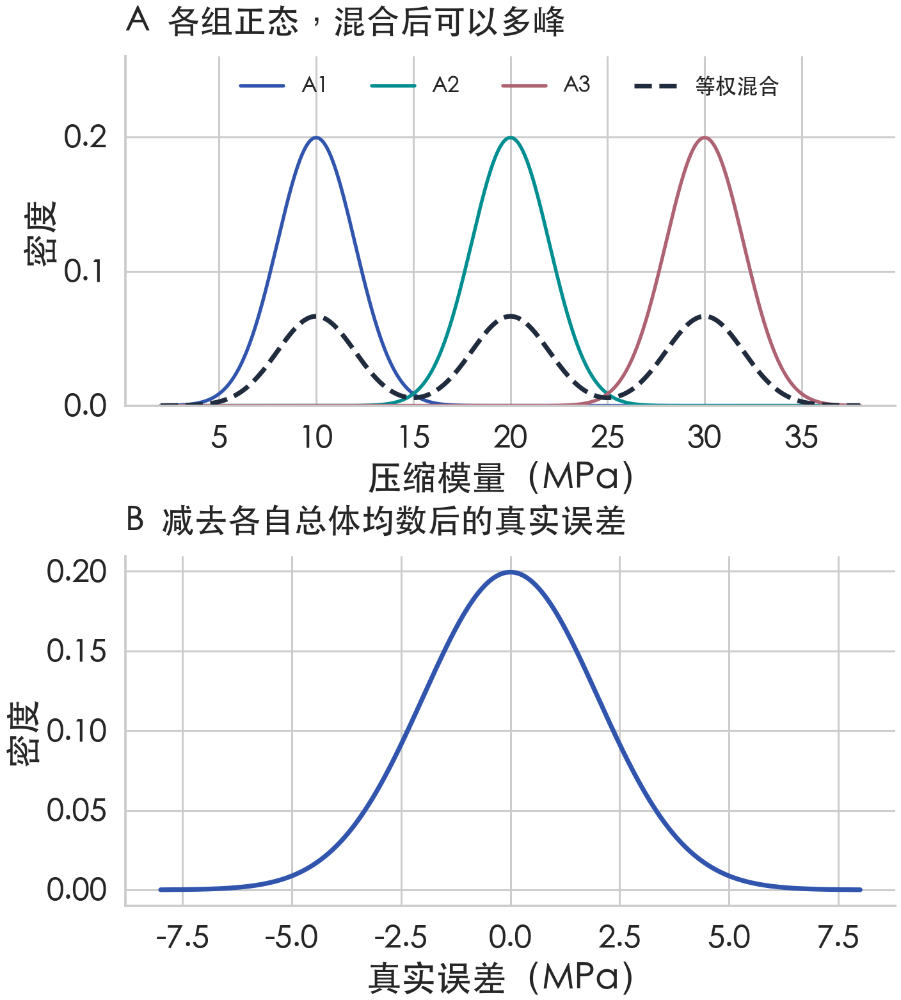
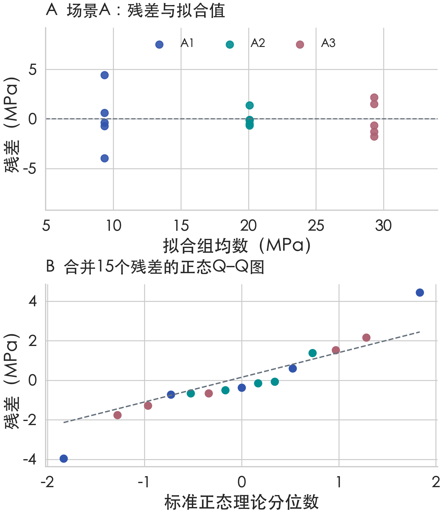
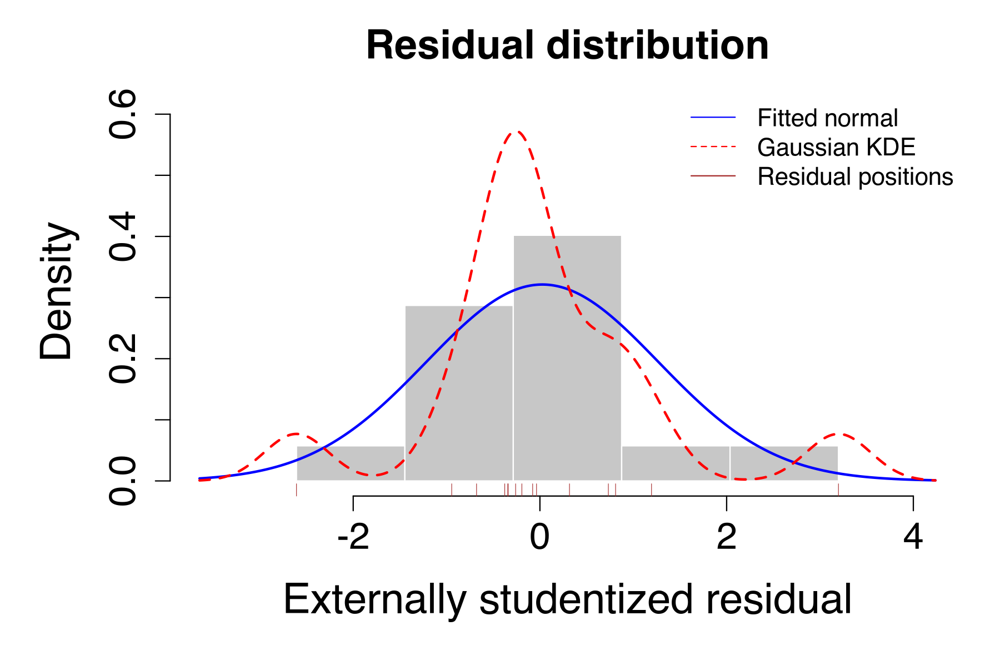

明哥的微生物世界 · 统计课堂 43

# 方差分析的正态性、方差齐性：指什么，一定要检验吗？

> 摘要　方差分析所说的正态性和方差齐性，分别针对什么？它们为什么影响F检验，又是否每次都要先做正式检验？从一道三组比较的完整例题出发，分清观测、误差与残差，说明模型前提怎样支持F推断，以及怎样结合已有依据、图形和必要的检验作判断。


大家好，我是明哥。

这次单因素方差分析课要用到正态性和方差齐性检验。课时有限，检验背后的原理和诊断细节，就放到公众号里接着讲。

上一篇[统计课堂42《为什么有些统计检验，我们反而希望P＞0.05？》](https://mp.weixin.qq.com/s?__biz=MzkxODE4ODY2OA==&mid=2247484446&idx=1&sn=eef00281c9f28e75dc739f9782fca604&chksm=c0cf5c40e2569898fc600103b5fcf0ac17144ff55b182edfe57feb976b478175a20510550840)已经介绍了这些检验的H₀、P值和常用统计量。本篇用一道三组均数比较的完整例题，进一步说明正态性和方差齐性怎样支撑经典F检验，再讨论怎样看残差、是否每次都需要正式检验。

## 一、先把完整题目摆出来

假设一个团队比较A1、A2、A3三种组织工程支架设计的压缩模量（MPa）。每组独立制备5个试件，每个试件测一次，制备和测试顺序随机；15个试件相互独立。

设三组总体均服从正态分布，均数分别为10、20、30 MPa，标准差都为2 MPa，称为**场景A**。表1列出按上述模型生成的15个观测；同一行只是组内编号，没有配对关系。

*表1｜场景A：三种支架设计的模量，单位MPa。*

| 组内编号 | A1 | A2 | A3 |
| --- | --- | --- | --- |
| 1 | 8.97 | 20.02 | 27.56 |
| 2 | 9.95 | 19.59 | 28.03 |
| 3 | 13.78 | 21.47 | 28.66 |
| 4 | 8.62 | 19.94 | 30.83 |
| 5 | 5.39 | 19.43 | 31.48 |

本题要回答三个问题：

1. 三种设计的总体平均模量是否全相同？F值怎样换成P值？
2. 正态性和方差齐性分别针对什么，怎样支撑经典F检验？
3. 怎样判断这些模型条件是否合理？是否每次都要做正式检验？

均数比较的原假设为**H₀：μ₁＝μ₂＝μ₃**，备择假设为总体均数不全相等。本文检验水准均取α＝0.05。

## 二、正态性、方差齐性分别指什么？

ANOVA的正态假设针对各组内部。式（1）将第i组第j个观测写成本组总体均数μᵢ与随机误差之和<sup>[1]</sup>。

$$
Y_{ij}=\mu_i+\varepsilon_{ij}
$$

*式（1）｜单因素组均数模型，误差均值设为0。*

若第i组总体正态，观测就有式（2）的分布；σᵢ²表示该组总体方差。

$$
Y_{ij}\sim N(\mu_i,\sigma_i^2)
$$

*式（2）｜给定组别后的观测分布。*

减去本组总体均数只改变分布位置。因此，组内总体正态与式（3）的真实误差正态等价。

$$
\varepsilon_{ij}=Y_{ij}-\mu_i\sim N(0,\sigma_i^2)
$$

*式（3）｜真实误差围绕0波动，仍保留所属组的方差。*

**方差齐指各组总体方差相等。** 本题为σ₁²＝σ₂²＝σ₃²＝σ²，比较的是各组围绕自身均数的波动大小。

### （一）各组正态，原始数据合并后也正态吗？

**不一定。各组均数不同，合并后的分布可能有多个峰。** 图1A中三个总体分别以10、20、30为中心，均为正态；三组等权混合后却出现三个峰。图1B中，各组观测减去各自的总体均数后，三组真实误差都服从正态分布N(0, 2²)，分布曲线重合。



*图1｜总体模型曲线。A中彩线分别为三个组的N(10, 2²)、N(20, 2²)、N(30, 2²)，黑色虚线是等权混合密度。B中三组真实误差分布重合，图上显示共同的N(0, 2²)曲线。横轴单位MPa，纵轴为密度。*

### （二）总体均数未知时，用残差观察组内波动

真实研究中μᵢ未知。用本组样本均数ȳᵢ代替它，就得到式（4）的残差；小写yᵢⱼ表示本次观测值。

$$
e_{ij}=y_{ij}-\bar y_i
$$

*式（4）｜一个观测相对所属组拟合均数的偏离。*

A1第一个试件的模量是8.97 MPa，本组样本均数为9.342 MPa，残差为8.97−9.342＝−0.372 MPa。本题还知道模拟总体均数μ₁＝10，所以对应的真实误差为−1.03 MPa。两者的区别在于减去样本均数还是总体均数。

在配套项目根目录读入CSV，用`lm(value ~ group)`拟合三个组均数。`fitted()`提取拟合值，`residuals()`提取观测减拟合值<sup>[2]</sup>。

```r
d <- read.csv("数据/residual_cases.csv")
a <- subset(d, scenario == "A")
a$group <- factor(a$group, levels = c("A1", "A2", "A3"))
fit <- lm(value ~ group, data = a)
a$fitted <- fitted(fit)
a$residual <- residuals(fit)
a[1, c("value", "fitted", "residual")]
```

实际输出为：

```text
  value fitted residual
1  8.97  9.342   -0.372
```

**同组残差共用样本均数，因此彼此有关联。** 每组5个残差之和必为0，知道其中4个，第5个就确定了。三组共留下15−3＝12个自由度；不同组的残差仍由独立的试件计算，彼此独立。

在正态模型下，每个残差仍是正态量；组内关联不会改变这一点。**但合并残差的正态外观，不能反推各组总体都正态。**

## 三、F＝117.2845是怎样算出的？

比较组均数，要同时考虑组间相差多少、组内波动多大。组数记为k，总样本量记为N，每组观测数记为nᵢ。

本题每个观测的预测值ŷᵢⱼ，就是所属组的样本均数ȳᵢ。式（5）将“观测值−预测值”平方后相加，得到组内平方和SSE。

$$
\mathrm{SS}_E=\sum_i\sum_j(y_{ij}-\hat y_{ij})^2=\sum_i\sum_j e_{ij}^2
$$

*式（5）｜组内平方和，量纲为MPa²。*

式（6）将各组均数相对总均数ȳ的偏差平方，**再按组内观测数nᵢ加权**，得到组间平方和SSB。同组nᵢ个试件共用一个拟合均数，因此这个组均数偏差的平方要计入nᵢ次。

$$
\mathrm{SS}_B=\sum_i n_i(\bar y_i-\bar y)^2
$$

*式（6）｜组间平方和，ȳ为全部观测的合并总均数。*

例如A1有5个试件，组均数为9.342 MPa，总均数为19.581333 MPa；该组贡献5×(9.342−19.581333)²，约524.22 MPa²。

**三个组均数共用总均数作为中心，因此三个偏差也受到约束。** 本题三组样本量相同，三个“组均数−总均数”之和必为0；知道其中两个，第三个就确定了。所以组间平方和有3−1＝2个自由度。一般k组的约束是按nᵢ加权的偏差之和为0，组间自由度为k−1。

平方和分别除以自由度，得到组间均方MSB与组内均方MSE。式（7）用两者的比值构造F统计量。

$$
F=\frac{\mathrm{MS}_B}{\mathrm{MS}_E}
=\frac{\mathrm{SS}_B/(k-1)}{\mathrm{SS}_E/(N-k)}
$$

*式（7）｜经典单因素ANOVA的均方比。*

因此，本题F的**分子自由度为2，分母自由度为12**。按式（5）、（6）汇总表1，得到SSE＝51.10356、SSB＝998.942813，因此MSE＝4.25863、MSB＝499.471407，F＝117.2845。

**这个F值算不算大？** 假如三组总体均数相同，反复抽样仍会得到不同的F值。要计算观察到117.2845或更大值的概率，就需要知道这些F值的分布。

## 四、正态、方差齐怎样给出F参照？

<strong style="color:#c00000">在观测独立、各组正态且具有共同方差σ²的模型中</strong>，每组的组内平方和除以σ²，服从nᵢ−1个自由度的卡方分布。把各组相加，得到式（8），自由度合计N−k<sup>[1][3]</sup>。

$$
\frac{\mathrm{SS}_E}{\sigma^2}\sim\chi^2(N-k)
$$

*式（8）｜共同方差正态模型下的组内平方和分布。*

### （一）为什么组间平方和在H₀下也有卡方分布？

H₀下，各组总体均数相同，记作μ；样本组均数仍会因抽样而有高有低。它们也服从正态分布，第i组均数的方差为σ²/nᵢ。

**本题三组样本量相同，可把组间波动拆成两个均数差：A1与A2的均数之差，以及A3均数与前两组均数平均值之差。** 正态模型下，前两组均数的“差”与“平均”独立，A3又来自独立试件，所以这两个差也独立。

在H₀下，这两个均数差的均值都为0。各除以自己的理论标准差，便得到两个独立标准正态量；它们的平方和正好等于SSB/σ²。

两个独立标准正态量的平方和服从χ²(2)，所以本题得到式（9）；一般k组对应k−1个独立标准正态量，自由度就是k−1<sup>[1]</sup>。

$$
\frac{\mathrm{SS}_B}{\sigma^2}\sim\chi^2(k-1)
$$

*式（9）｜同一模型且H₀成立时的组间平方和分布。*

总体均数不等时，SSB还包含真实的均数差异，所以式（9）是H₀下的参照。

### （二）方差齐为什么是经典F检验的前提？

**方差齐让两个平方和具有共同的方差尺度σ²。** 在前述独立、正态条件及H₀下，式（8）、（9）才是用同一个σ²得到的两个卡方量；MSB与MSE也都估计这个共同方差。

正态模型中，样本均数与组内偏差独立，因而SSB与SSE也独立，依据见[统计课堂7关于正态样本均数与方差独立的解释](https://mp.weixin.qq.com/s/KuRH3VnO1RQpmIWfYCVutA)。

将这两个独立卡方量各除以自由度，再取比值，分子分母中的同一个σ²便相消，得到式（10）的F分布。

$$
F=\frac{(\mathrm{SS}_B/\sigma^2)/(k-1)}
{(\mathrm{SS}_E/\sigma^2)/(N-k)}
\sim F(k-1,N-k)
$$

*式（10）｜独立、正态、同方差且H₀成立时的精确F参照。*

均方比仍可按式（7）计算；但若各组方差不同，就不能保证两个平方和还能按同一个σ²换成上述卡方量，也就不能直接沿用式（10）的精确F参照。**因此，使用经典F检验需要评估方差齐性是否合理。**

本题的模型条件已给定，用F(2, 12)的右尾，求F达到或超过117.2845的概率。

`anova(fit)`返回方差分析表；`pf()`直接计算F分布的概率，`lower.tail = FALSE`指定右尾<sup>[2]</sup>。

```r
anova_result <- as.data.frame(anova(fit))
anova_result[, c("Df", "F value", "Pr(>F)")]
pf(anova_result["group", "F value"], 2, 12, lower.tail = FALSE)
```

实际输出为：

```text
          Df  F value       Pr(>F)
group      2 117.2845 1.328789e-08
Residuals 12       NA           NA
[1] 1.328789e-08
```

`group`行检验三组总体均数是否全相同，`Residuals`行给出分母部分的自由度。P≈1.33×10⁻⁸，小于0.05，因此在给定模型下拒绝H₀，支持三种设计的总体平均模量不全相同。

## 五、正态性和方差齐性，一定要先检验吗？

前面的计算给定了总体分布；实际研究中，总体分布未知。是否需要正式检验，**要结合已有依据、样本量和诊断目的判断**。专业知识、测量机制和既往同类资料支持组内误差近似正态时，可以据此建模，不必每次先取得一个P＞0.05。**两独立样本的方法学讨论也指出，既往试验和预实验可为分布假设提供依据**<sup>[4]</sup>。

图形展示分布与散布的细节，正式检验提供针对相应H₀的统计量与P值；两者共同辅助模型判断。

### （一）合并残差看形状，保留组别看差异

在本题同方差、等样本量模型下，合并残差可集中观察共同误差的形状。图2A按拟合组均数排列残差，比较各组散布；图2B把15个残差合并画正态Q–Q图，颜色保留原组别<sup>[5][6]</sup>。

`car::qqPlot()`可以画出图2B这样的分位数关系。Q–Q图按残差大小排列观测，代码先排序，再同步指定组别颜色；`line = "quartiles"`采用四分位点参考线。残差有前文所说的组内约束，这里关闭默认独立样本包络<sup>[7]</sup>。

```r
qdat <- a[order(a$residual), ]
group_colours <- c(A1 = "#3155ad", A2 = "#008e91", A3 = "#ae6373")
car::qqPlot(qdat$residual, distribution = "norm",
            col = group_colours[as.character(qdat$group)],
            line = "quartiles", envelope = FALSE, id = FALSE)
```

这里传入原始残差向量，参照为正态；若直接传入`fit`，函数使用学生化残差，默认参照相应的t分布<sup>[7]</sup>。



*图2｜场景A的样本诊断。A中横轴为拟合组均数、纵轴为残差，三列各有5个观测；横虚线为0。B中横轴为标准正态理论分位数、纵轴为有序残差，虚线经过样本残差的第1、第3四分位数对应点，位置和尺度由当前样本估计，供形状比较使用。颜色在两图中均表示原组别。*

图2B两端较远的蓝点来自A1；图2A也显示A1的散布比A2宽。保留组别后，就能回到相应观测核查原因。Q–Q图的整体弯曲、尾部偏离和孤立点，通常比少量数据的直方图更容易辨认<sup>[8]</sup>。

合并残差的形状异常，也可能来自各组方差不同，因此要保留组别，同时查看各组散布。

### （二）用residplot补充看分布

Q–Q图看点怎样偏离直线；`residplot()`则直接显示数值集中处和两侧形状。它使用按估计误差尺度调整后的学生化残差，横轴无量纲，与图2的MPa原始残差不同。

第42篇已提供这个自编函数。本篇配套保留同一文件，将拟合好的`fit`交给它；`nbreaks = 5`把直方图分成5个区间。

```r
source("代码/residplot.R")
residplot(fit, nbreaks = 5)
```

图3是本次调用结果：蓝线为拟合正态密度，仅作形状参照；红色虚线为平滑密度，底部短线标出残差位置。



*图3｜场景A的辅助分布图，由本次residplot(fit, nbreaks＝5)实际生成。横轴为外部学生化残差，无量纲；纵轴为密度。灰色直方图分为5个区间，蓝实线为拟合正态密度，红虚线为Gaussian核密度，底部短线显示15个残差的位置。*

多数点靠近0，两侧各有较远的点；其组别来源仍可回看图2。

### （三）按组读正态性检验

Shapiro–Wilk可以对各组的5个原始观测分别进行。每次的H₀是对应组的总体服从正态分布；`by()`按组将`value`交给`shapiro.test()`<sup>[9]</sup>。

```r
by(a$value, a$group, shapiro.test)
```

表2汇总本次的W统计量与P值。

*表2｜场景A各组原始观测的Shapiro–Wilk检验，每组n＝5。*

| 组别 | W | P值 |
| --- | --- | --- |
| A1 | 0.9569 | 0.7865 |
| A2 | 0.8140 | 0.1049 |
| A3 | 0.8866 | 0.3405 |

三组P值均大于0.05，本次未拒绝各组正态性H₀。每组仅5个观测，检验能力有限，仍需结合图2的尾部偏离阅读。

R的`nortest::ad.test()`支持至少8个观测，本例各组不足，因此不运行AD<sup>[10]</sup>。合并后的15个残差有关联，不能将其常规AD或Shapiro P值直接当作独立样本检验结果。

### （四）用Levene与Bartlett看方差

这两项检验的H₀是**各总体方差相等：σ₁²＝σ₂²＝σ₃²**，与均数比较的H₀不同。

**中位数中心的Levene检验**计算观测与本组中位数的绝对距离，再比较各组平均距离。这是Brown–Forsythe修正；原始Levene以均数为中心。中位数版本对偏离正态通常比Bartlett更稳健，P值使用近似F参照<sup>[11][12]</sup>。

**Bartlett检验**以各组样本方差构造统计量，用近似χ²分布计算P值，对正态性偏离较敏感<sup>[13]</sup>。R中分别调用car包的`leveneTest(center = median)`与`bartlett.test()`<sup>[14]</sup>。

```r
levene_a <- car::leveneTest(value ~ group, data = a, center = median)
bartlett_a <- bartlett.test(value ~ group, data = a)
levene_a
bartlett_a
```

表3列出实际结果。

*表3｜场景A的方差齐性检验。*

| 检验 | 统计量 | 自由度 | P值 |
| --- | --- | --- | --- |
| Levene（中位数中心） | F＝1.2798 | 2，12 | 0.3135 |
| Bartlett | χ²＝5.2337 | 2 | 0.0730 |

两项均未拒绝方差相等，仍需与图2的分组散布一同阅读。**评估共同方差的合理性，不等于每次都必须做正式方差检验**。若预先采用允许各组方差不同的Welch ANOVA，就不以方差齐性检验的P值为门槛；独立性和分布条件仍需评估<sup>[15]</sup>。

经典F检验对某些非正态偏离有一定稳健性，方差不齐与不等样本量结合则可能明显影响推断。影响程度取决于分布形状、方差差异和设计，不能据此认定正态性不重要<sup>[15]</sup>。

<u>观测独立性主要靠抽样与实验设计保障；正态性和方差齐性则结合专业知识与残差诊断评估。</u>这三项模型假设在H₀与备择假设下都适用。

## 六、近期研究怎样使用这些检验？

下面两项研究，分别展示了实验研究和临床研究怎样报告这些检查。

### （一）帕金森病模型：检查残差的正态性和方差

De Schepper等2026年发表于《Nature》的研究，考察肠道巨噬细胞如何影响帕金森病模型中的α-突触核蛋白病理。原论文图1c的定量以小鼠为观察单位，每组6～8只，每个数据点是单只小鼠的平均结果。论文统计方法总体报告：用Shapiro–Wilk检查残差正态性，方差检查列出Bartlett、Brown–Forsythe或Levene等检验；对部分异方差数据采用对数或平方根变换<sup>[16]</sup>。

这里的检查对象是模型残差及其波动，正对应前文“分清组均数差异，再看组内波动”的思路。

### （二）胆囊炎手术：用AD等检查数值变量分布

Şahin与Alçı于2025年发表于《Surgical Endoscopy》的回顾性研究纳入201例急性胆囊炎患者，按手术时机分为早期62例、中期34例、延迟105例，比较术后6个月的胃肠道生活质量指数（GIQLI）。统计方法列出Shapiro–Wilk、Kolmogorov–Smirnov和Anderson–Darling评价数值变量正态性；多组非正态变量的比较采用Kruskal–Wallis检验<sup>[17]</sup>。

这两例展示的是作者报告的实际用法；采用哪些检查，仍要结合本研究的模型与数据判断。

## 七、本篇讲了哪些知识？

- **正态性说的是组内总体，等价于各组真实误差正态。** 拟合残差帮助观察组内波动；合并后的正态外观不能证明各组正态。
- **方差齐是各组总体方差相等。** 在H₀成立且满足独立、正态、共同方差时，两个独立卡方量各除以自由度后取比值，共同σ²消去，得到经典F参照。
- **模型条件需要评估，正式检验按需使用。** 保留组别的Q–Q图和残差分布图展示偏离位置、形状与尺度；本例按组做Shapiro，并用Levene、Bartlett检验方差齐性。是否使用正式检验，要结合已有依据、样本量和目的。
- **合并残差仍保留组内约束。** 本例15个残差只有12个自由度，不能当作15个独立观测直接套用常规正态性检验。

## 配套资料与练习入口

本篇提供R、Python和MATLAB三套练习，任选一种，重现本题的拟合、残差、平方和、图形和检验。

R打开`ANOVA条件与残差.Rproj`，运行`代码/anova_residuals.R`；Python在Spyder按`# %%`运行`代码/anova_residuals.py`；MATLAB将配套项目设为Current Folder，按`%%`运行`代码/anova_residuals.m`。三种语言读取同一份`数据/residual_cases.csv`，详见README。

本篇完整练习：[下载R、Python与MATLAB配套项目](https://github.com/fuyuming/statistics-classroom/raw/refs/heads/main/stats_classroom/anova_assumptions_residuals/%E7%BB%9F%E8%AE%A1%E8%AF%BE%E5%A0%8243_ANOVA%E6%9D%A1%E4%BB%B6%E4%B8%8E%E6%AE%8B%E5%B7%AE_%E9%85%8D%E5%A5%97%E9%A1%B9%E7%9B%AE.zip)。解压后进入`配套项目`，先读README。

本篇GitHub配套目录：
https://github.com/fuyuming/statistics-classroom/tree/main/stats_classroom/anova_assumptions_residuals

系列仓库：https://github.com/fuyuming/statistics-classroom

整个仓库ZIP：https://github.com/fuyuming/statistics-classroom/archive/refs/heads/main.zip

这里是“明哥的微生物世界”，一起把统计问题读清楚、算明白。

## 参考资料

[1] Rosner B. Fundamentals of Biostatistics. 8th ed. 第12章§12.2–12.3，印刷页552–556：单因素模型、平方和、均方与F检验。

[2] R官方文档：lm与F分布，线性模型拟合、拟合值、残差及pf的尾部概率。https://stat.ethz.ch/R-manual/R-devel/library/stats/html/lm.html ；https://stat.ethz.ch/R-manual/R-devel/library/stats/html/Fdist.html

[3] NIST/SEMATECH统计手册：One-Way ANOVA，模型、共同方差及均方比。https://www.itl.nist.gov/div898/handbook/ppc/section2/ppc231.htm

[4] Rochon J, Gondan M, Kieser M. To test or not to test: Preliminary assessment of normality when comparing two independent samples. BMC Medical Research Methodology. 2012;12:81. 结论讨论了利用既往试验和预实验建立分布假设。https://doi.org/10.1186/1471-2288-12-81

[5] R官方文档：plot.lm，残差图及标准化残差的定义。https://stat.ethz.ch/R-manual/R-devel/library/stats/html/plot.lm.html

[6] R官方文档：qqnorm、qqline及ppoints，正态理论分位数与参考线约定。https://stat.ethz.ch/R-manual/R-devel/library/stats/html/qqnorm.html ；https://stat.ethz.ch/R-manual/R-devel/library/stats/html/ppoints.html

[7] car官方文档：qqPlot，数值向量与lm模型方法、参照分布及包络。https://search.r-project.org/CRAN/refmans/car/html/qqPlot.html

[8] NIST/SEMATECH统计手册：Check of assumptions，残差图与小样本正态概率图。https://www.itl.nist.gov/div898/handbook/pri/section2/pri245.htm

[9] R官方文档：shapiro.test，Shapiro–Wilk检验及样本量要求。https://stat.ethz.ch/R-manual/R-devel/library/stats/html/shapiro.test.html

[10] nortest官方文档：ad.test，Anderson–Darling正态性检验及样本量要求。https://search.r-project.org/CRAN/refmans/nortest/html/ad.test.html

[11] 颜艳、王彤.《医学统计学》第5版. 第四章第七节，印刷页71–72：Bartlett与Levene检验，式（4–21）及均数、中位数、截尾均数三种中心。

[12] NIST/SEMATECH统计手册：Levene Test for Equality of Variances，检验原假设、均数与中位数中心版本。https://www.itl.nist.gov/div898/handbook/eda/section3/eda35a.htm

[13] NIST/SEMATECH统计手册：Bartlett’s Test，统计量、χ²近似与正态性要求。https://www.itl.nist.gov/div898/handbook/eda/section3/eda357.htm

[14] R与car包文档：leveneTest与bartlett.test，调用方式、中心参数及返回值。https://rdrr.io/cran/car/man/leveneTest.html ；https://stat.ethz.ch/R-manual/R-devel/library/stats/html/bartlett.test.html

[15] Delacre M, Leys C, Mora YL, Lakens D. Taking Parametric Assumptions Seriously: Arguments for the Use of Welch’s F-test instead of the Classical F-test in One-Way ANOVA. International Review of Social Psychology. 2019;32(1):13. https://doi.org/10.5334/irsp.198 ；R官方oneway.test文档：Welch方法不要求方差相等。https://stat.ethz.ch/R-manual/R-devel/library/stats/html/oneway.test.html

[16] De Schepper S, Konstantellos V, Conway JA, et al. Intestinal macrophages modulate synucleinopathy along the gut–brain axis. Nature. 2026;651:174–184. 统计方法部分及图1c。https://doi.org/10.1038/s41586-025-09984-y

[17] Şahin AG, Alçı E. Impact of surgical timing on postoperative quality of life in acute cholecystitis: a comparative analysis of early, intermediate, and delayed laparoscopic cholecystectomy. Surgical Endoscopy. 2025;39:2489–2497. Statistical analysis及研究对象部分；采用已更正版本。https://doi.org/10.1007/s00464-025-11620-9 ；更正说明：https://doi.org/10.1007/s00464-025-11648-x
