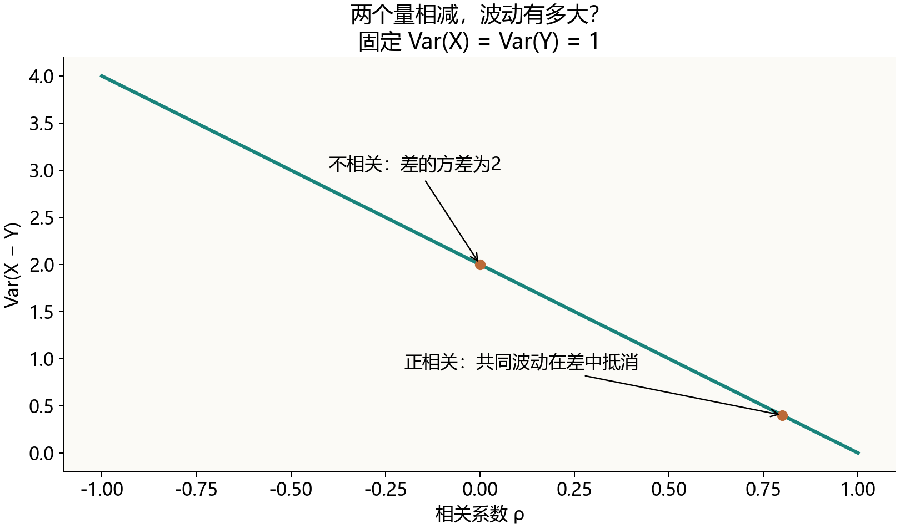
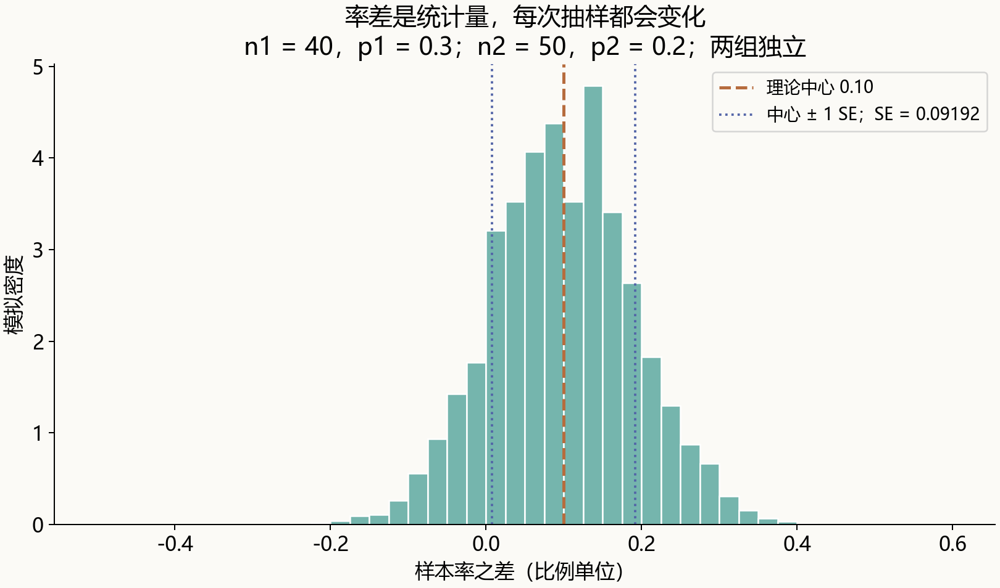
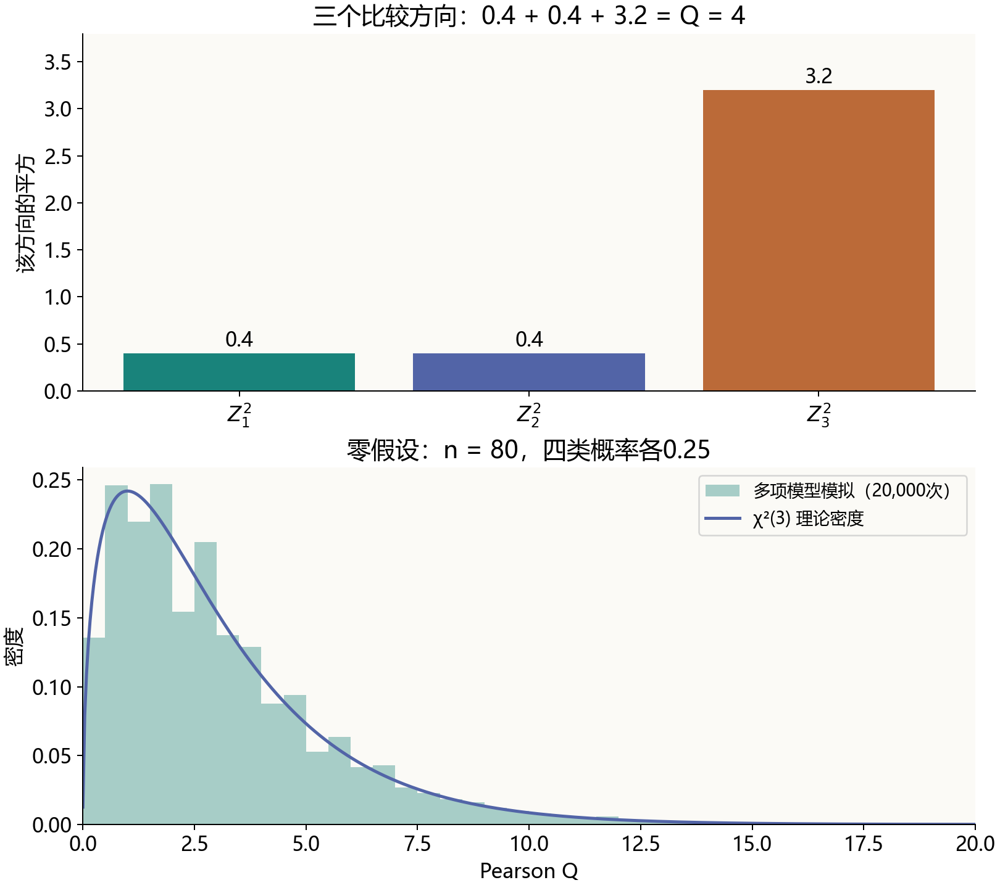

# 两个率相减，为什么方差反而相加？从这里走到分类统计量Q

> 明哥的微生物世界 · 统计课堂 09
>
> 摘要：给第6次课补几步推导：期望为什么可以直接加减，方差为什么要带上协方差，以及这些性质怎样连到样本率之差和分类频数的Pearson Q。

大家好，我是明哥。

第6次课讲到样本率之差、分类频数的偏离统计量Q时，公式往下推，大家开始跟不上它们是怎么来的。我觉得自己需要把中间几步补清楚。

卡住的地方，往往是看起来很熟悉的“加减乘除”：两个变量相减，为什么方差却相加？样本率已经除以n，方差为什么要除以n²？四类频数相加固定为80，它们还能当成四个独立变量吗？

这篇先把期望、方差、协方差的运算理顺，再回到课堂的两道例子。

## 一、先看清：我们在算哪个量的波动？

设某种检测结果只有阳性和阴性。用随机变量X表示一次结果：阳性记1，阴性记0。总体阳性概率记为p。

一次检测只能得到0或1；如果反复独立抽取样本，阳性所占的比例会围绕p波动。这里的**期望**，就是按各种可能结果的概率加权得到的理论平均：

> E(X) = 1 × p + 0 × (1−p) = p。

例如p = 0.3，期望是0.3，不表示某份样本会出现“0.3个阳性”。

方差则描述随机变量围绕自己的期望有多大波动：

> Var(X) = E[(X−E(X))²]
>
> = E(X²) − [E(X)]²。

第二行来自把平方展开再逐项求期望。对于0、1变量，X² = X，所以：

> **Var(X) = p−p² = p(1−p)。**

注意E(X²)与[E(X)]²不同：前者先平方再取平均，后者先取平均再平方。二者的差，恰好就是方差。

后面出现的样本率、两个样本率之差、Q，也都是随机变量。讨论它们的方差，是问：**如果按同样的规则重复抽样，这个统计量会怎样波动？** 一次已算出的数值与它在重复抽样中的分布，要分开理解。

## 二、期望可以逐项算，方差需要先看平方

下面各式中，a、b、c都是固定常数，所涉及的期望与方差存在。

期望有一个很好用的性质：

> **E(aX+bY+c) = aE(X)+bE(Y)+c。**

系数可以提出，和与差可以逐项求期望。**这一步不要求X与Y独立。**

例如，两个组的样本率之差，期望就是两个样本率的期望之差。

但方差不能照抄这个规则。先只看一个变量：

> Var(aX+c)
>
> = E[{aX+c−(aE(X)+c)}²]
>
> = E[{a(X−E(X))}²]
>
> **= a²Var(X)。**

加上的常数c消掉了，乘上的系数a被平方了。于是：

- 整体加10，方差不变。
- 所有数乘2，方差变成原来的4倍。
- 所有数除以n，方差变成原来的1/n²。
- 改成−X，方差仍与X相同，因为(−1)² = 1。

最后一点，已经提示了“相减为什么可能变成方差相加”。但两个变量一起运算时，还要处理一个交叉项。

## 三、协方差，就是平方展开后不能漏掉的那一项

令μX = E(X)，μY = E(Y)。从差的方差开始展开：

> Var(X−Y)
>
> = E[{(X−μX)−(Y−μY)}²]
>
> = E[(X−μX)²] + E[(Y−μY)²]
> − 2E[(X−μX)(Y−μY)]。

最后一项中的期望，叫作**协方差**：

> Cov(X,Y) = E[(X−μX)(Y−μY)]
>
> = E(XY)−E(X)E(Y)。

两个变量常常一起高于各自均值、一起低于各自均值，偏差乘积倾向于为正；一个高、一个低，则倾向于为负。协方差记录这种共同波动，大小也受变量单位影响。

因此：

> **Var(X−Y) = Var(X)+Var(Y)−2Cov(X,Y)。**
>
> Var(X+Y) = Var(X)+Var(Y)+2Cov(X,Y)。
>
> Var(aX+bY) = a²Var(X)+b²Var(Y)+2abCov(X,Y)。

正相关的共同波动，在做差时可能互相抵消；负相关的波动，在做差时反而会放大。

*图1｜固定Var(X) = Var(Y) = 1，此时Cov(X,Y)等于相关系数ρ，所以Var(X−Y) = 2−2ρ。这是公式曲线，不是实验结果。ρ = 0时方差为2，ρ = 0.8时为0.4。*

若X与Y独立，在这里的有限二阶矩条件下，E(XY) = E(X)E(Y)，所以Cov(X,Y) = 0。差的方差才简化为：

> **Var(X−Y) = Var(X)+Var(Y)。**

不是减号被随意换成了加号，而是系数−1经过平方成为+1，协方差又因独立性消失了。

也可以用X−X检查自己有没有漏项：同一个变量减自己恒为0，其方差当然为0。公式给出Var(X)+Var(X)−2Cov(X,X) = 0，因为Cov(X,X) = Var(X)。如果误把两个X当成独立，就会算错。

另一个常用性质是：Cov(aX+c,bY+d) = abCov(X,Y)。常数平移不改变协方差，两个系数分别提出。独立可以推出协方差为0，反过来通常不成立。

基础定义与性质可查阅CMU概率讲义：https://www.cs.cmu.edu/~mgormley/courses/ml-primer/probability.html

## 四、样本率是一个平均数，方差就能推出来

现在独立抽取n份样本，每份都按同一个概率p出现阳性。记第i份结果为Xi，阳性总数为C。

> C = X₁+⋯+Xₙ；样本率 p̂ = C/n。

帽子“̂”提示这是从样本算出的统计量，p则是模型中的总体概率。期望可以逐项相加：

> E(C) = np；E(p̂) = E(C)/n = p。

方差需要用独立性。不同样本的协方差为0，故：

> Var(C) = np(1−p)。

接下来，样本率把C除以n，方差要除以n²：

> Var(p̂) = Var(C/n)
>
> = Var(C)/n²
>
> = np(1−p)/n²
>
> **= p(1−p)/n。**

这一行里，分子本来就有一个n，所以最后只剩下1/n，而不是1/n²。

把方差开平方，得到样本率的标准误：

> **SE(p̂) = √[p(1−p)/n]。**

它描述的是样本率在重复抽样中的波动。单份0、1检测结果的标准差为√[p(1−p)]，两者相差一个√n。

这些期望和方差是模型下的精确结果，没有要求样本量很大，也没有要求0、1结果服从正态分布。大样本条件，是后面用正态分布近似抽样分布时才需要的。

## 五、两组率相减：把刚才的规则各用一次

沿用第6课的教学模型：第一组n₁ = 40、p₁ = 0.3；第二组n₂ = 50、p₂ = 0.2。组内观测独立，两组也相互独立。这里的p₁、p₂是给定的总体概率，不是从观察数反算的值。

设D = p̂₁−p̂₂。先求期望：

> E(D) = E(p̂₁)−E(p̂₂)
>
> = p₁−p₂ = **0.10，即10个百分点**。

再求方差，先写完整形式：

> Var(D) = Var(p̂₁)+Var(p̂₂)−2Cov(p̂₁,p̂₂)。

两组独立，协方差为0。代入各组样本率的方差：

> Var(D) = p₁(1−p₁)/n₁ + p₂(1−p₂)/n₂
>
> = 0.3 × 0.7/40 + 0.2 × 0.8/50
>
> = 0.00525 + 0.00320 = **0.00845**。
>
> SE(D) = √0.00845 ≈ **0.09192，即9.19个百分点**。

两个组各有抽样波动。相减后，这两份独立的波动并不会自动互相抵消。

*图2｜按课堂参数进行20,000次独立抽样的教学模拟。虚线为理论中心0.10，两条点线为中心±1个理论标准误。它们用于展示波动尺度，不是置信区间；模拟柱形的高度是密度，面积才对应比例。*

如果来自同一批对象的前后检测，两次结果可能相关，协方差项就需要保留，不能直接套用独立两组的公式。

实际研究中p₁、p₂通常未知，需要估计标准误。在估计率差和检验“两总体率相等”时，代入方式也可能不同。本篇先讲理论方差的来源，不把一条理论公式直接当成所有情境通用的检验公式。

## 六、同一批样本分成四类，独立性就变了

再看第6课的四分类例：80次相互独立的观察，每次只能落入A、B、C、D四类中的一类。零假设事先给定四类概率均为0.25。

一次教学观察得到的频数为14、18、22、26，期望频数都为80 × 0.25 = 20。

| 类别 | 观察频数Oj | 期望频数mj | 偏差Oj−mj | 平方偏差/mj |
| --- | --- | --- | --- | --- |
| A | 14 | 20 | −6 | 1.8 |
| B | 18 | 20 | −2 | 0.2 |
| C | 22 | 20 | 2 | 0.2 |
| D | 26 | 20 | 6 | 1.8 |

这里用mj表示期望频数，避免把它与“求期望”的算子E混淆。Pearson统计量把最后一列加起来：

> **Q = Σ (Oj−mj)²/mj = 4。**

Σ表示对所有类别求和。平方避免正负偏离互相抵消，除以期望频数则调整不同类别的频数尺度。但为什么这个分母合理，还要往下推。

**80次观察相互独立，不代表四个类别的总计数相互独立。** 因为O₁+O₂+O₃+O₄始终等于80，一个类别计数增多，其余类别的合计就必须减少。

对一次观察，令Ij表示“是否属于第j类”：属于记1，否则记0。若j与ℓ是不同类别，同一次观察不能同时属于两类，所以IjIℓ恒等于0。

> Cov(Ij,Iℓ) = E(IjIℓ)−E(Ij)E(Iℓ)
>
> = 0−pjpℓ = −pjpℓ。

把n次独立观察的指标相加，跨观察的协方差为0，留下n项同一次观察的协方差：

> **E(Oj) = npj；Var(Oj) = npj(1−pj)。**
>
> **Cov(Oj,Oℓ) = −npjpℓ，j ≠ ℓ。**

本例每个计数的方差为80 × 0.25 × 0.75 = 15，任意两类计数的协方差为−80 × 0.25² = −5。

可以马上自查：四个计数之和的方差，应是4 × 15 + 2 × 6 × (−5) = 0。这里6是四类之间不同配对的数量。协方差恰好抵消了各类方差，符合“总数固定为80”。

## 七、Q的分母为什么是期望频数，而不是每类的方差？

既然Var(Oj) = npj(1−pj)，为什么Q里只除以npj，没有再乘(1−pj)？

先把类别减少到两类，让第一类计数为O、总体概率为p。第二类计数必然是n−O，概率为1−p。两类偏差分别是O−np及其相反数。

把两项合起来：

> Q = (O−np)²/(np) + (O−np)²/[n(1−p)]
>
> = (O−np)² × {1/(np)+1/[n(1−p)]}
>
> **= (O−np)²/[np(1−p)]。**

分母里的(1−p)并没有丢掉，它在把两类贡献合起来之后出现了。于是两分类的Q，恰好等于二项计数标准化后的平方：

> Q = Z²；Z = (O−np)/√[np(1−p)]。

Z在适当大样本条件下近似标准正态，Q便近似χ²(1)。这个推导同时告诉我们：两类只有一个可以自由变化的计数，第二类由总数决定。

回到四类，也不能把每一项都当作一个独立标准正态变量的平方。令rj = (Oj−npj)/√(npj)，则：

> Var(rj) = 1−pj，而不是1；
>
> Cov(rj,rℓ) = −√(pjpℓ)，而不是0。

本例各项方差为0.75，任意两项协方差为−0.25。若分别除以每类自己的方差15再相加，得到的是(4/3)Q，已经不是原来的Pearson Q，不能仍然拿同一个χ²(3)分布作参照。

## 八、四分类为什么能走到χ²(3)？把三个方向写出来

只说“总和固定，所以少一个自由度”还不够：它解释了少一个方向，却没说明剩下三个方向为什么具有合适的尺度。

对于课堂的四类等概率模型，可以直接构造三个比较：

> Z₁ = (O₁−O₂)/√40；
>
> Z₂ = (O₃−O₄)/√40；
>
> Z₃ = (O₁+O₂−O₃−O₄)/√80。

前两个分别比较A与B、C与D；第三个比较前两类合计与后两类合计。各分子的期望都是0。

为什么分母分别是√40、√40、√80？第一项可以直接用协方差算：

> Var(O₁−O₂) = 15+15−2 × (−5) = 40。

第三项令A = O₁+O₂，则A是概率0.5、次数80的二项计数；它的分子等于2A−80，方差为4 × 80 × 0.5 × 0.5 = 80。因此三个Z的方差都等于1。

再检查共同波动，例如：

> Cov(O₁−O₂, O₃−O₄)
>
> = Cov(O₁,O₃)−Cov(O₁,O₄)
> −Cov(O₂,O₃)+Cov(O₂,O₄)
>
> = −5+5+5−5 = 0。

用同样的逐项展开方法，也能得到另外两对协方差为0。此时我们有了三个**均值为0、方差为1、两两不相关**的比较量。

这个平方和关系也能展开看。令dj = Oj−20，则d₁+d₂+d₃+d₄ = 0。于是：

> Z₁²+Z₂² = [(d₁−d₂)²+(d₃−d₄)²]/40；
>
> Z₃² = [(d₁+d₂)²+(d₃+d₄)²]/40。

把两式相加，利用(a−b)²+(a+b)² = 2a²+2b²，得到Σdj²/20，也就是Q。因此，在总数为80时：

> **Q = Z₁²+Z₂²+Z₃²。**

代入14、18、22、26，三个平方分别为0.4、0.4、3.2，加起来仍然等于4。

**这里还差最后一个条件：不相关本身不等于独立。** 当样本量增大、四个类别概率固定且均为0.25时，多项分布的中心极限定理使这三个标准化比较量联合趋近正态；上面的分母也相应写成√(n/2)、√(n/2)、√n。极限中协方差为0的联合正态分量相互独立，才得到三个独立标准正态的平方和。

因此，四分类的Pearson Q具有**渐近χ²(3)参照分布**。有限样本下Q是离散的，不会精确等于连续的卡方分布。

*图3｜上图核对同一次观察的Q = 0.4+0.4+3.2 = 4；下图比较20,000次多项抽样的Q与χ²(3)密度。图中模拟使用n = 80、四类概率各0.25；模拟帮助观察近似，不构成证明。*

一般k类、各pj > 0且概率事先给定时，也有类似的加权变换，保留k−1个有效方向，得到χ²(k−1)的大样本近似。上面的简单三式专用于四类等概率，不能原样套到任意类别概率。

类别稀疏、期望频数很小时，近似可能不可靠；如果分类概率还用了同一批数据估计参数，自由度也不能直接照写k−1。

还可以用期望做一个漂亮的核对：在概率事先给定且正确的多项模型下，

> E(Q) = Σ E[(Oj−npj)²]/(npj)
>
> = Σ Var(Oj)/(npj)
>
> = Σ(1−pj) = **k−1**。

这个期望等式在有限样本下就成立，因为期望逐项相加不需要类别独立。但“均值等于k−1”单独并不能证明Q服从卡方分布，分布近似仍需要上面的联合极限论证。

多项分布与Pearson统计量参考：Penn State STAT 504，第2课：https://online.stat.psu.edu/stat504/Lesson02

## 九、把两道题放回同一张纸上

两独立组的率差，协方差为0，因此差的方差是两组方差之和。同一批观察的分类计数，总和受约束，协方差为负；把这层关系保留下来，才能解释Q及其自由度。

| 运算 | 要记住的规则 |
| --- | --- |
| 期望的加减 | 逐项计算，不要求独立 |
| 变量乘常数 | 方差乘系数的平方 |
| 两变量相加或相减 | 保留±2Cov(X,Y)，再判断是否为0 |
| 对平方求期望 | E(X²) = Var(X)+[E(X)]² |
| 分类频数求和 | 观察独立与类别计数独立是不同问题 |

这些运算性质帮助我们算出期望与方差；要进一步说一个统计量服从什么分布，还要核对正态性、中心极限定理或其他分布条件。

这次配了R、Python和MATLAB三套练习。选自己熟悉的一种，先核对率差方差0.00845、标准误0.09192、分类Q = 4，再把四分类计数改成10、20、25、25，看看Q与三个比较的平方和是否仍然相等。输入表是课堂教学例子，没有真实实验或学生个人信息。

本篇配套资料：https://github.com/fuyuming/statistics-classroom/tree/main/stats_classroom/article08_expectation

完整仓库下载：https://github.com/fuyuming/statistics-classroom/archive/refs/heads/main.zip

解压后进入对应的article09文件夹，R打开`统计课堂08.Rproj`，Python或MATLAB运行`代码`文件夹里的同名脚本`moments`。三种入口和中文显示说明见README。控制台按“问题—结果—解释”输出，便于对着公式读。

回头再看最初的问题，推导里没有神秘的跳步：先认出随机变量，按定义展开，再根据抽样设计判断协方差能不能消掉。把这几步写全，公式就有了来处。

这里是“明哥的微生物世界”。这一篇，也是我对第6次课的一次补讲。
