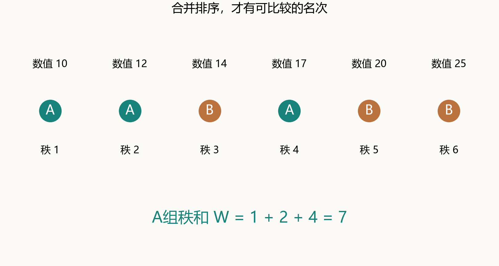
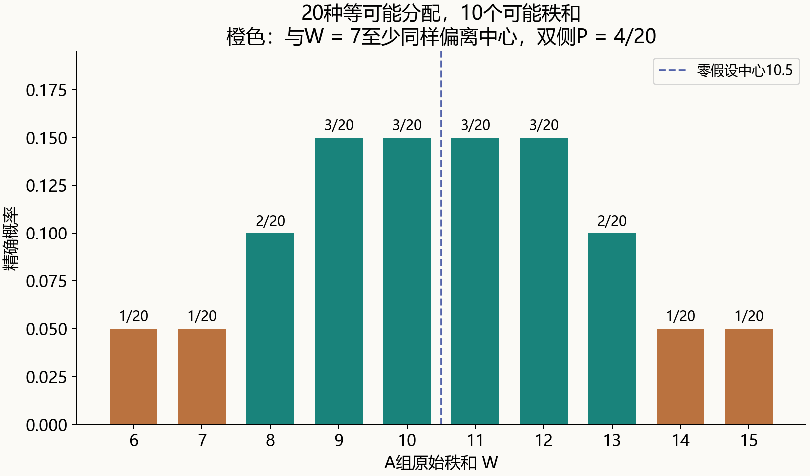
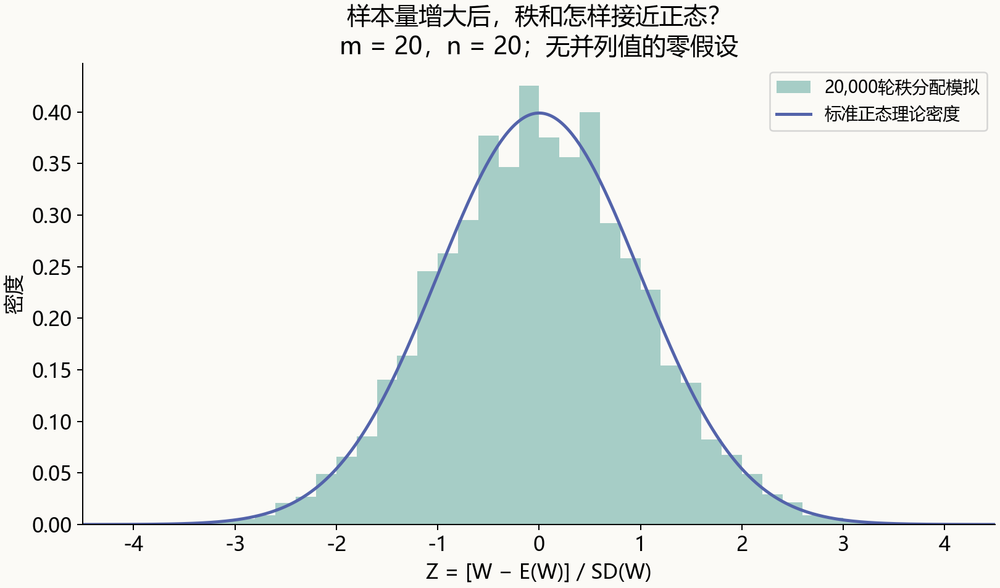

# 把数据换成名次后，统计量服从什么分布？

> 明哥的微生物世界 · 统计课堂 10
>
> 摘要：把两组各3个观测的20种名次分配全部列出来，看清Wilcoxon秩和统计量的精确分布，再推导它的期望、方差与正态近似，最后补上并列秩。

大家好，我是明哥。

前一篇给第6次课补了期望、方差和协方差的运算。顺着这条线，还有一个值得单独讲的问题：如果把数据换成名次，再把名次加起来，得到的统计量又服从什么分布？

这也是理解秩检验的一道关口。会把数据排序，还不等于知道应该拿哪个分布作参照。

今天只讲一个具体对象：**两独立样本的Wilcoxon秩和统计量**。它与配对数据使用的Wilcoxon符号秩统计量不同，不能只看见“Wilcoxon”就混用。

## 一、先把两组数据放到同一条队伍里

设有两组独立观测，每组3个。为了专心看计算，用下面这组人工教学数据，数值可理解为某项检测评分，不对应真实实验：

> A组：10、12、17。
>
> B组：14、20、25。

把两组合在一起，从小到大排队：

| 数值 | 10 | 12 | 14 | 17 | 20 | 25 |
| --- | --- | --- | --- | --- | --- | --- |
| 组别 | A | A | B | A | B | B |
| 秩（名次） | 1 | 2 | 3 | 4 | 5 | 6 |

这里的秩就是在**合并后的全部观测中**的名次。不要在各组内部单独排出1、2、3，再拿来做两组秩和比较，那样每组秩和都一样了。

记A组的秩和为W：

> **W = 1+2+4 = 7。**

W较小，说明A组较多地占据较小的名次；W较大，则说明A组较多地占据较大的名次。

*图1｜六个位置代表六个名次，间距不代表原始数值差。A组占据1、2、4，秩和为7；B组秩和为14，总秩和固定为21。*

使用秩以后，10与12之间相差2、20与25之间相差5，这些间距信息不再直接进入W；保留的是大小顺序。严格递增的变换不改变这个顺序，也不改变秩和。

## 二、数值已经排好，随机性在哪里？

先明确建立参照分布的条件：两组内及两组之间的观察均独立；零假设下，两组都来自**同一个连续分布**。连续分布使并列值的理论概率为0，暂时不用处理名次相同的问题。

在这个零假设下，组别标签与大小顺序没有系统联系。给定排好序的六个数，A组可以占据任意三个位置，每种选择都同样可能。

> 可选分配数 = C(6,3) = 6!/(3!×3!) = **20**。

C(6,3)表示“从6个位置选3个”。选出A的位置，剩下的位置就都属于B，因此不需要再乘一个C(3,3)以外的数，更不能重复计算组内排列。

**我们固定的是这六个有序位置，变动的是哪些位置带A标签。** 在两组同分布的零假设下，这种条件置换分布也给出了无并列值时秩和的零假设抽样分布。

如果样本有配对、聚类，或者两个组在零假设下也不具备这样的标签可交换性，就不能直接说这20种分配等可能。

## 三、把20种分配列全，精确分布就出现了

这里不靠模拟，也不先查表。逐一列出A组的位置，把三个名次相加：

| A组占据的秩 | W | A组占据的秩 | W |
| --- | --- | --- | --- |
| 1、2、3 | 6 | 2、3、4 | 9 |
| 1、2、4 | 7 | 2、3、5 | 10 |
| 1、2、5 | 8 | 2、3、6 | 11 |
| 1、2、6 | 9 | 2、4、5 | 11 |
| 1、3、4 | 8 | 2、4、6 | 12 |
| 1、3、5 | 9 | 2、5、6 | 13 |
| 1、3、6 | 10 | 3、4、5 | 12 |
| 1、4、5 | 10 | 3、4、6 | 13 |
| 1、4、6 | 11 | 3、5、6 | 14 |
| 1、5、6 | 12 | 4、5、6 | 15 |

每一种位置分配的概率都是1/20；但**不同秩和值的概率并不相等**，因为同一个和可能对应多种分配。

| W | 对应分配数 | 概率 |
| --- | --- | --- |
| 6 | 1 | 0.05 |
| 7 | 1 | 0.05 |
| 8 | 2 | 0.10 |
| 9 | 3 | 0.15 |
| 10 | 3 | 0.15 |
| 11 | 3 | 0.15 |
| 12 | 3 | 0.15 |
| 13 | 2 | 0.10 |
| 14 | 1 | 0.05 |
| 15 | 1 | 0.05 |

*图2｜这是20种分配全部枚举得到的精确概率，不是模拟频率。中心为10.5，它本身不是W的可能取值。橙色标出与观察到的W = 7至少同样偏离中心的取值。*

这张表不需要知道原始总体是正态、指数还是其他连续分布。只要两组在零假设下来自同一连续分布且观察独立，20种分配的规则就相同。这是这里“分布无关”的具体含义，前提并没有消失。

## 四、有了分布，才能说“这个秩和有多偏”

本例观察到W = 7。若事先提出单侧问题“A组是否倾向于更小”，相应精确尾概率是：

> P(W ≤ 7 | H₀) = P(W = 6)+P(W = 7)
>
> = 2/20 = **0.10**。

若问题是双侧的，本篇以“离零假设中心10.5至少同样远”定义更极端：

> P(|W−10.5| ≥ |7−10.5| | H₀)
>
> = P(W ≤ 7 或 W ≥ 14 | H₀)
>
> = 4/20 = **0.20**。

在这个对称分布里，它与两倍较小单侧尾概率相同。一般离散检验的双侧定义需要说明，不能默认所有软件、所有情境完全一致。

还有一个很直观的限制：即便A组完全占据最小三个名次，W = 6，双侧精确P值仍然是2/20 = 0.10。

因此，两组各3个、没有并列值时，按这里的普通双侧精确检验，最极端的排序也达不到P < 0.05。这反映了样本量和离散分布的分辨率，不能据此断言两组没有差异，也不应为追求更小P值临时改变单双侧问题。

## 五、W与U只是差一个常数，别被软件名字绕住

记A组样本量为m，B组为n，总数N = m+n。本篇始终用W表示**A组原始秩和**，其最小值为1+⋯+m = m(m+1)/2。

减去这个最小值，可以得到本篇约定的Mann–Whitney统计量：

> **U = W−m(m+1)/2。**

本例m = 3，W = 7，所以U = 7−6 = 1。

没有并列值时，这个方向的U还等于所有跨组配对中“A值大于B值”的对数：A组的17大于B组的14，只有这一对，所以U = 1。若交换两组，对应统计量变为mn−U。

这也说明秩和为什么适合发现某一组数值整体偏大的倾向。若要把结论专门解释成中位数差异，还需要相应的位置移动、分布形状等条件；“用了秩”并不自动把问题变成“只检验中位数”。

在R的两独立样本`wilcox.test()`中，输出虽然标作W，数值却已减去m(m+1)/2。本例会看到1，不是手算的7。SciPy的`mannwhitneyu()`返回的也是第一组方向的U。**先核对统计量的定义，再核对数值。**

R说明：https://stat.ethz.ch/R-manual/R-devel/library/stats/html/wilcox.test.html

SciPy说明：https://docs.scipy.org/doc/scipy/reference/generated/scipy.stats.mannwhitneyu.html

## 六、秩和的期望、方差，从哪里来？

现在把它接回前一篇的运算性质。没有并列值时，零假设下A组占据的m个名次，可以看作从1到N中**不放回抽取m个数**。

为了写公式，把这m个抽到的秩随机编号为R₁到Rₘ，注意这里不是把A组内部的秩再按大小编号。每个Rᵢ的边际分布都是在1、2、…、N上等概率。

它的期望为：

> E(Rᵢ) = (1+⋯+N)/N = (N+1)/2。

因为W = R₁+⋯+Rₘ，期望可以逐项相加：

> **E(W) = m(N+1)/2。**

本例E(W) = 3 × 7/2 = 10.5，与精确分布表算出的平均值一致。

单个秩的方差，用1²+⋯+N² = N(N+1)(2N+1)/6可得：

> Var(Rᵢ) = E(Rᵢ²)−[E(Rᵢ)]²
>
> = (N+1)(2N+1)/6 − (N+1)²/4
>
> **= (N²−1)/12。**

接下来不能把m份方差直接相加，因为秩是**不放回**抽取的。

为什么协方差为负？把1到N作一个均匀随机排列，所有位置上的秩之和固定。记每个秩的方差为v，不同位置之间相同的协方差为c，则：

> 0 = Var(全部N个秩之和)
>
> = Nv+N(N−1)c。
>
> 所以c = −v/(N−1) = **−(N+1)/12**。

所有成对位置都有同样的协方差，是因为随机排列中位置对称。

于是m个秩之和的方差为：

> Var(W) = mv+m(m−1)c
>
> = m(N²−1)/12 − m(m−1)(N+1)/12
>
> = m(N+1)(N−m)/12
>
> **= mn(N+1)/12。**

这里m(m−1)来自不同秩之间的交叉项，已经包含两种顺序，不能再额外乘2。

本例m = n = 3：

> **Var(W) = 3 × 3 × 7/12 = 5.25。**
>
> SD(W) = √5.25 ≈ 2.2913。

如果漏掉负协方差，错误地把三个秩当成独立，便会算成3 × 35/12 = 8.75，而不是5.25。

U与W差一个常数，所以Var(U) = Var(W)，E(U) = mn/2。R的分布函数采用这个从0到mn的U尺度：https://stat.ethz.ch/R-manual/R-devel/library/stats/html/Wilcoxon.html

## 七、样本量大了，怎样走到正态近似？

当两组样本量都逐渐增大、组间比例不过分失衡等常规条件成立时，可以将秩和中心化、标准化：

> **Z = [W−m(N+1)/2] / √[mn(N+1)/12]。**

在无并列值的零假设下，Z的分布趋近标准正态。有限样本中它仍是离散的，“中心为0、方差为1”本身也不能证明它已经正态。

*图3｜每轮从1到40中不放回选20个名次，计算W并标准化；共模拟20,000轮。柱形为模拟密度，曲线为标准正态密度。条件为m = n = 20、无并列值且标签可交换，不是“样本量20必然适用”的统一门槛。*

用连续曲线近似离散尾概率时，常见实现会做连续性校正。例如本例左尾P(W ≤ 7)，用正态近似时可把边界写成7.5，而不是7。

因此，本例连续性校正后的双侧正态近似约为0.1904，精确值则是0.20。它们在这个例子里比较接近，但两组各3个时，既然20种分配可以完整列出，就没有必要用近似替代精确计算。

模拟是在帮助我们看近似的表现。理论的期望、方差可以由有限分布精确算出；趋近正态则需要额外的极限结果，这两层不能混在一起。

## 八、出现并列值，名次和分布都要重新处理

如果B组的14改成12，合并后变成：10、12、12、17、20、25。两个12占据第2、3位，通常都赋予平均秩(2+3)/2 = 2.5。

> 合并平均秩：1、2.5、2.5、4、5、6。
>
> A组原有的10、12、17，对应W = 1+2.5+4 = **7.5**。

不能凭组别或录入先后，把两个12任意分成第2与第3。那会人为制造差异。

在标签可交换的零假设下，仍可以把**六个观测记录**中的任意三个分配给A，全部20种分配依然等可能。不过由于两个记录共享2.5的秩，不同记录分配可能产生同一个秩和，不能把重复秩和删掉后再给剩下的值相等权重。

由这20种记录分配得到的条件精确分布，均值仍为10.5，方差变为**5.10**。本例按前面“偏离中心至少同样远”的双侧定义，精确P值为0.30；原来无并列值的分布表不再适用。

并列值的方差调整也有统一表达。令tⱼ表示第j组并列值的个数：

> **Var(W | 合并后的平均秩)**
>
> = (mn/12) × {N+1 − Σ(tⱼ³−tⱼ)/[N(N−1)]}。

没有并列值时，所有tⱼ = 1，减去的部分为0，就回到原公式。本例只有一组两个并列值，t = 2，故：

> Var(W) = (9/12) × [7−(2³−2)/(6×5)] = **5.10**。

这个调整来自不放回抽样时合并秩的方差；并列名次取平均以后，原先秩之间的一部分分散被压缩了。

“有并列值就不能精确计算”并不正确，可以使用给定平均秩的条件置换分布。只是软件版本与算法支持不同：普通无并列值的精确分布算法，不能不加检查地套到并列数据。配套脚本直接枚举记录分配，避免这一歧义。

## 九、选一种语言，把20种分配亲手列出来

这次同样提供R、Python和MATLAB三套脚本。第一步读同一份教学表，第二步排序求W，第三步枚举20种分配，最后生成正态近似的模拟，并核对并列秩方差。

第一次运行，先对上四个数：

> **无并列值：W = 7，U = 1，E(W) = 10.5，Var(W) = 5.25。**

再看输出的20行分配表与10行概率表。这里用全部等可能分配计算方差，分母用20，不能把它当作20次随机抽样去使用样本方差的19分母。

第二次，读脚本中已经把B组14改成12的并列情形（输入表的value_tied列），检查平均秩2.5、W = 7.5和方差5.10。还可以把模拟的组样本量从20改成5，观察离散分布与正态曲线的差别。

本篇完整资料：https://github.com/fuyuming/statistics-classroom/tree/main/stats_classroom/article10_rank_sum_distribution

完整仓库下载：https://github.com/fuyuming/statistics-classroom/archive/refs/heads/main.zip

解压后进入article10目录。R打开`统计课堂10.Rproj`；Python和MATLAB运行`代码`中的`rank_sum`主脚本。输入数据、逐步结果、配图代码及运行方法都在同一目录，具体见README。

回到标题的问题：把数值换成名次，并不会自动让统计量服从正态分布。**先说明哪些标签分配等可能，再由分配得到精确分布；期望、方差和大样本近似，都在这条主线上。**

这里是“明哥的微生物世界”。理解名次背后的随机性，才算真正走进了秩统计量。
