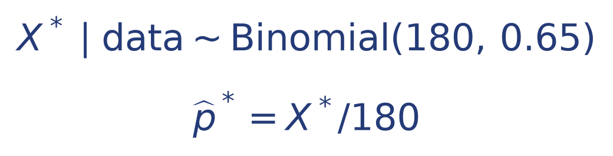
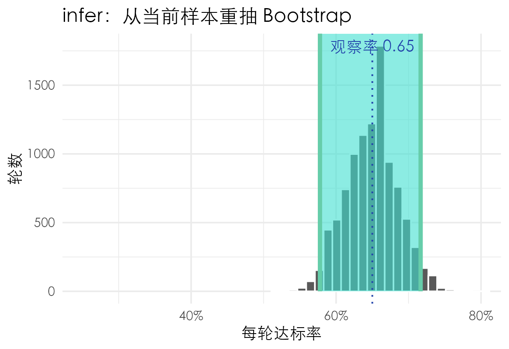
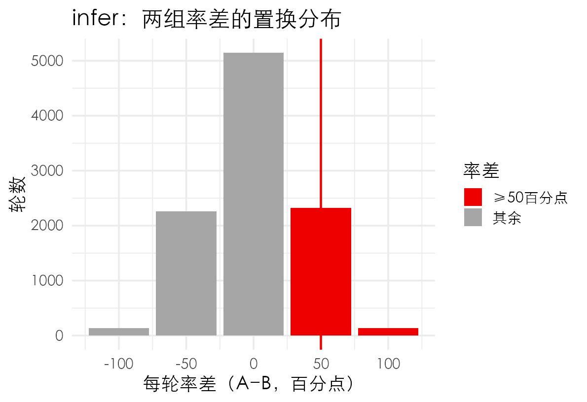
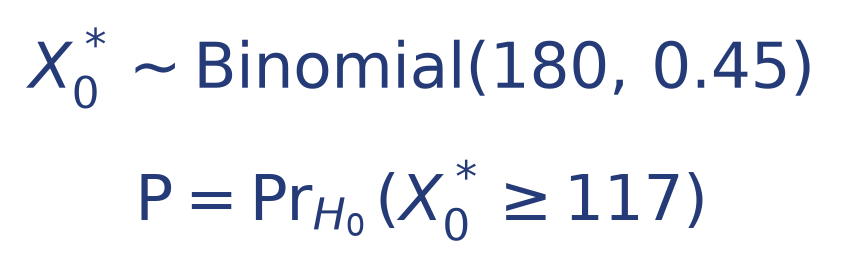
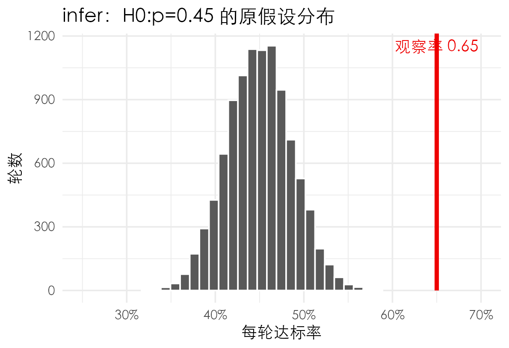

# 非参数重抽样与蒙特卡洛：Bootstrap与Permutation在模拟什么？

> 明哥的微生物世界 · 统计课堂 26
>
> 摘要　非参数重抽样依据什么生成结果，蒙特卡洛又怎样把这些规则变成可计算的区间与P值？本文从单样本率入手，用Bootstrap估计抽样波动，再用两组资料演示Permutation（置换检验）怎样构造H₀参照分布，理解两种重抽样方法与**蒙特卡洛模拟（依靠重复随机抽样的计算机仿真）**之间的联系。


*第9课《样本率的估计和检验》配套延伸 · 统计课堂26*

大家好，我是明哥。

本科同学在第8课学习非参数检验时，听冯老师介绍过Bootstrap的基本原理，但还没有实际操作。第9课是我接手后的第一次课，同学们又学习了三种由单样本率估计总体率的置信区间。这篇从刚学过的单样本率入手，讲清Bootstrap与Permutation的非参数重抽样原理，以及它们与蒙特卡洛计算的联系，再借助R的**infer**包完成区间估计和置换检验。两个例子对应不同的研究设计，用来展示怎样根据问题选择重抽规则<sup>[1]</sup>。

[统计课堂12《Bootstrap与置换检验：反复抽样，究竟在模拟什么？》](https://mp.weixin.qq.com/s/1nNR1qagwiCCmsYLbylLxA)已经讨论了重抽样的基本规则。下面先从180人的资料入手，再用两组各4人的小例子完成置换检验，看看每个函数接收什么、返回什么，以及每轮样本怎样变成最终的区间和P值。文中的R代码按出现顺序运行，后一步会使用前一步保存的对象；环境准备见配套README。

## 一、从观察到的65%开始

假设从某目标人群随机抽取180名受试者，按预先规定的同一标准记录是否达标：117人达标，63人未达标。样本量记为n，本题n=180。采用二项模型，**不同受试者相互独立，每人的达标概率相同，记为总体率p**。

对这份单样本资料，先回答两个估计问题：

1. 用双侧95%区间估计总体达标率。
2. 与研究开始前指定的固定参考率45%相比，总体达标率相差多少？估计率差p−0.45，并给出双侧95%区间。

先按汇总人数建立数据表dat，每行保存一名受试者的达标或未达标结果。outcome是列名，yes表示达标，no表示未达标；`factor()`把它设为分类变量。`dat$outcome`中的`$`表示从dat中取出outcome这一列，`table()`统计两类人数。

```r
dat <- data.frame(
  outcome = factor(
    c(rep("yes", 117), rep("no", 63)),
    levels = c("no", "yes")
  )
)
table(dat$outcome)
```

```text
 no yes
 63 117
```

达标率就是yes在180条记录中所占的比例。infer先用`specify()`确认分析列和成功类别，再用`calculate(stat="prop")`计算这个比例。代码中的`infer::`表示调用infer包中的函数，`|>`把前一步的结果传给下一步<sup>[2]</sup>。

```r
obs_stat <- dat |>
  infer::specify(response = outcome, success = "yes") |>
  infer::calculate(stat = "prop")
as.data.frame(obs_stat)
```

```text
  stat
1 0.65
```

`response`指定分析列；`success="yes"`指定要计算哪一类的率；`stat="prop"`中的prop表示proportion，即比例。返回的obs_stat是一张小表，stat这一列存放观察率0.65。

得到观察率65%之后，还要回答题目的第一问：用这180人估计总体率，结果有多不确定？接下来从当前样本有放回地重抽，每轮仍取180条记录，用各轮率的变化了解抽样波动。

## 二、把一次重抽展开看

### （一）非参数Bootstrap为什么从原样本重抽？

如果能从目标总体反复抽取180人，每次都算一个样本率，就能看到样本率围绕真实总体率p怎样波动。现在手里只有这一份样本，Bootstrap就用样本的**经验分布**近似未知的总体分布，再从中反复抽样。

经验分布怎样构造？给原样本每条记录相同的抽取概率1/180。117条yes合计占65%，63条no合计占35%。每次有放回地抽取一条记录，就相当于从这个经验分布抽一次；抽满180条，便得到一轮Bootstrap样本。

**用重抽率围绕观察率65%的波动，近似原样本率围绕真实总体率p的波动**，这就是本题Bootstrap估计的出发点。原样本提供关于总体的信息，重抽则让这种近似的抽样波动显现出来<sup>[3]</sup>。

这里的“非参数”，指重抽分布直接由观测值及其出现频率构造。本题以独立、同分布的受试者记录为重抽单位，接下来用infer生成这样的样本。

### （二）generate返回每轮的记录

先做三轮，看看infer怎样保存重抽结果：同一条原记录可以被抽到多次，每轮抽满180条。每段随机计算开始前都设`set.seed(20261110)`，方便分别复现；本次运行使用R 4.6.1、infer 1.1.0。

```r
set.seed(20261110)
demo_samples <- dat |>
  infer::specify(response = outcome, success = "yes") |>
  infer::generate(reps = 3, type = "bootstrap")
nrow(demo_samples)
table(demo_samples$replicate)
```

实际输出：

```text
[1] 540
  1   2   3
180 180 180
```

`reps=3`是生成三轮；`type="bootstrap"`选择普通有放回重抽，每轮记录数仍为180。`nrow()`显示对象共有540行；`replicate`这一列记录轮次编号，表中的1、2、3各有180行<sup>[4]</sup>。

### （三）calculate把每轮记录汇总成一个率

```r
demo_stats <- demo_samples |>
  infer::calculate(stat = "prop")
as.data.frame(demo_stats)
```

实际输出：

```text
  replicate      stat
1         1 0.5888889
2         2 0.6388889
3         3 0.6055556
```

现在每轮只留下一个率，对应106、115、109人达标。`replicate`仍表示轮次，stat表示这一轮的达标率。

把原始数据dat和这两个重抽对象放在一起看：

| 对象 | 一行表示什么 | 本次行数 |
| --- | --- | ---: |
| dat | 原样本的一条结果 | 180 |
| demo_samples | 某一轮里抽到的一条结果 | 540 |
| demo_stats | 一轮重抽得到的样本率 | 3 |

**`generate()`保存各轮样本，`calculate()`把各轮样本变成统计量。** 从demo_samples到demo_stats，540条记录变成了3个率。区间计算需要更多轮的率，下面把reps从3改为10000，沿用同样的流程。

## 三、用蒙特卡洛重抽构造Bootstrap区间

三轮结果已经显示出率的变化。要进一步用分位数构造区间，就需要积累更多轮的结果。**蒙特卡洛模拟，就是依靠重复随机抽样的计算机仿真**；在这里，Bootstrap规定从经验样本有放回重抽，蒙特卡洛模拟则把这条规则反复运行，形成区间计算所用的率分布。

### （一）把三轮扩大到10000轮

```r
set.seed(20261110)
boot_dist <- dat |>
  infer::specify(response = outcome, success = "yes") |>
  infer::generate(reps = 10000, type = "bootstrap") |>
  infer::calculate(stat = "prop")
nrow(boot_dist)
```

```text
[1] 10000
```

`boot_dist`有10000行，每行保存一轮的率。这10000个率组成Bootstrap模拟分布，用来近似了解样本率的抽样波动。**10000是重抽轮数B，原样本人数n仍是180。**

本题只有yes和no两种取值，每次从经验分布抽到yes的概率都是0.65。一轮独立抽取180次，因此达标计数服从Bin(180,0.65)，再除以180就是该轮率。也就是说，在本题中，按记录做非参数Bootstrap与按这个二项分布生成达标计数是等价的：



*式（1）｜X∗表示一轮重抽中的达标人数，p̂∗表示该轮率。这里的0.65来自当前样本，Bootstrap用这份经验分布近似总体抽样波动。*

### （二）从分布中取出区间

现在手里有了10000个率，按大小排序，取2.5%和97.5%分位点作为本次百分位区间的两端。这一步由`get_confidence_interval()`完成：

```r
ci <- infer::get_confidence_interval(
  boot_dist, level = .95, type = "percentile"
)
as.data.frame(ci)
```

```text
   lower_ci  upper_ci
1 0.5777778 0.7166667
```

`level=.95`指定95%置信水平，`type="percentile"`指定百分位法，取这10000个率的2.5%和97.5%分位点。返回表中的lower_ci和upper_ci分别是下限、上限，得到本次**双侧95%百分位Bootstrap区间：57.78%至71.67%**<sup>[5]</sup>。

95%置信水平针对反复获得原始样本并各自计算区间的长期覆盖表现；这里使用的是近似区间程序。增加B可以减小端点的模拟波动，区间表现仍取决于抽样设计和样本提供的信息。

有了总体率p的区间，就可以接着回答“比固定参考率45%高多少”。这个效应量记为率差p−0.45，点估计为0.65−0.45=0.20。由于45%是固定常数，将p的区间两端各减去0.45，就得到率差的区间：

```r
effect <- obs_stat$stat - .45
effect_ci <- c(ci$lower_ci, ci$upper_ci) - .45
effect
effect_ci
```

```text
[1] 0.2
[1] 0.1277778 0.2666667
```

因此，观察率比固定参考率高**20个百分点，率差的双侧95%Bootstrap百分位区间为12.78至26.67个百分点**。


### （三）把区间放回它来自的分布中

再来看总体率区间ci。它只保存两个端点；把ci标到boot_dist的直方图上，就能同时看到各轮率怎样分散，以及区间位于哪里：

```r
infer::visualize(boot_dist, bins = 25) +
  infer::shade_confidence_interval(ci)
```

`visualize()`把boot_dist中的10000个率画成直方图；`bins=25`设置绘图分组数，纵轴显示落入各组的轮数。前面的reps决定生成多少轮，这里的bins决定怎样把结果分组展示。

`shade_confidence_interval()`再接收ci，在同一张图上标出两个端点及中间区域。两者用`+`连接，表示添加图层；前面的`|>`则用于把数据传给下一个函数<sup>[6]</sup>。



*图1｜infer实际重抽10000轮的结果。横轴为每轮达标率，纵轴为轮数；区间标记来自ci，观察率为0.65。配套脚本在原生绘图结果上补充中文标签。*

通过原样本的经验分布，我们已经给出了总体率和率差的区间。检验问题同样需要反复生成结果，但生成依据要随H₀和研究设计改变。接下来先比较规则，再把置换检验实际做一遍。

## 四、Bootstrap与置换：重抽规则怎样决定推断？

要选择检验的参照分布，先看每轮生成时究竟改变了什么。先比较当前样本的换序与两组结局的重排，再用完整的两组资料运行`type="permute"`。

### （一）同一个generate，可以选择三种生成规则

前面使用`type="bootstrap"`。`type`还可取`"permute"`或`"draw"`，三个选项对应不同的数据生成依据<sup>[4]</sup>：

| type | 每轮怎样生成 | 分布用来回答什么 |
| --- | --- | --- |
| `"bootstrap"` | 从经验样本有放回地抽取同样多的记录 | 近似抽样波动，估计标准误与置信区间 |
| `"permute"` | 按H₀允许的方式重排变量之间的对应关系 | 构造置换参照分布，检验变量关系或组间差异 |
| `"draw"` | 按H₀指定的理论概率生成结果 | 本题中生成固定率假设下的二分类样本 |

`generate()`的常用参数还有：`x`接收输入数据，使用管道时由前一步传入；`reps`指定重复轮数，默认1；`variables`用于指定要重排的列，在置换时默认重排响应变量。本文把`type`明确写出，以便看清生成规则。

### （二）有放回重抽与换序，各改变了什么？

有放回重抽时，同一条yes记录可以被抽到多次，也可能一次没有抽到，因此每轮yes的人数会变化。若每条记录都保留一次，只把180条记录换个顺序，117个yes和63个no的数量保持原样。

用三次随机重排看看这一点。`sample()`把整列记录随机换序，`replace=FALSE`表示不放回；`replicate()`把计算重复三次：

```r
set.seed(20261110)
shuffle_rates <- replicate(
  3, mean(sample(dat$outcome, replace = FALSE) == "yes")
)
shuffle_rates
```

```text
[1] 0.65 0.65 0.65
```

每轮率都为65%，原因是换序保留了117个yes和63个no。本题只有当前样本的结局记录，45%是研究预先给定的参照值。要看置换怎样产生有用的参照分布，需要进一步考虑结局与其他变量之间的对应关系。

置换检验通常重排的是**结局与组别等变量的对应关系**。以两个独立组的比较为例：保留两组人数和全部结局，将结局重新分配给组别，再算两组率差。总达标人数保持不变，两组各自的达标人数却会变化，因此每次分配都能得到一个率差。

要用这些率差作为H₀参照，需要满足可交换条件：在H₀及抽样设计下，重排上述对应关系后，资料的联合分布保持不变。满足这一条件时，就可以把观察率差放进置换分布中，判断它有多极端<sup>[7]</sup>。

这里选择两组率差作为统计量。在可交换条件成立时，同样的重排思路也可用于均数差等统计量；决定置换规则的是H₀和研究设计<sup>[4]</sup>。

在infer的这类两组流程中，`specify()`同时指定结局与组别，`hypothesize(null="independence")`声明无关联的原假设，再选择`type="permute"`生成重排结果。

### （三）两种非参数思路，怎样与蒙特卡洛计算联系起来？

前面的Bootstrap已经示范了蒙特卡洛计算；置换检验也可以反复随机重排，每轮计算统计量，再与观察值比较。两者采用的随机生成规则不同：Bootstrap依据经验分布，置换依据H₀下允许的重排。**重抽规则说明统计依据，蒙特卡洛说明怎样用随机计算近似结果。**

Bootstrap的非参数思路也能用于构造检验：先用经验分布估计统计量的抽样波动，再据此判断观察值偏离H₀的程度。例如，构造与检验方向、水平相配的Bootstrap置信区间，检查H₀给定值是否被区间排除，就能得到一种近似检验；其近似效果取决于所用的区间方法<sup>[7]</sup>。

下面换用一个两组各4人的新例子，实际跑通`permute`。完成后再用180人的资料，补充演示与固定45%比较的检验。

## 五、用permute完成两组率的置换检验

### （一）两组各4人，比较什么？

假设从目标人群随机抽取8名受试者，随机分到A、B两组，各4人，分别采用两种培训方案。培训结束时，按同一标准记录是否达标。A组3人达标、1人未达标；B组1人达标、3人未达标。假设各人的结局相互独立，并满足H₀下的可交换条件。

我们要判断A方案的总体达标率是否高于B方案。预先设H₀：分组与达标无关联，在本例二分类模型下对应pA=pB；H₁：pA>pB，检验水准α=0.05。统计量取**A组率减B组率**。

把这份新的两组资料写成study，每行记录一名受试者。group保存组别，outcome仍记录yes或no；观察率差随后保存为obs_diff。这两个对象分别对应前面单样本分析中dat与obs_stat的角色：

```r
study <- data.frame(
  group = factor(rep(c("A", "B"), each = 4),
                 levels = c("A", "B")),
  outcome = factor(
    c("yes", "yes", "yes", "no", "yes", "no", "no", "no"),
    levels = c("no", "yes")
  )
)
table(study$group, study$outcome)
```

```text
    no yes
  A  1   3
  B  3   1
```

A组达标率3/4=75%，B组1/4=25%。先用`calculate()`算出观察率差：

```r
obs_diff <- study |>
  infer::specify(outcome ~ group, success = "yes") |>
  infer::calculate(stat = "diff in props", order = c("A", "B"))
as.data.frame(obs_diff)
```

```text
  stat
1  0.5
```

`outcome ~ group`把结局与组别的关系交给`specify()`，左边是结局，右边是解释变量。`stat="diff in props"`指定率差；`order=c("A","B")`规定减法顺序为A−B。因此obs_diff保存的0.5就是**50个百分点的观察率差**<sup>[2]</sup>。

### （二）先看五轮置换怎样保存

H₀下若分组与达标无关联，就按允许的方式重排结局与组别的对应关系。每轮保留8条结局、A与B各4个名额，改变的是哪些结局落在A组、哪些落在B组。

先用`hypothesize(null="independence")`声明无关联假设，再让`generate(type="permute")`生成五轮重排<sup>[8]</sup>：

```r
set.seed(20261110)
perm_demo <- study |>
  infer::specify(outcome ~ group, success = "yes") |>
  infer::hypothesize(null = "independence") |>
  infer::generate(reps = 5, type = "permute")
nrow(perm_demo)
table(perm_demo$replicate, perm_demo$group)
```

```text
[1] 40
    A B
  1 4 4
  2 4 4
  3 4 4
  4 4 4
  5 4 4
```

五轮各8条，共40行；每轮A、B组都保留4条。再用`calculate()`把每轮的记录汇总成一个率差：

```r
perm_demo_stats <- perm_demo |>
  infer::calculate(stat = "diff in props", order = c("A", "B"))
as.data.frame(perm_demo_stats)
```

```text
  replicate stat
1         1  0.0
2         2  0.0
3         3  0.0
4         4 -0.5
5         5 -0.5
```

前3轮恰好两组率相同，后2轮的A−B率差为−50个百分点。与单列换序相比，这次结局被分配给不同组别，率差确实会变化。现在生成更多轮，形成H₀下的参照分布。

### （三）10000轮置换，计算右尾P值

```r
set.seed(20261110)
perm_dist <- study |>
  infer::specify(outcome ~ group, success = "yes") |>
  infer::hypothesize(null = "independence") |>
  infer::generate(reps = 10000, type = "permute") |>
  infer::calculate(stat = "diff in props", order = c("A", "B"))
nrow(perm_dist)
```

```text
[1] 10000
```

现在perm_dist有10000行，stat列的每个值是一轮H₀置换得到的A−B率差；obs_diff保存原资料的观察率差0.5。**P值是在H₀及相应模型下，出现当前结果以及更加极端地背离H₀、也就是更趋向H₁方向的结果的概率。** 本例的H₁指向A组率更高，因此将率差达到或超过0.5的轮次计入右尾：

```r
perm_p <- infer::get_p_value(
  perm_dist, obs_stat = obs_diff, direction = "greater"
)
as.data.frame(perm_p)
sum(perm_dist$stat >= obs_diff$stat)
```

```text
  p_value
1  0.2462
[1] 2462
```

本次10000轮中，2462轮的率差至少为50个百分点，模拟置换P值估计为2462/10000=0.2462<sup>[9]</sup>。这就是`type="permute"`的完整推断：声明H₀、生成置换样本、计算各轮率差，再与原观察率差比较。

### （四）把置换分布画出来

```r
infer::visualize(perm_dist, bins = 5) +
  ggplot2::geom_vline(xintercept = obs_diff$stat, color = "red2")
```

`visualize()`仍接收每轮一个统计量的分布；这里横轴变成A−B率差，红线标记观察率差0.5。图2使用同一份perm_dist，红色两根柱对应达到或超过观察率差的2462轮，与P值计算采用同一个判断条件；完整配色和中文标注见配套脚本。



*图2｜实际置换10000轮。横轴按百分点显示率差，红线为观察率差50个百分点；右尾包括50和100个百分点两个取值，合计2462轮。纵轴为轮数。*

### （五）只有70种分组时，直接穷举作对照

A、B各4人且组名固定，从8人中选4人进入A组，其余进入B组，分配方式只有70种。满足交换条件时，可以把70种全部列举出来，精确计算右尾比例<sup>[10]</sup>。

R自带的`combn(8,4)`能列出全部A组索引。下面用y记录0/1结局，对每种索引计算A组均值减B组均值；在0/1资料中，均值就是率。`a_idx`表示本轮进入A组的4行，`-a_idx`表示其余4行<sup>[11]</sup>：

```r
y <- as.integer(study$outcome == "yes")
all_perm_stats <- utils::combn(
  nrow(study), 4,
  FUN = function(a_idx) mean(y[a_idx]) - mean(y[-a_idx])
)
length(all_perm_stats)
table(all_perm_stats)
sum(all_perm_stats >= obs_diff$stat)
mean(all_perm_stats >= obs_diff$stat)
```

```text
[1] 70
all_perm_stats
  -1 -0.5    0  0.5    1
   1   16   36   16    1
[1] 17
[1] 0.2428571
```

70种分组只产生5种率差。达到或超过观察值0.5的有16+1=17种，因此精确单侧置换P值为17/70≈0.2429；10000轮蒙特卡洛结果0.2462是对它的随机近似。

这也回答了小样本时“组合有限是否就不准”：穷举给出的概率是精确的，有限组合使P值较离散，可取的值较少，检出差异的能力也受到限制。更多模拟会反复遇到这些分组，主要改善计算精度。

本例可以这样报告：

> A组3/4达标、B组1/4达标，样本率差为50个百分点；单侧蒙特卡洛置换P值为0.2462（10000轮），穷举70种分组得到的精确置换P值为0.2429。在α=0.05下，结果未达到拒绝H₀的标准。

换用Bootstrap反复重抽，经验分布的信息仍来自每组原来的4人，小样本百分位区间也会受到信息量和覆盖表现的限制<sup>[7]</sup>。**增加模拟轮数改善计算精度，增加原始样本量才补充研究信息。**

两组置换检验到这里完成。下面重新使用第一节的dat与obs_stat，回到180人、固定45%的单样本问题，用`draw`按二项模型生成参照分布。

## 六、补充：单样本率与固定参考率怎样比较

前面用180人的资料估计了总体率及其与固定45%的率差。现在补充一个检验问题：如果总体率真是45%，出现117人或更多人达标，会有多罕见？

继续使用单样本数据dat和观察率obs_stat。预先设H₀：p=0.45、H₁：p>0.45，检验水准α=0.05，因此将117人及更多人达标的结果计入右尾。

本题的H₀把二分类结果的概率确定为：达标45%，未达标55%。**draw表示从指定的理论分布随机生成结果**，这里采用H₀下的二项模型。先用`hypothesize()`声明固定率假设，再用`generate(type="draw")`生成每轮180人的结果<sup>[8]</sup>。

```r
set.seed(20261110)
null_dist <- dat |>
  infer::specify(response = outcome, success = "yes") |>
  infer::hypothesize(null = "point", p = .45) |>
  infer::generate(reps = 10000, type = "draw") |>
  infer::calculate(stat = "prop")
head(round(null_dist$stat * 180))
```

实际运行的前六轮达标人数：

```text
[1] 78 85 80 78 91 77
```

`null="point"`表示一个固定参数值的假设，`p=.45`给出该值。dat仍保留117人达标的原样本；0.45控制draw生成的H₀模型样本。`calculate()`仍计算每轮率，`null_dist$stat`取出这些率，乘180还原为人数。



*式（2）｜X₀∗表示H₀模型下一轮的达标人数；右尾包括117人及更多人达标。*

前面Bootstrap每次按样本中的65%达标比例抽取；这里draw每次按H₀指定的45%生成结果。两条流程都保留每轮180人、重复10000轮，并用`calculate(stat="prop")`算率，改变的是生成结果所依据的概率。

## 七、计算固定率的模拟P值，再作精确对照

### （一）把观察值交给get_p_value

第一节的obs_stat保存观察率0.65，null_dist保存刚才生成的H₀下10000个率。把这份参照分布和观察率一起交给`get_p_value()`，指定右尾方向，就能计算达到或超过0.65的模拟比例。`obs_stat=obs_stat`等号左边是函数的参数名，右边是已算好的对象名：

```r
sim_p <- infer::get_p_value(
  null_dist, obs_stat = obs_stat, direction = "greater"
)
as.data.frame(sim_p)
sum(null_dist$stat >= 117/180)
```

实际输出中的P值字段及命中数：

```text
  p_value
1       0
[1] 0
```

`p_value`是本次模拟得到的极端结果比例；`direction="greater"`把达到或超过观察率的结果计入右尾。函数同时提示，这个返回值是基于当前模拟轮数得到的近似。<sup>[9]</sup>

据此可以报告：**本次10000轮模拟中0次命中，模拟P值估计为0**。命中比例每增加一次，就增加1/B=0.0001。先在图上看观察率与这批模拟结果的关系，再用精确二项计算核对尾概率。

### （二）在图上看这次比较

为了看清0.65在这批参照结果中的位置，沿用刚才的null_dist、obs_stat和greater方向作图：

```r
infer::visualize(null_dist, bins = 25) +
  infer::shade_p_value(
    obs_stat = obs_stat, direction = "greater"
  )
```

`shade_p_value()`使用与计算相同的观察值和方向，在图上标记观察值及右尾方向；本次右尾命中0轮，该区域没有可见柱形<sup>[12]</sup>。



*图3｜H₀为p=0.45，实际模拟10000轮，纵轴为轮数。观察率0.65位于这批模拟结果的右侧；本次该尾部命中0轮。精确右尾概率由后面的二项计算给出。*

### （三）把效应量、Bootstrap区间和模拟P值放在一起

现在先汇报这套模拟分析的结果。区间来自原样本的非参数Bootstrap，P值来自H₀二项模型的蒙特卡洛模拟，分别标明方法和方向：

> 180人中117人达标，样本率65%，较固定参考率45%高20个百分点；率差的双侧95%Bootstrap百分位区间为12.78至26.67个百分点（重抽10000轮）。H₀下模拟10000轮，0次出现至少117人达标，单侧蒙特卡洛P值估计为0（0/10000）。

这份报告同时回答三个问题：观察率比参考率高多少，这个差值的估计有多不确定，以及观察结果在H₀下有多极端。累计轮数和命中数则交代了模拟P值的计算依据。

### （四）再与精确二项结果作对照

10000轮零命中记录了本次模拟的结果。对于这条极小尾概率，本题已有明确的二项模型，可以直接精确计算同一条右尾概率。R自带stats包的`binom.test()`同时返回与greater方向对应的单侧95%率区间<sup>[13]</sup>。

```r
exact <- stats::binom.test(
  117, 180, p = .45,
  alternative = "greater", conf.level = .95
)
exact$p.value
as.numeric(exact$conf.int)
```

```text
[1] 5.23827e-08
[1] 0.5871878 1.0000000
```

这是二项模型直接计算的精确单侧P，约为5.24×10⁻⁸。模拟部分报告的是0/10000，精确部分给出的是同一H₀模型下的右尾概率，两者的计算来源分别标明。

函数返回的总体率单侧95%精确区间为58.72%至100%，对应率差p−0.45的单侧95%精确区间为13.72至55.00个百分点。第三节报告的是双侧95%Bootstrap区间；这里是与greater单侧检验相配的精确区间。

精确P远小于α=0.05，结果支持总体达标率高于45%；这与10000轮中未出现右尾结果的模拟现象一致。本篇用10000轮展示生成规则和P值的计算，对这条极小尾概率采用已有模型的精确结果。

## 八、本篇讲了哪些知识？

1. **Bootstrap的原理。** 用样本的经验分布近似未知总体分布，再有放回地重抽。各轮统计量的变化用来近似抽样波动，进而估计标准误和置信区间；本篇采用百分位法构造区间。
2. **Permutation的原理。** 在H₀及研究设计允许的可交换条件下，重排数据之间的对应关系，保留规定的样本信息，得到H₀参照分布，再判断观察统计量有多极端。率差是本例选用的统计量。
3. **两种方法的区别与联系。** Bootstrap从经验分布重抽，Permutation按H₀允许的关系重排；两者都可以用蒙特卡洛模拟反复生成结果。组合较少时，置换还可以直接穷举，得到精确P值。
4. **方法要匹配研究设计。** 单组记录换序保持总率不变；两组比较可以在满足条件时重排结局与组别的对应；单样本与固定45%比较则按给定概率用draw生成模型样本。
5. **模拟轮数与样本量作用不同。** 增加B改善蒙特卡洛计算精度，增加n才补充原始研究信息。小样本置换P值的离散性与计算是否精确，需要分别理解。
6. **infer怎样实现这些原理。** specify指定变量，hypothesize声明检验的H₀，generate按所选规则生成样本，calculate把各轮样本变成统计量。区间和P值函数再接收这份统计量分布，完成推断。
7. **结果怎样报告。** 交代效应量、区间或P值采用的方法、方向和模拟次数；区分实际命中比例与精确概率。数值和图使用同一批结果，解释回到题目的估计或检验目标。

这套比例分析也可用于AI模型的独立测试集评估：把每个独立测试样本的预测结果记为正确或错误，就得到同样的0/1资料，可以按上述流程估计正确率及其区间。

读懂这两条操作后，可以继续把统计量换成数值变量的均数或两组均数差，分别使用`stat="mean"`、`"diff in means"`。变量关系仍由`specify()`指定，生成规则继续根据研究设计选择<sup>[2]</sup>。

## 配套练习

Bootstrap与单样本率入口是`R/infer_walkthrough.R`，置换检验入口是`R/permutation_walkthrough.R`。正式计算均使用10000轮；三轮和五轮的小演示用于查看生成样本的结构。置换项目还保存70种分组的穷举结果，`R/article26_v8_additions.R`补充率差区间与单组换序操作。Python、MATLAB提供单样本率的基础练习。

正文集中使用infer。配套项目还提供boot示例、generate不同类型及其他统计量的使用说明，以及区间构造和覆盖率拓展，供需要时继续阅读。三种语言沿用相同数据、方向与区间定义。

同样的统计原理在Python与MATLAB中也有实现。本文用infer逐步展开操作，其他语言可以使用以下工具：

| 实现环境 | 对应入口 |
| --- | --- |
| R：infer | `generate()`选择`"bootstrap"`或`"permute"`，再计算统计量与推断结果 |
| Python：SciPy | `bootstrap()`计算Bootstrap区间；`permutation_test()`进行置换检验<sup>[14]</sup><sup>[15]</sup> |
| MATLAB | `bootstrp()`生成重抽统计量，`bootci()`计算Bootstrap区间；`randperm()`生成随机索引，可据此重排数据、计算统计量和P值<sup>[16]</sup><sup>[17]</sup> |

MATLAB的两个Bootstrap函数属于Statistics and Machine Learning Toolbox。与本文百分位区间对照时，SciPy指定`method="percentile"`，MATLAB的`bootci`指定`'Type','per'`，同时统一置信水平和检验方向。MATLAB的`permute`用于数组维度重排，随机索引重排这里用`randperm`<sup>[17]</sup>。

本篇代码、数据和运行结果已上传GitHub。进入以下具体目录，先读`配套项目/README.md`：
https://github.com/fuyuming/statistics-classroom/tree/main/stats_classroom/article26_single_proportion_resampling

[下载本篇完整项目ZIP（含正文、配图和三语言代码）](https://github.com/fuyuming/statistics-classroom/raw/refs/heads/main/stats_classroom/article26_single_proportion_resampling/%E7%BB%9F%E8%AE%A1%E8%AF%BE%E5%A0%8226_%E5%AE%8C%E6%95%B4%E9%A1%B9%E7%9B%AE.zip)

系列已有资料的仓库入口：
https://github.com/fuyuming/statistics-classroom

系列仓库ZIP：
https://github.com/fuyuming/statistics-classroom/archive/refs/heads/main.zip

从系列仓库ZIP解压后，本篇项目位于`stats_classroom/article26_single_proportion_resampling/配套项目`。

这里是明哥的微生物世界，我们下次再见。

## 参考资料

[1] infer官方主页与介绍。https://infer.tidymodels.org/

[2] infer官方文档，specify与calculate。https://infer.tidymodels.org/reference/specify.html 和 https://infer.tidymodels.org/reference/calculate.html

[3] Efron B. Bootstrap Methods: Another Look at the Jackknife. The Annals of Statistics, 1979, 7(1): 1–26，§2。https://doi.org/10.1214/aos/1176344552

[4] infer官方文档，generate生成重抽样本与模型样本。https://infer.tidymodels.org/reference/generate.html

[5] infer官方文档，get_confidence_interval。https://infer.tidymodels.org/reference/get_confidence_interval.html

[6] infer官方文档，visualize与shade_confidence_interval。https://infer.tidymodels.org/reference/visualize.html 和 https://infer.tidymodels.org/reference/shade_confidence_interval.html

[7] Hesterberg T. What Teachers Should Know about the Bootstrap: Resampling in the Undergraduate Statistics Curriculum. 2014预印本，§2、§7及§7.4（Bootstrap与置换、检验及小样本问题）。https://www.amstat.org/docs/default-source/amstat-documents/edu-resamplingundergradcurriculum.pdf

[8] infer官方文档，hypothesize。https://infer.tidymodels.org/reference/hypothesize.html

[9] infer官方文档，get_p_value与零值提示。https://infer.tidymodels.org/reference/get_p_value.html

[10] SciPy官方文档，permutation_test：独立样本置换、穷举与随机近似。https://docs.scipy.org/doc/scipy/reference/generated/scipy.stats.permutation_test.html

[11] R官方文档，combn列举所有组合。https://stat.ethz.ch/R-manual/R-devel/library/utils/html/combn.html

[12] infer官方文档，shade_p_value。https://infer.tidymodels.org/reference/shade_p_value.html

[13] R官方文档，binom.test。https://stat.ethz.ch/R-manual/R-devel/library/stats/html/binom.test.html

[14] SciPy官方文档，bootstrap。https://docs.scipy.org/doc/scipy/reference/generated/scipy.stats.bootstrap.html

[15] SciPy官方文档，permutation_test。https://docs.scipy.org/doc/scipy/reference/generated/scipy.stats.permutation_test.html

[16] MathWorks官方文档，bootstrp与bootci。https://www.mathworks.com/help/stats/bootstrp.html 和 https://www.mathworks.com/help/stats/bootci.html

[17] MathWorks官方文档，randperm与permute。https://www.mathworks.com/help/matlab/ref/double.randperm.html 和 https://www.mathworks.com/help/matlab/ref/double.permute.html
