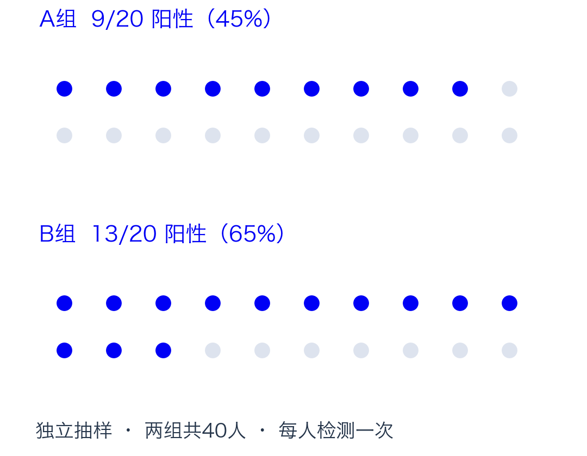

# 独立样本率之差：置信区间怎样算？

> 明哥的微生物世界 · 统计课堂 29
>
> 摘要：两批独立的人，阳性率分别为45%和65%，总体率差有多大？用同一道题比较Wald、Newcombe和Agresti–Caffo三种置信区间，理解它们为什么不同，再用R、Python或MATLAB动手核对。


大家好，我是明哥。

这次讨论两组独立样本：**A组和B组是两批不同的人，每个人只检测一次。** 拿到两组阳性率以后，我们既要算出相差多少，也要估计总体率差可能有多大。

下面用同一道题比较Wald、Newcombe和Agresti–Caffo三种95%置信区间，看看它们怎样从同一份资料得到不同端点，再用R、Python或MATLAB复算。

## 一、先把题目读完整：两批人，A减B

假设从A、B两个目标人群中，分别独立随机抽取20人。两组人员互不重叠，各人之间相互独立；在同一评价时点，使用相同检测方法和阳性判定标准，每人记录一次阳性或阴性结果。得到：

| 组别 | 阳性 | 阴性 | 合计 |
| --- | --- | --- | --- |
| A组 | 9 | 11 | 20 |
| B组 | 13 | 7 | 20 |

我们要回答：**A人群总体阳性率减去B人群总体阳性率，点估计是多少，双侧95%置信区间又是多少？** 下面统一按“A减B”计算。

记两个未知总体阳性率为p<sub>A</sub>和p<sub>B</sub>，待估参数为δ＝p<sub>A</sub>−p<sub>B</sub>。在本题的二项模型下，两组阳性人数分别服从二项分布，且彼此独立；每组内各人共享该组的阳性概率。

本次样本给出A组9/20＝45%，B组13/20＝65%，所以样本率差d＝0.45−0.65＝**−0.20，即−20个百分点**。

这里的“20个百分点”表示两个百分数直接相减；相对变化则还需选定作为分母的基准率。



*图1｜每个圆点表示一人，蓝色表示阳性，浅灰表示阴性。A、B两组各20人。*

## 二、点估计是−20，区间要多留多少余地？

d＝−20个百分点，是这次样本给出的点估计。若按同样设计重新抽样，两组阳性人数和d都会随抽样波动。区间估计把这种波动计入，用一个范围估计未知总体率差δ。

先看熟悉的**Wald正态近似**。两组相互独立时，样本率差的方差等于两个样本率的方差相加。用各组样本率估计相应总体率，得到标准误，再取“点估计±1.96个标准误”：


*式（1）｜p̂<sub>A</sub>、p̂<sub>B</sub>是本次样本率，n<sub>A</sub>、n<sub>B</sub>是各组人数。SE的估计值描述样本率差在重复抽样中的波动；1.96约为标准正态分布的0.975分位点，对应双侧各留2.5%的尾部。*

这里把两个方差**相加**，原因是作差时B组的系数为−1，而方差计算中系数要平方。代入本题，标准误约为0.15411，即15.41个百分点；误差限约为30.21个百分点。

因此，Wald区间为**（−50.21，10.21）个百分点**。我们按A减B计算：负值表示A总体率较低，正值表示A总体率较高，0表示两总体率相同。

区间横跨0，表示按这种区间构造，A总体率低于、等于或高于B的情形都与这份资料相容。**包含0表示零差异仍是一个候选值，不能据此断定两总体率相等。**

本篇采用双侧95%置信水平。它描述区间方法的重复抽样覆盖目标：按同一设计反复抽样，每次用同一方法计算区间，目标是使约95%的区间覆盖固定的总体率差δ。**本篇三种方法采用近似构造，实际覆盖率随样本量和真实阳性率变化。**

## 三、三种构造，各自在处理什么？

### （一）Wald：把这次估计的标准误固定下来

Wald先算出d和一个标准误，再在d两侧各延伸1.96个标准误，得到式（1）的区间。阳性或阴性人数很少时，标准误的样本估计可能失真，区间覆盖表现较差<sup>[1]</sup>。

R的DescTools包可以直接计算<sup>[2]</sup>：

```r
xA <- 9
nA <- 20
xB <- 13
nB <- 20
confidence <- 0.95
wald <- DescTools::BinomDiffCI(
  xA, nA, xB, nB,
  conf.level = confidence, method = "wald"
)
wald
#       est     lwr.ci    upr.ci
# [1,] -0.2 -0.5020507 0.1020507
```

前四个参数依次是A组阳性数、A组总人数、B组阳性数、B组总人数；`conf.level`给置信水平。返回矩阵中的`est`是样本率差，`lwr.ci`、`upr.ci`是区间下限和上限。端点乘100，就换成“百分点”。

### （二）Newcombe：先照顾每组率的不确定性，再组合

单个率可以用**Wilson得分区间**估计。计算时，把候选总体率代入标准误，找出与样本率相容的候选值范围。

Newcombe把两组Wilson区间提供的两侧距离组合起来，构造率差区间。这里采用其1998年独立样本论文中的**方法10，不作连续性校正**<sup>[1]</sup>。

本题两组各自的95% Wilson区间为：A组（25.82%，65.79%），B组（43.29%，81.88%）。从d向左延伸时，取“A样本率到A下限”和“B上限到B样本率”的距离，平方、相加、开平方，得到左侧误差限；向右延伸时，则组合“A上限到A样本率”和“B样本率到B下限”的距离。

例如，左侧两段距离约为0.191802和0.168808，合成的左侧误差限约为0.255508；从−0.20减去它，下限就是−0.455508。这样得到的率差区间为**（−45.55，10.06）个百分点**。左右两侧分别合成距离，因此误差限可以不同。

沿用前面的R变量，只需明确换方法：

```r
newcombe <- DescTools::BinomDiffCI(
  xA, nA, xB, nB,
  conf.level = confidence, method = "score"
)
newcombe
#       est     lwr.ci    upr.ci
# [1,] -0.2 -0.4555079 0.1006339
```

**`method = "score"`对应这里的Newcombe构造**，返回字段与前面相同。

### （三）Agresti–Caffo：先作小幅调整，再套Wald形式

还有一种容易动手的办法：**在计算中给每组各加1个阳性和1个阴性**，也就是阳性数加1，总人数加2，再按调整后的率与人数计算Wald形式的区间。这是Agresti–Caffo调整<sup>[3]</sup>。

本题用于计算的两个率变为10/22＝45.45%和14/22＝63.64%，调整后的差值约为−18.18个百分点。按调整后率差作为计算中心，得到**（−47.11，10.75）个百分点**。

下面用`method = "ac"`计算：

```r
ac <- DescTools::BinomDiffCI(
  xA, nA, xB, nB,
  conf.level = confidence, method = "ac"
)
ac
#       est     lwr.ci    upr.ci
# [1,] -0.2 -0.4711246 0.1074882
```

输出中，**`est`列是原始样本率差−0.20**；这个区间的计算中心为−0.181818。

## 四、把结果放在一起，怎样读？

下表统一估计A减B，使用双侧95%置信水平；单位均为**百分点**。

| 构造 | 95%区间 | 本题区间宽度 |
| --- | --- | --- |
| Wald | −50.21～10.21 | 60.41 |
| Newcombe | −45.55～10.06 | 55.61 |
| Agresti–Caffo | −47.11～10.75 | 57.86 |


*图2｜每条横线是一种方法的95%区间，竖虚线表示总体率差为0。三行圆点均标原始样本率差−20个百分点，便于比较；Agresti–Caffo区间的计算中心另用菱形标出。*

三种构造都给出了跨过0的区间。以Newcombe为例，结果可报告为：

> A组20人中9人阳性（45%），B组20人中13人阳性（65%）。两组率差（A减B）的点估计为−20个百分点，95%置信区间为−45.55至10.06个百分点（Newcombe法，无连续性校正）。

本题中，Newcombe区间最窄。评价一种区间方法时，还要看它在不同样本量和真实阳性率下的覆盖率与区间长度；原始方法论文比较的正是这些重复抽样性质<sup>[1,3]</sup>。

## 五、使用前，先看设计与计数

这三种计算用于两组独立的二项资料。**每组人数在抽样前确定，每个人记录一次阳性或阴性，同组观察相互独立并具有共同的阳性概率。** 两组人数可以相同，也可以不同。

本题中，两组采用相同的检测方法与判定标准，比较的是同一定义下的阳性率。

计数接近0或全部阳性时，三种构造的差别尤其明显。例如两组都为0/20，原始样本率差为0，Wald会算出（0，0）；同一资料用Newcombe得到的区间约为**（−16.11，16.11）个百分点**。

Wald把两个样本率0代入标准误后，两个方差项都变成0，区间随之缩成一个点。Newcombe先计算每组的Wilson区间，零计数时仍保留一个范围，再组合两侧距离得到率差区间。

## 六、用一种熟悉的语言跑通，再改参数

配套项目提供R、Python和MATLAB三个入口，可选择一种语言复算表中的三种区间。

**<u>就本篇这类专门统计区间的计算而言，R的优势在于现成函数较丰富、参数设置集中，便于作为主要计算语言。</u>** 例如`BinomDiffCI()`通过`method`选择构造、`conf.level`设置置信水平、`sides`指定单侧或双侧区间，可以在同一接口下比较多种方法<sup>[2]</sup>。

R入口为`代码/independent_ci.R`，三种区间调用DescTools。Python入口为`代码/independent_ci.py`，三种区间调用statsmodels。两者都有现成函数；下面是Python的Newcombe调用<sup>[4]</sup>：

```python
from statsmodels.stats.proportion import confint_proportions_2indep

xA, nA = 9, 20
xB, nB = 13, 20
confidence = 0.95
lower, upper = confint_proportions_2indep(
    xA, nA, xB, nB,
    method="newcomb", compare="diff",
    alpha=1-confidence
)
print(lower, upper)
# -0.4555079... 0.1006339...
```

第一组传A，第二组传B；`compare="diff"`计算第一组率减第二组率，即A减B，`alpha=0.05`对应95%置信水平，返回的`lower, upper`就是下限和上限。Wald和Agresti–Caffo分别用`method="wald"`和`method="agresti-caffo"`。

MATLAB入口为`代码/independent_ci.m`，可逐节复算三种区间。

三套脚本读取同一份`数据/independent_counts.csv`，结果显示在控制台和图窗口中。具体运行步骤见项目README。

跑通后做三个小练习，每次改完都重新从读取数据开始运行：

1. 将共享CSV改为A组45/100、B组65/100，每组人数扩大到100人，两个样本率保持不变。点估计仍是−20个百分点，区间会怎样变化？
2. 恢复9/20和13/20，只把脚本中的`confidence`改成0.90。两侧留下的余地怎样改变？留意输出和图标题是否都已更新。
3. 将两组都改成0/20，比较三种区间，检查Wald为什么退化为（0，0）。然后恢复原始数据，核对主例题。

这些改动分别考察样本量、置信水平和边界计数的影响。每次只改一项，比较起来更清楚。

## 七、本篇讲了哪些知识？

- **两组相互独立时，样本率差的方差等于两个样本率的方差之和。**
- **率差的方向和单位要固定。** 样本率差−0.20表示A组样本阳性率低20个百分点。交换组别后，点估计变号，区间端点变号并交换次序。
- **置信水平相同，区间构造仍可以不同。** Wald在样本估计处计算标准误；Newcombe组合两组Wilson区间的两侧距离；本篇Agresti–Caffo给每组加1阳性、1阴性后计算，区间中心可以偏离原始率差。
- **本篇三种构造都是近似方法。** 设定95%置信水平后，实际覆盖率会随样本量和总体阳性率变化。

## 配套资料

本篇完整练习ZIP：
https://raw.githubusercontent.com/fuyuming/statistics-classroom/main/stats_classroom/article29_independent_proportion_ci/independent_proportion_ci_project.zip

本篇代码、数据与运行结果：
https://github.com/fuyuming/statistics-classroom/tree/main/stats_classroom/article29_independent_proportion_ci

解压本篇ZIP后，先读README，再选择一种语言，从准备与参数节开始运行。

整个系列仓库入口：https://github.com/fuyuming/statistics-classroom

整个仓库ZIP下载入口：https://github.com/fuyuming/statistics-classroom/archive/refs/heads/main.zip

从整个仓库解压后，进入`stats_classroom/article29_independent_proportion_ci`。

这里是“明哥的微生物世界”，一起把统计问题读清楚、算明白。

## 参考资料

[1] Newcombe RG. Interval estimation for the difference between independent proportions: comparison of eleven methods. *Statistics in Medicine*. 1998;17:873–890. https://doi.org/10.1002/%28SICI%291097-0258%2819980430%2917%3A8%3C873%3A%3AAID-SIM779%3E3.0.CO%3B2-I

[2] DescTools官方函数说明：BinomDiffCI。https://andrisignorell.github.io/DescTools/reference/BinomDiffCI.html

[3] Agresti A, Caffo B. Simple and effective confidence intervals for proportions and differences of proportions result from adding two successes and two failures. *The American Statistician*. 2000;54:280–288. https://doi.org/10.1080/00031305.2000.10474560

[4] statsmodels官方函数说明：confint_proportions_2indep。https://www.statsmodels.org/stable/generated/statsmodels.stats.proportion.confint_proportions_2indep.html
