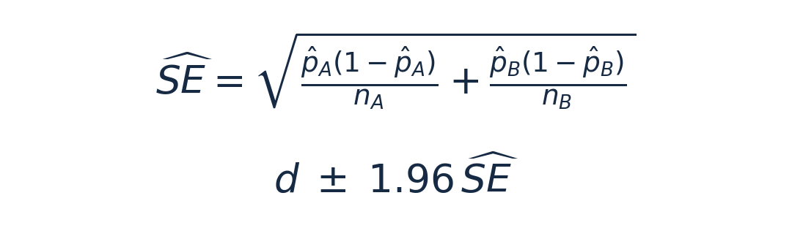
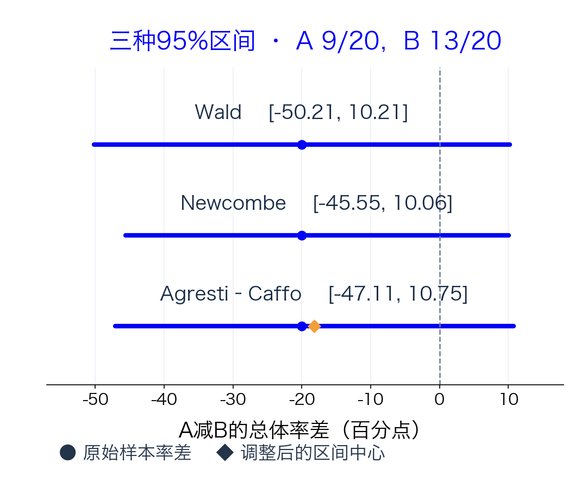

# 两组阳性率相差20个百分点，置信区间怎样算？

> 明哥的微生物世界 · 统计课堂 29
>
> 摘要：两批独立的人，阳性率分别为45%和65%，总体率差有多大？用同一道题比较Wald、Newcombe和Agresti–Caffo三种置信区间，理解它们为什么不同，再用R、Python或MATLAB动手核对。


大家好，我是明哥。

前面讨论配对资料时，我们关心同一个人的两次结果怎样一起变化。这次换一个研究设计：**A组和B组是两批独立的人，每个人只检测一次。**

两种设计都能算出“两个率相减”，但换样本时的波动不同，区间也就要跟着设计改变。今天用一道完整例题，看看独立样本率差的区间怎样计算，以及同样写着“95%”，为什么端点还会不同。

## 一、先把题目读完整：两批人，A减B

假设从A、B两个目标人群中，分别独立随机抽取20人。两组人员互不重叠，各人之间相互独立；在同一评价时点，使用相同检测方法和阳性判定标准，每人记录一次阳性或阴性结果。得到：

| 组别 | 阳性 | 阴性 | 合计 |
| --- | --- | --- | --- |
| A组 | 9 | 11 | 20 |
| B组 | 13 | 7 | 20 |

我们要回答：**A人群总体阳性率减去B人群总体阳性率，点估计是多少，双侧95%置信区间又是多少？** 下面统一按“A减B”计算。

记两个未知总体阳性率为p<sub>A</sub>和p<sub>B</sub>，待估参数为δ＝p<sub>A</sub>−p<sub>B</sub>。在本题的二项模型下，两组阳性人数分别服从二项分布，且彼此独立；每组内各人共享该组的阳性概率。

本次样本给出A组9/20＝45%，B组13/20＝65%，所以样本率差d＝0.45−0.65＝**−0.20，即−20个百分点**。

“低20个百分点”是两个百分数直接相减；若说“低了百分之多少”，分母还要选定，那是相对变化。本篇估计的是率差。


*图1｜假设教学资料。每个圆点表示一人，蓝色表示阳性，浅灰表示阴性。两组共40名不同的人，图中的排列只为计数，没有一一配对关系。*

即使另一份配对资料也得到45%和65%，两个边际率也不足以确定配对率差的标准误；还需要同一个人两次结果的联合信息。本题的独立性则让两组样本率的协方差为0。

## 二、点估计是−20，区间要多留多少余地？

d＝−20个百分点，是这次样本给出的点估计。若按同样设计重新抽样，两组阳性人数和d都会随抽样波动。区间估计把这种波动计入，用一个范围估计未知总体率差δ。

先看熟悉的**Wald正态近似**。两组相互独立时，样本率差的方差等于两个样本率的方差相加。用各组样本率估计相应总体率，得到标准误，再取“点估计±1.96个标准误”：



*式（1）｜p̂<sub>A</sub>、p̂<sub>B</sub>是本次样本率，n<sub>A</sub>、n<sub>B</sub>是各组人数。SE的估计值描述样本率差在重复抽样中的波动；1.96约为标准正态分布的0.975分位点，对应双侧各留2.5%的尾部。*

这里把两个方差**相加**，原因是作差时B组的系数为−1，而方差计算中系数要平方。代入本题，标准误约为0.15411，即15.41个百分点；误差限约为30.21个百分点。

因此，Wald区间为**（−50.21，10.21）个百分点**。负值表示A低于B，正值表示A高于B；这个区间横跨0，说明按本方法，现有数据还不足以确定两总体率差的方向。

这个区间从−50.21延伸到10.21个百分点，范围很宽，说明估计还不够精确。0是其中容许的一个值；区间同时也容许幅度不小的差异，因此，包含0并不等于证明两总体率相等或等效。

“95%”描述的是构造方法在重复抽样中的覆盖表现：反复按同一设计取样、用同一方法算区间，希望约95%的区间覆盖固定的δ。**本篇三种都是近似方法，实际覆盖率会随样本量和真实阳性率改变，并不保证处处恰好95%。**

## 三、三种构造，各自在处理什么？

### （一）Wald：把这次估计的标准误固定下来

Wald先算出d和一个标准误，然后在d两侧留出同样的余地。式（1）易懂，也便于手算，但阳性或阴性人数很少时，估计的标准误可能失真，覆盖表现较差<sup>[1]</sup>。

本题四个观察计数为9、11、13、7，都大于5。它们满足常见的粗略经验检查，但这个门槛只能提醒我们留意稀疏计数，不能保证Wald区间可靠。

R的DescTools包可以直接计算<sup>[2]</sup>：

```r
xA <- 9
nA <- 20
xB <- 13
nB <- 20
confidence <- 0.95
wald <- DescTools::BinomDiffCI(
  xA, nA, xB, nB,
  conf.level = confidence, method = "wald"
)
wald
#       est     lwr.ci    upr.ci
# [1,] -0.2 -0.5020507 0.1020507
```

前四个参数依次是A组阳性数、A组总人数、B组阳性数、B组总人数；`conf.level`给置信水平。返回矩阵中的`est`是样本率差，`lwr.ci`、`upr.ci`是区间下限和上限。端点乘100，就换成“百分点”。

### （二）Newcombe：先照顾每组率的不确定性，再组合

单个率可以用**Wilson得分区间**估计。它把候选总体率放进标准误中考察，保留与数据相容的候选值，因此不像Wald那样只使用样本率处的一个标准误。

Newcombe把两组Wilson区间提供的两侧距离组合起来，构造率差区间。这里采用其1998年独立样本论文中的**方法10，不作连续性校正**<sup>[1]</sup>。

本题两组各自的95% Wilson区间为：A组（25.82%，65.79%），B组（43.29%，81.88%）。从d向左延伸时，取“A样本率到A下限”和“B上限到B样本率”的距离，平方、相加、开平方，得到左侧误差限；向右延伸时，则组合“A上限到A样本率”和“B样本率到B下限”的距离。

例如，左侧两段距离约为0.191802和0.168808，合成的左侧误差限约为0.255508；从−0.20减去它，下限就是−0.455508。这样得到的率差区间为**（−45.55，10.06）个百分点**。左右误差限可以不同。直接用“A下限减B上限、A上限减B下限”会得到另一条区间，不能把它当成这里的Newcombe区间。

沿用前面的R变量，只需明确换方法：

```r
newcombe <- DescTools::BinomDiffCI(
  xA, nA, xB, nB,
  conf.level = confidence, method = "score"
)
newcombe
#       est     lwr.ci    upr.ci
# [1,] -0.2 -0.4555079 0.1006339
```

**这里的`method = "score"`是DescTools中的方法名**，返回字段与前面相同。不同软件的名字不一定一一对应，下面Python的同一种构造要写`"newcomb"`。

### （三）Agresti–Caffo：先作小幅调整，再套Wald形式

还有一种容易动手的办法：**在计算中给每组各加1个阳性和1个阴性**，也就是阳性数加1，总人数加2，再按调整后的率与人数计算Wald形式的区间。这是Agresti–Caffo调整<sup>[3]</sup>。

本题用于计算的两个率变为10/22＝45.45%和14/22＝63.64%，调整后的差值约为−18.18个百分点。按调整后率差作为计算中心，得到**（−47.11，10.75）个百分点**。

这些附加计数是区间计算规则，原始资料仍是9/20和13/20。因此，报告时仍可写原始样本率差−20个百分点，同时注明区间采用Agresti–Caffo方法；区间中心与原始点估计可以不同。

```r
ac <- DescTools::BinomDiffCI(
  xA, nA, xB, nB,
  conf.level = confidence, method = "ac"
)
ac
#       est     lwr.ci    upr.ci
# [1,] -0.2 -0.4711246 0.1074882
```

这个函数的`est`列仍返回**原始样本率差−0.20**，并非区间中心−0.181818。读软件输出时，字段的定义要和计算方法一起看。

## 四、把结果放在一起，怎样读？

下表统一估计A减B，使用双侧95%置信水平；单位均为**百分点**。

| 构造 | 95%区间 | 本题区间宽度 |
| --- | --- | --- |
| Wald | −50.21～10.21 | 60.41 |
| Newcombe | −45.55～10.06 | 55.61 |
| Agresti–Caffo | −47.11～10.75 | 57.86 |



*图2｜每条横线是一种方法的95%区间，竖虚线表示总体率差为0。三行圆点均标原始样本率差−20个百分点，便于比较；Agresti–Caffo区间的计算中心另用菱形标出。*

图中的三个区间都跨过0：既包含A总体率低于B的负值，也包含A总体率高于B的正值。因此，三种方法给出的共同信息是：**样本中A组低20个百分点，但总体差异的方向仍不确定。** 以Newcombe结果为例，可以这样报告：

> A组样本阳性率为45%，B组为65%。A减B的样本率差为−20个百分点，采用无连续性校正的Newcombe方法，双侧95%置信区间为−45.55至10.06个百分点；现有样本对差异方向及大小的估计仍不精确。

本题中，Newcombe区间最窄。评价一种区间方法时，还要看它在不同样本量和真实阳性率下的覆盖率与区间长度；原始方法论文比较的正是这些重复抽样性质<sup>[1,3]</sup>。

本篇以Newcombe为主要示范，把每组率的不确定性联系到率差；Agresti–Caffo用于观察计数调整怎样改变区间，Wald作为熟悉的对照。实际研究应根据设计、样本量和计数，预先选定方法，并说明是否作连续性校正。

## 五、使用前，先看设计与计数

首先，**两组独立，而且组内观察也独立**。同一人前后测量、一一匹配，或一个家庭、一个病区内结局相关，都需要采用能处理相关性的模型。本题两组人数相等只是方便演示；独立率差方法也允许人数不同。

其次，每组的二项模型要与资料相符：固定样本量、一次二分类结局，以及组内共同的阳性概率。相同检测与评价标准有助于保证两组率含义可比；抽样偏倚、混杂和检测误差也会影响结果，区间本身只刻画所用模型下的抽样不确定性。

最后，要特别留意0或接近全部阳性的情况。例如两组都为0/20时，原始样本率差为0，Wald会算出（0，0）。但各观察20人都未阳性，显然还不足以断定两个总体阳性率完全相同；同一资料用Newcombe得到的区间约为**（−16.11，16.11）个百分点**。

Newcombe与Agresti–Caffo针对简单Wald的不足提供了另外两种构造，仍是近似区间。若研究方案要求有限样本下的覆盖保证，需要另选与**独立率差**对应的精确构造，并说明具体方法。

## 六、用一种熟悉的语言跑通，再改参数

和前面的统计课堂一样，这次准备了R、Python和MATLAB三套脚本。先选自己熟悉的一种，逐节运行，看清楚“问题—思路—参数—分步计算—答案解释”。

R入口为`代码/independent_ci.R`，三种区间调用DescTools。Python入口为`代码/independent_ci.py`，三种区间调用statsmodels。两者都有现成函数；下面是Python的Newcombe调用<sup>[4]</sup>：

```python
from statsmodels.stats.proportion import confint_proportions_2indep

xA, nA = 9, 20
xB, nB = 13, 20
confidence = 0.95
lower, upper = confint_proportions_2indep(
    xA, nA, xB, nB,
    method="newcomb", compare="diff",
    alpha=1-confidence
)
print(lower, upper)
# -0.4555079... 0.1006339...
```

第一组传A，第二组传B；`compare="diff"`计算第一组率减第二组率，即A减B，`alpha=0.05`对应95%置信水平，返回的`lower, upper`就是下限和上限。Wald和Agresti–Caffo分别用`method="wald"`和`method="agresti-caffo"`；Python中的`"score"`对应另一种得分构造，不能照搬R的名字。

MATLAB入口为`代码/independent_ci.m`，可逐节复算三种区间。

三套脚本读取同一份`数据/independent_counts.csv`。默认在IDE中显示结果与图，保存开关关闭；打开Rproj或设置工作目录的具体步骤见README。

跑通后做三个小练习，每次改完都重新从读取数据开始运行：

1. 将共享CSV改为A组45/100、B组65/100，保持两个样本率不变。点估计仍是−20个百分点，区间会怎样变化？这是一组扩大样本量的假设资料，不是复制原来的40个人来增加信息。
2. 恢复9/20和13/20，只把脚本中的`confidence`改成0.90。两侧留下的余地怎样改变？留意输出和图标题是否都已更新。
3. 将两组都改成0/20，比较三种区间，检查Wald为什么退化为（0，0）。然后恢复原始数据，核对主例题。

这些改动分别考察样本量、置信水平和边界计数的影响。每次只改一项，比较起来更清楚。

## 七、本篇讲了哪些知识？

- **同样的两个样本率，设计不同，抽样波动就可能不同。** 独立两组的样本率协方差为0，率差方差由两组方差相加；配对资料需要保留联合结果。
- **率差的方向和单位要固定。** A减B为−0.20，表示A低20个百分点；交换组别后，点估计变号，区间两端也随之变号并交换次序。
- **置信水平相同，区间构造仍可以不同。** Wald在样本估计处计算标准误；Newcombe组合两组Wilson区间的两侧距离；本篇Agresti–Caffo给每组加1阳性、1阴性后计算，区间中心可以偏离原始率差。
- **近似区间的覆盖率依赖样本量与真实率。** 四个观察计数都大于5只是粗略经验检查，不能保证Wald达到95%覆盖；零计数尤其需要留意。区间包含0表示资料尚与零差异相容，不能证明相等或等效。

回到开头的问题：A组的样本阳性率比B组低20个百分点，但三种95%置信区间都同时包含负值、0和正值。负值表示A总体率较低，正值表示A总体率较高，0表示两总体率相同。**因此，按这些方法，现有资料还不足以确定总体率差的方向。**

## 配套资料

本篇完整练习ZIP：
https://raw.githubusercontent.com/fuyuming/statistics-classroom/main/stats_classroom/article29_independent_proportion_ci/independent_proportion_ci_project.zip

本篇代码、数据与运行结果：
https://github.com/fuyuming/statistics-classroom/tree/main/stats_classroom/article29_independent_proportion_ci

解压本篇ZIP后，先读README，再选择一种语言，从准备与参数节开始运行。

整个系列仓库入口：https://github.com/fuyuming/statistics-classroom

整个仓库ZIP下载入口：https://github.com/fuyuming/statistics-classroom/archive/refs/heads/main.zip

从整个仓库解压后，进入`stats_classroom/article29_independent_proportion_ci`。需要回看配对资料的分布背景，可读前篇：https://mp.weixin.qq.com/s/HWRYFiDUJDqSPlONx8qCnw

这里是“明哥的微生物世界”，一起把统计问题读清楚、算明白。

## 参考资料

[1] Newcombe RG. Interval estimation for the difference between independent proportions: comparison of eleven methods. *Statistics in Medicine*. 1998;17:873–890. https://doi.org/10.1002/%28SICI%291097-0258%2819980430%2917%3A8%3C873%3A%3AAID-SIM779%3E3.0.CO%3B2-I

[2] DescTools官方函数说明：BinomDiffCI。https://andrisignorell.github.io/DescTools/reference/BinomDiffCI.html

[3] Agresti A, Caffo B. Simple and effective confidence intervals for proportions and differences of proportions result from adding two successes and two failures. *The American Statistician*. 2000;54:280–288. https://doi.org/10.1080/00031305.2000.10474560

[4] statsmodels官方函数说明：confint_proportions_2indep。https://www.statsmodels.org/stable/generated/statsmodels.stats.proportion.confint_proportions_2indep.html
