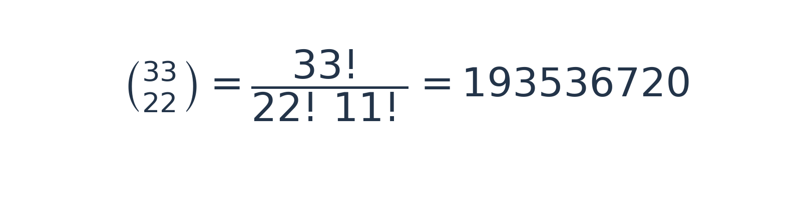
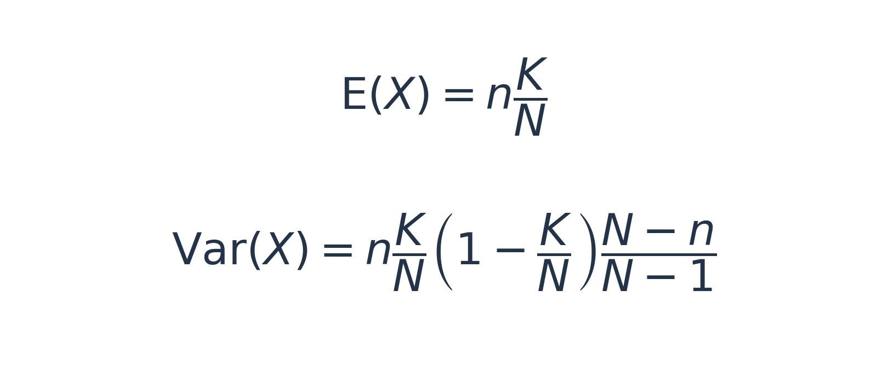
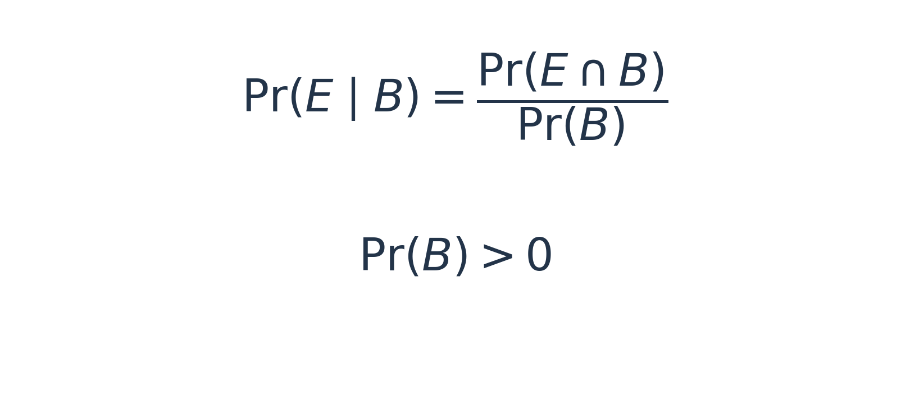
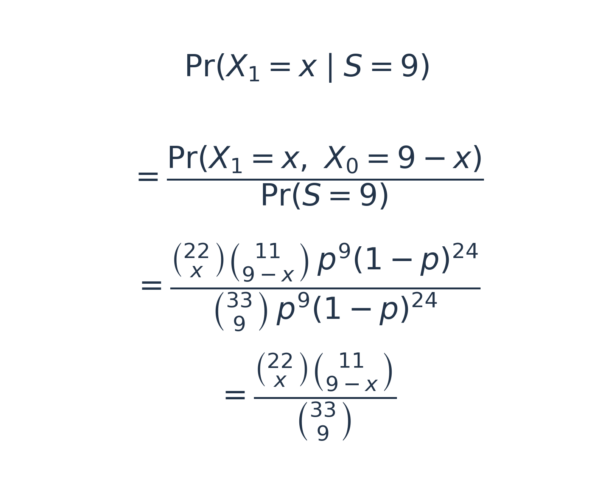

# 超几何分布从哪里来？从不放回抽样到Fisher精确检验

> 明哥的微生物世界 · 统计课堂 31
>
> 摘要　从33张卡片中不放回地抽22张，理解超几何分布的分子与分母，再回到Fisher条件检验。对照课堂的33例HBV与200人达标例题，说明何时优先精确计算、何时可用率差的正态近似，以及大样本为什么仍可使用Fisher检验。


大家好，我是明哥。

11月16日本科生第10次课讲到四格表的Fisher精确检验时，出现了两道例题：一道是33例孕妇的HBV预防例题；另一道是新方案与对照各100人，总共80人达标的主例。

我们先借33例HBV题，把课件中的一步展开：给定行列合计后，预防组的感染人数为什么服从超几何分布？最后再回到200人主例，对照精确检验与率差的正态近似。

这一步值得单独展开。为什么算一张四格表的概率，会变成一道不放回抽样题？公式分母为什么是“从33人中选22人”？

前文[《样本率为什么能用Z检验？从一个率走到两个独立率之差》](https://mp.weixin.qq.com/s/yFWPQNnmvm_OKQO4ZgsEBA)（统计课堂25）第四节已经讲过：两个独立二项计数的概率先相乘，再把产生相同率差的结果归并，就能得到率差的精确离散分布<sup>[1]</sup>。本篇沿着这条线继续走，看看**加入“总感染人数已经给定”这个条件后，随机对象和计算方式怎样改变。**

## 一、先数抽法：分母里到底有多少种可能？

先把人换成卡片，暂时只看抽取规则。

桌上有33张有各自编号的卡片，其中9张标“阳性”，24张标“阴性”。将它们充分混匀，随机抽出22张，抽出后不放回。我们关心：抽出的22张中，恰好有4张阳性的概率是多少？

这里的随机抽取，是指**每一种由22张不同卡片组成的集合，都有同样的机会被选中**。卡片抽出的先后顺序不影响阳性张数，因此先数“选中了哪些卡片”，不用排列抽取次序。

从33张卡片中选22张，共有193536720种选法。组合数记作式（1）：上面的33表示可供选择的总张数，下面的22表示要选出的张数。



*式（1）｜不计先后顺序时，全部可能的22张卡片集合数。感叹号表示阶乘，例如3! = 3×2×1。*

再数其中符合“4张阳性”的选法。

- 从9张阳性卡中选4张，有126种选法。
- 还需要22 − 4 = 18张阴性卡，从24张阴性卡中选18张，有134596种选法。

每一种阳性卡的选法，都可以搭配每一种阴性卡的选法，因此两者相乘，得到16959096种符合要求的集合。再除以全部集合数，就得到式（2）。


*式（2）｜恰好抽到4张阳性卡的概率。X表示抽出的阳性张数，4是它的一种可能取值。*

图1把分子的两次选择画了出来。**一个计数结果可以由许多不同的卡片集合产生。** “恰好4张阳性”的概率，就是这些集合所占的比例。


*图1｜33张卡片中的一种选取结果。圆点代表有各自编号的卡片，橙色代表阳性，浅色代表阴性；选中的22张含4张阳性和18张阴性，剩余11张含5张阳性和6张阴性。图中只画出一种具体集合，式（2）的分子统计所有具有同样计数的集合。*

## 二、把问题写成符号，就是超几何分布

将刚才的抽取问题推广：有限总体共有N个对象，其中K个具有某种特征，另外N − K个没有；从中等可能地、不放回地选n个，用X表示选中的特征对象数。

给定这些条件，X服从**超几何分布**。它的概率质量函数，也就是“每个可能计数对应多少概率”，写成式（3）<sup>[2]</sup>。


*式（3）｜超几何分布的概率质量函数。分子分别数特征对象和其余对象的选法，分母数全部大小为n的集合。*

本文的N = 33、K = 9、n = 22。小写x是X的某个取值。例如x = 4时，需要同时抽出18张阴性卡，式（3）就成为式（2）。

但x的取值还受到库存限制。它至少为0，至多为n和K中较小的一个；同时，抽出的其余n − x个对象不能超过N − K个。因此，所有有正概率的整数取值组成式（4）的范围，这叫作**支持集**。


*式（4）｜超几何计数的可行范围。本例下限为max(0,22 − 24) = 0，上限为min(22,9) = 9。*

本例可以一张阳性卡也没抽到，因为24张阴性足够抽22张；也可以把9张阳性全部抽走，因为样本有22个位置。所以x可以取0、1、2，直到9。

**这里比较两种计数模型：独立、同一成功概率的试验模型，以及总体中阳性总数已给定的不放回抽样模型。**

先看同一袋卡片。第一张抽到阳性的概率是9/33。如果抽到一张阳性后不放回，袋里只剩8张阳性、24张阴性，第二张为阳性的概率变为8/32；如果第一张是阴性，袋里则剩9张阳性、23张阴性，第二张为阳性的概率为9/32。**知道第一张的结果，会改变我们对第二张阳性机会的判断。**

如果每次抽完把卡片放回、重新混匀，下一次抽取前又有9张阳性、24张阴性，每次阳性概率都是9/33，各次抽取相互独立。这样重复n次，阳性张数服从二项分布。独立观察n名新生儿、并假定每人的感染概率都为同一个p，也可以建立二项模型；放回抽卡只是它的一种演示方式。

因此，**n次独立、成功概率同为p的二分类试验，其成功总数服从二项分布；在N和阳性总数K已给定的有限总体中，等可能地不放回抽n个对象，其阳性总数服从超几何分布。**<sup>[3]</sup>

这两种模型都可以使每个抽取位置单独来看有相同的阳性概率。在本例固定的33张卡片中，未看第一张结果时，单看第二张，它为阳性的概率仍是9/33；已知第一张结果后，第二张的条件概率才变为8/32或9/32。**这里的差别在于各次结果的联合关系：二项模型中的试验独立，固定总体的不放回抽取则相互依赖。** 这种关系也会体现在计数方差中。

超几何计数的期望和方差为式（5）。期望描述按同一规则反复抽取时，阳性张数的长期平均；方差描述这些张数围绕期望的波动<sup>[2]</sup>。



*式（5）｜超几何计数的期望与方差。此处N > 1，N、K、n都是给定的抽样参数。*

每个抽取位置出现阳性的平均机会都是K/N，n个位置的期望相加，就是nK/N。方差中，前面n(K/N)(1 − K/N)与同样n和阳性概率下的二项方差相同，后面多出一个有限总体修正因子(N − n)/(N − 1)。

本例的期望为22×9/33 = 6。二项模型对应的方差为48/11，约4.364；不放回时再乘11/32，方差变为1.5。随着总体中的阳性被抽走，后续再抽到阳性的机会会下降，这种牵连缩小了计数波动。若把33张全部抽走，阳性数必定为9，修正因子也恰好变为0。

只有当抽取人数相对于总体很少时，这个因子才接近1，二项近似才有相应依据。本例抽走22/33，直接用超几何分布计算更合适。

## 三、回到HBV例题：固定边际后，一格决定整张表

课堂采用颜艳、王彤《医学统计学》第5版例7-4，印刷第111页：某医师研究乙肝免疫球蛋白预防胎儿宫内感染HBV的效果，将33名HBsAg阳性孕妇随机分为预防注射组和非预防组，记录新生儿的HBV感染结局。HBsAg是乙肝表面抗原，HBV是乙型肝炎病毒<sup>[4]</sup>。

| 组别 | 感染 | 未感染 | 合计 |
| --- | --- | --- | --- |
| 预防注射组 | 4 | 18 | 22 |
| 非预防组 | 5 | 6 | 11 |
| 合计 | 9 | 24 | 33 |

每对母婴提供一个新生儿感染结局，两组观察单位互不重叠。沿用独立二项模型，将两组的总体感染概率记为p₁、p₀。本题问两组总体感染率有无差别，采用双侧假设H₀：p₁ = p₀，H₁：p₁ ≠ p₀，检验水准α = 0.05。

观察感染率分别为4/22≈18.18%和5/11≈45.45%；按预防组减非预防组，观察率差约为−27.27个百分点。现在要判断，这样的组间差异在H₀下有多常见。

Fisher条件检验把这张表的**行合计22、11和列合计9、24作为给定条件**。“边际”指的就是这些位于表格边缘的合计。22和11来自分组安排；感染总数9来自观察结果，我们在分析时进一步给定这个总数。

设X为给定这些合计后预防组的感染人数。只要X取某个值x，另外三格便确定了：

| 组别 | 感染 | 未感染 | 合计 |
| --- | --- | --- | --- |
| 预防组 | x | 22 − x | 22 |
| 非预防组 | 9 − x | 2 + x | 11 |
| 合计 | 9 | 24 | 33 |

例如x = 4时就是观察表；x = 6时，两组的感染人数为6和3，未感染人数为16和8。**在这一组固定边际下，10个可行的x值对应10张完整四格表。**

在H₀及上述独立二项模型下，给定总共9名感染者后，感染结局在33个观察单位间的具体分配等可能。下一节将从二项概率验证这一点。给定总感染数9之后，可以用卡片抽取作等价计数：33张卡片中9张感染、24张未感染，等可能地选22张放入预防组，其余11张放入非预防组。这个卡片模型描述的是固定边际后的条件分布。原研究中的不同母婴观察单位仍按独立二项模型建模；加入总数这一条件后，两组感染计数相互约束。于是，X的条件概率正是式（3），参数为N = 33、K = 9、n = 22。

## 四、为什么可以给定总感染数？共同的未知概率被消去了

再往前推一步，看看“条件”在数学上做了什么。

沿用第25篇的建模方式，先不固定总感染数。前一节用X表示固定边际后的预防组感染数；这里先用X₁表示尚未给定总感染数时的同一组计数，X₀表示11名非预防组新生儿中的感染数。H₀下，两组独立，共享同一个未知感染概率p，所以分别服从Binomial(22,p)和Binomial(11,p)。

令S = X₁ + X₀表示总感染数。独立二项计数相加，在共同概率p下，S服从Binomial(33,p)。

**什么是条件概率？就是已经知道某个事件发生后，另一个事件发生的概率。** 它先把比较范围限制到满足已知条件的结果，再计算目标结果在这个范围中所占的概率。第二节的8/32，正是已知第一张阳性后，第二张阳性的条件概率。

在本题中，尚未给定总感染数时，一次重复研究的S可能为0、1、2，直到33。现在已经知道S = 9，就只在总感染数为9的结果中，问“预防组有4人感染”的概率有多大。

把“总感染数等于9”记为条件事件B，把“预防组感染数等于4”记为目标事件E。“事件”在这里就是满足某个要求的一类研究结果。条件概率写作P(E｜B)，竖线读作“在B发生的条件下”，它的计算规则为式（6a）。



*式（6a）｜条件概率的定义。E∩B表示E和B同时发生；分子是同时满足目标与条件的概率，分母是条件本身的概率。*

把这个定义对回本题，分子和分母就有了具体含义：

- **分母P(B)：总感染数等于9的所有结果的概率。** 这包括两组感染人数为(0,9)、(1,8)，直到(9,0)的各种情况。
- **分子P(E∩B)：预防组感染4人，并且总感染数为9的概率。** 此时非预防组必定感染5人，所以分子也可以写成“两组感染人数分别为4和5”的联合概率。

分子覆盖的结果只是分母范围中的一部分。**除以P(B)，就是把“总感染数为9”这一范围的概率重新作为1，求其中“预防组感染4人”所占的比例。** 给定总感染数为9时，等可能的是每一种具体的9人感染者集合；按两组感染人数归并后，不同计数组合包含的具体集合数不同，因而概率通常不同。

把4换成任意可行的x，道理相同：预防组有x人感染且总数为9，等价于非预防组有9 − x人感染。我们先用条件化前的独立二项模型，计算“两组计数分别为x和9 − x”的联合概率，再除以总感染数为9的概率，就得到式（6b）。



*式（6b）｜H₀下两组共同感染概率为p，且0 < p < 1。给定总感染数S = 9后，分子与分母中的共同因子p⁹(1 − p)²⁴相消。*

**条件分布里不再含有未知的p。** 在H₀下，我们可以直接计算每张允许表的概率，无须先估计共同感染率再代入。

式（6b）从“在33人中安排9名感染者”的角度数；前面的式（3）从“在33人中选择22人进入预防组”的角度数。两种计数角度给出相同的概率：


*式（7）｜两种等价的组合数写法。左边按感染者的位置计数，右边按进入预防组的人员计数；均对应同一组固定边际。*

这也解释了为什么真实研究中，感染总数可以在不同重复样本间变化，而Fisher检验仍给定观察到的9：**检验以观察到的总感染数9为条件，比较同样满足S = 9时，各组感染人数如何分配。** 条件化改变了用于比较的样本集合，不要求研究开始前就规定必须发生9例感染。

## 五、列出完整分布，再从一张表走向P值

现在把10个可行人数的概率全部算出来。R的`dhyper()`返回超几何计数恰好等于x的概率；其中`m`是总体阳性数，`n`是总体阴性数，`k`是抽取人数。注意，R参数名`n`在这里对应本文的N − K，抽取人数则由`k`指定<sup>[2]</sup>。

```r
x <- 0:9
q <- dhyper(x, m = 9, n = 24, k = 22)

# 用组合数逐项核对同一组概率。
q_choose <- choose(9, x) *
  choose(24, 22 - x) / choose(33, 22)
data.frame(x, q, q_choose)
sum(q)
# [1] 1

# 按概率加权，核对均值6、方差1.5。
mean_x <- sum(x * q)
var_x <- sum((x - mean_x)^2 * q)
c(mean = mean_x, variance = var_x)
#     mean variance
#      6.0      1.5
```

`0:9`生成0到9的整数序列，q与这些人数一一对应。`sum(q)`将全部可能结果的概率相加；`sum(x * q)`按概率加权计算人数的平均值。完整结果如下，表中只为阅读而保留8位小数，计算使用未舍入值。

| x | P(X = x) |
| --- | --- |
| 0 | 0.00000143 |
| 1 | 0.00009412 |
| 2 | 0.00197656 |
| 3 | 0.01844785 |
| 4 | 0.08762728 |
| 5 | 0.22532729 |
| 6 | 0.31921366 |
| 7 | 0.24321040 |
| 8 | 0.09120390 |
| 9 | 0.01289752 |

图2用横轴表示预防组感染人数x，纵轴表示相应概率。概率最高的位置是6，与本例期望6一致；观察到的4位于其左侧。


*图2｜H₀及固定边际N = 33、K = 9、n = 22下的完整概率分布，所有柱高之和为1。虚线标出期望6，观察表x = 4用深色边框标出。橙色柱为R双侧Fisher检验纳入的x = 0、1、2、3、4、9；其中前几根柱很低，数值可对照概率表。*

观察表概率约为0.08762728。若关心“预防组感染人数不超过4”，就把x = 0到4的概率相加，得到左尾概率约0.10814723；这也对应预先规定“预防组感染率较低”方向时的单侧检验。R的`phyper(4, m = 9, n = 24, k = 22)`直接返回这个累计概率。

本题问两组有无差别，采用双侧检验。沿用R的定义，把H₀下概率不大于观察表概率的所有表纳入，再把概率相加<sup>[5]</sup>。

```r
q_obs <- dhyper(4, m = 9, n = 24, k = 22)

# 1e-7是比较浮点概率时的相等容差。
included <- q <= q_obs * (1 + 1e-7)
x[included]
# [1] 0 1 2 3 4 9
sum(q[included])
# [1] 0.1210448
```

x = 9的表概率约0.01289752，比观察表小，计入双侧P；x = 8的表概率约0.09120390，稍大于观察表，便没有计入。橙色柱的概率合计约0.12104475。至此，**超几何分布提供每张表的概率，双侧检验规则决定把哪些表的概率加起来。**

最后交给完整检验函数核对。`rbind()`按行放入两组数据；`alternative = "two.sided"`指定双侧；`conf.int = FALSE`让本次调用集中返回检验信息。

```r
tab <- rbind(
  Prevention = c(Positive = 4, Negative = 18),
  Control = c(Positive = 5, Negative = 6)
)
fit <- fisher.test(
  tab, alternative = "two.sided",
  conf.int = FALSE
)
fit$p.value
# [1] 0.1210448
```

在两组总体感染率相等、并给定这些边际的模型下，按本篇双侧规则，观察到当前这样或更极端表的概率约为0.1210。按α = 0.05，本题不拒绝H₀；这33例数据对两组总体感染率有差别的证据尚不足。观察率差仍为−27.27个百分点，其幅度与检验的不确定性需要一起理解。

这里的“精确”指直接使用有限样本的离散概率计算，过程不依赖正态或卡方近似。统计课堂21[《Fisher精确检验：双侧P值为什么不能直接乘2？》](https://mp.weixin.qq.com/s/HKPL2P8PG3v6H652hFwSkA)已展开比较不同双侧算法；需要继续理解尾部选择，可以接着阅读该篇<sup>[6]</sup>。

## 六、从率差到Fisher：同一零假设，怎样连接两种检验？

[统计课堂25](https://mp.weixin.qq.com/s/yFWPQNnmvm_OKQO4ZgsEBA)中，两组样本量给定，两个感染计数分别变化。对于给定的p₁、p₀，先计算每个计数组合的联合概率，再将得到同一率差的组合归并。

对本文的两独立组而言，率差的Z检验与Fisher检验都可以检验**H₀：p₁ = p₀，也就是总体率差p₁ − p₀ = 0**。要理解它们怎样连接，需要分别看清两件事：**固定边际怎样把一格计数与率差联系起来，以及H₀怎样给出这一计数的概率分布。**

先看计数关系。给定总感染数9后，只要预防组有x名感染者，非预防组就有9 − x名。这个约束来自人数合计，无论两组总体感染率是否相等，它都成立。

| 比较对象 | 第25篇：独立二项抽样 | 本篇：给定边际后的抽样 |
| --- | --- | --- |
| 给定什么 | 两组样本量及模型中的p₁、p₀ | 两组样本量、总感染数 |
| 随机计数 | X₁、X₀相互独立 | X₁ = X，X₀ = 9 − X |
| 总感染数 | 随两组计数一起变化 | 条件取值为9 |
| 率差概率 | 联合概率按相同率差归并 | 由超几何计数的概率换算 |

在本例固定边际下，样本率差D与X的关系为式（8）。


*式（8）｜本例固定边际下的样本率差。方向为预防组减非预防组；在H₀下，用E(X) = 6、Var(X) = 1.5及线性变换性质，得到这一条件分布的均值与方差。*

每个x对应一个D，所以也可以把图2的横轴换成率差，柱高保持不变。比如x = 4对应D≈−0.2727，x = 6对应D = 0。**H₀说的是两组总体率相等；样本率差D描述一次研究的观察结果，在H₀下也会随机波动。**

**H₀的作用，是确定这些可行结果各有多大概率。** 在H₀及独立二项模型下，33人的感染概率同为p。任意指定的9人感染、其余24人未感染，其概率都是式（6b）中的共同因子p⁹(1 − p)²⁴。因此，给定总感染数9后，每个具体的9人感染者集合等可能；再按预防组感染人数归并，就得到X的超几何条件分布。

如果两组总体感染率不同，一个具体感染者集合的概率会随它在两组中的分配而改变。**给定感染总数后，“这些感染者怎样分配到两组”仍然包含组间差异的信息。**

在H₀下，X的条件均值为6，对应样本率差D的条件均值为0。观察到x = 4，也就是D≈−0.2727。Fisher检验利用上述条件分布，按第五节的规则判断观察表有多极端；率差的Z检验则在满足近似条件时，利用H₀下的正态近似计算P值。**两种方法检验同一个“两总体率相等”的假设，计算P值所依据的分布与比较范围有所不同。**

这与第25篇接上了：我们从两个独立二项计数出发，在H₀下进一步给定总感染数，便能得到样本率差的条件分布，并据此进行Fisher检验<sup>[5]</sup>。

效应量区间估计则描述参数的不确定性。R的`fisher.test()`默认给出的区间针对优势比OR；若研究目标是总体率差的区间，还要采用相应的率差区间方法<sup>[5]</sup>。第25篇已介绍两个独立率之差的精确推断，这里不重复展开。

## 七、先查期望频数：何时近似，何时精确？

现在回到课堂两道例题的方法选择。这里要检查的是**H₀下四格的期望频数**：每一格用“该行合计×该列合计÷总人数”计算。它描述两组总体率相同时，该格的平均计数，与这次实际观察到的格子人数有所区别。

对于本文的两独立样本四格表，可以先用一句话作经验筛查：**若有格子的期望频数小于5，本篇优先采用Fisher精确检验；四格期望频数均不少于5时，再核查所用近似的条件，满足时可使用率差的正态近似，大样本也可以继续用Fisher。**

5是常用经验门槛之一。“小样本”不能只按总人数判断：总人数很多而事件罕见时，某格的期望人数仍可能很少。独立组设计也是这里的前提；同一患者前后配对的表，要回到配对率的模型。

### （一）33例HBV：一格期望只有3，采用Fisher

HBV例题的合并感染率为9/33。预防组的期望感染人数为22×9/33 = 6，非预防组为11×9/33 = 3；两组的期望未感染人数分别为16和8。四格依次为**6、16、3、8**，其中一格小于5。

本篇因此采用Fisher条件精确检验，直接按超几何概率求和，得到双侧P≈0.12104。这个选择所依据的是计数较稀疏、常规近似的依据不足。

### （二）200人主例：可以正态近似，也可以Fisher

课堂主例假设患者随机分配至新方案与常规对照，各100人，两组独立；按同一标准在4周时评价是否达标。结果如下：

| 组别 | 达标 | 未达标 | 合计 |
| --- | --- | --- | --- |
| 新方案 | 50 | 50 | 100 |
| 常规对照 | 30 | 70 | 100 |
| 合计 | 80 | 120 | 200 |

问题仍是两组总体达标率是否相同。设p新、p对照分别为两组总体达标概率，采用双侧H₀：p新 = p对照，H₁：p新 ≠ p对照，α = 0.05。观察率差按新方案减对照，为0.50 − 0.30 = 0.20，即20个百分点。

在正态近似检验中，用H₀下的合并率80/200 = 0.40估计共同概率。两组各100人，每组的期望达标数都是100×0.40 = 40，期望未达标数都是60，因此四格为**40、60、40、60**，均不小于5。

再按第25篇采用的较保守检查，分别计算两组的nᵢp̂合并(1 − p̂合并)，都为100×0.40×0.60 = 24，也超过10。本例采用独立二项模型，且满足本课程采用的经验检查，因此可使用率差的正态近似。

在上述近似条件下，H₀下的标准化率差近似服从标准正态分布。用合并率计算估计标准误，再标准化得到式（9）的Z值；未作连续性校正的双侧P约为0.00389242。


*式（9）｜200人主例的未校正正态近似检验。SE₀使用H₀下的合并率；Φ表示标准正态分布的累计分布函数，最后一行计算双侧尾部概率。*

在H₀下，如果继续使用Fisher，就在两组各100人的基础上，再给定总达标数80。用A表示新方案中的达标人数，它服从参数N = 200、K = 80、n = 100的超几何分布。A可取0至80，观察值为50；式（3）直接变为式（10）。


*式（10）｜200人主例在H₀及固定边际下的表概率。这里的80是总达标人数，总样本量为200；新方案100人中观察到50人达标。*

在这张固定边际的表中，新方案有A人达标，对照就有80 − A人达标；两组各100人，样本率差便是(2A − 80)/100。**A = 40对应率差0，观察到的A = 50对应率差0.20。** H₀下A的条件均值为40；Fisher正是用这一条件分布，判断观察到的分配有多极端。

观察表的概率约0.001798976。按同样的双侧概率排序，将概率不大于它的表相加，得到Fisher双侧P≈0.00593734。下面用R核对两个检验；`prop.test()`关闭连续性校正时，以χ²形式返回与式（9）Z检验相同的双侧P<sup>[7]</sup>。

```r
tab_200 <- rbind(
  New = c(Achieved = 50, NotAchieved = 50),
  Control = c(Achieved = 30, NotAchieved = 70)
)

# 分别调用未校正近似检验与Fisher条件精确检验。
p_normal <- prop.test(
  x = c(50, 30), n = c(100, 100),
  alternative = "two.sided", correct = FALSE
)$p.value
p_fisher <- fisher.test(
  tab_200, alternative = "two.sided",
  conf.int = FALSE
)$p.value
data.frame(p_normal, p_fisher)
#      p_normal    p_fisher
# 1 0.003892417 0.005937341
```

两个P值分别来自近似计算与条件精确计算，数值可以不同。本例二者都小于0.05，均提供两总体达标率存在差异的证据；观察到的新方案达标率较高，率差为20个百分点。

**大样本使近似方法有了使用依据，并不使Fisher检验失效。** 对于本例这样的2×2表，精确计算也很容易。两种方法对抽样结果的处理有所区别，因此即使都适用，也不要求P值完全相等。

## 本篇讲了哪些知识？

- 在N和特征对象总数K已给定的有限总体中，等可能不放回抽取n个对象，样本特征计数服从**超几何分布**；n次独立、成功概率同为p的二分类试验，其成功数服从**二项分布**。
- 固定总体不放回抽样时，**各位置的边际成功概率仍为K/N**；已知先前结果后，**后续的条件概率会随之改变**，各次抽取因而相互依赖。
- **条件概率把比较范围限制在已知条件B成立的结果中**，用“目标与条件同时发生的概率÷条件本身的概率”计算。Fisher检验给定的条件是**行列合计**。
- 可行人数同时受**样本量、特征对象总数和其余对象总数**约束，其取值为式（4）支持集中的整数。
- 期望为**nK/N**，方差包含**有限总体修正因子(N − n)/(N − 1)**。抽取比例越大，不放回对波动的影响越明显；33人HBV例的均值为6、方差为1.5。
- 两组独立二项计数在H₀下共享未知p；**给定观察到的总阳性数**后，共同概率因子相消，得到**超几何条件分布**。
- 两独立样本四格表的方法选择要结合设计、H₀下的期望频数及近似条件。按本篇采用的经验规则，**有格期望频数小于5时优先使用Fisher检验**；**满足近似条件时可用率差的正态近似**；**大样本同样可以使用Fisher精确检验**。

## 配套练习与下载

这次配套R、Python和MATLAB，选择一种即可。三套主脚本都从同一张HBV数据表开始，先用组合数计算，再核对分布函数、均值方差、尾部概率和完整Fisher检验。另有`large_sample_comparison`脚本，对照200人主例的期望频数、率差正态近似与Fisher结果；输入数据和运行入口见README。

R重点对应`dhyper(x, m = 9, n = 24, k = 22)`；Python对应`hypergeom.pmf(x, M = 33, n = 9, N = 22)`；MATLAB对应`hygepdf(x, 33, 9, 22)`。同样的三个人数，在不同软件中参数名和顺序各不相同，按“总体总数、总体阳性数、抽取人数”的含义核对即可<sup>[2,8,9]</sup>。

做完原题，可以把卡片抽取人数从22改为11，保留总张数33和阳性9，重新计算分布。抽到的11张与留下的22张互为补集，两个阳性计数相加恒为9。试着比较两者的期望、方差和概率表，看看这条关系怎样体现在结果中。

本篇完整项目：
https://github.com/fuyuming/statistics-classroom/tree/main/stats_classroom/article31_hypergeometric

整个仓库：
https://github.com/fuyuming/statistics-classroom

整个仓库ZIP：
https://github.com/fuyuming/statistics-classroom/archive/refs/heads/main.zip

下载整个仓库ZIP并完整解压，进入`stats_classroom`中的`article31_hypergeometric`，先读文章目录的README，再进入“配套项目”下的`article31_hypergeometric`，选择一种语言按节运行。

从分母里那些等可能的选法出发，超几何公式就有了具体含义；再给定四格表的边际，Fisher检验所用的概率也有了来处。

这里是明哥的微生物世界，我们下次再见。

## 参考资料与延伸阅读

[1] 明哥的微生物世界．《样本率为什么能用Z检验？从一个率走到两个独立率之差》．统计课堂25，第四节。 https://mp.weixin.qq.com/s/yFWPQNnmvm_OKQO4ZgsEBA

[2] R官方文档．The Hypergeometric Distribution：概率函数、支持集、期望和方差。 https://stat.ethz.ch/R-manual/R-devel/library/stats/html/Hypergeometric.html

[3] OpenStax．Introductory Statistics 2e．§4.3 Binomial Distribution、§4.5 Hypergeometric Distribution：独立同p试验与固定总体不放回模型。 https://openstax.org/books/introductory-statistics-2e/pages/4-3-binomial-distribution ；https://openstax.org/books/introductory-statistics-2e/pages/4-5-hypergeometric-distribution

[4] 颜艳、王彤主编．《医学统计学》第5版．人民卫生出版社，2020．例7-4，印刷第111页。

[5] R官方文档．Fisher's Exact Test for Count Data：固定边际、超几何条件分布、双侧概率排序及OR区间。 https://stat.ethz.ch/R-manual/R-devel/library/stats/html/fisher.test.html

[6] 明哥的微生物世界．《Fisher精确检验：双侧P值为什么不能直接乘2？》．统计课堂21。 https://mp.weixin.qq.com/s/HKPL2P8PG3v6H652hFwSkA

[7] R官方文档．prop.test：两总体率相等检验与连续性校正设置。 https://stat.ethz.ch/R-manual/R-devel/library/stats/html/prop.test.html

[8] SciPy官方文档．scipy.stats.hypergeom：总体M、特征对象数n、抽取人数N及概率质量函数。 https://docs.scipy.org/doc/scipy/reference/generated/scipy.stats.hypergeom.html

[9] MathWorks官方文档．hygepdf：参数顺序与超几何概率。 https://www.mathworks.com/help/stats/hygepdf.html

延伸阅读：[《样本率为什么能用Z检验？从一个率走到两个独立率之差》](https://mp.weixin.qq.com/s/yFWPQNnmvm_OKQO4ZgsEBA)（统计课堂25），第四节“图3中的精确概率怎样算？”。
