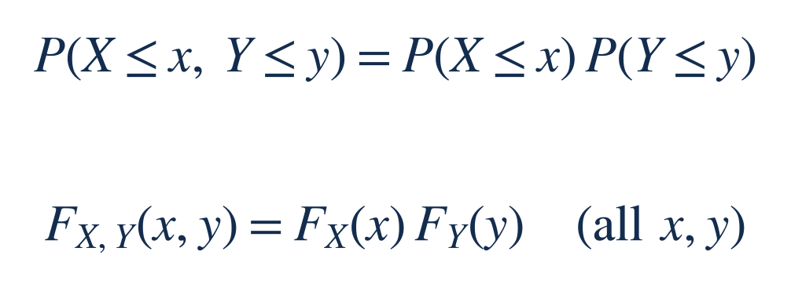
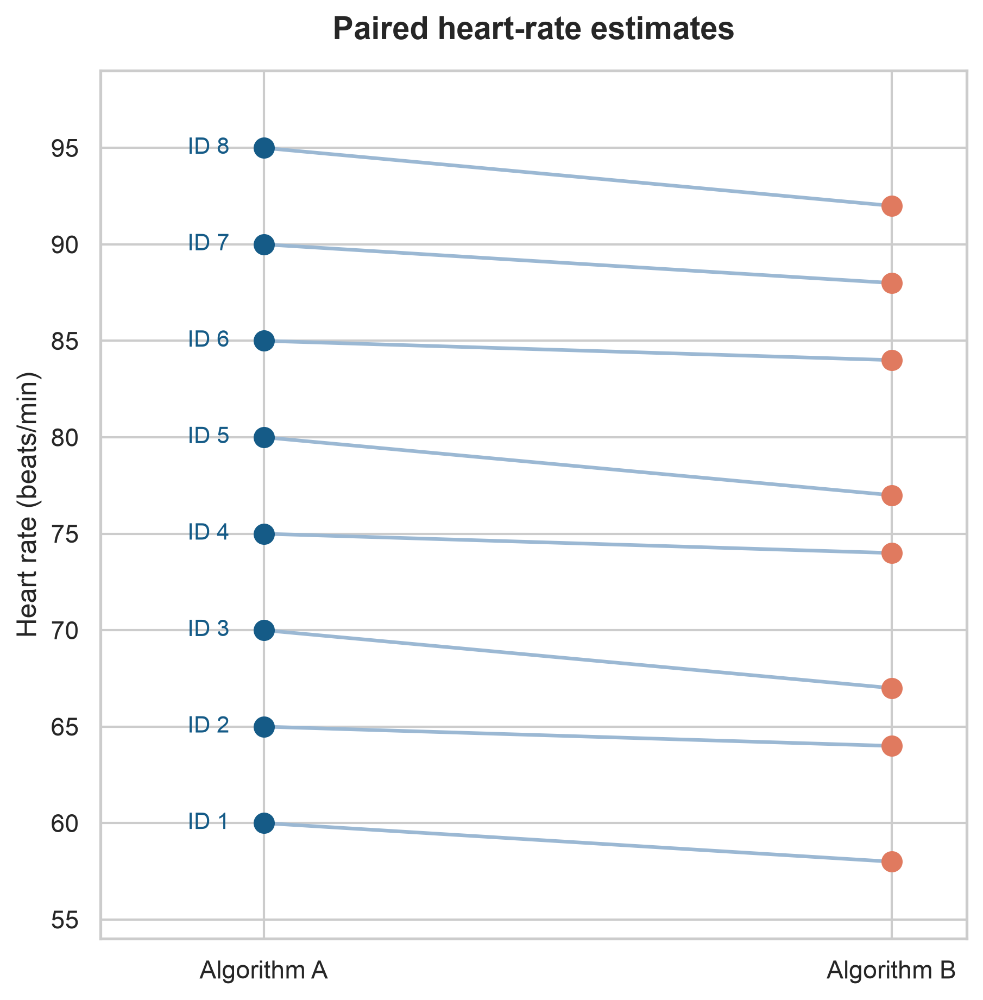
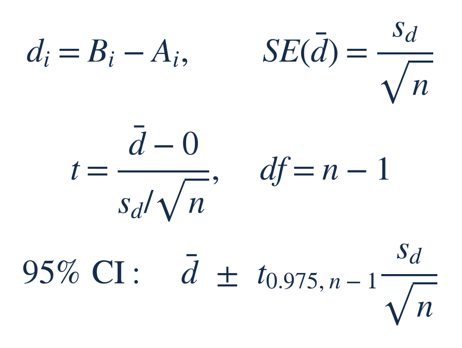
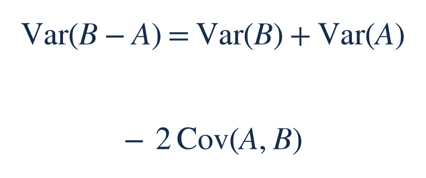

# 独立与配对，究竟怎样区分？

> 明哥的微生物世界 · 统计课堂 33
>
> 摘要　独立首先是随机量的概率分布性质；配对描述有意义的一一对应结构。两者怎样联系？从正态样本的均值与方差独立出发，再看时间、空间、技术和双生子四种配对情形，用心率例题与配对四格表说明：独立的是谁，相关性应在哪一层保留。


大家好，我是明哥。

分析分类资料之前，有一个问题值得先讲清：为什么同样是两列数据，有时使用独立样本的方法，有时却要使用配对的方法？

比如，两种算法各给出100个检测结果。我们首先需要知道，这些结果来自两组不同的人，还是来自同一批人的同一份记录。两列数字的来历不同，对差异的分析也会不同。

## 一、“独立”仍是概率论里的独立

我们在[统计课堂07](https://mp.weixin.qq.com/s/KuRH3VnO1RQpmIWfYCVutA)讲过：来自同一个正态总体的独立同分布样本，其样本均值与样本方差相互独立。这里讨论独立样本，底层使用的是同一个概率论定义。

设X、Y是两个会随重复抽样而变化的随机量。若对任意门槛x、y，“X不超过x且Y不超过y”的概率，都等于这两个事件各自概率的乘积，就称X、Y独立：



*式（1）｜左边计算两个事件同时发生的概率，右边相乘两个事件各自的概率。等式须对所有x、y成立。F表示累积分布函数。*

直观地说，知道其中一个量的信息，不会改变另一个量的概率分布。这种独立性描述重复抽样时两个随机量的分布关系。

前篇的两个随机量是“样本均值”和“样本方差”；这里则可能是两名患者的读数，或两组样本（每组包含多次观测）。**定义相同，需要先说明独立的是谁。** 讨论多个随机量时，同样要看整个联合分布能否分解为各自分布的乘积。

前篇中，均值与样本方差都由同一批观测计算得到，它们的独立性由独立同分布正态模型的分布性质保证。对本篇的两组读数，我们则要结合抽样和测量安排，为独立性假设提供依据。下面比较两种取得心电记录的方式，看看这个假设怎样落实到具体数据。

## 二、先找到每条记录属于谁

假设要比较两种心电算法的心率读数。

一种安排是：从目标人群抽取两组相互独立的患者，每人选取一段规定长度的心电记录，第一组用算法A，第二组用算法B。两组患者之间没有设计上的一一对应关系，这是两个独立样本的比较，两组人数可以不同。

这样的比较还需要考虑两组人群组成是否可比；随机分配有助于控制两组构成差异带来的干扰。

另一种安排是：抽取一组患者，每人选取一段心电记录，**同一段记录同时交给算法A和B处理**。第一位患者的A读数对应自己的B读数，第二位也如此。这些数据应保留逐人的对应关系。

**样本数相等，并不能建立配对。配对需要有明确来源的一一对应关系。** 把两个独立组分别按读数从小到大排序，再把第一名、第二名依次放在一起，会人为改变差值的分布，不能创造有效的配对设计。

可以先写下：研究对象是谁，每个对象产生几条记录，简单配对分析最终有几个差值。

配对记录为（Aᵢ，Bᵢ）时，同对内可能相关，需要保留这个结构；简单配对方法通常假定不同对子相互独立。**配对是一种设计和记录结构，不能直接与“必然不独立”画等号。** 同一来源也不意味着任意两个指标一定相关，分析要针对具体随机量及其联合分布。

## 三、四种常见的配对情形

下面按时间、空间、技术和双生子四个入口来理解。它们是便于识别设计的常见情形，可以有交叠；共同点都是先说明比较对象怎样逐一对应。

### 1．时间配对：同一对象前后测量

例如，招募30名患者，规定同一测量条件，分别记录康复训练前和训练6周后的步行速度。每个人的后测值与自己的前测值配成一对，共有30对数据。

这里要分析的是每个人的变化。若前测来自第一批患者、后测来自另一批患者，仅仅因为测量时间一前一后，并不能形成配对。

前后比较也有解释边界：观察到变化，并不自动证明变化完全由训练造成。同期疾病进展、其他治疗以及自然恢复等因素，仍需要通过研究设计控制。

### 2．空间配对：同一对象的对应部位

例如，在20名受试者左右前臂的对应位置分别使用两种电极固定材料，每种材料在每人身上恰用一次。按相同程序活动后，左右各测一次电极接触阻抗，单位为kΩ。每名受试者提供一对结果、一个差值；对两种材料的比较，可以先在每个人内部作差。

左右两侧本身可能存在差异，因此可在设计时随机决定每种材料使用哪一侧。还应判断一侧的处理是否会影响另一侧，以及两个位置是否具有可比性。

空间接近本身也不够：同一病房的两名患者、同一城市的两所医院，可能共享环境，却没有形成一对一的可比对象。这类资料还可能涉及群组相关性。

### 3．技术配对：同一材料、两种方法

例如，同一份血液标本分成两份，分别用仪器A和B测量同一个指标；或者，同一段心电记录交给两种算法估计心率。每份标本或记录，都是连接两种方法的依据。

分装和测量本身也可能带来误差，配对并不会让这些误差消失；这里仍要按标本保留对应关系。

这与“同一台仪器把同一份标本测三遍”不同。后者属于测量重复，可以帮助了解测量波动；这三次读数仍只来自一份标本。若每名患者在每种方法下都有多次重复，应先明确要估计什么，再选择患者内汇总或能处理同一患者、标本内相关性的分析。

两种方法在平均读数上有无差异，也只回答平均差异的问题。评价方法能否互换，还需要研究个体差异范围、测量误差和预先规定的可接受界限。

### 4．双生子与匹配对象

例如，招募20对成年双生子，在每对内随机决定两人分别接受训练方案A或B，训练6周后，比较握力改善量。虽然共有40人，但进行简单配对分析时，每对提供一个“A与B的差值”，共有20个差值。

双生子配对利用的是两人在遗传或成长背景上的相近之处。同卵与异卵双生子的遗传相似程度不同，研究中应记录这一特征，说明每对对象的可比性。

**基础实验中，也可以通过匹配把不同对象配成对子。** 例如，从不同窝中各选一只同一品系、同性别的小鼠，再按周龄和试验前体重配成20对。在每对内随机决定两只小鼠分别接受训练方案A或B，比较训练后的握力改善量。匹配使对内这些背景条件接近，处理效果的比较在对子内部完成。

这里的对应关系是在试验前建立的：既可以利用双生子的天然联系，也可以根据与研究结局有关的背景特征进行匹配。动物试验中的配对随机分配与区组安排，可参阅文末的ARRIVE指南。

这四种情形都要求说明：**为什么是这两个结果配成一对，换成其他对象为什么会失去原来的比较含义。**

## 四、两个属性就是配对资料吗？

同一人有两项属性，说明这一行保存了两个属性的联合记录。接下来要分清，是研究两个属性的关联，还是比较同一对象在两种条件下的同一指标。

假设调查200名相互独立的患者，每人记录吸烟状态和是否患某种疾病。表中一格表示“既吸烟、又患病”的人数。

这里的问题是：**两个分类属性是否有关联？** 每位患者只贡献一次联合分类，普通独立列联表的卡方（χ²）检验是在适当条件下可考虑的方法。其“独立性”原假设指吸烟与患病两个变量独立；检验所需的“观察单位独立”，指不同患者的记录彼此独立。

再看同一批患者分别接受检测A和B的情形。如果问题是两种检测的总体阳性判定率是否相同，就要利用同一患者的两次结果，采用相应的配对率比较方法。

**选择方法时，既要看资料怎样取得，也要看研究问题是什么。** 同一张配对检测表，还可以研究判定一致性，或两种结果的关联；这些问题与比较阳性判定率有不同的统计目标。

## 五、先对8份心电记录逐对作差

假设从目标人群抽取8名相互独立的患者，每人选取一段固定30秒的心电记录，两种算法分别估计该段平均心率，单位为次/分。数据如下。我们要估计总体平均读数差“B−A”，给出95%置信区间，并在双侧α＝0.05下检验其是否为0。

| 记录编号 | 算法A | 算法B | 同一记录的B−A |
| --- | ---: | ---: | ---: |
| 1 | 60 | 58 | −2 |
| 2 | 65 | 64 | −1 |
| 3 | 70 | 67 | −3 |
| 4 | 75 | 74 | −1 |
| 5 | 80 | 77 | −3 |
| 6 | 85 | 84 | −1 |
| 7 | 90 | 88 | −2 |
| 8 | 95 | 92 | −3 |

先在每份记录内部计算差值，再对8个差值求平均。得到平均差−2次/分，差值的样本标准差约为0.9258次/分，平均差的估计标准误约为0.3273次/分。



*图1｜每条线连接同一份心电记录的A、B读数。不同记录的心率水平相差较大，但各记录的B−A主要在−1至−3次/分之间。图示数据为上述假设例题。*

记第i份记录的差值为dᵢ，平均差为d̄，差值的样本标准差为s_d。配对t分析使用的标准误和统计量为：



*式（2）｜n是完整配对数，本例为8；t统计量检验总体平均差是否为0。区间中的临界值取自由度n−1的t分布双侧95%临界值。*

这里使用配对t推断的条件是：不同对子产生的差值随机变量相互独立，来自共同的、近似正态的总体。例题按这一模型前提演算；真实小样本需要结合专业知识和差值图检查，不能用一次“不显著”的正态性检验证明正态。

R的调用如下，先输入完整数据，再运行整个函数调用：

```r
# 每个位置都属于同一份记录；两列单位均为次/分。
A <- c(60, 65, 70, 75, 80, 85, 90, 95)
B <- c(58, 64, 67, 74, 77, 84, 88, 92)

# B放在前面，因此估计的方向是B−A。
# paired=TRUE要求按相同位置逐对比较；默认进行双侧检验。
fit <- t.test(B, A, paired = TRUE, conf.level = 0.95)
fit
```

实际得到t＝−6.1101，自由度7，双侧P≈0.0004862，平均差的95%置信区间为［−2.7740，−1.2260］次/分。在上述模型成立的前提下，有证据认为算法B的总体平均读数低于A。这个结果没有提供金标准，不能据此判断谁更准确。

配对关系为什么重要，还可以从方差看出来：



*式（3）｜A、B表示同一记录的两种随机读数；Cov是协方差，描述两者共同变化的程度。同对内的共同变化会进入差值的方差。*

本例中，两列各自的样本方差约为150和145.1429，样本协方差约为147.1429。代入后，差值的样本方差为150＋145.1429−2×147.1429≈0.8571。

保留对应关系，才能使用这部分信息。若把B列倒序，虽然两列各自的均值都不变，差值的标准差却会变成约24.2782。这个操作只是展示错配会丢失什么信息，实际分析应按真实编号连接数据。

当对内协方差为正时，作差可以减少这部分共同波动；配对是否提高精度，还取决于相关程度、设计成本及模型条件。不能为了得到更小的P值而改变配对方式。

## 六、二分类结果的配对比较

再假设有100名相互独立的患者，每人各提供一段心电记录。两种算法分别判断该段是否含有至少一次室性早搏：算法作出这一标记记为阳性，否则记为阴性。每份记录都有完整的A、B结果。现在比较两算法的总体阳性判定率，方向仍为B−A，采用双侧α＝0.05。

| 算法A结果 | B阳性 | B阴性 | 合计 |
| --- | ---: | ---: | ---: |
| A阳性 | 25 | 5 | 30 |
| A阴性 | 25 | 45 | 70 |
| 合计 | 50 | 50 | 100 |

A的阳性率是30%，B是50%，样本率差为20个百分点。这个差值也可以逐人计算：A阴、B阳的25人各贡献＋1；A阳、B阴的5人各贡献−1；其余70人贡献0。平均差为（25−5）/100＝0.20。

**率差的分母是全部100个配对对象。** McNemar检验则关注两个不一致方向是否平衡：5人与25人，共30人。连续性校正的统计量为（|25−5|−1）²/30＝12.0333，以χ²₁近似求得P≈0.0005226。

```r
# 行是A阳性、A阴性；列是B阳性、B阴性。
# byrow=TRUE让下面四个人数按行填入，避免把两格方向弄反。
tab <- matrix(c(25, 5, 25, 45), nrow = 2, byrow = TRUE)
dimnames(tab) <- list(A = c("阳性", "阴性"),
                     B = c("阳性", "阴性"))
tab

# 比较配对总体阳性率；correct=TRUE明确采用连续性校正。
mcnemar.test(tab, correct = TRUE)
```

本例不一致人数m＝30，按本课m≥20的经验口径展示χ²近似；条件二项精确检验的双侧P≈0.0003249。两者使用不同的参照计算，不应要求数值完全相同。

将100个个人差值（5个−1、70个0、25个＋1）的样本标准差除以100的平方根（即10），得到估计标准误约0.05125。采用标准正态临界值1.96、不作连续性校正，普通配对Wald近似的率差95%区间约为［9.96，30.04］个百分点。

这个近似区间与上述校正检验并非同一方法的反演。更完整的区间比较见[统计课堂28](https://mp.weixin.qq.com/s/PW70QHqDXeT_bHvkvJDQbw)，校正、精确法和mid-P见[统计课堂18](https://mp.weixin.qq.com/s/pdhCl9mFrJONR23349ESKQ)。

这张表里的5、25等数字，是同一个人的两次结果组合。如果只留下“30/100”和“50/100”，就丢失了这种组合信息。这里也未提供人工判读的金标准，因此“B判阳性更多”不能直接解释为“B检测更准确”。

## 七、到底有多少个独立对象？

回到研究设计，最好同时记录：**测量了谁，处理施加给谁，以及哪些记录共享同一个来源。**

20名患者，每人左右前臂各测一次，有40个部位读数，但简单配对比较依靠20个人内的差值。

如果材料随机分配到前臂，前臂是接受处理的单位，患者则是配对区组，也就是把同一个人的两个部位放在同一组内比较。不能把这两层混为一谈。

10名患者，每人一份标本，每种方法都测3遍，确实有60个读数，但并没有因此变成60名独立患者。重复读数可以提高对各份标本测量结果的了解，却不能替代更多独立患者。

类似地，同一患者有多段心电、同一家庭有多个成员、同一培养物有多个视野，都需要追踪共享来源。这类相关性有时需要汇总分析，有时需要重复测量或多层模型。识别出“有关联”之后，还要继续判断，是否真的能简化为一对两个结果。

Lazic等在2018年的PLOS Biology文章中，专门讨论了生物学单位、实验单位和观察单位的区别。ARRIVE指南也要求明确实验单位，避免把同一单位内部的重复测量当作独立重复；相关原文见文末。

实际拿到一份数据时，可以先问三个问题：每一行来自谁？两列中的第i项为什么应当相互对应？不同对子之间是否还共享患者、家庭或其他来源？回答清楚后，再选择与研究目标相符的检验。

## 八、本篇讲了哪些知识？

- **独立是联合分布能够分解的概率性质。** 观测之间、样本之间、统计量之间，都可以讨论独立性，但必须明确讨论的对象。研究设计为相应假设提供依据。

- **配对的依据是有意义的一一对应关系。** 前后、左右、同材料两方法、双生子及人为匹配，都需要说明对应关系的来源；相等的样本数或事后排序不构成配对依据。
- **配对结构与概率独立性要分清。** 配对分析保留对内联系的可能，简单配对推断通常假定不同对子作为整体相互独立。处理分配单位、记录条数和用于简单配对分析的差值个数，可以不同。
- **配对均值比较分析的是差值。** 配对t推断使用差值的标准差和完整配对数；有限样本的t参照依赖独立、正态差值模型，而不是分别检验两列是否正态。
- **配对二分类资料要保留四格联合计数。** 率差以全部配对数为分母；McNemar关注不一致两格，二者各自使用的样本信息不同。
- **资料结构与研究目标共同决定方法。** 比较总体判定率、研究变量关联、评价判定一致性及诊断准确性，回答不同问题。
- **技术重复不自动增加独立对象数。** 重复测量提供的信息，应在它所处的患者、标本或实验层级上解释。

## 九、配套练习与延伸阅读

配套练习提供R、Python和MATLAB三种版本。用熟悉的一种即可：先核对8份记录的差值、标准误和区间，再检查100人配对表的率差、McNemar与精确P。可以在练习副本中仅改变B的排列，观察“列均值不变、差值波动改变”，理解真实配对编号的作用。

本篇项目目录：https://github.com/fuyuming/statistics-classroom/tree/main/stats_classroom/article33_independent_paired

系列仓库入口：https://github.com/fuyuming/statistics-classroom

完整仓库ZIP下载：https://github.com/fuyuming/statistics-classroom/archive/refs/heads/main.zip

下载解压后，进入`stats_classroom/article33_independent_paired/`，先读README，再按语言选择两个分析脚本。R从项目文件进入；Python按Spyder单元运行；MATLAB按节运行。本篇目录中的`data/`、`scripts/`与`results/`分别保存共享数据、代码和参考结果，使用自己熟悉的一种语言即可。

已有公众号可按问题继续读：

- 统计独立的含义与正态样本特性：[统计课堂07](https://mp.weixin.qq.com/s/KuRH3VnO1RQpmIWfYCVutA)。
- 配对率差怎样由个人变化形成：[统计课堂27](https://mp.weixin.qq.com/s/HWRYFiDUJDqSPlONx8qCnw)。
- 配对率差区间为什么不同：[统计课堂28](https://mp.weixin.qq.com/s/PW70QHqDXeT_bHvkvJDQbw)。
- McNemar校正与精确检验：[统计课堂18](https://mp.weixin.qq.com/s/pdhCl9mFrJONR23349ESKQ)。
- 对照独立组率差的抽样分布：[统计课堂25](https://mp.weixin.qq.com/s/yFWPQNnmvm_OKQO4ZgsEBA)。

本文定义、单位与软件的进一步依据：

1. 李春喜等，《生物统计学》第6版，第236—237页：配对试验设计与适用情形。
2. Rosner B. *Fundamentals of Biostatistics*, 8th ed., 2015, p280：配对样本定义与实例。
3. NIST统计手册，配对观测及配对t分析：https://www.itl.nist.gov/div898/handbook/prc/section3/prc311.htm
4. ARRIVE指南，研究设计与实验单位：https://arriveguidelines.org/arrive-guidelines/study-design
5. Lazic SE, Clarke-Williams CJ, Munafò MR. 2018. *What exactly is ‘N’ in cell culture and animal experiments?* PLOS Biology 16(4): e2005282. https://doi.org/10.1371/journal.pbio.2005282
6. R官方t检验说明：https://stat.ethz.ch/R-manual/R-devel/library/stats/html/t.test.html
7. R官方McNemar说明：https://stat.ethz.ch/R-manual/R-devel/library/stats/html/mcnemar.test.html
8. 概率教材的联合分布与独立性定义：https://www.probabilitycourse.com/chapter6/6_1_1_joint_distributions_independence.php
9. ARRIVE指南，动物试验中的匹配随机分配与区组：https://arriveguidelines.org/arrive-guidelines/randomisation/4a/explanation

这里是“明哥的微生物世界”，我们下次见。
