# 配对率差之外：两种检测的结果有多一致？

> 明哥的微生物世界 · 统计课堂 34
>
> 摘要　同一张配对四格表，既能比较阳性率，也能评价逐人判定的一致性。沿着第11课的58人例题，从配对率差走到Cohen κ，再从每人的0、1记录逐步推出κ估计量的一阶近似期望与方差，进而构造Wald区间，最后用成对Bootstrap比较区间。


大家好，我是明哥。

第11课课件中，有一张检测表用了两次。前面问：两种方法的总体阳性率是否相同？后面继续用这张表，改问：两种方法对同一个人的判定，有多一致？

这可以接上[统计课堂27](https://mp.weixin.qq.com/s/HWRYFiDUJDqSPlONx8qCnw)讨论的配对率差。率差汇总了两法判阳性人数的差；回到每个人的两次结果，才能同时看到两个分歧方向，以及两法判定相同的人数。

## 一、先把配对率差放回原表

颜艳、王彤《医学统计学》第5版例7-3，给出了58名可疑系统性红斑狼疮患者的检测结果。每名患者都接受免疫荧光法和乳胶凝集法的抗核抗体检测，结果分为阳性、阴性。每名患者的两次结果合为一条联合记录；下面假定不同患者的联合记录相互独立<sup>[1]</sup>。

58人的配对结果见表1；后文的率差、一致率和κ都从这张表出发。

*表1｜58名患者两种检测的配对四格表*

| 免疫荧光法 | 乳胶阳性 | 乳胶阴性 | 合计 |
| --- | ---: | ---: | ---: |
| 阳性 | 11（a） | 12（b） | 23 |
| 阴性 | 2（c） | 33（d） | 35 |
| 合计 | 13 | 45 | 58 |

表1中，每个人恰好进入一个格子。例如，12人被免疫荧光法判为阳性、乳胶法判为阴性；另有2人的分歧方向相反。

后文用a、b、c、d表示四格人数，n＝a＋b＋c＋d。**a是共同阳性人数，d是共同阴性人数；b、c是两个方向的不一致人数。** 本例依次为11、12、2、33；换成其他配对二分类资料，仍按这四个格子计算。

免疫荧光法的样本阳性率是23/58，约39.66%；乳胶法是13/58，约22.41%。沿用“乳胶减免疫”的方向，样本率差为−10/58，即 **−17.24个百分点**。

回顾[统计课堂27](https://mp.weixin.qq.com/s/HWRYFiDUJDqSPlONx8qCnw)中的个人差值：两法都阳性或都阴性的人贡献0；免疫阴、乳胶阳的人贡献＋1；免疫阳、乳胶阴的人贡献−1。于是，率差等于两种分歧方向人数的差，再除以全部配对人数。

这里b＝12、c＝2，比较的是这两个分歧方向是否平衡。按条件二项精确McNemar检验计算，双侧P约0.01294；在α＝0.05下，有证据认为两法的总体阳性率存在差异<sup>[1]</sup>。

接下来，把问题换成：**同一人的两次判定，有多少次落在同一个类别？**

## 二、率差看分歧的方向，一致率看判定是否相同

原表中，11人两法都阳性，33人两法都阴性，共44人得到一致判定。观察一致率为44/58，约 **75.86%**。

把它记作Pₒ，o取自observed，表示实际观察到的一致比例。式（1）把样本率差与观察一致率并排写出：

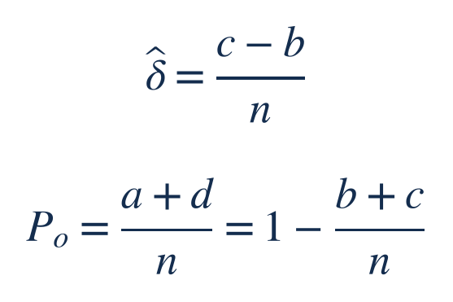

*式（1）｜n为全部完整配对人数。样本率差记为δ̂，方向为乳胶减免疫；Pₒ为观察一致率。*

这两个量对不一致信息作了不同的汇总：**率差用c−b，一致率取决于b＋c。**

这也解释了一个常见疑问：即使两法阳性率相等，也可能有不少人的结果发生了对换。只要两个分歧方向人数相等，率差就是0；至于各有多少人分歧，还要回到配对表里看。

本例同时存在“乳胶判阳性较少”和“44人判定一致”，两句话各自描述原表的一部分。

## 三、机会一致率：保留边际人数，暂时打散对应关系

75.86%的观察一致率已经很直观。Cohen κ还要再问一步：如果只保留两法各自判阳性、阴性的人数，由随机配对所形成的一致基准会是多少<sup>[2]</sup>？

可以想象：免疫荧光法的23个阳性、35个阴性位置不动，把乳胶法的13个阳性、45个阴性标签，均匀地随机排列后分给这58个人。这就得到按两法边际比例形成的独立参照。

对于免疫法判阳性的任意一人，分到乳胶阳性标签的概率是13/58。因此，23个免疫阳性者中，预期有23×13/58≈5.155人同时得到乳胶阳性标签。

同理，35个免疫阴性者中，预期有35×45/58≈27.155人同时得到乳胶阴性标签。两类预期一致人数相加，再除以58，就得到 **机会一致率Pₑ**，计算见式（2）：

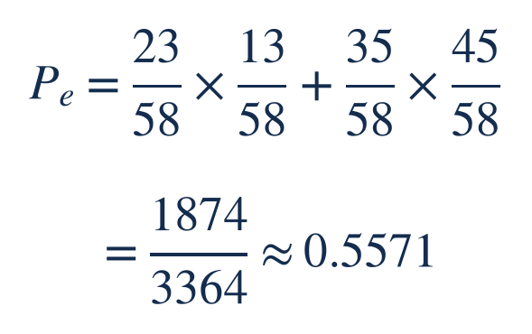

*式（2）｜e取自expected。两项分别对应预期的共同阳性与共同阴性。*

预期人数出现小数很自然：它描述反复随机分配标签后的人数平均值，单次表里的计数仍然是整数。

这个基准来自**两法的边际比例，以及打散逐人对应关系的参照安排**。实际资料仍保留真实配对；正是把实际一致程度与这个基准相比，κ才有了含义。

## 四、κ为什么先减Pₑ，再除以1−Pₑ？

本例实际一致率为75.86%，机会基准为55.71%，两者相差约20.15个百分点。

直接报告这个超出量也有意义。κ再作一步归一化：从机会基准55.71%到100%一致，还相差44.29个百分点；用实际超出基准的20.15个百分点，除以这段参照距离。写成式（3），就得到κ的计算公式<sup>[2]</sup>。

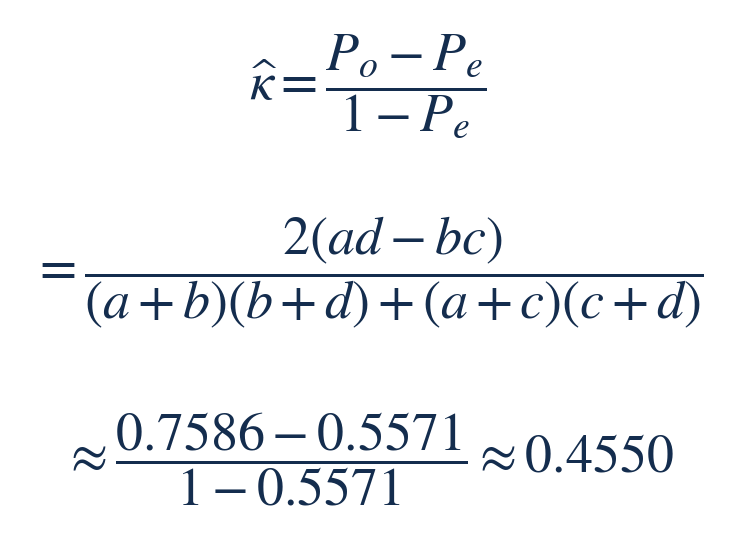

*式（3）｜κ是目标人群中的一致性系数，κ̂是用四格人数算出的样本估计值。第二行将Pₒ、Pₑ展开为a、b、c、d；代入计算使用未舍入的比例。*

因此，**κ̂＝0.455表示：以机会基准为起点，实际超出的一致量约占上述参照距离的45.5%。** 实际有多少人的判定相同，仍由Pₒ＝75.86%回答。

在Pₑ＜1、κ有定义时：κ＝0对应恰好等于机会基准，κ＝1对应完全一致，κ＜0对应低于机会基准。−1≤κ≤1。

点估计给出一致程度；接下来还要看，58人的抽样波动会让这个估计有多不确定。

## 五、κ的置信区间怎样计算？

本例κ̂≈0.455。若按同样的方式再抽58名患者，四格人数会变化，算出的κ̂也会变化。置信区间就要利用这种抽样波动，估计目标人群中的总体κ。

下面沿着[统计课堂8《期望、方差、协方差》](https://mp.weixin.qq.com/s/QkG1VROHLoOtyDgxEonrDw)的思路，从每名患者的0、1记录开始，把期望、方差和区间一步步接起来。仍假定不同患者的联合记录独立，且来自同一组总体概率。

### （一）先定义样本中的三个统计量

这里关注样本中的三个统计量：**免疫法的样本阳性率、乳胶法的样本阳性率、观察一致率。** 它们均由同一批58名患者的记录计算，而且都能写成0、1值的平均数。

对第i名患者，记三个0、1值：

- X<sub>i</sub>：免疫法阳性记1，阴性记0。
- Y<sub>i</sub>：乳胶法阳性记1，阴性记0。
- C<sub>i</sub>：两法判定相同记1，不同记0。共同阳性和共同阴性都记1。

例如，表1中12名“免疫阳、乳胶阴”的患者，都是X＝1、Y＝0、C＝0。将58人的记录分别相加，再除以58，就得到式（4）中的这三个统计量：

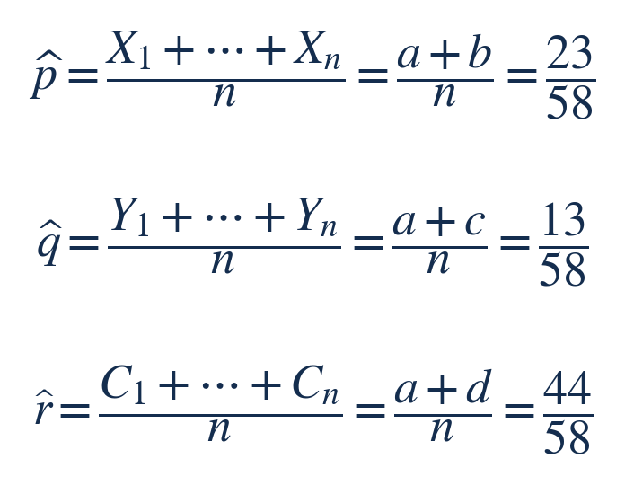

*式（4）｜p̂、q̂分别为两法的样本阳性率，r̂就是前文的观察一致率Pₒ；n＝58。*

样本表中的a/n、b/n、c/n、d/n，估计的是目标人群中四种联合结果的概率，分别记为π<sub>a</sub>、π<sub>b</sub>、π<sub>c</sub>、π<sub>d</sub>，四者相加为1。于是，免疫法总体阳性概率p＝π<sub>a</sub>＋π<sub>b</sub>，乳胶法总体阳性概率q＝π<sub>a</sub>＋π<sub>c</sub>，总体一致概率r＝π<sub>a</sub>＋π<sub>d</sub>。

以免疫法为例，每个X<sub>i</sub>的期望都是p，所以n个X的和的期望是np，除以n后仍为p。因此，**E(p̂)＝p；同样，E(q̂)＝q、E(r̂)＝r。**

将总体p、q代入机会一致率公式，记所得概率为e：e＝pq＋(1−p)(1−q)＝1−p−q＋2pq。样本代入得到ê，也就是前文的Pₑ。总体κ＝(r−e)/(1−e)，样本κ̂＝(r̂−ê)/(1−ê)。

### （二）两法的样本阳性率变化，怎样影响机会一致率？

记Δp＝p̂−p、Δq＝q̂−q、Δr＝r̂−r，表示这三个统计量相对总体概率的偏差；Δe＝ê−e表示机会一致率的偏差。

把p̂＝p＋Δp、q̂＝q＋Δq代入e的计算式，再减去原来的e，展开后得到式（5）：

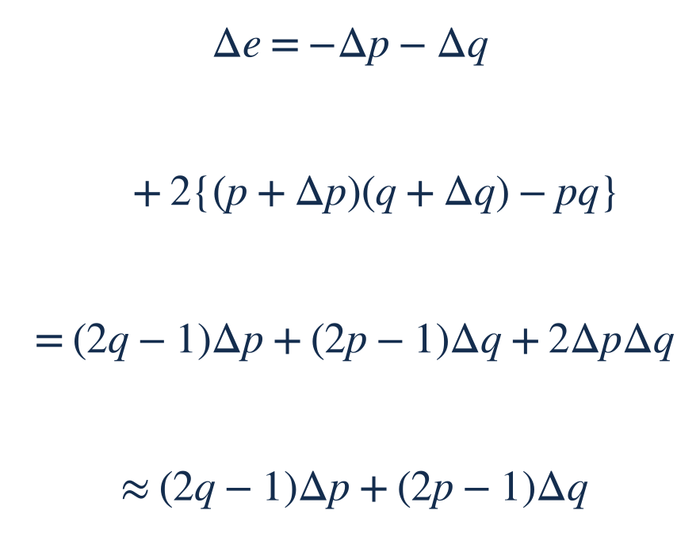

*式（5）｜前两行是代入展开的等式；最后一行忽略了两个偏差的乘积2ΔpΔq，开始使用近似。*

这里的近似有具体含义：当两法样本阳性率的偏差都较小时，它们的乘积更小。例如Δp、Δq都为0.01，2ΔpΔq只有0.0002。先保留只含一次偏差的项，就能把机会一致率的变化写成两个偏差的加权和。这类保留一次偏差项的办法，称为一阶delta近似。

### （三）把这个变化代回κ，先求期望

先将样本κ̂与总体κ相减。由κ＝(r−e)/(1−e)，有1−κ＝[(1−e)−(r−e)]/(1−e)＝(1−r)/(1−e)。式（6a）先将两个分式通分，再代入这一关系：

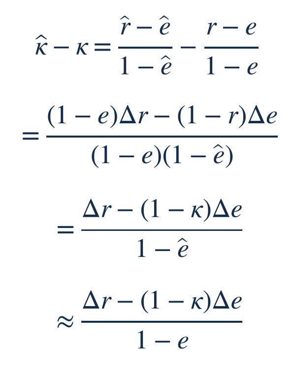

*式（6a）｜前三行是等式；最后一行以1−e近似接近它的1−ê。它将κ̂的变化分成观察一致率变化和机会一致率变化两部分。*

现在把式（5）的最后一行代进式（6a）。将分子中的乘法逐项展开后，κ̂−κ近似等于式（6b）这三个项的和：

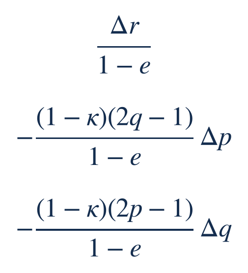

*式（6b）｜三行依次是Δr、Δp、Δq所对应的项；将三项相加。每个偏差前的乘数都已写出。*

把Δr、Δp、Δq前面的乘数分别记为c<sub>r</sub>、c<sub>p</sub>、c<sub>q</sub>，就得到式（6c）。它们是同一组总体系数，对每名患者使用相同的权重：

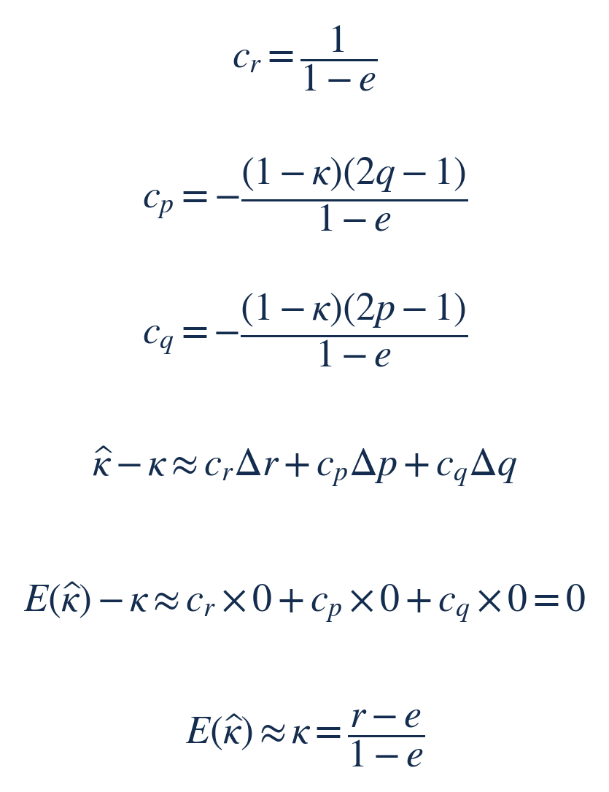

*式（6c）｜三个系数由总体p、q、r及κ决定；推导期望时，它们是固定的乘数。*

为什么最后一行等于0？因为上一步已经得到E(p̂)＝p，所以E(Δp)＝E(p̂−p)＝0，另外两个偏差同样如此。期望可以逐项算，三个“系数×偏差”的期望相加仍是0。因此：

**期望（一阶近似）：E(κ̂)≈κ＝(r−e)/(1−e)。**

这里的κ由总体四格概率决定：先用π<sub>a</sub>＋π<sub>b</sub>、π<sub>a</sub>＋π<sub>c</sub>求p、q，算出e；再用r＝π<sub>a</sub>＋π<sub>d</sub>计算κ。用样本四格比例代入，才得到本例的κ̂≈0.455034。

这里保留一次偏差项，得到的是近似期望。被略去的项可能带来有限样本偏差，下一节用当前样本的经验分布给出Bootstrap偏差估计。

### （四）再把方差算出来

接着求式（6c）中这三个偏差合起来的方差。**W<sub>i</sub>是把第i名患者的X、Y、C，按式（6c）的三个系数相加得到的辅助量。** 它把三个统计量合起来的变化，写成一个平均数的变化。式（7a）写出W及其平均数：

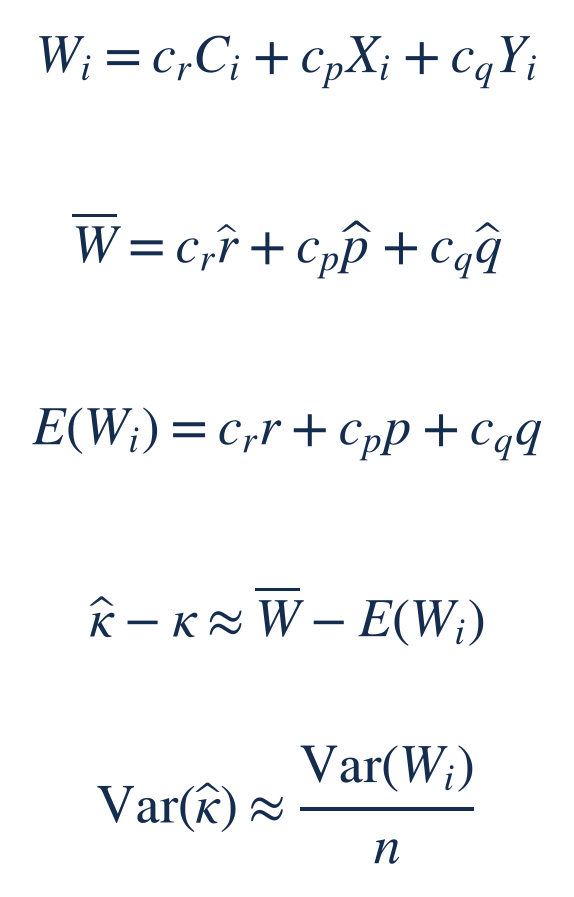

*式（7a）｜W̄是n名患者的W平均数。不同患者独立，所以平均数的方差等于单人W方差除以n。*

这一换写为什么有用？因为W̄＝c<sub>r</sub>r̂＋c<sub>p</sub>p̂＋c<sub>q</sub>q̂，而E(W<sub>i</sub>)＝c<sub>r</sub>r＋c<sub>p</sub>p＋c<sub>q</sub>q。两者相减，正好就是式（6c）中的三个加权偏差。求κ̂的近似方差，就转成了求一个普通平均数的方差。不同患者独立，平均数的方差等于单人W的方差除以样本量n，因此：

**方差（一阶近似）：Var(κ̂)≈Var(W)/n。**

实际计算时，总体p、q、r未知，用本例的23/58、13/58、44/58代入，估计三个系数。先有Pₑ≈0.557075、κ̂≈0.455034；例如c<sub>r</sub>＝1/(1−e)，代入得到约2.257718。另外两项按式（6c）代入，得到c<sub>p</sub>≈0.678831、c<sub>q</sub>≈0.254562。

回到四格表，同一格内每人的X、Y、C都相同，所以W只有四种可能值，分别记为W<sub>a</sub>、W<sub>b</sub>、W<sub>c</sub>、W<sub>d</sub>。表2将每一格的表达式和本例代入值列在一起。

例如，a格的X、Y、C都为1，因此W<sub>a</sub>＝c<sub>r</sub>＋c<sub>p</sub>＋c<sub>q</sub>；本例约为2.257718＋0.678831＋0.254562＝3.191110。b格只有X＝1，W<sub>b</sub>＝c<sub>p</sub>；c格只有Y＝1，W<sub>c</sub>＝c<sub>q</sub>；d格只有C＝1，W<sub>d</sub>＝c<sub>r</sub>。

*表2｜四格中W的表达式，以及按本例样本比例代入后的数值*

| 四格（人数） | W的表达式 | 本例代入值 |
| --- | --- | ---: |
| a：共同阳性（11） | W<sub>a</sub>＝c<sub>r</sub>＋c<sub>p</sub>＋c<sub>q</sub> | 3.191110 |
| b：免疫阳、乳胶阴（12） | W<sub>b</sub>＝c<sub>p</sub> | 0.678831 |
| c：免疫阴、乳胶阳（2） | W<sub>c</sub>＝c<sub>q</sub> | 0.254562 |
| d：共同阴性（33） | W<sub>d</sub>＝c<sub>r</sub> | 2.257718 |

X、Y、C来自同一个人，三者有联系。按表2的联合结果计算同一个W的方差，就把这种联系保留了下来。

上面的方差关系，先将由总体概率决定的三个系数视为固定值来推导。实际计算时，用样本比例估计三个系数，得到表2最后一列的四个W代入值；下面的m₁、m₂都使用这些代入值。

**m₁是n个人的W平均数；m₂是n个人的W²平均数。** a格有a个人，便有a个相同的W<sub>a</sub>，其余三格同理。因此，m₁按人数a、b、c、d给四种W值加权；m₂先将每种W值平方，再按相同人数加权。式（7b）先列任意四格表的表达式，再代入本例的11、12、2、33，运算使用未舍入系数：

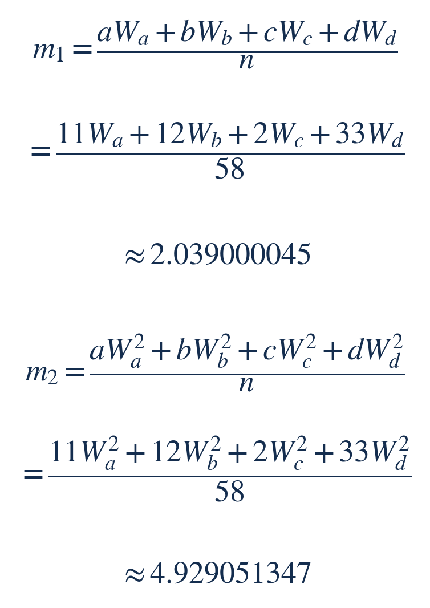

*式（7b）｜m₁估计单人W的期望，m₂估计单人W²的期望；加权人数来自原四格表，n＝a＋b＋c＋d。*

再用统计课堂第8篇已经推过的Var(W)＝E(W²)−[E(W)]²：先作m₂−m₁²，得到单人W的方差估计；再除以患者数58，得到κ̂的方差估计；最后开平方，得到标准误。完整代入见式（7c）<sup>[3]</sup>。

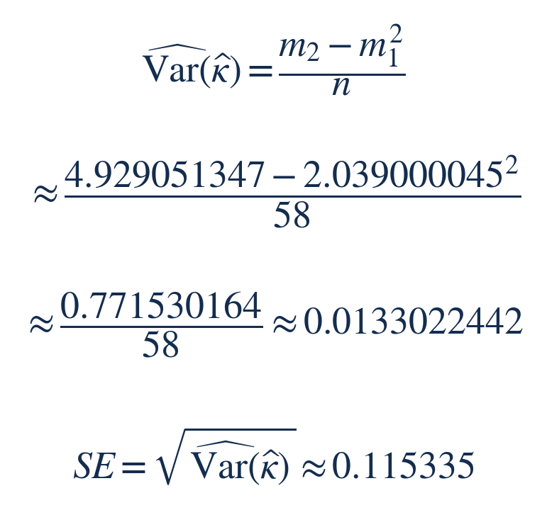

*式（7c）｜m₁、m₂按式（7b）由四格人数和四个W代入值计算；分母n是全部配对人数，本例为58。SE是方差估计的平方根。*

因此，**一般四格表的κ̂方差估计＝(m₂−m₁²)/n**，其中m₁、m₂按式（7b）计算。

本例 **κ̂的方差估计≈0.0133022442，SE≈0.115335**。这个0.115335，描述按相同方式重复抽58名患者时，κ̂的抽样波动尺度。

### （五）从标准误走到95%Wald区间

期望和方差算出来后，还要说明分布的近似。每名患者的W只有表2中的四种取值；不同患者独立、同分布。当四种联合结果在总体中都有正概率、e＜1时，W有有限的正方差。随着样本量增大，W平均数的标准化抽样分布趋近标准正态。

前面又得到κ̂−κ近似等于W̄−E(W)。因此，κ̂的抽样分布可用以总体κ为中心、方差约Var(W)/n的正态分布近似。**这一步正态近似，才让我们能用1.96来构造双侧95%区间。**

R的vcd包可用`Kappa()`核对手算，`Unweighted`中的`value`为κ估计值、`ASE`为渐近标准误<sup>[4]</sup>。

```r
# 行为免疫荧光法，列为乳胶法；均按阳性、阴性排序。
tab <- matrix(c(11, 12, 2, 33), nrow = 2, byrow = TRUE)
fit <- vcd::Kappa(tab)

# value是κ估计值，ASE是渐近标准误，均读取未加权结果。
kappa_hat <- unname(fit$Unweighted["value"])
se <- unname(fit$Unweighted["ASE"])

# 标准误的平方是方差估计；把三个量放在一起查看。
c(kappa = kappa_hat, variance = se^2, SE = se)
```

输出κ̂≈0.455034、方差≈0.013302、SE≈0.115335，与上述计算一致。将估计值和标准误代入式（8），临界值取1.96：

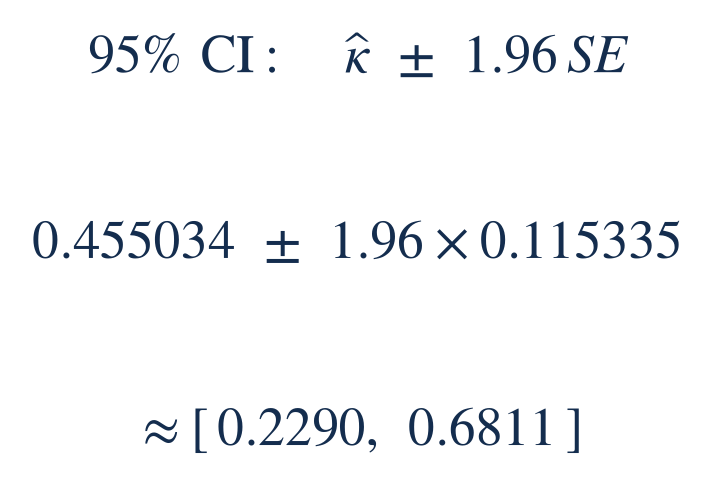

*式（8）｜双侧95%Wald区间；本例约为［0.2290，0.6811］。*

接着调用`confint(fit, level = .95)`，读取`Unweighted`这一行，也得到四位小数的区间［0.2290，0.6811］。Python配套以statsmodels的`cohens_kappa()`核对，MATLAB配套按相同方法计算<sup>[5]</sup>。

## 六、用成对Bootstrap计算κ区间

前面的Wald区间与下面的Bootstrap区间，都估计同一个总体κ。Wald用“κ̂加减1.96个标准误”构造两端；Bootstrap沿用[统计课堂26](https://mp.weixin.qq.com/s/f7fo2FN6OJKqEPwNLbNqdA)介绍的重抽思路，用每轮κ的变化近似抽样波动，再确定区间两端。

### （一）每次抽取一名患者的完整检测结果

本例每名患者有一对结果，重抽时把这对结果作为一个整体抽取。有放回抽58次，得到一张新的四格表，再算一次κ̂；重复50,000次，就得到50,000个重抽κ值，记作κ̂<sup>∗</sup>。R的`boot::boot()`执行重抽，`boot::boot.ci()`计算指定的区间<sup>[6]</sup>。

这样保留了同一人的两法对应关系，两法的阳性人数也会随抽到的患者改变。它延续的是前面“重新抽取患者”的思路。

固定随机种子20261120，本次重抽κ值的均值约为0.45144，样本方差约为0.013374，标准差约为0.11565；均值比原样本κ̂≈0.45503低约0.00359。在当前样本的经验分布下，均值与原κ̂之差给出Bootstrap偏差估计；重抽κ值的标准差则是Bootstrap标准误。

### （二）百分位与BCa，分别怎样取区间两端？

**百分位法**先把50,000个κ̂<sup>∗</sup>排序，取2.5%和97.5%分位点。本例得到95%区间 **［0.2215，0.6758］**。

**BCa法**在此基础上调整分位水平。它使用偏差校正量z₀和加速量a<sub>acc</sub>：前者由重抽κ值中小于原κ̂的比例计算，后者由逐个删去一名患者后的κ变化计算<sup>[7]</sup>。

本次有50.524%的重抽κ值小于原κ̂，对应z₀≈0.013135；58个删一结果给出a<sub>acc</sub>≈−0.012863。将它们代入式（9），得到调整后的取值位置：

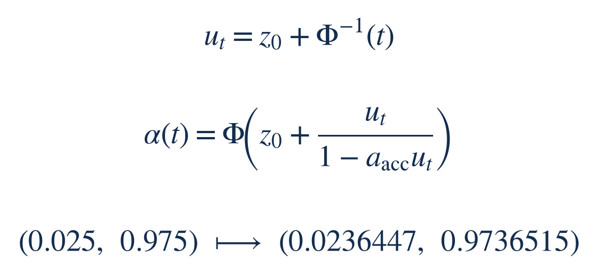

*式（9）｜Φ为标准正态累积分布函数，Φ⁻¹为其分位函数；t是原分位水平，α(t)是调整后的分位水平。a<sub>acc</sub>表示加速量。*

也就是说，这次把 **2.5%、97.5%改为约2.36447%、97.36515%**，再从同一批重抽κ值中读取端点，得到95%BCa区间 **［0.2193，0.6725］**。调整的是取端点的位置，原表的κ̂≈0.45503保持不变。

下面的R代码按四种联合结果的人数展开原表，每次抽完整的患者联合结果。删一法计算的`L`传给`boot.ci()`，用于BCa的加速量。

```r
cell <- rep(1:4, times = c(11, 12, 2, 33))

# 每次抽完整的联合结果；计数式与前面的κ定义等价。
kappa_stat <- function(cell, index) {
  z <- tabulate(cell[index], nbins = 4)
  numerator <- 2 * (z[1] * z[4] - z[2] * z[3])
  denominator <- (z[1] + z[2]) * (z[2] + z[4]) +
                 (z[3] + z[4]) * (z[1] + z[3])
  numerator / denominator
}

RNGkind("Mersenne-Twister", "Inversion", "Rejection")
set.seed(20261120)
bt <- boot::boot(cell, kappa_stat, R = 50000)

# 删一法：每次删一名患者，以删一估计的均值为中心计算影响值。
jack <- sapply(seq_along(cell), function(i) {
  kappa_stat(cell[-i], seq_len(length(cell) - 1))
})
L <- (length(cell) - 1) * (mean(jack) - jack)
boot::boot.ci(bt, conf = .95, type = c("perc", "bca"), L = L)
```

`type = c("perc", "bca")`同时请求百分位和BCa两种区间，输出中的Percentile与BCa分别对应上述结果。

### （三）三种κ区间放在一起看

表3列出三种区间的端点，图1将它们放在同一条κ轴上比较。

*表3｜同一58人原表的三种κ区间*

| 95%区间方法 | 本例区间 |
| --- | --- |
| 普通delta-Wald | ［0.2290，0.6811］ |
| 成对Bootstrap百分位 | ［0.2215，0.6758］ |
| 成对Bootstrap BCa | ［0.2193，0.6725］ |

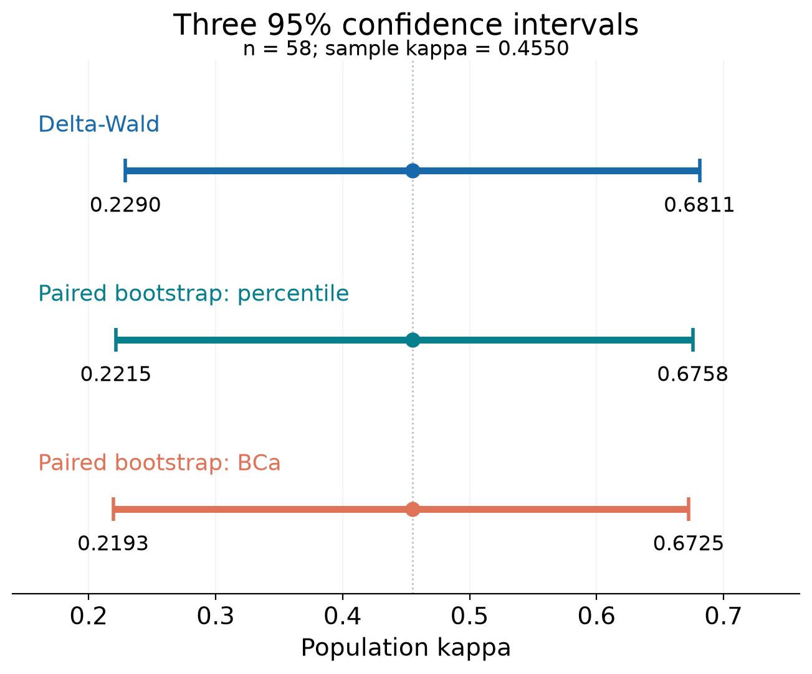

*图1｜三种方法估计同一个总体κ，点均为原样本κ̂≈0.4550。Bootstrap使用50,000次成对重抽、种子20261120。Wald、百分位和BCa均为近似区间。*

本例三种区间接近：下限约0.22—0.23，上限约0.67—0.68。更换区间构造后，对一致程度的不确定性判断变化不大。接下来再看另一个问题：这些资料是否支持κ高于0？

## 七、κ＝0时，还容易算出0.455吗？

总体κ＝0，表示总体一致率恰好等于两法边际概率形成的机会基准。本例却算出κ̂≈0.455。检验要问：**如果总体κ真的为0，抽58名患者时，像0.455这么高的估计值常见吗？**

第11课沿用Rosner的设置，事先关心一致程度是否高于机会基准，所以检验H₀：κ＝0，对H₁：κ＞0，采用右尾单侧检验<sup>[2]</sup>。

先在κ＝0这个假设下计算波动。本例只有阳、阴两类。两法总体阳性概率均在0与1之间时，κ＝0等价于两法判定在总体中独立；每格的联合概率便等于两法相应边际概率的乘积，与第三节构造机会基准的方式相同。用原表的23/58、13/58估计两法的阳性概率，就得到表4的预期计数；例如，共同阳性的预期人数是58×(23/58)×(13/58)≈5.155。

*表4｜κ＝0时，由两法边际概率得到的预期计数（显示三位小数）*

| 免疫荧光法 | 乳胶阳性 | 乳胶阴性 | 合计 |
| --- | ---: | ---: | ---: |
| 阳性 | 5.155 | 17.845 | 23 |
| 阴性 | 7.845 | 27.155 | 35 |
| 合计 | 13 | 45 | 58 |

表4是按零假设和样本边际概率算出的参考表，表1是实际观察人数。计算使用未舍入的预期概率：式（6c）—（7c）中的系数和W的两个矩都按表4计算，κ取0；最后将m₂−m₁²除以58，得到方差约0.014629，开平方得到 **SE₀≈0.120950**<sup>[3]</sup>。

这就解释了两个标准误的差别：前面的0.115335根据实际四格表估计κ̂的波动；这里的0.120950根据κ＝0的预期表计算假设成立时的波动。本次检验用后一个。

现在量一量：观察值0.455离假设值0，有多少个这样的标准误？按式（10）计算：

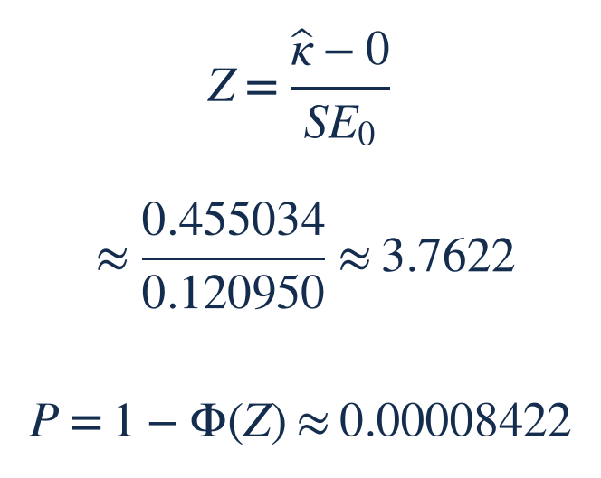

*式（10）｜Z≈3.7622表示观察值比0高约3.76个零假设标准误；Φ为标准正态累积分布函数。*

沿用前面已经算出的`kappa_hat`，R可这样核对：

```r
# 按两法边际人数相乘，构造κ=0时的预期计数表；总人数仍为58。
tab0 <- outer(c(23, 35), c(13, 45)) / 58

# 在这张预期表上κ为0，一般渐近SE也就给出这里所用的SE0。
se0 <- unname(vcd::Kappa(tab0)$Unweighted["ASE"])
z <- (kappa_hat - 0) / se0
# lower.tail=FALSE读取标准正态右尾，即Z至少这么大的概率。
p_greater <- stats::pnorm(z, lower.tail = FALSE)
c(SE0 = se0, Z = z, P_greater = p_greater)
```

输出SE₀≈0.120950、Z≈3.7622、右尾P≈0.00008422。**在H₀下，按正态近似计算，Z至少达到3.7622的右尾概率约为0.00008422。这个概率很小，因此资料支持总体κ＞0。** 一致程度有多高，仍要连着κ̂≈0.455、置信区间和下面的分级一起看。

## 八、κ＝0.455，六级与三级分别怎样解释？

常见的经验分级有不同口径。Landis与Koch在1977年给出了六级参考，表5将它整理为连续区间，并列出相应描述<sup>[8]</sup>。

*表5｜Landis–Koch六级κ经验分级*

| κ范围（连续区间写法） | 英文描述 | 中文参考表述 |
| --- | --- | --- |
| κ＜0 | Poor | 差，低于机会基准 |
| 0≤κ≤0.20 | Slight | 轻微一致 |
| 0.20＜κ≤0.40 | Fair | 尚可 |
| 0.40＜κ≤0.60 | Moderate | 中等一致 |
| 0.60＜κ≤0.80 | Substantial | 较强一致 |
| 0.80＜κ≤1.00 | Almost perfect | 接近完全一致 |

原文用0.21—0.40、0.41—0.60等两位小数区间展示；表5用相应的连续区间衔接各档，并明确端点归属。本例κ̂≈0.455，清楚落在moderate，通常译为 **“中等一致”**。

第11课采用的Rosner三级参考见表6<sup>[2]</sup>。

*表6｜Rosner三级κ经验分级*

| κ范围 | 英文描述 | 中文参考表述 |
| --- | --- | --- |
| 0≤κ＜0.4 | Marginal | 较弱 |
| 0.4≤κ≤0.75 | Good | 良好 |
| κ＞0.75 | Excellent | 优秀 |

按表6的口径，同一个κ̂≈0.455落在good，即 **“良好”**。这张三级表讨论非负κ，负值另按“低于机会基准”解释。

**“中等”与“良好”来自不同经验分界，数值本身没有改变。** 写研究结果时，给出采用哪套参考，读者就能理解名称的来源。Landis与Koch在原文中也明确指出，分界具有任意性，其用途是帮助讨论具体例子<sup>[8]</sup>。

再看本例区间［0.229，0.681］：按六级表，它横跨尚可、中等与较强；按三级表，它跨过较弱与良好的0.4分界。因此，点估计所属档位并未消除抽样不确定性。研究报告可以同时给出原表、75.86%的观察一致率、κ̂及其区间，再结合检测用途解释这种分歧是否可接受。

本例评价的是两法判定的吻合程度。若要判断检测是否诊断正确，还需要相应的临床参考标准与诊断效能指标。

## 九、本篇讲了哪些知识？

- **配对率差与一致性使用同一张联合计数表，却汇总了不同信息。** 率差由两个分歧方向之差c−b决定，观察一致率由分歧总人数b＋c决定。
- **κ以两法边际比例形成的机会一致率为基准。** 减Pₑ表示超出基准的一致量，除以1−Pₑ把机会基准映到0、100%一致映到1。
- **κ估计量的一阶近似期望与方差可以从每人的0、1记录逐步推出。** 先写出这三个统计量的偏差怎样影响κ，再把它们合成每名患者的W；用“平方的平均减平均的平方”估计Var(W)，除以58得到κ̂的方差，开平方得到SE。正态近似再给出Wald区间。
- **Bootstrap的调整要落实到算法。** 百分位法直接取重抽分位点，BCa用偏差校正量与删一法加速量调整分位水平；本例三种方法均给出实际端点。
- **一般标准误与零假设标准误按推断任务区分。** 本篇用一般多项渐近SE构造双侧95%Wald区间，用SE₀进行预先指定的κ＞0右尾单侧检验。
- **κ的经验分级要说明来源。** 本例0.455按Landis–Koch六级表为中等一致，按Rosner三级表为良好；分档应连同区间和研究用途一起解释。
- **一致程度、统计证据和实际用途需要一起解释。** P值回答与机会基准的比较；κ及区间描述程度与不确定性，检测用途决定怎样评价这些分歧。

## 十、配套练习与延伸阅读

配套项目提供R、Python和MATLAB三种版本，用熟悉的一种即可。先读入58人四格表，核对率差、Pₒ、Pₑ和κ；再分别查看区间与零假设检验的标准误。用第三份脚本逐步复算κ的方差与标准误，再用第二份脚本计算成对Bootstrap的百分位及BCa区间。

配套项目`article34_paired_kappa`包含共享原表与重抽计数数据、三语言脚本及区间比较结果；第三份脚本按正文的三个0、1均数、W和两个矩复算期望/方差的代入过程。先读README，从数据准备节顺序运行。

本篇项目目录：https://github.com/fuyuming/statistics-classroom/tree/main/stats_classroom/article34_paired_kappa

系列仓库入口：https://github.com/fuyuming/statistics-classroom

完整仓库ZIP下载：https://github.com/fuyuming/statistics-classroom/archive/refs/heads/main.zip

下载仓库并解压，进入`stats_classroom/article34_paired_kappa/`，先读README，再选择自己熟悉的一种语言练习。

延伸阅读可按问题选择：[第14篇](https://mp.weixin.qq.com/s/RE66xquSoQAtDH3g1_7xjw)回看单个率的Wald、Wilson与精确区间；[第26篇](https://mp.weixin.qq.com/s/f7fo2FN6OJKqEPwNLbNqdA)回看Bootstrap的经验分布；[第27篇](https://mp.weixin.qq.com/s/HWRYFiDUJDqSPlONx8qCnw)理解配对率差的分布；[第28篇](https://mp.weixin.qq.com/s/PW70QHqDXeT_bHvkvJDQbw)看配对率差的精确构造；[第29篇](https://mp.weixin.qq.com/s/bDJiRyRskkiC_UbtZ1FEkw)比较独立率差的三种区间。

希望进一步了解κ的精确区间，可读Shan与Wang关于二分类κ的Buehler精确单侧置信限研究<sup>[9]</sup>。

这里是“明哥的微生物世界”，一起把统计问题读清楚、算明白。

## 参考文献与官方说明

1. 颜艳、王彤主编.《医学统计学》第5版，2020年，第110—111页，例7-3及表7-3：58人两种抗核抗体检测结果；第118页：同属性配对分类资料的一致性分析提示。
2. Rosner B. *Fundamentals of Biostatistics*. 8th ed. §10.8, pp431–436：Pₒ、Pₑ、κ构造、κ＝0对κ＞0的单侧检验及三级经验解释。
3. SAS. *The FREQ Procedure: Tests and Measures of Agreement*，Simple Kappa Coefficient部分：一般渐近方差、正态近似区间及零假设方差。https://support.sas.com/documentation/cdl/en/procstat/63963/HTML/default/procstat_freq_a0000000568.htm
4. vcd官方手册，Kappa条目：未加权κ、ASE及`confint()`接口。https://cran.r-project.org/web/packages/vcd/vcd.pdf#page=53
5. statsmodels官方文档与实现：`cohens_kappa()`的κ、两类方差及结果字段。https://www.statsmodels.org/stable/generated/statsmodels.stats.inter_rater.cohens_kappa.html ；https://www.statsmodels.org/stable/_modules/statsmodels/stats/inter_rater.html
6. R boot包官方说明：`boot()`、`boot.ci()`；区间类型、BCa影响值L、正态分位尺度插值。https://stat.ethz.ch/R-manual/R-devel/library/boot/html/boot.html ；https://stat.ethz.ch/R-manual/R-devel/library/boot/html/boot.ci.html
7. Efron B. Better bootstrap confidence intervals. *Journal of the American Statistical Association*. 1987;82(397):171–185. https://doi.org/10.1080/01621459.1987.10478410
8. Landis JR, Koch GG. The measurement of observer agreement for categorical data. *Biometrics*. 1977;33(1):159–174. 六级经验表及分界说明见印刷第165页。https://doi.org/10.2307/2529310 ；原文：https://jjcurtin.github.io/book_iaml/pdfs/landis_1977_kappa.pdf#page=8
9. Shan G, Wang W. Exact one-sided confidence limits for Cohen’s kappa as a measurement of agreement. *Statistical Methods in Medical Research*. 2017;26(2):615–632（2014年在线发表）. https://doi.org/10.1177/0962280214552881
