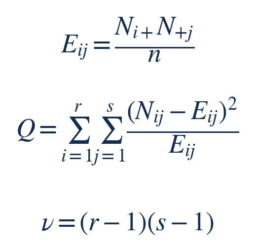
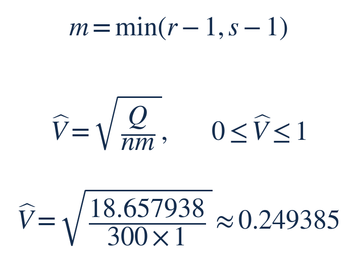

# 卡方检验之后：把P值、关联效应量和置信区间一起报告

> 明哥的微生物世界 · 统计课堂 35
>
> 摘要　卡方检验给出统计量和P值，完整报告还要说明关联有多强、估计有多不确定。沿用第11课三种封装合格率的例子，选择合适的关联系数作为效应量，再用effectsize计算V及其置信区间、用report整理文字，把检验结果、关联效应量和区间一起报告。


大家好，我是明哥。

第11课用三种心电接头封装的合格率，讲了多组率的卡方检验。在R中，将计数表交给`chisq.test()`，可以得到Pearson χ²统计量、自由度和P值<sup>[1]</sup>。

同一次分析还要报告**关联效应量，以及效应量的置信区间**。前者描述封装方式与合格状态的关联有多强，后者描述对总体关联强度的估计有多不确定。φ、Pearson C和Cramér V就是这类关联效应量，需要按变量类别和表格结构选择。

`chisq.test()`没有直接给出这些关联系数及其区间。本篇选择Cramér V，用`effectsize`取得点估计和置信区间，再借助`report()`将它们与卡方检验结果组织成文字报告。

[统计课堂11《把P值、效应量和置信区间放在一起看》](https://mp.weixin.qq.com/s/ZwcUQoyq5vk4dw5Nhv74Gw)已经讨论过这三个量的分工。这次把这种报告方式落实到同一张列联表：先看Q怎样反映关联、为什么还受样本量影响，再比较关联系数的适用条件，最后结合效应量和区间，解释这次卡方检验的结果。

## 一、Q怎样反映封装与合格状态的关联？

沿用课件中的假设试验：300台相互独立的可穿戴心电记录器，随机采用三种接头封装，每种100台。A为硅胶灌封，B为环氧灌封，C为热缩套管。

各台完成100次弯折后，接模拟器记录10分钟；没有持续达到1秒的数据缺口，判为合格。次数、时长和阈值都是本题设定。每台设备只采用一种封装，并得到一次合格或不合格判定。

表1给出试验结果。我们要比较三种封装的总体合格率，并描述封装方式与合格状态的关联强度。

*表1｜三种接头封装的合格情况*

| 封装 | 合格 | 不合格 | 合计 | 合格率 |
| --- | ---: | ---: | ---: | ---: |
| A | 90 | 10 | 100 | 90% |
| B | 80 | 20 | 100 | 80% |
| C | 65 | 35 | 100 | 65% |
| 合计 | 235 | 65 | 300 | 78.33% |

把“封装类型”和“是否合格”看成两个分类变量。如果二者在总体中没有关联，采用不同封装的总体合格率就应相同。这也是本题的零假设H₀。

在H₀下，三组都按合并合格率235/300≈78.33%计算预期频数：每组预期合格78.333台、不合格21.667台。实际却是A组合格90台、B组80台、C组65台，偏离的方向和大小各不相同。

**Pearson χ²统计量Q，将各格观察频数与“没有关联时”的预期频数作比较，把整张表的偏离汇总起来。** 它先将每格的差值平方，再除以该格预期频数，最后相加；平方使正、负偏离都能累积，除以预期频数则考虑了各格原有的规模。

将第i行、第j列的观察频数记为N<sub>ij</sub>，预期频数记为E<sub>ij</sub>。下标中的“＋”表示相应行或列的合计，n是总台数。式（1）给出Q及预期频数的计算方式。



*式（1）｜r为行数，s为列数；ν为自由度。本篇将未作连续性校正的Pearson χ²统计量记为Q。*

Q＝0时，这张样本表的观察频数恰好都等于独立模型下的预期频数。在相同样本量和表格维数下，Q越大，整体偏离独立模型的程度越大。**这就是Q与关联的联系。** 但Q还受到样本量影响，下一节用同一组比例说明这一点。

本例是3×2表，自由度ν＝2。六个预期频数都超过5，设备之间按题设相互独立。例如，A组合格格的贡献为(90−78.333)²/78.333≈1.7376；将六格贡献相加，得到 **Q≈18.658，P≈0.0000888**。这些资料支持三组总体合格率不全相同。

R的`chisq.test()`读取人数矩阵，返回Q、自由度、P值和预期频数。下面明确设置`correct = FALSE`，沿用本篇计算关联系数时的未校正Pearson Q：

```r
tab <- rbind(
  A = c(90, 10),
  B = c(80, 20),
  C = c(65, 35)
)
colnames(tab) <- c("合格", "不合格")
fit <- stats::chisq.test(
  tab, correct = FALSE
)

# H0下的预期频数。
fit$expected

# 分别读取Q、自由度和P值。
c(
  Q = unname(fit$statistic),
  df = unname(fit$parameter),
  P = fit$p.value
)
```

## 二、为什么P值、效应量和置信区间要一起报告？

先看同一组合格率在不同样本量下会怎样。假设另做同样设计的试验，将每组规模改为200台，并且恰好仍得到90%、80%、65%的合格率。此时三组计数变成180/20、160/40、130/70。

各格比例保持相同，观察频数和预期频数都变成两倍，Q也变成两倍。人数继续按同一倍数增加时，Q会随之成比例增加，而Q/n保持不变。

表2把每组100、200、400台的计算放在一起。

*表2｜合格率保持相同，试验规模变化时的结果*

| 总台数n | Q | P值 | Q/n |
| ---: | ---: | ---: | ---: |
| 300 | 18.658 | 8.88×10⁻⁵ | 0.062193 |
| 600 | 37.316 | 7.89×10⁻⁹ | 0.062193 |
| 1200 | 74.632 | 6.22×10⁻¹⁷ | 0.062193 |

三组仍然相差10、15、25个百分点，Q却随规模成比例增大，P值也相应减小。因此，Q虽然反映了偏离独立模型的程度，仍需连着样本量理解。

**P＞0.05时，效应量和置信区间同样要报告。** 如果样本效应量较大，而区间较宽，当前结果可能提示值得继续研究的关联，也提示估计仍不精确。是否开展更大样本的后续研究，可以结合实际研究价值、有实际意义的效应大小，以及希望达到的估计精度或统计功效来规划。相关内容可回看[统计课堂10《真实有差异，为什么还检不出来？》](https://mp.weixin.qq.com/s/3I6Ei7qgCtH61mVMDH2g9Q)。

**描述关联有多强，需要在Q的基础上把样本量、表格维数等因素纳入处理。** 接下来的φ、C和V就是几种不同的关联效应量。

## 三、φ、C和V，各适合什么情形？

这三个系数都处理两个分类变量的频数表。本例中，每台设备提供“采用哪种封装”和“是否合格”两个取值；设备之间相互独立，是本篇常规检验与区间计算的设计前提。

表3先把各系数的适用条件、优点与局限放在一起，随后用原题说明怎样选<sup>[2,3]</sup>。

*表3｜三种关联效应量怎样选择*

| 系数 | 适用情形 | 优点 | 局限 |
| --- | --- | --- | --- |
| 有符号φ | 两个二分类变量，组成2×2表 | 对应0、1变量的Pearson相关，可表示编码方向 | 正负取决于编码；部分软件返回的是绝对值 |
| Pearson C | 两个分类变量，可有多行、多列 | 由Q构造，便于读传统列联表报告 | 上界受表格维数限制，需结合维数比较 |
| Cramér V | 两个分类变量，尤其适合包含多个类别的表 | 取值0至1，重排行列不变，便于汇总整体关联强度 | 不显示方向或具体哪两组有差异 |

**φ适合先从两个二分类变量理解。** 只取表1的A、C两组，共200台：将封装编码为A＝1、C＝0，将结局编码为合格＝1、不合格＝0。对这两列0、1值计算Pearson相关，就得到有符号φ̂≈0.2993。

这个正号对应A组的合格比例更高。把封装编码反过来，φ会变成−0.2993，关联程度保持相同。对于同一张四格表，非负V等于有符号φ的绝对值。

**C的主要局限，可以用一个极端情形看出来。** 本例三组300台计算得到C≈0.242。如果换成A、B全部合格、C全部不合格，知道封装类型就能完全判断合格状态，此时C≈0.707，V＝1。0.707已经是3×2表中C的维数上界；换成其他维数的表，C的上界可能不同。

**本篇用V报告三种封装的整体关联。** 回到原表中90%、80%、65%的合格率，V̂≈0.2494。V便于用同一个0至1的尺度表示整体强度，具体哪种封装更好则由原始合格率说明。

式（2）给出V的计算方式。m是行数减1与列数减1中的较小者，本例3行2列，m＝1。m用于V的标准化。



*式（2）｜r为行数，s为列数。样本估计记为V̂，目标总体参数记为V。本例n＝300、m＝1。*

本例三组按设计各占1/3，所以V描述的是三种封装等权比较下的关联。若组别权重改变，各组差异在整体效应中所占的分量也会改变。这里的V̂来自这300台设备；下一节的区间估计针对同类试验条件、相同组别权重下的总体V。

R中可以用easystats生态的`effectsize`包计算这两个效应量：`pearsons_c()`返回Pearson C，`cramers_v()`返回Cramér V。这里用`ci = NULL`先读取点估计，`adjust = FALSE`沿用前面未经偏差修正的V。`rstatix::cramer_v()`也能计算V，设置`correct = FALSE`使用未作Yates连续性校正的Pearson Q<sup>[4]</sup>。

```r
# tab仍为三种封装的计数表。
fit_c <- effectsize::pearsons_c(
  tab, ci = NULL
)
fit_v_point <- effectsize::cramers_v(
  tab, adjust = FALSE, ci = NULL
)

# 分别读取结果中的C和V。
c(
  Pearson_C = fit_c$Pearsons_c,
  Cramer_V = fit_v_point$Cramers_v
)

# 用rstatix核对未经Yates校正的V。
rstatix::cramer_v(tab, correct = FALSE)
```

输出约为C＝0.241974、V̂＝0.249385，与手算一致；`rstatix`得到的V也相同。后面的区间计算继续使用`effectsize`。

## 四、V的置信区间怎样计算和解释？

V̂≈0.2494来自本次300台设备。如果换一批同样条件下的设备，估计值会有所变化，因此还需要报告置信区间。

`effectsize::cramers_v()`可以同时返回V的点估计与区间。这里设置`adjust = FALSE`，沿用前面未经偏差修正的V；`ci = .95`与`alternative = "two.sided"`指定双侧95%区间。函数返回非中心χ²法的近似区间<sup>[5]</sup>。

```r
# 同时计算V及双侧95%区间。
fit_v <- effectsize::cramers_v(
  tab, adjust = FALSE,
  ci = .95, alternative = "two.sided"
)
as.data.frame(fit_v)
```

返回结果中，`Cramers_v`是点估计，`CI_low`与`CI_high`分别是区间下限、上限。本例得到 **V̂≈0.2494，双侧95%近似置信区间为［0.1269，0.3570］**。

下一节把点估计和区间两端放进同一套经验分级，比较它们是否落在相同的效应等级。

## 五、怎样把结果写成一段完整的话？

前面已经分别算出了Q、P、V和置信区间，写结果时还要把它们组织成一段话。与`effectsize`同属easystats生态的`report`包提供了同名函数`report()`：将前面的卡方检验对象`fit`交给它，就能生成包含检验结果、效应量、置信区间和程度分级的文字草稿，减少逐项摘抄结果的工作<sup>[6]</sup>。

这里用`report::report()`调用该函数，`adjust = FALSE`沿用本文未经偏差修正的V，`ci = .95`与`alternative = "two.sided"`指定双侧95%区间。返回的`report_result`可直接打印；下面再按同一套规则查看区间两端分别落在哪个等级。

```r
# fit为前面的卡方检验对象。
report_result <- report::report(
  fit, adjust = FALSE,
  ci = .95, alternative = "two.sided"
)
report_result

# 依次给下限、点估计、上限分级。
V_values <- c(
  lower = fit_v$CI_low,
  estimate = fit_v$Cramers_v,
  upper = fit_v$CI_high
)
effectsize::interpret_cramers_v(
  V_values, rules = "funder2019"
)
```

这次`report`给出的程度判断是 **medium（中等）**，采用Funder与Ozer（2019）的经验规则。表4列出这套规则的范围，便于同时解释点估计和区间<sup>[7]</sup>。

*表4｜report采用的Funder–Ozer经验分级*

| V范围 | 英文描述 | 中文参考 |
| --- | --- | --- |
| 0≤V＜0.05 | tiny | 极小效应 |
| 0.05≤V＜0.10 | very small | 很小效应 |
| 0.10≤V＜0.20 | small | 小效应 |
| 0.20≤V＜0.30 | medium | 中等效应 |
| 0.30≤V＜0.40 | large | 大效应 |
| 0.40≤V≤1 | very large | 很大效应 |

按表4，**点估计0.249落在中等效应范围，区间下限0.127、上限0.357分别落在小效应和大效应范围。**

把软件输出结合原题整理成中文，可以报告：

> 在本题设定的弯折与记录条件下，A、B、C三种封装的样本合格率分别为90%、80%、65%。未校正Pearson χ²检验得到Q＝18.658，df＝2，P＝0.0000888；Cramér V＝0.249，非中心χ²法的双侧95%近似置信区间为［0.127，0.357］。按Funder–Ozer（2019）的经验分级，点估计对应中等关联；区间下限处于小效应范围，上限处于大效应范围。

V约0.249应连着原表解释。本例A、C的样本合格率相差25个百分点；工程上是否值得更换封装，还要结合封装成本、可维修性以及实际使用工况。

**V的数值没有直接对应“合格率提高多少”。** 如果关心某两组相差多少，就报告那两组的率差及区间；若要比较全部三对，则先明确比较族，再按[统计课堂19](https://mp.weixin.qq.com/s/Ox3tXlD1XchvU6GSmtiuWg)讨论的方法处理多重比较。

前一篇的κ评价同一对象上两种判定的一致性；本篇V评价封装类别与合格状态的关联。这里的两个变量分别是“采用什么封装”和“是否合格”，评价对象随研究问题而定。

## 六、本篇讲了哪些知识？

- **Q汇总观察频数对独立模型预期频数的偏离。** 各格比例相同时，样本量增加会使Q增大、P值减小，因此报告关联强度还需要效应量。
- **系数选择先看变量类别与研究问题。** 有符号φ适合两个二分类变量，方向由编码确定；C要结合表格维数理解；V适合报告多类别表的整体关联。
- **V描述的是整体关联，组别权重参与其中。** 本例三种封装等权，原始合格率进一步说明差异发生在哪里。
- **效应量要与置信区间一起报告。** 读取点估计的同时，也要读取上下限，结合估计的不确定性判断关联强度。
- **完整报告要写出程度判断及分级依据。** `report()`可以帮助组织文字，再结合原始组率解释实际差异。

## 七、配套练习与延伸阅读

这次也准备了R、Python、MATLAB三套脚本，用自己熟悉的一种跑通即可。

第一份脚本从原表计算预期频数、Q、P、C和V，再取A/C子表核对有符号φ，比较三种假设试验规模。第二份脚本按“调用函数、读取区间、效应分级、结果报告”的顺序运行。R直接使用`effectsize`，并调用`report()`生成文字报告；Python和MATLAB调用配套自编区间函数。函数内部的数值步骤保留在`helpers/`中，供进一步阅读。

先核对原题结果，再试着将A、B、C重新排列：哪些量保持不变？只对A/C子表交换行顺序，有符号φ会怎样变化？

本篇配套项目目录：https://github.com/fuyuming/statistics-classroom/tree/main/stats_classroom/article35_association_strength

系列仓库入口：https://github.com/fuyuming/statistics-classroom

完整仓库ZIP下载：https://github.com/fuyuming/statistics-classroom/archive/refs/heads/main.zip

下载仓库并解压，进入`stats_classroom/article35_association_strength/`，先读README，再从各语言脚本的数据准备节顺序运行。

延伸阅读：[第11篇](https://mp.weixin.qq.com/s/ZwcUQoyq5vk4dw5Nhv74Gw)回看P值、效应量和区间的分工；[第16篇](https://mp.weixin.qq.com/s/ZLu8MdeLFrye3bMc5mroDA)回看四格表卡方检验与自由度；[第19篇](https://mp.weixin.qq.com/s/Ox3tXlD1XchvU6GSmtiuWg)回看三组的两两比较；[第30篇](https://mp.weixin.qq.com/s/HLJRiyPfm02OB9uOQqCgUg)回看独立两率的Cohen h。

这里是“明哥的微生物世界”，一起把统计问题读清楚、算明白。

## 参考文献与官方说明

1. R stats官方说明：`chisq.test()`，Pearson列联表检验、预期频数及连续性校正的适用范围。https://stat.ethz.ch/R-manual/R-devel/library/stats/html/chisq.test.html
2. SAS/STAT官方说明：The FREQ Procedure, Chi-Square Tests and Statistics，四格表有符号φ、Pearson列联系数及其取值范围。https://support.sas.com/documentation/cdl/en/statug/68162/HTML/default/statug_freq_details08.htm
3. SciPy官方说明：`scipy.stats.contingency.association()`，非负Cramér V、Pearson C及接口参数。https://docs.scipy.org/doc/scipy/reference/generated/scipy.stats.contingency.association.html
4. effectsize官方说明：列联表的效应量，Pearson C与Cramér V。https://easystats.github.io/effectsize/articles/xtabs.html ；rstatix官方说明：`cramer_v()`，Cramér V与连续性校正参数。https://rpkgs.datanovia.com/rstatix/reference/cramer_v.html
5. effectsize官方说明：`cramers_v()`及Confidence Intervals，非中心参数反演、偏差修正选项和单双侧区间参数。https://easystats.github.io/effectsize/reference/phi.html
6. report官方说明：`report.htest()`，检验对象的自动文字与表格报告。https://easystats.github.io/report/reference/report.htest.html
7. Funder DC, Ozer DJ (2019). Evaluating Effect Size in Psychological Research: Sense and Nonsense. https://doi.org/10.1177/2515245919847202 ；effectsize官方分级实现：`interpret_cramers_v(rules = "funder2019")`。https://easystats.github.io/effectsize/reference/interpret_r.html
