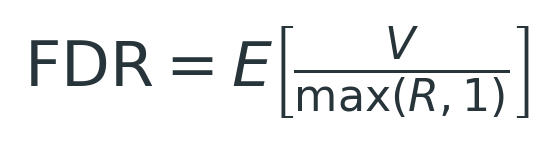

# P值调整后就是q值吗？——从多重检验到假发现率

> 明哥的微生物世界 · 统计课堂 36
>
> 摘要　多次检验时，为什么要调整P值？沿用三种疗法的两两比较，先分清整批误报风险与候选名单中的假发现比例，再用同一组三个P值说明Bonferroni与Holm怎样判断差异，最后解释研究文献中常见的q值写法。


大家好，我是明哥。

这节课讨论多组分类计数资料。例如，比较三种疗法的有效率，整体卡方检验之后，可能继续作三次两两比较。如果三次都各自用P＜0.05作判断，**这一批结论的误报风险还能控制在5%吗？**

比较多组平均浓度、平均体重时，也会遇到同样的问题。分类计数资料、连续计量资料产生P值的方法各有不同；多次作出判断时，都要考虑整批结论的误报风险。

[统计课堂19《三个组怎样两两比较？Bonferroni与Holm为什么结论不同？》](https://mp.weixin.qq.com/s/Ox3tXlD1XchvU6GSmtiuWg)已经介绍了两种调整方法。这次先分清“整批至少错一次”和“名单中错多少”两种控制目标，再看调整后的P值与q值有什么区别。

## 一、家族错误率：怎样保护整批结论？

沿用第19篇的课堂例题：某医师比较物理疗法、药物治疗和外用膏药治疗周围性面神经麻痹的疗效。三组是不同患者，每人只接受其中一种疗法，结局分为有效、无效。表1列出原题数据。

*表1｜三种疗法的有效、无效人数*

| 疗法 | 有效 | 无效 | 合计 | 有效率 |
| --- | ---: | ---: | ---: | ---: |
| A：物理疗法 | 199 | 7 | 206 | 96.60% |
| B：药物治疗 | 164 | 18 | 182 | 90.11% |
| C：外用膏药 | 118 | 26 | 144 | 81.94% |

整体卡方检验提示三组总体有效率不全相同，接下来要问：具体哪些疗法之间有差异？于是作物理与药物、物理与膏药、药物与膏药三次两两比较，每次检验的H₀都是“两种疗法的总体有效率相同”。

这三次检验共同回答“哪两种疗法不同”，组成一个“检验族”。**这里的m数的是两两比较的次数，本题m＝3。**

**一项检验按所采用的规则拒绝H₀，就记为一个“发现”；发现总数记为R。** 若三项比较中有两项拒绝H₀，则R＝2。

被拒绝的假设中，实际H₀成立的才是“假发现”，个数记为V。

**家族错误率（FWER），是这一批检验中至少出现一次假发现的概率。** 控制FWER为5%，就是把这个概率限制在5%以内。式（1）写出它所关注的错误事件。


*式（1）｜Pr表示概率，V≥1表示这一批检验至少误报一次。*

先看一个便于计算的情形：三个H₀都成立，三次检验相互独立，每次误报的概率恰为0.05。

从反面算，一次不误报的概率是0.95，三次都不误报的概率就是0.95³＝0.857375。剩下的，便是至少误报一次的概率：

**FWER＝1－0.95³＝0.142625≈14.26%。**

每次都按5%判断，三次合起来，至少误报一次的概率就到了约14.26%。

## 二、假发现率：怎样看入选名单中的错误？

三种疗法只需要作三次两两比较，基因研究的检验次数则可能多得多。例如，比较处理组与对照组的1000个基因，每个基因检验一次，一共就是1000次检验。每个基因对应一项“处理组与对照组没有表达差异”的H₀；每拒绝一项，就增加一个发现。

如果仍要求“1000次检验中至少误报一次的概率不超过5%”，每项检验的门槛往往会很严格。

例如，假设基因X确实有表达差异，本次检验得到P＝0.001。单独按0.05判断，它会被筛出；**如果整批规则把每项门槛收紧到0.00005，它就会落选，漏掉一个真实差异。**

按预先规定的统计标准筛出的基因，会进入“差异表达候选名单”，也就是下文说的“入选基因”。为了保留更多值得验证的候选，筛查时还可以把控制目标放在这份名单上：其中假发现所占比例有多大？

**假发现率（FDR），是筛出名单中假发现比例的平均水平。** 本例检验1000个基因，预先将FDR目标设为5%<sup>[1]</sup>。式（2）写出它的定义。



*式（2）｜E表示重复抽样取平均；R为发现总数，V为其中的假发现数。没有发现时，这一轮的比例按0计入。*

生信中的大规模候选筛查常采用这一目标，在控制假发现比例的同时，争取保留更多值得验证的信号。

## 三、Bonferroni、Holm与BH怎样调整P值？

### （一）Bonferroni：把调整P值统一与0.05比较

先回到三种疗法，按FWER不超过5%的目标分析。第19篇介绍的Bonferroni和Holm都用于控制FWER；只要各项原始P值有效，**即使检验之间存在依赖，也可使用**。这里的“有效”，指原始检验在零假设成立时，按其声明的水平控制误拒绝概率<sup>[2]</sup>。

第19篇对表1中的每一对疗法取出一个2×2表，采用带Yates连续性校正的卡方检验。按P值从小到大排列，得到：

- 物理与膏药（A与C）：原始P≈0.000009345。
- 物理与药物（A与B）：原始P≈0.016754307。
- 药物与膏药（B与C）：原始P≈0.047763774。

这里的“原始P值”，是指还没有作多重比较调整；计算时已采用连续性校正。

本题有三次两两比较。Bonferroni将每项门槛设为0.05/3≈0.0167，各项真实零假设的误报概率至多为0.05/3。至少误报一次的概率不超过各项误报概率之和，所以上限为3×(0.05/3)＝0.05。

判断某一项是否达到标准，原本是看P是否不超过0.05/3。将这个不等式的两边同时乘以3，就得到：

**P≤0.05/3，等价于3P≤0.05。**

为了让各项结果都能统一与0.05比较，本例把原始P值乘以3，得到Bonferroni调整P值。一般有m次检验时，就将原始P值乘以m；**乘积超过1时，将调整P值记为1。**

把m换成1000，单项门槛就是0.05/1000＝0.00005。第二节基因X遇到的严格门槛，来自同一套规则。

再看三种疗法中的物理与药物，原始P≈0.0167543：

- 用原始P值判断：0.0167543＞0.05/3，未达到标准。
- 用调整P值判断：0.0167543×3≈0.0502629＞0.05，也未达到标准。

**“门槛除以3”和“P值乘以3”，得到的是同一个判断。** 三项都这样计算，Bonferroni下只有物理与膏药达到0.05的标准。

### （二）Holm：为什么先严后宽？

Bonferroni让三项比较始终使用同一个门槛0.05/3。Holm也控制FWER，但它的门槛跟着“还剩几项没判断”来改变。

**第一关先用前面Bonferroni的共同门槛。** 我们希望三次比较中至少一次误报的概率不超过5%，于是先给每次判断设定5%/3（约1.67%）的误报概率上限。三个上限相加为5%，第一关就用0.05/3判断。

**再看为什么先检查最小P。** <u>如果最小P都大于0.05/3，其余两个更大的P也过不了这个共同门槛，Holm就在第一关停止</u>。

**最小P先通过0.05/3这一关，才看剩下两项中的较小P，用0.05/2判断；第二关也通过，才判断最后一项，用0.05。** 分母3、2、1，数的是每一关还没判断的项数。

把这三关用到疗法原例：

- 待判断3项，先看物理与膏药：P≈0.000009345，与0.05/3≈0.016667比较，通过。
- 第一关通过后，待判断2项，再看物理与药物：P≈0.016754307，与0.05/2＝0.025比较，通过。
- 前两关都通过后，待判断1项，最后看药物与膏药：P≈0.047763774，与0.05比较，也通过。

**某一步没有通过，这一项及后面的H₀都不再拒绝。** 本例三步都通过，所以Holm下三对都达到显著性标准。相同的三个原始P值，Bonferroni只保留了物理与膏药，Holm则保留了三对。

这样放宽门槛，仍然要把FWER控制在5%。关键是看**第一次误报发生的那一关**：在它之前，被拒绝的项都确实有差异，所有真正无差异的项还留在待判断的项中。

因此，这一关的“剩余项数”不会少于真正无差异项的总数。用0.05除以这个剩余项数，门槛就不会比只对那些无差异项作Bonferroni调整时更宽。前面的概率相加上界仍然适用，至少误报一次的概率仍不超过5%。

上面是在用三个原始P值，分别与三个门槛比较。报告时，我们也希望像Bonferroni那样，把Holm的各项结果统一与0.05比较。于是，第一步的P乘3，第二步乘2，第三步乘1，先得到三个乘积：**0.0000280、0.0335086、0.0477638**。

这三个乘积还要保留“前面的步骤都通过”这一条件。第二项能被拒绝，需要前两步都满足标准，所以要看前两个乘积中较大的那个；第三项则要看前三个乘积中的最大值。**每个位置取本项及此前所有乘积的最大值，这就是累计最大值。** 超过1时，调整P值记为1。

疗法原例的三个乘积已经逐步增大，取累计最大值后不变，正是各项的Holm调整P值。为了看清这一步的作用，再换一组便于手算的P值：A与B、A与C、B与C分别为0.020、0.023、0.040。

- 第一项：0.020×3＝0.060，调整P为0.060。
- 第二项：0.023×2＝0.046，但前两步要一起通过，所以调整P取max(0.060，0.046)＝0.060。
- 第三项：0.040×1＝0.040，前三步要一起通过，所以调整P取max(0.060，0.046，0.040)＝0.060。

第二项的乘积虽小于0.05，仍受第一步0.060的限制。这就是不能只看“原始P乘当前乘数”的原因。

R会完成这些累计处理，并把调整值放回原来的比较顺序。将这组三个原始P值传给`p.adjust()`，`method = "holm"`指定Holm方法：

```r
p_example <- c(
  AB = 0.020, AC = 0.023, BC = 0.040
)
p.adjust(p_example, method = "holm")
```

```text
  AB   AC   BC
0.06 0.06 0.06
```

三个调整值都是0.060，统一与0.05比较时都不拒绝。逐步检验虽然在第一关就停止，R仍给每项返回完整结果，因为前一步的限制已经包含在后续调整值中。

调整值也可以不同。例如，原始P值若为0.020、0.040、0.100，依次乘3、2、1得到0.060、0.080、0.100，已经逐步增大；取累计最大值后仍是这三个数。

### （三）BH：筛选很多基因时，怎样控制假发现率？

前面两种方法控制FWER；回到1000个基因，下面采用BH，按第二节预先设定的5% FDR目标形成候选名单。**BH是Benjamini–Hochberg的缩写。**

下面使用配套的1000个模拟P值：800项代表没有差异的基因，其P值在0到1之间均匀生成；200项代表有差异的基因，模拟时让它们更容易产生小P值。各项按相互独立的模型生成，输入保存在`screening_pvalues.csv`。已知真相标签用于模拟核对，**调整算法只读取P值。**

**先把完整的1000个P值从小到大排序。** 本例总检验数m＝1000，预先设定的FDR目标是0.05。BH给每个排序位置一个门槛：

- 第1位：1×0.05/1000＝0.00005。
- 第50位：50×0.05/1000＝0.0025。
- 第67位：67×0.05/1000＝0.00335。

也就是：**排在第几位，就把0.05乘以几，再除以总检验数1000。** 因此，排序位置越靠后，对应的门槛越大。

接下来，把每个P值与自己位置的门槛比较。**BH要检查全部位置，找到最后一个达标的位置；该位置及其前面的基因一起进入候选名单**<sup>[1]</sup>。

为了也统一与0.05比较，将每个原始P乘以“1000/排序位置”。以第67位为例：**P≤67×0.05/1000，等价于P×1000/67≤0.05。** 表2把原门槛和换算过程并排列出。

*表2｜完整1000项基因检验中，BH筛选边界附近的三个位置*

| 位置 | 原始P值 | 本位门槛 | 换算方法 | 换算值 | ≤0.05 |
| ---: | ---: | ---: | --- | ---: | :---: |
| 66 | 0.002928 | 0.003300 | P×1000/66 | 0.0444 | 是 |
| 67 | 0.002975 | 0.003350 | P×1000/67 | 0.0444 | 是 |
| 68 | 0.003775 | 0.003400 | P×1000/68 | 0.0555 | 否 |

完整计算中，第68至1000个位置均未达标，所以最后达标的是第67位，筛出前67个基因。

表2已经给出各位置的换算值。判断某个基因能否入选，还要查看它后面的排序位置：后面某个位置达标，它也会一起进入名单。因此，要**从当前位置及后面所有换算值中取最小值**，得到这个基因最终的BH调整P值；超过1时记为1。

例如，排序第60位的P≈0.00222255，按这个位置算，换算值约为0.0370425；第62位的换算值则约为0.0367829。若名单取到第62位，排序第60位的基因也包括在内。实际检查第60至1000位后，最小换算值就是0.0367829，所以这个基因的BH调整P值约为**0.03678**。

从最后一个位置向前累计取最小值，就能算出每项调整值。它们与0.05比较的结果，和前面按最后达标位置确定名单的结果一致。

BH在检验独立，或满足规定的正依赖条件（PRDS）时控制FDR。本篇1000个模拟P值采用独立模型。实际研究中，多个检验的结果可能相互关联，接下来再看一种对依赖形式限制更少的方法。

### （四）BY：为什么要在BH基础上再收紧？

BY是Benjamini–Yekutieli方法。在每项原始P值有效的前提下，它能在一般依赖结构下控制FDR。为此，BY在BH基础上加了一个由检验总数决定的校正因子。

本例有1000次检验，这个因子为：**1＋1/2＋1/3＋…＋1/1000≈7.4855**。这个和称为调和因子。原论文证明，用它收紧BH的门槛，可以在一般依赖结构下仍将FDR控制在预定水平<sup>[3]</sup>。

具体计算时，可以将BH的每个位置门槛再除以7.4855。报告调整P值时，则把**本例已经算出的BH调整P值再乘以7.4855，超过1时记为1**，得到BY调整P值，仍与0.05比较。

例如，表2第67位的BH调整P≈0.0444，原本小于0.05；按BY换算后约为0.332，大于0.05，这个基因就不再入选。目标仍是FDR不超过5%，BY以更严格的门槛，换取对更一般依赖结构的控制保证。

同一批1000个P值，BH筛出67项，BY筛出38项。下面用R把这几种方法放在一起计算。

### （五）R怎样计算这一批调整P值？

在R中，这四种方法都通过`p.adjust()`完成：输入完整P值向量，通过`method`选择方法，得到与原输入顺序一致的调整值。其中`"fdr"`是`"BH"`的别名<sup>[2]</sup>。

下面代码把四种调整结果保存在`adjusted`中，再统计每种方法下调整P≤0.05的项数。

```r
input_file <-
  "data/screening_pvalues.csv"
dat <- read.csv(input_file)
p <- dat$p

adjusted <- data.frame(
  id = dat$id,
  raw = p,
  Bonferroni = p.adjust(
    p, "bonferroni"
  ),
  Holm = p.adjust(p, "holm"),
  BH = p.adjust(p, "BH"),
  BY = p.adjust(p, "BY")
)
# 第3至6列是四种方法的调整P值。
# colSums()逐列统计调整P≤0.05的项数。
colSums(adjusted[3:6] <= 0.05)
```

实际运行结果为：

```text
Bonferroni       Holm         BH         BY
        23         23         67         38
```

输出中的数字都是对应方法的发现总数。例如，BH这一列的67，表示有67个基因的BH调整P≤0.05，与前面按排序门槛筛选得到的名单一致。

## 四、调整后的P值，就是q值吗？

**研究文献中常把BH调整P值称为q值，也会明确写成“BH q值”。** 这种叫法见于不同研究领域：Science发表的六国减贫干预研究用BH方法计算q值<sup>[4]</sup>。社会媒体与公共健康研究也直接报告“Benjamini–Hochberg q-value”<sup>[5]</sup>。

本文沿用这种常见写法，将代码中`adjusted$BH`保存的调整P值称为“BH调整P值（BH q值）”。

Bonferroni、Holm的结果仍按各自的调整P值命名。报告BH q值时，注明BH方法和预先设定的FDR目标。它与[第22篇Tukey检验中的学生化极差q统计量](https://mp.weixin.qq.com/s/VE3pGhSa0J2n_NQna0fhqA)是不同的量。

## 五、同一批数据，为什么会得到不同的发现数？

表3将前面R输出中的四种方法与未经调整的结果放在一起：均按原始P或调整P≤0.05计数，其中BH一行对应本篇的q值筛选。

*表3｜同一组1000项检验的筛选结果*

| 所用数值 | 方法关注的目标 | 发现数 |
| --- | --- | ---: |
| 原始P值 | 每项检验分别判断 | 149 |
| Bonferroni调整P值 | FWER | 23 |
| Holm调整P值 | FWER | 23 |
| BH调整P值 | FDR | 67 |
| BY调整P值 | 一般依赖结构下的FDR | 38 |

用模拟时保留的真相标签核对：本例200个真实有差异的基因中，Bonferroni与Holm各检出23个；BH检出64个真差异，另有3个假发现。**BH比Holm多筛出67－23＝44项，其中41项是真差异，3项是假发现。**

<u style="color:#0000F5;">这说明，在大量检验中严格控制FWER，可能漏掉更多真实差异。</u>选择控制目标时，要同时考虑误报与漏报的代价；报告结果时，也要注明方法和目标水平。

名单筛出之后，还要判断哪些差异值得继续验证。**应把效应量、置信区间与P值或q值一起解释；效应量较大但估计还不精确时，再结合研究目标判断是否需要更多样本**<sup>[6]</sup>。关于P值、效应量和区间的联合解读，见[第11篇《P＝0.06，该怎样解释？》](https://mp.weixin.qq.com/s/ZwcUQoyq5vk4dw5Nhv74Gw)。

## 六、本篇讲了哪些知识？

- **分类计数与连续计量资料都可能遇到多重检验。** 三组两两比较有3次检验；两组逐个比较1000个基因，也有1000次检验。检验次数由要回答的问题数决定。
- **FWER控制整批至少一次假发现的概率。** Bonferroni与Holm用于这一目标；Holm根据剩余检验数逐步放宽门槛，遇到未通过的一步就停止拒绝后面的假设。
- **FDR控制发现名单中假发现比例的平均水平。** BH用于检验独立或满足规定正依赖条件的情形，BY可用于一般依赖结构。
- **四种方法的调整值，都可与预设水平0.05比较。** Bonferroni把原始P乘以检验总数；Holm排序后乘以剩余检验数，再向前取累计最大值；BH排序后乘以“总检验数/排序位置”，再向后取累计最小值；BY把BH调整值再乘以调和因子。调整值超过1时记为1。
- **BH与BY的调整结果，应分别注明方法。** 本文把BH调整P值称为“BH q值”；R中`"fdr"`等同于`"BH"`，BY则要指定`method = "BY"`。报告时同时注明预设的FDR目标。
- **选择FWER还是FDR，要权衡误报与漏报。** 结合研究用途确定控制目标；严格控制整批误报风险时，也要考虑可能漏掉真实差异。

## 七、用自己熟悉的一种语言复算

这些步骤可以在配套项目中复算。三套主练习包含表1的疗法例题，并用同一份1000项P值比较Bonferroni、Holm、BH和BY。R使用`p.adjust()`，Python使用`statsmodels`，MATLAB调用配套自编函数。下载后先读README，再选择一种语言逐节运行`01_p_adjust`练习。

本篇配套项目目录：
https://github.com/fuyuming/statistics-classroom/tree/main/stats_classroom/article36_p_adjust_qvalue

系列仓库：
https://github.com/fuyuming/statistics-classroom

整个仓库ZIP下载：
https://github.com/fuyuming/statistics-classroom/archive/refs/heads/main.zip

下载仓库ZIP并解压后，项目位于`stats_classroom/article36_p_adjust_qvalue`。

这里是“明哥的微生物世界”，一起把统计问题读清楚、算明白。

## 参考文献与官方说明

[1] Benjamini Y, Hochberg Y. Controlling the false discovery rate: a practical and powerful approach to multiple testing. Journal of the Royal Statistical Society: Series B. 1995;57(1):289–300.
https://doi.org/10.1111/j.2517-6161.1995.tb02031.x

[2] R官方文档：p.adjust，调整方法及其控制目标。
https://search.r-project.org/R/refmans/stats/help/p.adjust.html

[3] Benjamini Y, Yekutieli D. The control of the false discovery rate in multiple testing under dependency. The Annals of Statistics. 2001;29(4):1165–1188.
https://doi.org/10.1214/aos/1013699998

[4] Banerjee A, Duflo E, Goldberg N, et al. A multifaceted program causes lasting progress for the very poor: Evidence from six countries. Science. 2015;348(6236):1260799. 正文与补充分析说明使用BH方法计算q值。
https://doi.org/10.1126/science.1260799

[5] Alajajian SE, Williams JR, Reagan AJ, et al. The Lexicocalorimeter: Gauging public health through caloric input and output on social media. PLoS One. 2017;12(2):e0168893. 方法与图7直接使用“Benjamini–Hochberg q-value”。
https://doi.org/10.1371/journal.pone.0168893

[6] 美国统计学会（ASA）：关于统计显著性与P值的声明，2016。
https://www.amstat.org/asa/files/pdfs/p-valuestatement.pdf
