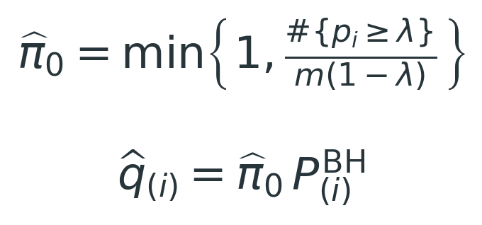
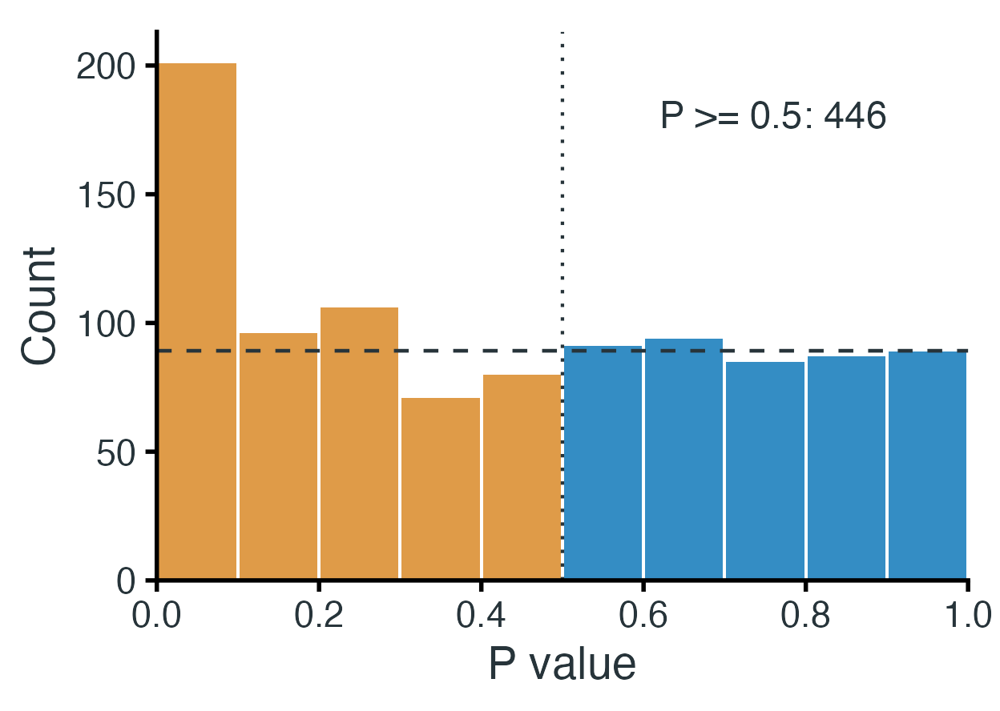

# Storey π₀ 估计：大 P 值怎样提供线索

本说明独立复述正文移出的 π₀ 计算。输入是项目 [`data/screening_pvalues.csv`](../data/screening_pvalues.csv) 中的 1000 个模拟 P 值：模拟设定有 800 个真实零假设、200 个备择假设。**800/1000＝0.8 是模拟时预先知道的真相，不是算法输入；算法只读取 P 值。**

## 从大 P 值估计真实零假设比例

零假设成立时，P 值理想地服从 Uniform(0,1)，因此预期约一半满足 P≥0.5；模拟中800项真实零假设预计贡献约400项。若观察到大于等于 0.5 的 P 值有 446 个，可先反推约有 446×2＝892 个真实零假设，再除以总数 1000，得到 π̂₀＝0.892。备择假设也可能产生大 P 值，所以这只是估计，不是把 0.8 直接交给算法。

本项目固定窗口 λ＝0.5，并按 qvalue 的计数规则计算：

$$\hat\pi_0(\lambda)=\min\left\{1,\frac{\#\{p_i\ge\lambda\}}{m(1-\lambda)}\right\}.$$

代入 m＝1000、λ＝0.5、计数 446：π̂₀＝min(1,446/(1000×0.5))＝0.892。对应的原公式图如下；在本补充中独立编号为**补充式1**。

*补充式1｜固定 λ＝0.5 时的 π̂₀ 估计；本项目使用 `pfdr = FALSE`。*

## 与 BH 调整值的关系

在固定 λ＝0.5 且 `pfdr = FALSE` 的指定设置下，本项目采用

$$\hat q_i=\hat\pi_0\,\hat p^{BH}_i,$$

即 q 值估计等于 π̂₀ 乘以 BH 调整 P 值（再按实现规则处理边界）。因此本例中缩放因子是 0.892。R入口为 [`scripts/02_storey_q.R`](../scripts/02_storey_q.R)；对应的 Python、MATLAB 入口分别是 [`scripts/02_storey_q.py`](../scripts/02_storey_q.py) 与 [`scripts/m02_storey_q.m`](../scripts/m02_storey_q.m)。

## P 值分布图

原图使用同一份 1000 个模拟 P 值：横轴为 P 值，竖向点线标出 λ＝0.5，右半部分统计 P≥0.5 的 446 项；横向虚线表示 π̂₀ 所对应的均匀零假设部分在每个宽度 0.1 区间中的预期个数。原图在本补充中独立编号为**补充图1**。

*补充图1｜图中数据的坐标明细见 [`配图/图01_P值分布与pi0_坐标.csv`](配图/图01_P值分布与pi0_坐标.csv)。*

## 来源

- 输入数据：本项目 [`data/screening_pvalues.csv`](../data/screening_pvalues.csv)。
- 计算入口：本项目 [`scripts/02_storey_q.R`](../scripts/02_storey_q.R) 及同目录的 Python、MATLAB 入口。
- 方法参考：[`qvalue` 官方页面](https://bioconductor.org/packages/qvalue/)。
