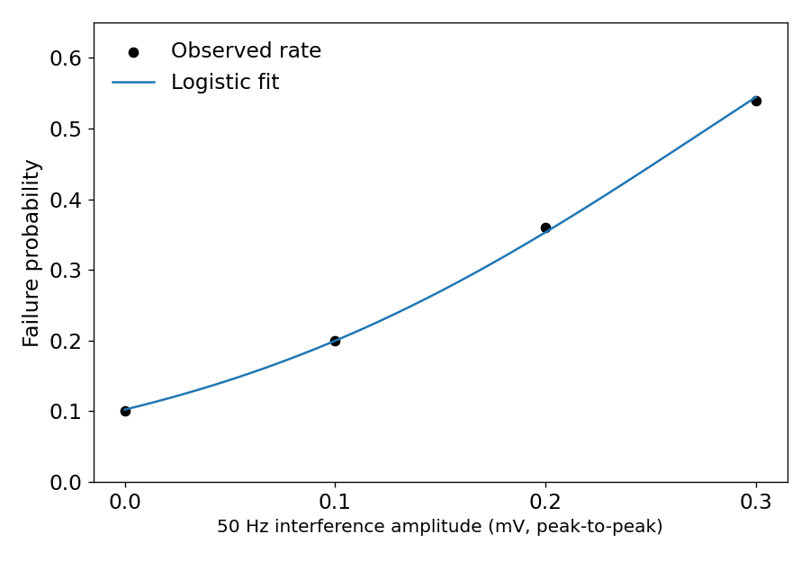
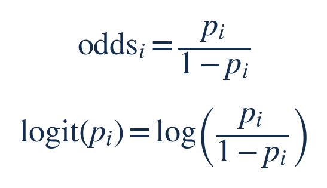
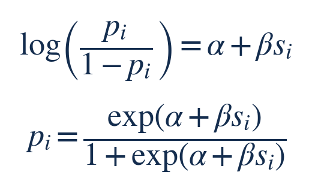
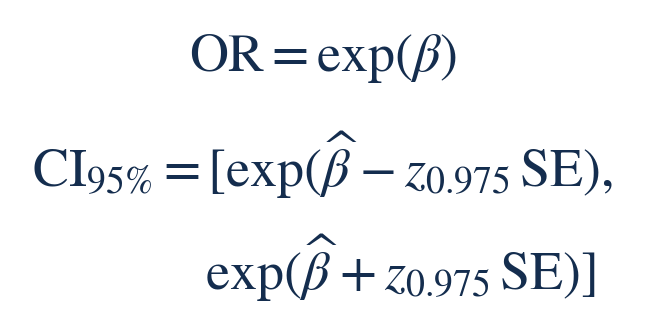
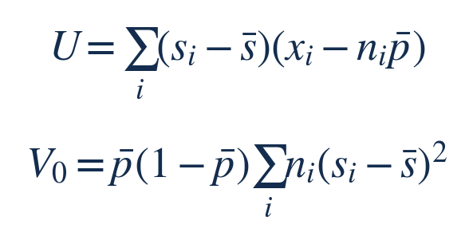
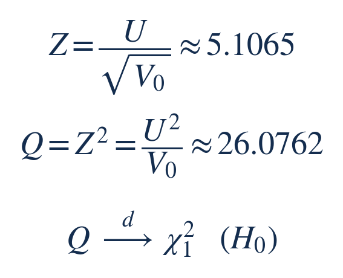

> 明哥的微生物世界 · 统计课堂 40

# 趋势检验为什么能写成Logistic回归？从一道例题认识模型与结果

> 摘要　干扰越强，心电检测算法的失败率会不会越高？本篇从一道完整假设题出发，先认识Logistic回归怎样描述失败概率，读懂系数、胜算比和预测结果，再用计数偏差和抽样波动说明趋势统计量的构造，看它怎样与模型检验对应。再对照近期真实研究，看看这类资料怎样用于实际分析。


大家好，我是明哥。

准备第11课“分类资料的检验、关联与一致性”时，我重新整理了心电干扰这道例题：每段记录最后只有“检测失败”或“检测成功”两种判定，干扰强度则分为从低到高的四组。我们关心的是，失败率会不会随着干扰增强而上升。

对这种“有序分组＋二分类结局”的资料，**趋势检验**先按组别顺序规定数值评分，再判断总体失败率是否沿评分呈上升或下降趋势。**Logistic回归**则建立一个描述二分类事件发生概率的数学关系；用数据估计其中的系数，就是拟合模型。拟合以后，可以估计不同评分下的失败概率，也能检验概率是否随评分变化<sup>[1]</sup>。

[统计课堂13《t检验，原来也是回归》](https://mp.weixin.qq.com/s/prfW3gQe7kXAUhqaisG6yw)从均数比较走到了模型系数。本篇换成失败或成功的结局，先看模型怎样用、结果怎样读，再回到趋势检验。

## 一、先把完整题目摆出来

假设有200名不同患者，每人各提供一段含100个已标注QRS波的心电记录。QRS波对应心室除极，是心电检测算法需要识别的波形之一。

将这些记录随机分为四组，每组50段，分别叠加峰峰值为0、0.1、0.2、0.3 mV的50 Hz干扰。同一段记录只接受一种干扰强度，固定算法处理所有记录；一段中漏检**超过5个QRS波**，就把这段记为“检测失败”；漏检不超过5个则记为“检测成功”。不同患者的记录相互独立。

这里每段记录只得到一次失败或成功判定。每段中的100个QRS波用于定义这个结局，因此分析单位是200段独立记录；计算各组失败率时，分母分别为50段。

四组评分在分析前规定为0、1、2、3，因此**一个评分单位对应0.1 mV**。表1列出这道假设题的数据，后面的计算都使用这张表。

*表1｜不同干扰强度下的检测结果*

| 评分 | 峰峰值/mV | 失败 | 成功 | 总段数 |
| ---: | ---: | ---: | ---: | ---: |
| 0 | 0.0 | 5 | 45 | 50 |
| 1 | 0.1 | 10 | 40 | 50 |
| 2 | 0.2 | 18 | 32 | 50 |
| 3 | 0.3 | 27 | 23 | 50 |

本题要回答四个问题：

1. 四组总体失败率是否沿预定评分呈趋势？
2. 拟合模型后，干扰每增加0.1 mV，失败概率及相应的变化幅度怎样解释？
3. 按评分构造的趋势检验，怎样与描述失败概率的Logistic模型对应？
4. 为什么趋势检验与Logistic回归软件默认输出的P值会不同？

检验采用双侧备择，检验水准为0.05；变化幅度的区间采用双侧95%置信水平。

围绕这四个问题，先把表1输入R。`data.frame()`把每组的评分、干扰强度、失败数和总数放在同一行；`n - failed`得到成功数，失败数除以总数得到样本失败率。

```r
d <- data.frame(
  score = 0:3,
  amplitude_mV = c(0, .1, .2, .3),
  failed = c(5, 10, 18, 27),
  n = rep(50, 4)
)
d$passed <- d$n - d$failed
d$observed_rate <- d$failed / d$n
d[, c("score", "failed", "passed", "observed_rate")]
```

实际得到的四组样本失败率依次为 **10%、20%、36%、54%**。接下来用模型描述这些样本率背后的总体失败概率。

## 二、先用模型算出四组失败概率

回到表1的四个观察率。Logistic回归要做的是，用评分建立一个估计失败概率的规则：输入0、1、2、3，返回各自的概率。我们先拟合模型，看看它实际给出什么结果。

### （一）告诉R：事件是什么，输入是什么

R的`glm()`可以拟合本题模型。`~ score`指定按数值评分建立关系；`data = d`指定使用表1的数据。把要分析的计数写成`cbind(failed, passed)`，第一列是失败事件数，第二列是成功数。

`binomial(link = "logit")`选择二项分布和logit连接。每段只有成功/失败两种判定，同组概率相同且记录独立时，一组失败总数可用二项分布描述。logit是将“失败概率÷成功概率”取自然对数的变换，下一节用本题逐步说明<sup>[1]</sup>。

拟合返回的对象保存在`fit`中；`coef()`读取系数，`summary()`提供标准误等结果。代码中的`ctrl`固定迭代精度，便于后面核对检验数值<sup>[2]</sup>。

```r
# fit保存按评分拟合的模型。
# epsilon和maxit控制迭代收敛精度与最大次数。
ctrl <- glm.control(epsilon = 1e-12, maxit = 100)
fit <- glm(
  cbind(failed, passed) ~ score, data = d,
  family = binomial(link = "logit"),
  control = ctrl
)
coef(fit)
coef(summary(fit))["score", ]
```

### （二）直接看四组预测概率

R的`predict()`可以完成这一步。`newdata = d`要求对表1四组预测，`type = "response"`要求返回概率；默认的`type = "link"`则返回logit。

```r
d$fitted_rate <- predict(
  fit, newdata = d, type = "response"
)
d[, c("amplitude_mV", "observed_rate", "fitted_rate")]
```

表2将预测概率与观察率并列。前者来自同一条模型关系，后者是各组失败数除以50。

*表2｜观察失败率与Logistic拟合失败概率*

| 峰峰值/mV | 观察率 | 拟合概率 |
| ---: | ---: | ---: |
| 0.0 | 10% | 10.24% |
| 0.1 | 20% | 19.98% |
| 0.2 | 36% | 35.33% |
| 0.3 | 54% | 54.45% |

图1把四组观察率和拟合概率画在一起，便于比较模型给出的概率变化与各组实际观察率。



*图1｜课堂假设数据，每组50段独立记录。点为观察率，实线为模型拟合概率；曲线只画在本题干扰范围内。*

图中的拟合概率约从10.24%升到54.45%。我们先看到了模型给出的结果，下面再解释它怎样把评分连到概率。

## 三、回头读模型：胜算、斜率与OR

刚才已经得到四组拟合概率。现在回头看，模型怎样用同一个评分关系描述这些概率，斜率又表示什么。

先约定两个符号：下标i表示四组中的某一组，s<sub>i</sub>是该组预定评分，p<sub>i</sub>是该组未知的总体失败概率。直接把概率写成评分的直线函数，延长后可能超出0到1；Logistic回归会先变换概率，再建立直线关系。

变换分两步。**失败胜算**是失败概率除以成功概率；对这个比值取自然对数，得到**logit，也叫对数胜算**。式（1）给出这两个量。



*式（1）｜pᵢ是失败概率，1−pᵢ是成功概率；log表示自然对数。*

例如，给定失败概率为0.20，成功概率就是0.80，失败胜算为0.20/0.80＝0.25，也就是失败与成功的可能性之比为1∶4；再取自然对数，logit约为−1.386。

概率介于0和1之间，logit则可以取任意实数。我们便可以在这个尺度上写直线：用截距α描述评分为0时的对数胜算，用斜率β描述评分每增加1时，对数胜算改变多少。式（2）同时写出这条直线，以及怎样将它还原为概率。



*式（2）｜sᵢ是评分；α是截距，β是评分斜率。exp(x)表示e的x次方，第二行把模型结果还原到0到1的概率尺度。*

本题的一个评分单位是0.1 mV。β为正，模型中的失败概率就随评分升高；β为负，失败概率就随评分降低。下面把刚才的系数输出与这些符号对应起来。

### （一）对照系数表读取斜率

先看`score`这一行：`Estimate`＝**0.783203**是斜率估计，`Std. Error`＝**0.161909**是它的标准误。`z value`＝4.837290是前两者之比，`Pr(>|z|)`≈1.316×10⁻⁶是对应的双侧P值；第五节再看它为什么与趋势检验不同。

截距估计α̂＝−2.170961，描述评分为0时的水平。截距行的P检验的是α＝0，也就是评分为0时的失败概率是否为0.5。本题问“是否随评分变化”，应读取`score`行。

### （二）把斜率换成胜算比

斜率0.783203的单位是“每增加1评分，对数胜算的变化量”。把它取指数，就得到每评分单位的**胜算比（odds ratio，OR）**。

我们还要说明这个估计有多精确。用斜率估计加减约1.96个标准误构造区间，再对两个端点取指数，就是本篇采用的双侧95% **Wald置信区间**。式（3）把这两步写在一起。



*式（3）｜β̂表示用数据得到的斜率估计；SE是其标准误；z₀.₉₇₅≈1.96是标准正态分布的97.5%分位点。区间使用大样本近似。*

```r
beta <- unname(coef(fit)["score"])
beta_se <- coef(summary(fit))["score", "Std. Error"]
# 双侧95%区间两端各留2.5%，所以取0.975分位点。
cutoff <- qnorm(.975)
OR <- exp(beta)
OR_CI <- exp(beta + c(-1, 1) * cutoff * beta_se)
c(OR = OR, low = OR_CI[1], high = OR_CI[2])
```

本次得到 **OR＝2.18847，双侧95% Wald置信区间［1.59339，3.00579］**。按本模型，在0到0.3 mV的分析范围内，干扰峰峰值每增加0.1 mV，失败胜算估计乘以约2.19。

这个2.19是胜算的倍数。表2的失败概率则由截距、斜率和评分一起代入式（2）得到。

从0到0.1 mV，拟合概率约从10.24%升到19.98%；从0.2到0.3 mV，则约从35.33%升到54.45%。两次都增加0.1 mV，概率增量却不同。**模型固定的是每步的胜算比，概率变化还取决于起点。** 概率的倍数应由相应预测概率相除，和OR分别解释。

## 四、再看趋势检验：这个上升相对抽样波动有多强？

四个观察率从10%升到54%，模型斜率也是正的。要作统计判断，还需要一个共同的参照：**假设四组总体失败概率相同，会怎样？**

在式（2）中，这个零假设H₀就是β＝0。斜率为0后，评分不再改变概率，只有截距决定共同水平。表1合计60段失败、200段记录，合并失败率为0.30；在共同率模型下，每组预期失败50×0.30＝15段。

### （一）把各组偏差按评分方向合起来

四组的“观察失败数−预期失败数”分别为−10、−5、3、12。低评分组比预期少失败，高评分组比预期多失败，两端都支持上升。

为了把这种方向合起来，先将评分减去平均评分1.5，得到−1.5、−0.5、0.5、1.5。再将这些评分权重与各组计数偏差相乘：15、2.5、1.5、18，加起来得到 **U＝37**。U为正，表示偏离方向为上升。

U本身的大小还受样本规模影响。我们需要估计它在共同率假设下会有多大波动。在独立、同概率的二项模型下，计数的方差为n p(1−p)；计数乘以某个权重，方差就乘权重的平方。四组独立，再把四项方差相加。

式（4）将这两步写成通式。x<sub>i</sub>是观察失败数，n<sub>i</sub>是各组总段数，p̄是合并失败率，s̄是按各组总数加权的平均评分；本题各组一样大，s̄＝1.5。V₀估计的是U在H₀下的方差。



*式（4）｜本题p̄＝0.30，s̄＝1.5。脚本中对应的列名是I_eff，这里按U在H₀下的方差估计使用。*

代入本题，V₀＝0.30×0.70×50×(2.25＋0.25＋0.25＋2.25)＝**52.5**。下面仍用表1计算：

```r
N <- sum(d$n)
p0 <- sum(d$failed) / N
score_mean <- sum(d$n * d$score) / N
t_score <- d$score - score_mean
U <- sum(t_score * (d$failed - d$n * p0))
I_eff <- p0 * (1 - p0) * sum(d$n * t_score^2)
c(U = U, I_eff = I_eff)
```

输出为`U = 37`、`I_eff = 52.5`。到这里，一个量描述沿评分的偏离，另一个量估计这种偏离的方差。

### （二）用标准差衡量偏离，再得到Q

先对方差V₀开平方，得到标准差，再用U相除，得到有方向的标准化统计量Z。Z平方就是双侧趋势统计量Q，式（5）给出本题结果。



*式（5）｜Z的正负保留趋势方向，Q衡量偏离强弱；P值取χ²₁分布的右尾，等价于对有方向的Z计算双侧正态尾部概率。*

本次 **Q＝26.0762，双侧P≈3.282×10⁻⁷**。在预定0.05水准下拒绝β＝0，再结合正Z，将趋势判断为上升。这里比较的是沿预定评分的整体趋势，没有逐对检验相邻组。

为什么是1个自由度？从共同率模型到式（2），只增加了一个评分斜率β；我们检验的就是这一个参数。

R的`prop.trend.test()`可以复算：`x`输入失败数，`n`输入各组总数，`score`输入分析前规定的评分。返回对象包含Q、自由度和P值<sup>[3]</sup>。

```r
trend <- prop.trend.test(
  x = d$failed, n = d$n,
  score = d$score
)
trend
```

实际输出为`X-squared = 26.076`、`df = 1`、`p-value = 3.282e-07`，与手算一致。

**在本题的独立二项模型、相同预定评分和未作连续性校正的设置下，这个Q也正是Logistic模型检验β＝0的得分统计量。** “得分检验”考察的是：从拟合好的共同率模型出发，沿斜率方向的偏离有多强。它也称Rao检验，下一节用软件直接核对。

Q的χ²₁参照是大样本近似。Rosner教材对此趋势检验给出N p̄(1−p̄)≥5的经验建议，本例为42；这需要结合独立记录、预先评分及二项模型一起判断，不能当作近似精度的保证<sup>[4]</sup>。

## 五、为什么软件默认P与趋势检验不同？

第三节`score`行的P约为1.316×10⁻⁶，和趋势检验的P不同。原因在于软件摘要默认用的是**Wald检验**：用斜率估计除以其标准误，本题0.783203/0.161909≈4.8373，再按标准正态计算双侧P<sup>[2]</sup>。

还可以比较两个模型对同一组数据的拟合。模型给这四组观察计数的联合概率称为似然；拟合寻找使它最大的参数。对最大似然取自然对数，得到最大对数似然。允许斜率自由变化后，这个值比共同率模型提高了多少，就是**似然比检验**要衡量的改善。

现在拟合共同率模型`null`：`~ 1`表示只保留截距，四组概率相同。它是`fit`取β＝0的特例，因此二者是嵌套模型。把它们交给`anova()`，设置`test = "Rao"`核对得分检验，设置`test = "LRT"`作似然比检验<sup>[5]</sup>。

```r
null <- glm(
  cbind(failed, passed) ~ 1, data = d,
  family = binomial(link = "logit"),
  control = ctrl
)
rao <- anova(null, fit, test = "Rao")
lrt <- anova(null, fit, test = "LRT")
# 读取第二行，即加入score相对于共同率模型的比较。
c(Q_Rao = rao$Rao[2], P_Rao = rao$`Pr(>Chi)`[2])
c(Q_LRT = lrt$Deviance[2], P_LRT = lrt$`Pr(>Chi)`[2])
# glm摘要的score行给出Wald z及其双侧P。
coef(summary(fit))["score", c("z value", "Pr(>|z|)")]
```

表3汇总同一H₀的三种结果。Rao的Q及P与第四节趋势检验相同，正好把两种写法接起来。

*表3｜同一数据、同一H₀：β＝0，三种检验的结果*

| 方法 | 统计量 | P值 |
| --- | ---: | ---: |
| 得分（Rao） | Q<sub>trend</sub>＝26.0762 | 3.282×10⁻⁷ |
| Wald | z＝4.8373 | 1.316×10⁻⁶ |
| 似然比 | Q<sub>LRT</sub>＝27.4439 | 1.617×10⁻⁷ |

表中的Q<sub>trend</sub>就是第四节的趋势Q；Q<sub>LRT</sub>是另一个似然比统计量。三者都问斜率是否为0，衡量偏离的方式各有侧重：得分检验从共同率模型出发，Wald看完整模型的斜率离0有多少个标准误，似然比则比较两个模型的最大对数似然。**同一个原假设，有限样本P值可以不同。**

R中还可以用`lmtest`包的`lrtest()`完成同一似然比比较，输入仍是同一数据上拟合的两个嵌套模型<sup>[6]</sup>。

```r
course_lrt <- lmtest::lrtest(null, fit)
course_lrt
```

本次输出中，两行`LogLik`分别为−21.715889和−7.993942；两者之差的2倍约为27.4439，对应`Chisq`列。`Pr(>Chisq)`给出P≈1.617×10⁻⁷，与`anova(..., test = "LRT")`一致。

本例三种检验都提供反对β＝0的有力证据。报告时要交代采用哪一种检验，同时写出变化幅度和区间。本题可以这样报告：

> 在这份课堂假设数据中，200名不同患者各提供一段心电记录，四个干扰水平各50段。按预定0–3评分进行未校正趋势检验，Q＝26.0762，df＝1，双侧P≈3.282×10⁻⁷，支持失败率沿评分上升的趋势。二项Logistic模型估计，干扰峰峰值每增加0.1 mV，失败胜算比为2.188，双侧95% Wald置信区间为［1.593，3.006］。

## 六、回头看：这为什么是二项GLM？

现在已经看过拟合、预测和检验，再把我们做的选择放在一起。

**广义线性模型（generalized linear model，GLM）是一类描述响应均值怎样随输入变化的回归模型。** 响应变量就是要解释的结果；本题是已知各组总数下的失败计数，成功数由总数减失败数得到。一个GLM包括三个部分<sup>[1]</sup>：

- **响应分布**：给定评分后，失败数怎样波动。本题是独立二项计数，每组总数已知。
- **线性预测子**：把输入与系数组合起来，本题是α＋βs。
- **连接函数**：把响应的均值与线性预测子连起来。本题将计数均值除以总数，得到失败概率p，再用logit连接到α＋βs。

回看`family = binomial(link = "logit")`，分布和连接都写在里面。第13篇的正态线性模型使用正态条件分布和恒等连接，即直接对均值写线性关系；本题选择二项分布和logit连接。分布决定均数—方差关系，连接函数决定均值怎样接到线性预测子。

模型还需要检查。研究设计支持记录独立，观察率与曲线的比较帮助我们看拟合形态；实际应用中，还要判断logit随评分呈直线的设定是否合适。斜率检验回答β是否为0，不能代替对模型设定的检查。

## 七、真实研究怎样使用有序分组与二分类结局？

前面用课堂假设题走过了拟合、解释与检验，下面看同类资料在真实研究中怎样使用。

**儿童肥胖：程度越重，代谢异常比例是否越高？** Luo等的研究于2026年11月19日发表，目标是考察儿童肥胖分级与代谢异常的关系。研究纳入326名6–18岁肥胖儿童，只取首次诊断就诊的资料，依据论文采用的体重指数（BMI）标准，按肥胖程度分为1、2、3级。主要结局是有无“至少两项代谢异常”，即胰岛素抵抗、高尿酸血症、丙氨酸氨基转移酶升高三项中的至少两项同时存在。这里，**肥胖级别是有序组，有至少两项异常是事件**<sup>[7]</sup>。

三组的事件比例依次为49.7%、63.8%、75.8%，作者使用趋势检验考察变化。针对这一主要结局，作者直接拟合Logistic模型：将2、3级合为重度肥胖组，与1级比较，分别拟合仅含该分组的模型，以及同时纳入年龄、性别的模型。因此，这项研究的回归比较是“重度组对1级”，与前面三级趋势检验的分组方式有所不同<sup>[7]</sup>。

[论文原文：Luo等，2026](https://doi.org/10.3389/fped.2026.1974497)

这项研究与表1都可以整理成“有序组×事件/非事件”的计数表；回归怎样分组、怎样比较，要由研究问题确定。结合这道假设题和真实应用，我们可以归纳出下面几个要点。

## 八、本篇讲了哪些知识？

- **Logistic回归描述二分类事件的发生概率。** 截距和评分斜率先决定对数胜算，再还原为概率。
- **每0.1 mV的OR约为2.19。** 它表示失败胜算的倍数；各组概率由截距、斜率和评分一起决定。
- **趋势Q把有方向的偏离与其抽样波动相比较。** 本题U＝37、方差估计V₀＝52.5，Q＝U²/V₀。
- **本题趋势检验对应Logistic斜率为0的得分检验。** 相同评分、二项方差与校正设置下，统计量构造一致；P值仍依赖大样本近似。
- **得分、Wald和似然比都能检验β＝0。** 报告时同时交代检验方法、效应估计及区间，GLM的分布和连接选择也要回到具体问题。

## 九、从这道题到下学期《高级生态学》

这道心电题所用的建模思路，也适用于生态研究：先看观测单位和响应是什么，再选择分布、连接函数与预测变量。响应类型和数据的分组结构改变时，模型也要作相应调整。

下学期，我将和胡老师共同开设《高级生态学》，本科生和研究生都可以选修。**我负责的部分，主要讲怎样根据研究问题和数据特点选择统计模型、检查模型，并解释结果。** 在本篇二项GLM的基础上，我们还会进一步学习泊松与负二项模型、混合模型以及贝叶斯建模。

这些内容会沿着“数据与问题—模型—检查—解释”这条线展开。表4列出这部分教学中与本篇能够接上的几类工具。

*表4｜《高级生态学》统计模型部分与本篇衔接的R工具*

| 包与函数 | 主要用途 |
| --- | --- |
| `stats`<br>`glm()`、`predict()` | 拟合GLM，将模型结果还原为概率等响应尺度。 |
| `lmtest`<br>`lrtest()` | 比较同一数据上的嵌套模型，解释增加参数带来的拟合改善。 |
| `performance`<br>`check_model()`<br>`DHARMa`<br>`simulateResiduals()` | 结合模型类型查看诊断图、用模拟残差检查模型设定<sup>[8]</sup>。 |
| `sjPlot`<br>`tab_model()` | 将模型估计和区间等结果整理成报告表格<sup>[9]</sup>。 |
| `lme4`<br>`glmer()`<br>`glmmTMB`<br>`glmmTMB()` | 在存在样地、实验缸等分组结构时，进一步学习带随机效应的广义线性混合模型<sup>[10]</sup>。 |
| `brms`<br>`brm()` | 进一步学习以先验和似然进行贝叶斯建模<sup>[10]</sup>。 |

这些工具各有分工。本文实际使用的是基础GLM、概率预测和似然比比较；诊断、随机效应和贝叶斯模型会在后续学习中进一步展开。

欢迎大家来选修《高级生态学》，和我们一起学习高级统计模型，把分布、公式和函数与具体的科学问题连起来。

## 十、配套练习与延伸阅读

和前面的统计课堂一样，这次也准备了R、Python和MATLAB三套脚本，用自己熟悉的一种跑通即可。先按表1拟合模型，核对OR、区间与图1的预测结果，再计算U、方差和趋势Q，比较三种检验。

R用自带的`glm()`拟合，用`prop.trend.test()`与`anova(..., test = "Rao")`核对得分检验，再用`lmtest::lrtest()`复现同一似然比比较；Python用`statsmodels.GLM`，MATLAB用`glmfit()`拟合同一二项模型。后两套脚本的得分统计量直接按式（4）和式（5）计算，Wald、似然比及预测由拟合结果得到。

第一遍从01.1到01.5顺序运行：准备数据→拟合与OR→预测和图→趋势及三检验→汇总与保存。第二遍练习，把脚本开头的`mV_per_score`从0.1改为1，再从数据准备节顺序运行。这个参数表示模型中一个评分单位对应多少mV；改为1后，评分就是以mV计的干扰峰峰值。拟合概率和检验P应保持一致，斜率与OR的单位变为“每增加1 mV”。脚本还会将OR换算回“每增加0.1 mV”，便于核对原结果。这样能把单位变化与数据证据区分开。

本篇完整项目：https://github.com/fuyuming/statistics-classroom/tree/main/stats_classroom/article40_trend_logistic

系列仓库入口：https://github.com/fuyuming/statistics-classroom

完整仓库ZIP下载：https://github.com/fuyuming/statistics-classroom/archive/refs/heads/main.zip

本地学生练习包解压后，进入`article40_trend_logistic/`，先读README，再打开R项目、Spyder文件夹项目或MATLAB对应脚本，从数据准备节顺序运行。完整仓库解压进入`stats_classroom/article40_trend_logistic/`即可找到同一套材料。

延伸阅读：[统计课堂13](https://mp.weixin.qq.com/s/prfW3gQe7kXAUhqaisG6yw)回看均数比较与模型参数的对应；[统计课堂35](https://mp.weixin.qq.com/s?__biz=MzkxODE4ODY2OA==&mid=2247484411&idx=1&sn=bae476cc01e8402397401c0b2ac30859)回看为什么检验结果要连同效应估计和置信区间一起报告。

这里是“明哥的微生物世界”，一起把统计问题读清楚、算明白。

## 参考文献与官方说明

1. R stats：`family()`、`glm()`，二项响应、连接函数与拟合。https://stat.ethz.ch/R-manual/R-devel/library/stats/html/family.html ；https://stat.ethz.ch/R-manual/R-devel/library/stats/html/glm.html ；SAS/STAT：Generalized Linear Models，GLM三个组成部分。https://support.sas.com/documentation/cdl/en/statug/65328/HTML/default/statug_intromod_sect011.htm
2. R stats：`summary.glm()`，系数、标准误、z比与双侧P。https://stat.ethz.ch/R-manual/R-devel/library/stats/html/summary.glm.html
3. R stats：`prop.trend.test()`，有序组率趋势检验与log odds局部备择。https://stat.ethz.ch/R-manual/R-devel/library/stats/html/prop.trend.test.html
4. Rosner B. Fundamentals of Biostatistics. 8th ed. Cengage Learning, 2016. §10.6，p419，式10.20：二项比例的趋势统计量、双侧P与近似使用建议。
5. R stats：`anova.glm()`，同一数据的嵌套模型比较、Rao有效得分与似然比检验。https://stat.ethz.ch/R-manual/R-devel/library/stats/html/anova.glm.html
6. lmtest：`lrtest()`，嵌套模型的渐近似然比检验。https://cran.r-project.org/web/packages/lmtest/refman/lmtest.html#lrtest
7. Luo Y, Liu Y, Su D, Liao M, Hong L. Association of AAP/CDC %BMIp95 obesity severity grades with metabolic abnormalities in Chinese children with obesity attending a tertiary pediatric outpatient clinic: a retrospective cross-sectional study. Front Pediatr. 2026;14:1974497. https://doi.org/10.3389/fped.2026.1974497
8. performance：`check_model()`。https://easystats.github.io/performance/reference/check_model.html ；DHARMa：模拟残差与模型诊断。https://cran.r-project.org/web/packages/DHARMa/vignettes/DHARMa.html
9. sjPlot：`tab_model()`，模型结果HTML表。https://strengejacke.github.io/sjPlot/reference/tab_model.html
10. lme4：`glmer()`。https://lme4.github.io/lme4/reference/glmer.html ；glmmTMB：`glmmTMB()`。https://glmmTMB.github.io/glmmTMB/reference/glmmTMB.html ；brms：`brm()`。https://paulbuerkner.com/brms/reference/brm.html
