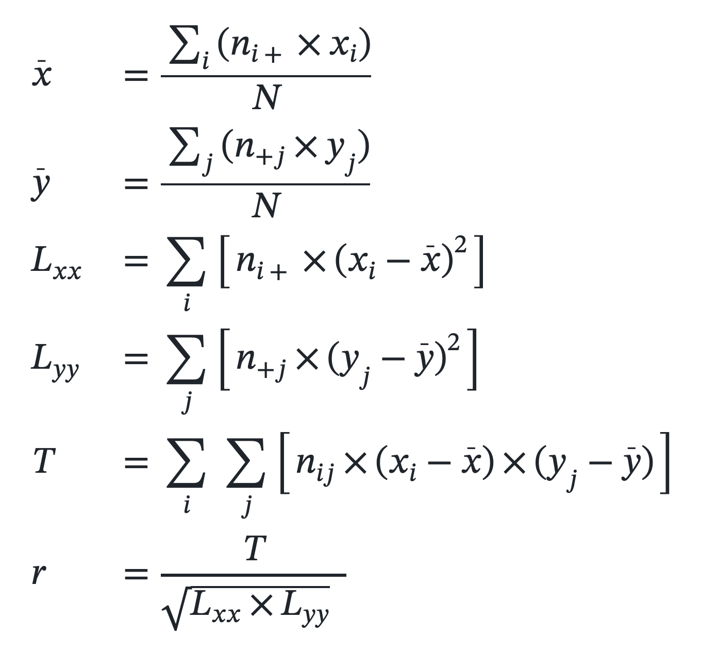
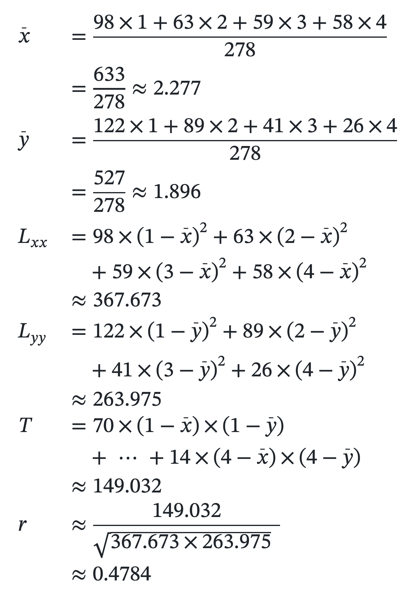
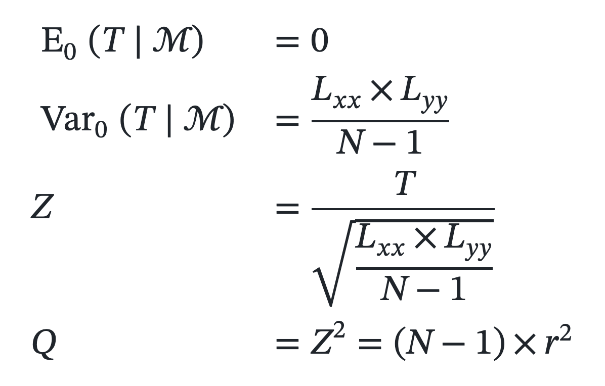
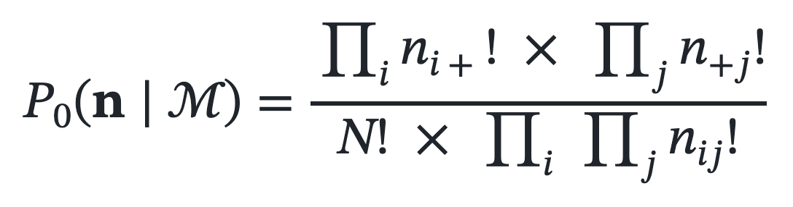
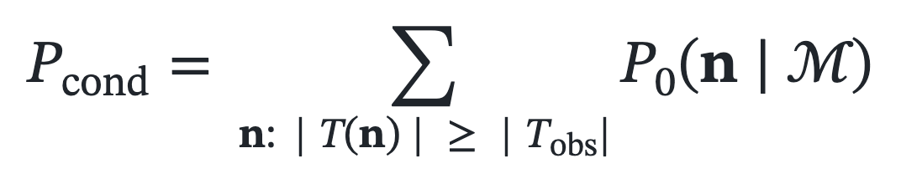
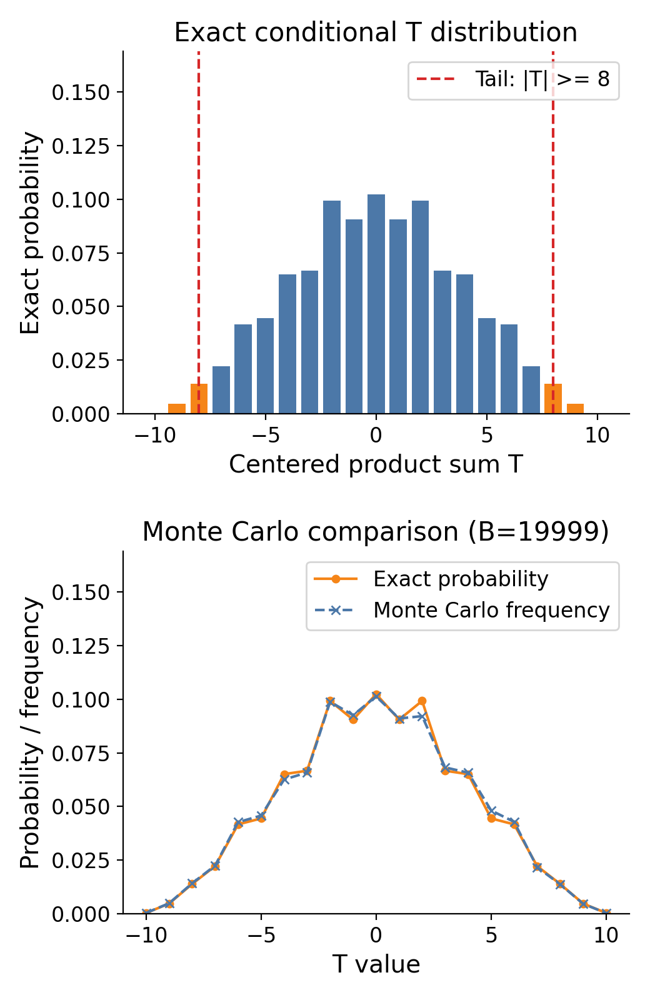
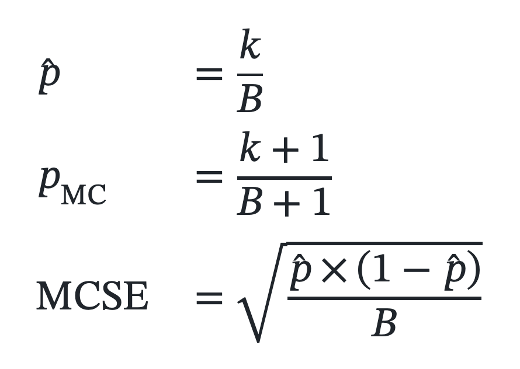
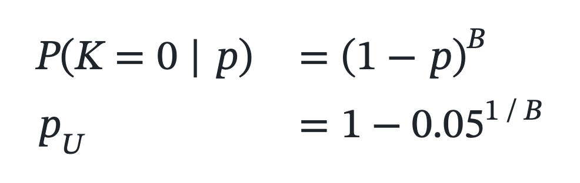

明哥的微生物世界 · 统计课堂 41

# 双向有序表怎样做条件模拟？从线性关联统计量到Monte Carlo P值

> 摘要　两个变量都有等级时，怎样模拟“没有关联”的情形？从278例尸解资料出发，说明固定行列合计保留了什么、评分的线性关联怎样衡量，再用可完整枚举的8例假设资料，看清同边际表为什么不等概率，以及Monte Carlo P值能算到多精细。最后对照两项真实研究，看这类资料怎样服务于具体研究目标。


大家好，我是明哥。

准备第11课内容时，我们遇到了一张两边都有等级的表：一边是年龄组，一边是冠状动脉粥样硬化等级。课件先计算评分之间的相关，再给出固定行列合计的条件模拟（Monte Carlo）入口。

这张表带来几个问题：**行列合计固定以后，还能随机改变什么？怎样才算比原表更极端？随机抽到的表，又该按什么概率出现？**

[统计课堂20《R怎样模拟卡方检验的P值？》](https://mp.weixin.qq.com/s/U58fgYZ5BXBh1HWiLU2F9g)介绍过列联表模拟，[统计课堂26《非参数重抽样与蒙特卡洛：Bootstrap与Permutation在模拟什么？》](https://mp.weixin.qq.com/s/f7fo2FN6OJKqEPwNLbNqdA)解释过重抽样的基本思路。这次把条件模拟落到一个更具体的问题：用预先确定的等级评分，检验两个有序变量的线性关联。

## 一、先读原题：278例资料在问什么？

颜艳、王彤《医学统计学》第5版例7-9，将278例尸解资料按年龄组与冠状动脉粥样硬化等级整理。原题问：年龄与硬化等级之间是否存在线性变化趋势？表1保留教材表7-11的数据，频数单位为例<sup>[1]</sup>。

*表1｜年龄组（岁）与冠状动脉粥样硬化等级*

| 年龄组 | − | + | ++ | +++ | 合计 |
| --- | ---: | ---: | ---: | ---: | ---: |
| 20～ | 70 | 22 | 4 | 2 | 98 |
| 30～ | 27 | 24 | 9 | 3 | 63 |
| 40～ | 16 | 23 | 13 | 7 | 59 |
| ≥50 | 9 | 20 | 15 | 14 | 58 |
| 合计 | 122 | 89 | 41 | 26 | 278 |

每例提供两个不同变量的记录；本题假定不同个体相互独立。年龄组从低到高赋分1、2、3、4，硬化等级从−到+++也赋分1、2、3、4。年龄评分的单位是分，表示组别从低到高的顺序。

本篇沿用这些预先给定的评分，作双侧检验，检验水准$\alpha=0.05$。我们依次回答：观察到的线性关联有多大？在两个变量独立的零假设$H_0$下，这么强或更强的关联有多罕见？如果用模拟计算，结果有多大计算误差？

**本文把年龄组与硬化等级独立作为条件模拟的$H_0$，双侧关注预定评分的线性关联。** 教材原题以“无线性关系”表述$H_0$；这里采用更强的独立性假设，作为打乱标签的依据。

## 二、先用评分把关联方向算出来

第$i$个年龄组的评分记为$x_i$，第$j$个硬化等级的评分记为$y_j$；$n_{ij}$是对应格的例数，$n_{i+}$、$n_{+j}$分别是行合计、列合计，$N$是总例数。本题$i$、$j$均从1到4。

把每例的两项评分各减去平均评分，两项偏差同号时，乘积为正；异号时，乘积为负。$T$把这些乘积按人数加总，衡量评分的共同变化。式（1）列出计算所需各量，并用$r$将$T$标准化。



*式（1）｜$\bar{x}$、$\bar{y}$为加权评分均值；$L_{xx}$、$L_{yy}$为各人的评分偏差平方总和；$T$为两项评分偏差的积和。后三者以分<sup>2</sup>计，$r$无量纲；$\times$表示相乘。*

平方和记录各项评分自身的分散程度，$r$用它们消除$T$的尺度影响。

式（1a）用表1的数据演示式（1）的计算：先按行、列合计算出两项评分均值，再计算各自的偏差平方和。$T$则逐格计算“例数×年龄评分偏差×硬化评分偏差”，把16格贡献加在一起，最后求$r$。



*式（1a）｜均值以分计，$L_{xx}$、$L_{yy}$、$T$以分<sup>2</sup>计，$r$无量纲。均值用未舍入值参与计算；$T$行的省略号代表中间14格，实际求和包含全部16格。*

例如，第一格70例的两项评分都是1，代入后对$T$的贡献约为80.064分<sup>2</sup>。汇总全部16格得到$T\approx149.032$分<sup>2</sup>，再除以两项平方和乘积的平方根，得到$r\approx0.4784$。正号说明这份资料中，两项评分同向偏离的贡献占优势，表现为年龄评分较高时，硬化评分整体也较高。在$H_0$下，这样的关联有多罕见？

## 三、固定边际：保留标签，打乱对应

固定行列合计，意味着每轮都保留原有的两组评分：

- 年龄评分1、2、3、4分别出现98、63、59、58次；
- 硬化评分1、2、3、4分别出现122、89、41、26次。

把年龄评分放在左列，保持原位；将右列的硬化评分随机打乱，再重新配对、交叉计数，就得到一张新表。**两项评分各自的分布不变，改变的是谁与谁配在一起。**

这就是[统计课堂26](https://mp.weixin.qq.com/s/f7fo2FN6OJKqEPwNLbNqdA)讲过的置换检验：前文重排组别与结局，计算两组率差；本题重排两项评分的对应，计算$T$。在本文独立同分布模型及独立性$H_0$下，给定两组标签，各个体的标签对应可交换，允许排列等概率；重排所得$T$及其概率，就是这里的条件零分布。coin包也以条件置换组织检验<sup>[2]</sup>。

这里的“固定”，是在计算中对已经观察到的边际取条件。家庭、病区等聚集或分层资料，需要按设计限制允许的排列。

## 四、怎样才算“更极端”？

固定边际后，评分均值及$L_{xx}$、$L_{yy}$都固定，只有$T$随配对改变。本篇作双侧检验：**模拟表的$|T|$达到或超过观察值，就计入尾部，包含相等。** 正向、反向同样强的关联都算。

式（2）把$T$换成常见的标准化统计量。下标0表示按$H_0$计算，$\mathcal{M}$代表给定的行列合计，$\operatorname{E}_0$、$\operatorname{Var}_0$分别表示条件均值、方差。



*式（2）｜$L_{xx}$、$L_{yy}$均非零。条件方差以分<sup>4</sup>计；标准差以分<sup>2</sup>计；$Z$、$Q$无量纲。*

随机配对时，两项评分没有系统的同向或反向对应，所以$T$的条件均值为0。条件标准差衡量这种重排带来的波动；用观察到的$T$除以它，得到偏离零中心多少个标准差，即$Z$。再平方，正、负方向就合到同一个$Q$上。

因此，按$|T|$、$|r|$或$Q=(N-1)\times r^2$选尾部，得到的是同一批表。这里的条件方差是精确关系；把$Q$参照$\chi^2_1$计算P值，则是大样本近似。

DescTools的`MHChisqTest()`采用这一MH口径：输入频数表，`srow`、`scol`指定行列评分，返回$Q$、自由度和渐近P值<sup>[3]</sup>。第35篇把Pearson χ²也记为$Q$，汇总各格对独立模型的偏离；这里的$Q$专门衡量预定评分的线性关联。表1得到$Q\approx63.3895$、自由度1，近似$P\approx1.6962\times10^{-15}$。教材采用$N\times r^2$并有提前舍入，数值略异；在同一固定边际下只差常数倍，不改变尾部排序。

## 五、同边际的表，为什么不等概率？

为了看全这个分布，假设另有8例尸解资料，每例记录年龄组和冠状动脉粥样硬化等级，不同个体相互独立。年龄仍分20～、30～、40～、≥50岁，硬化等级仍为−、+、++、+++；两边均按顺序事先评分1到4。表2列出全部假设计数，各年龄组及各硬化等级都各有2例。

本例要回答：评分关联有多大？在两变量独立的$H_0$下，固定边际的双侧精确P值是多少？用19999次模拟估计时有多准？检验水准仍为$\alpha=0.05$。

*表2｜8例假设尸解资料的年龄组与硬化等级，行名括号内为年龄评分；列评分依次为1、2、3、4*

| 年龄组（岁） | − | + | ++ | +++ | 合计 |
| --- | ---: | ---: | ---: | ---: | ---: |
| 20～（1） | 2 | 0 | 0 | 0 | 2 |
| 30～（2） | 0 | 1 | 1 | 0 | 2 |
| 40～（3） | 0 | 1 | 0 | 1 | 2 |
| ≥50（4） | 0 | 0 | 1 | 1 | 2 |
| 合计 | 2 | 2 | 2 | 2 | 8 |

表2算得$T=8$分<sup>2</sup>、$r=0.8$、$Q=4.48$。

现在固定左列的1、1、2、2、3、3、4、4，排列右列同样的标签。因为每个评分重复两次，不同右列序列共有$8!/(2!)^4=2520$种，在$H_0$下等概率。

形成表2时，第一行只能排“1、1”；其余三行各有两种安排，所以共有$1\times2\times2\times2=8$个序列汇成这张表，概率为$8/2520=1/315$。换成只有四个对角格各为2、其余格为0的表，则只对应1个序列，概率为$1/2520$。

**等概率的是标签排列；汇成同一张表的排列数不同，表的概率就不同。** 式（3）给出一般的计数结果：它把能汇成指定表的序列数，除以全部允许序列数。



*式（3）｜$\mathbf{n}$代表整张表；!表示阶乘，$0!=1$；$\prod$表示连乘。行列合计固定后，各格$n_{ij}$不同，表概率通常也不同。*

## 六、精确P值：选出尾部，再加概率

配套枚举程序列出满足表2边际的全部282张表，逐表计算$T$和式（3）的概率。式（4）定义本篇精确条件P值：把$|T|$不小于观察值的表选出来，加上它们各自的条件概率。



*式（4）｜$T_{\mathrm{obs}}$是观察表的$T$；本例为8，故尾部包括$T\le-8$及$T\ge8$。*

其中20张表落入尾部。把这20张表的条件概率相加，得到精确$P=4/105\approx0.0380952$。**$20/282$是表的张数比例，本题P值是这20张表的合计概率。**

图1上半部分把每张表的概率按$T$合并，橙色柱就是双侧尾部；下半部分将稍后的模拟频率与精确分布比较。



*图1｜给定表2边际及1到4评分；横轴为$T$（分<sup>2</sup>）。上图纵轴为精确概率，橙色包含$\pm8$尾部；下图比较精确概率与R模拟频率，$B=19999$、种子20261122。*

精确P值小于0.05，因此拒绝本例独立性$H_0$；$r=0.8$说明观察到正向评分关联。若用$Q=4.48$的$\chi^2_1$近似，得到$P\approx0.0342937$，判断相同，计算依据不同。

R的`fisher.test()`双侧检验选择表概率不大于观察表概率的那些表<sup>[4]</sup>。本篇按评分统计量$|T|$选尾部。同一个条件表分布，可以因关注的统计量不同而得到不同P值。

## 七、Monte Carlo：抽表，计算落入尾部的比例

大表往往难以完整枚举。Monte Carlo就从式（3）的条件分布独立抽表，用进入尾部的频率估计式（4）。

R的`r2dtable()`使用Patefield算法，依次输入抽表次数、行合计、列合计，返回随机表列表<sup>[5]</sup>。下面的自编`score_T()`接收按评分1到4排列的4×4表，返回$T$；`outer()`生成评分偏差乘积，逐格乘人数后求和。先取出第一张模拟表，`addmargins()`补上行列合计，再看这一轮的$T$。

```r
# 依行录入表2；byrow=TRUE表示每4个数填一行。
small <- matrix(c(
  2, 0, 0, 0,
  0, 1, 1, 0,
  0, 1, 0, 1,
  0, 0, 1, 1
), nrow = 4, byrow = TRUE)
scores <- 1:4

# 自编函数，返回一张表的中心化评分积和。
score_T <- function(tab) {
  N <- sum(tab)
  mean_x <- sum(rowSums(tab) * scores) / N
  mean_y <- sum(colSums(tab) * scores) / N
  weights <- outer(scores - mean_x, scores - mean_y)
  sum(tab * weights)
}

T_obs <- score_T(small)  # 观察表的中心化评分积和T＝8。
B <- 19999L
set.seed(20261122)
sim_tables <- stats::r2dtable(
  B, rowSums(small), colSums(small)
)
# 取同一批模拟的第一张；行列名是评分，Sum表示合计。
first_table <- sim_tables[[1]]
dimnames(first_table) <- list(scores, scores)
addmargins(first_table)
score_T(first_table)

# vapply逐表调用函数，结果是一列长度B的T值。
T_sim <- vapply(sim_tables, score_T, numeric(1))
# abs取绝对值；>=将端点也纳入双侧尾部。
k <- sum(abs(T_sim) >= abs(T_obs))
c(T_obs = T_obs, B = B, extreme = k)
```

第一轮及整批模拟的实际输出为：

```text
    1 2 3 4 Sum
1   1 0 0 1   2
2   0 0 2 0   2
3   0 1 0 1   2
4   1 1 0 0   2
Sum 2 2 2 2   8
[1] -3

  T_obs       B extreme
      8   19999     765
```

格内人数变了，行列合计仍各为2。这一轮$T=-3$，没有达到$|T_{\mathrm{obs}}|=8$；19999轮中共有765轮进入尾部。式（5）把这些次数转换为尾概率估计和计算精度。



*式（5）｜$\hat{p}$估计固定观察表的条件尾概率；$p_{\mathrm{MC}}$是本文采用的加一Monte Carlo检验P值；MCSE为估计模拟标准误。*

第26篇展示的模拟命中比例，对应这里的$\hat{p}=k/B$。加一P值把原观察结果也计入比较，因此分子、分母都加1；在$H_0$下可交换的构造中，它给出有效的Monte Carlo检验，并列值可能使检验保守<sup>[6]</sup>。

MCSE衡量更换模拟随机数后，$\hat{p}$会有多大计算波动。再用`binom.test()`的Clopper–Pearson区间表示尾概率的估计精度<sup>[7]</sup>。`conf.int`读取其下限和上限。

```r
p_hat <- k / B
p_MC <- (k + 1) / (B + 1)
MCSE <- sqrt(p_hat * (1 - p_hat) / B)
mc_interval <- stats::binom.test(
  k, B, conf.level = 0.95
)$conf.int
c(p_hat = p_hat, p_MC = p_MC, MCSE = MCSE)
mc_interval
```

实际得到$\hat{p}\approx0.0382519$、$p_{\mathrm{MC}}=0.0383$、$\mathrm{MCSE}\approx0.00136$，95%二项区间约为$[0.03564,\,0.04100]$，精确值0.0380952落在其中。**这个区间针对条件尾概率，描述模拟计算的精度。**

增加$B$能减小计算误差：MCSE大致与$\sqrt{B}$成反比，减半通常需约4倍轮数。研究资料仍是8例，增加的是抽表次数。

### 再用完整检验函数核对

`coin::lbl_test()`可直接完成本题。`as.table(small)`传入频数表，默认按有序等级赋1到4分；`two.sided`指定双侧，`approximate(nresample = B)`指定$B$次条件模拟。读取标准化统计量$Z$，再用`as.numeric()`取P值数值<sup>[8]</sup>。

```r
set.seed(20261122)
fit <- coin::lbl_test(
  as.table(small),
  alternative = "two.sided",
  distribution = coin::approximate(nresample = B)
)
coin::statistic(fit, type = "standardized")
as.numeric(coin::pvalue(fit))
```

本次$Z\approx2.116601$，平方为$Q=4.48$；$P\approx0.0382019$，与前面接近。coin与`r2dtable()`的随机抽样流程不同，得到的模拟P值略有波动。

## 八、回到278例：一次也没抽到极端表，意味着什么？

对表1使用相同评分与双侧尾部，仍取$B=19999$，继续调用上面的`score_T()`。

```r
# 按表1逐行录入278例；评分仍是前面的scores。
tab278 <- matrix(c(
  70, 22, 4, 2,
  27, 24, 9, 3,
  16, 23, 13, 7,
  9, 20, 15, 14
), nrow = 4, byrow = TRUE)
set.seed(20261122)
sim278 <- stats::r2dtable(
  B, rowSums(tab278), colSums(tab278)
)
T278 <- vapply(sim278, score_T, numeric(1))
k278 <- sum(abs(T278) >= abs(score_T(tab278)))
c(B = B, extreme = k278,
  p_MC = (k278 + 1) / (B + 1))
```

本次极端次数$k=0$，称为零超越；按式（5）报告的加一$P=1/20000=0.00005$。

**零次抽到，不等于真正的条件P值为0。** 若条件尾概率为$p$，每轮没有进入尾部的概率是$1-p$；$B$轮独立，全部未进入的概率就是$(1-p)^B$。式（6）用“零次概率为0.05”给出单侧95%上限。



*式（6）｜$K$为模拟中的极端次数，$p_{\mathrm{U}}$为零超越时条件尾概率的单侧95%上限。*

代入$B=19999$，得到条件尾概率的单侧95%上限$p_{\mathrm{U}}\approx0.0001498$。连同观察结果，可以这样报告：

> 对278例尸解资料，年龄组与冠状动脉粥样硬化等级均按预定顺序赋1～4分，$r\approx0.4784$、$Q\approx63.3895$。固定行列合计作双侧条件模拟，$B=19999$，极端次数0，加一Monte Carlo $P=0.00005$；条件尾概率的单侧95%二项上限约0.0001498。

在$\alpha=0.05$下拒绝独立性$H_0$；$r$的正号说明观察到正向评分关联。零超越时MCSE的代入值为0，二项上限提供了此时的计算精度信息。

再看第四节的$\chi^2_1$近似$P\approx1.7\times10^{-15}$：19999次普通模拟远没有测准这个量级。本次模拟给出的加一P值和二项上限，说明了当前轮数下的结果与计算精度。

## 九、真实研究怎样使用双向有序表？

教学例题中的“年龄组×硬化等级”，在真实研究中可以换成“年龄组×肿瘤分期”或“营养状态×病变分期”。下面两项研究，一项采用有序线性关联检验，另一项还明确采用了Monte Carlo计算。

### （一）乳腺癌：不同年龄组的肿瘤分期怎样变化？

Lin等2014年的研究，目标是比较不同年龄女性乳腺癌的临床病理特征与预后。其中，年龄组与临床病理特征的分析纳入台湾癌症数据库中2002—2006年新诊断的15881例I～III期女性乳腺癌患者。论文表2将年龄合并为≤39、40～49、50～59、≥60岁，与I、II、III期交叉，形成4×3的双向有序表；方法部分明确使用线性×线性关联检验，分析年龄组与肿瘤分期、病理分级的关联<sup>[9]</sup>。

对应本文，就是把“硬化等级”换成“肿瘤分期”，考察年龄顺序与病情等级的有序关联。论文的预后问题另用生存分析回答。

### （二）视网膜病变：营养状态是否随病变分期改变？

Hosseini等2026年的研究，目标是比较2型糖尿病患者有无视网膜病变时的维生素B12、维生素D与锌水平，并考察营养状态与病变严重程度的关联。全研究有140人，论文表3只分析其中已有病变的70人。每项营养状态分为“缺乏、不足、充足”；病变由轻至重，包括非增殖性病变的轻、中、重度和增殖性病变，共4级。两者交叉，分别形成3×4的双向有序表。表注明确采用线性×线性关联检验的Monte Carlo模拟，原因是存在低频或零频格；在这70人的分期分析中，三项指标均未检出显著的等级趋势<sup>[10]</sup>。

## 十、本篇讲了哪些知识？

- **条件模拟保留两项评分各自的分布，改变它们的对应。** 这沿用置换检验思路，可交换性来自本题的独立性零模型。
- **有序检验的尾部由预定评分和统计量定义。** 本篇按$|T|\ge|T_{\mathrm{obs}}|$，等价于按$Q=(N-1)\times r^2$排序，包含正反两个方向及端点。
- **同边际表通常不等概率，精确P值要按概率加权。** 枚举加出完整尾概率，Monte Carlo估计同一个尾部；$\chi^2$给的是渐近参照。
- **轮数决定计算精度，零超越可用二项上限表达。** 小表的模拟误差和主例的零次结果，都与抽表次数$B$有关。

## 十一、配套练习与延伸阅读

这次也准备了R、Python、MATLAB三套完整脚本，选自己熟悉的一种跑通即可。它们从两张共享表计算$T$、$r$、$Q$，枚举小表，再做条件模拟和分布绘图。R用`r2dtable()`及完整检验函数；Python、MATLAB通过自编程序置换个体列标签，统计定义相同，随机序列允许不同。

R打开`article41_ordinal_conditional_mc.Rproj`，Python在Spyder打开项目文件夹，MATLAB将项目设为Current Folder；先读README，再从首节运行。先核对小表精确$P=4/105$，再把$B$改成4999或79999，观察模拟误差。也可以把一边评分倒序，看看$r$的符号与双侧P分别怎样变化。

本篇完整项目：
https://github.com/fuyuming/statistics-classroom/tree/main/stats_classroom/article41_ordinal_conditional_mc

系列仓库入口：
https://github.com/fuyuming/statistics-classroom

完整仓库ZIP下载：
https://github.com/fuyuming/statistics-classroom/archive/refs/heads/main.zip

下载仓库ZIP并解压后，进入`stats_classroom/article41_ordinal_conditional_mc/`，先读README。

延伸阅读：[统计课堂20](https://mp.weixin.qq.com/s/U58fgYZ5BXBh1HWiLU2F9g)回看列联表模拟；[统计课堂26](https://mp.weixin.qq.com/s/f7fo2FN6OJKqEPwNLbNqdA)回看置换与零模型；[统计课堂35](https://mp.weixin.qq.com/s?__biz=MzkxODE4ODY2OA==&mid=2247484411&idx=1&sn=bae476cc01e8402397401c0b2ac30859)回看关联强度与结果报告。

这里是“明哥的微生物世界”，一起把统计问题读清楚、算明白。

## 参考文献与官方说明


1. 颜艳、王彤主编.《医学统计学》第5版. p116–117，双向有序分组资料的线性趋势检验，例7-9、表7-11及式（7-12）至（7-17）。
2. Hothorn T, Hornik K, van de Wiel MA, Zeileis A. Implementing a Class of Permutation Tests: The coin Package. Journal of Statistical Software. 2008;28(8):1–23. §2的条件置换框架。https://doi.org/10.18637/jss.v028.i08
3. DescTools官方说明：`MHChisqTest()`，指定行列评分、$Q=(N-1)\times r^2$及$\chi^2_1$渐近参照。https://andrisignorell.github.io/DescTools/reference/MHChisqTest.html
4. R stats官方说明：`fisher.test()`，固定边际及双侧表概率排序。https://stat.ethz.ch/R-manual/R-devel/library/stats/html/fisher.test.html
5. R stats官方说明：`r2dtable()`，固定边际随机表与Patefield算法。https://stat.ethz.ch/R-manual/R-devel/library/stats/html/r2dtable.html
6. Phipson B, Smyth GK. Permutation P-values should never be zero: calculating exact P-values when permutations are randomly drawn. Statistical Applications in Genetics and Molecular Biology. 2010;9:Article39. https://doi.org/10.2202/1544-6115.1585
7. R stats官方说明：`binom.test()`，Clopper–Pearson二项置信区间。https://stat.ethz.ch/R-manual/R-devel/library/stats/html/binom.test.html
8. coin官方手册：`lbl_test()`的评分、双侧选项、`approximate()`参考分布及结果读取。https://cran.r-universe.dev/coin/doc/manual.html
9. Lin C-H, Chuang P-Y, Chiang C-J, et al. Distinct Clinicopathological Features and Prognosis of Emerging Young-Female Breast Cancer in an East Asian Country: A Nationwide Cancer Registry-Based Study. The Oncologist. 2014;19(6):583–591. Statistical Analysis及表1–2。https://doi.org/10.1634/theoncologist.2014-0047
10. Hosseini H, Motarjemizadeh G, Alinejad V, Zarrin R. Serum vitamin B12, vitamin D, and zinc in type 2 diabetes mellitus and their association with diabetic retinopathy: a case-control study. BMC Endocrine Disorders. 2026;26:364. Statistical analysis及表3的Monte Carlo脚注。https://doi.org/10.1186/s12902-026-02363-2
