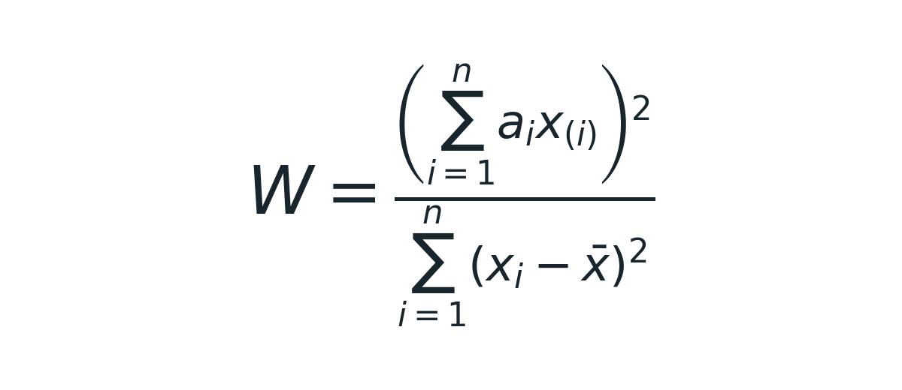

# 为什么有些统计检验，我们反而希望P＞0.05？

> 明哥的微生物世界 · 统计课堂 42
>
> 摘要：比较均数时，我们常关注P＜0.05；检查正态性、方差齐性时，却常希望P＞0.05。为什么会有这样的反差？把各自的H₀写出来，再看看小样本如何影响检验能力，以及Shapiro–Wilk、AD、Levene、Bartlett各用什么统计量，再结合图形理解结果。

大家好，我是明哥。

准备第12次课“单因素方差分析与多组比较”时，我想到：**有些统计检验，我反而不希望它的P值小于0.05。**

比较几组均数时，我们常关注P＜0.05；可在正态性检验、方差齐性检验中，我通常希望看到P＞0.05。

为什么同样是P值，这一次的期待变了？

关键在于：**这些检验的H₀写了不同的内容。** 先把各自检验的命题弄清楚，就能理解为什么我们对结果的期待不同。

## 一、先看H₀写的是什么

H₀叫原假设，也叫零假设。理解检验结果，先把这一句话写出来。

表1把三种检验放在一起。前一行比较总体均数，后两行检查总体分布形状或方差；它们检验的命题不同[1][2]。

*表1｜三种常见检验各自在检验什么。*

| 检验 | H₀ | 小P值提供的证据 |
| --- | --- | --- |
| 均数差异检验 | 总体均数相等 | 反对均数相等 |
| 正态性检验 | 总体服从正态分布 | 反对总体正态 |
| 方差齐性检验 | 各组总体方差相等 | 反对方差相等 |

正态性检验中的“正态”允许总体均数和方差未知，并非专指均数为0、方差为1的标准正态分布。方差齐性中的“相等”也指总体方差相等，样本方差本来就会随抽样波动。

**三种检验的判断方向始终相同：P值足够小，就拒绝各自的H₀。**

寻找均数差异时，拒绝“均数相等”正好对应我们关注的研究问题。检查模型条件时，拒绝“总体正态”或“总体方差相等”，则提示需要进一步评估偏离。

因此，检查正态性、方差齐性时，我们常希望看到P＞0.05，表示本次检验没有发现显著偏离。

## 二、为什么通常把正态、方差齐放进H₀？

这类检验从一个明确的模型出发，检查数据表现得是否反常。

以正态性检验为例，先假定观测独立地来自同一个正态总体，再研究正态样本中的检验统计量通常怎样波动。把实际统计量放进这个参照中，就可以判断：眼前这样的偏离，在正态模型下是否罕见。Shapiro–Wilk检验就是利用正态样本的性质构造统计量，再寻找偏离正态的证据[1]。

Levene检验则以各组总体方差相等为H₀。常用的中位数中心版本，也就是Brown–Forsythe修正，仍以方差相等作为原假设[2]。

**H₀在这里提供计算和判断的参照。** 它不表示我们已经认定条件成立，也不等于“研究者最想证明的命题”。

检验也可能误报。例如，总体本来正态，某次抽到的样本却显得很不寻常，检验因而拒绝了“总体正态”。预先设定检验水准α（例如0.05），就是为了控制这种错误拒绝H₀的风险[3]。

## 三、常用检验各用什么统计量？

正态性常见Shapiro–Wilk和Anderson–Darling（简称AD）；方差齐性常见Levene和Bartlett。这里介绍它们各怎样比较、用什么分布作参照。

统计量帮助我们理解“P值从哪里来”，判读仍然围绕各自的H₀。表2列出四种检验的统计量和判断方向。其中，k是组数，N是总样本量。**Shapiro–Wilk是W越小越反对正态；另外三种则是统计量越大，越反对各自的H₀。**

*表2｜四种检验的统计量与参照分布。*

| 检验 | 统计量与构造思路 | H₀下的参照 |
| --- | --- | --- |
| Shapiro–Wilk | W：比较排序观测与正态样本预期排列的接近程度 | 随样本量变化的专用分布近似 |
| AD | A²：比较经验分布与拟合正态分布，更重视尾部 | 正态性检验的专用校准 |
| 中位数中心Levene | F：对离本组中位数的绝对距离，比较组间与组内均方 | 近似F(k−1，N−k) |
| Bartlett | B：由各组方差及合并方差的对数构造 | 正态总体下近似χ²(k−1) |

以Shapiro–Wilk为例，式（1）给出W的计算方法。先将n个观测从小到大排序，记为x₍₁₎、…、x₍ₙ₎；x̄是样本均数。

*式（1）｜Shapiro–Wilk检验统计量。*

分母是各观测与样本均数之差的平方和。分子先将排序后的观测按权重aᵢ相加，再平方；这些权重由正态样本的排序规律确定，软件根据样本量计算。**W越接近1，样本通常越符合正态形状；W较小，则提示偏离正态。** 判断W是否小到足以拒绝H₀，还要结合样本量，按专用方法计算P值[1]。

Shapiro–Wilk的W与AD的A²，都不能直接套用普通χ²或F分布算P值。AD还需要区分正态分布的参数是预先已知，还是由本次样本估计；常用正态性检查属于后者[1][4]。

Bartlett对非正态较敏感；中位数中心Levene通常对非正态更稳健。因此，介绍它们时也要结合分布形状，理解两种方差检验的特点[2][5]。

三语对应入口在配套README中有完整对照：

- R：`shapiro.test()`、`nortest::ad.test()`、`car::leveneTest()`、`bartlett.test()`。
- Python：SciPy的`shapiro()`、`levene()`、`bartlett()`，以及statsmodels的`normal_ad()`。
- MATLAB：本课自编的`shapiro_wilk()`、原生`adtest()`和不同`TestType`的`vartestn()`。

本课Levene统一采用中位数中心：R写`center=median`，Python写`center="median"`，MATLAB对应`TestType='BrownForsythe'`。软件同名函数的默认选项不一定相同，配套脚本已明确写出。

## 四、P＞0.05究竟说明了什么？

P值是在H₀及其他模型前提成立时，所用统计量出现当前这样、或更不利于H₀的结果的概率。它不直接计算H₀成立的概率[6]。

所以，在预先选定α＝0.05后，正态性检验得到P＞0.05，可以表述为：

> **在本次样本与所用检验下，尚无足够证据拒绝“总体服从正态分布”。**

方差齐性检验相应的表述是：

> **尚无足够证据拒绝“各组总体方差相等”。**

这里的“未拒绝”保留了不确定性。NIST的统计手册也明确指出，不拒绝H₀并不意味着H₀为真，而是没有足够证据反对它[3]。

例如，正态性检验报告P＝0.60，意思仍然是未拒绝“总体正态”，不能把它解释为“总体有60%的概率正态”[6]。

## 五、样本少，为什么可能检不出偏态？

假设一个总体中，大多数数值比较小，少数数值特别大，所以总体呈右偏分布。

如果只随机抽取8个观测，可能没有抽到那些特别大的数，样本中的右偏特征就不明显。正态性检验因此可能得到P＞0.05。

**总体仍然右偏，只是这几个观测没有把它的偏态特征充分显示出来。**

如果从存在同一种偏离的总体中反复抽样、反复检验，检验能够拒绝H₀、检出这种偏离的概率，叫作**检验能力，也叫功效**。针对同一种偏离，增加观测通常能提高检验发现它的能力；样本少时，则可能检不出来[3]。

所以，我们通常希望看到P＞0.05，同时也要知道样本量会影响这个结果。每组只有几个观测时，可以结合按组展示的数据和Q–Q图一起观察分布特征。

## 六、无论用哪一种检验，都要结合图形看

正态性和方差齐性都应结合图形检查。图形能展示分布形状、离散程度和极端值，让我们看到一个P值没有展示的细节。

检查时，也要看对对象。比较多个组的均数，正态性通常针对组内总体或相应模型的误差；直接把均数可能不同的各组合并，会把组间位置差异混进分布形状。

**检查正态性，可以先看正态Q–Q图。** 它把样本分位数与正态分布的理论分位数放在一起比较。点大致沿直线排列，说明样本形状与正态参照比较接近；系统弯曲、两端明显偏离，则能提示偏态或尾部差异[7]。

R的`car::qqPlot(x)`可以对数值向量画正态Q–Q图；传入模型`fit`时，`car::qqPlot(fit)`则使用学生化残差，并默认采用相应的t分布参照。这里采用删除当前观测后估计的误差方差来调整残差，即外部学生化；模型Q–Q图与本课`residplot()`都使用这类残差。配套中也给出了对应的Python、MATLAB绘图函数[8]。

《R in Action》第二版第8章还给出了一个自编函数`residplot()`，见代码清单8.6。书中用`residplot(fit)`读取拟合模型的学生化残差，把直方图、正态密度曲线和由数据平滑估计的核密度曲线画在一起，底部再用短线标出观测位置。这样可以直观看到残差的分布形状与正态曲线有哪些不同[9]。

**检查方差齐性，可以先用按组箱线图看出端倪。** 在同一纵轴尺度下，比较各组箱体的高度、须长和极端点，就能观察各组离散程度是否有明显差别。箱体显示的是中间约50%观测的分布范围，方差还受尾部数值影响；中位数线的位置差异，主要提示组间位置不同[10]。

每组观测较少时，还可以在箱线图上叠加所有观测点，把实际有哪些数值展示出来。

把图形与检验放在一起，读到的就不只是“P值大于还是小于0.05”，还有“偏离出现在哪里、表现为什么样”。若检验得到P＜0.05，就进一步检查偏离情况，并考虑合适的替代方法。

回到开头的问题：我们对P值的期待不同，是因为各自的H₀不同。**先写清H₀，再读P值，检验结果就更容易理解。**

## 本篇讲了哪些知识？

- **小P值始终提供反对相应H₀的证据。** 均数差异检验、正态性检验、方差齐性检验的H₀不同，所以我们对结果的期待可能不同。
- **正态性、方差齐性检验中，我们通常希望看到P＞0.05。** 它表示本次检验未发现显著偏离，因此没有拒绝相应的H₀。
- **四种检验使用不同统计量和参照分布。** Shapiro–Wilk、AD使用专用校准，中位数中心Levene使用F近似，Bartlett在正态模型下使用χ²近似。
- **样本量影响检验发现偏离的能力。** 小样本可能没有充分显示总体的偏态特征，阅读检验结果时可结合图形一起观察。
- **正态性、方差齐性都应结合图形检查。** Q–Q图和残差分布图帮助观察形状，按组箱线图帮助观察离散程度差异，再用检验结果补充统计判断。

## 配套函数与练习

这次准备了R、Python和MATLAB三语配套：`residplot()`残差分布图、Q–Q图，以及Shapiro–Wilk、AD、中位数中心Levene和Bartlett的调用示例。

用自己熟悉的一种语言跑通即可：先运行`demo_residplot`观察残差分布，再运行`demo_diagnostics`查看四种检验、Q–Q图和按组箱线图。完整统计量定义和参照分布另有配套说明。

配套中，20个独立教学观测用于Shapiro–Wilk和AD；三组各5个观测用于方差齐性检验及模型残差图。两份资料的完整题干、数据、运行入口和改动练习都在本篇README中。

本篇完整项目：[https://github.com/fuyuming/statistics-classroom/tree/main/stats_classroom/article42_diagnostic_tests](https://github.com/fuyuming/statistics-classroom/tree/main/stats_classroom/article42_diagnostic_tests)。

也可以直接[下载本篇三语练习包](https://github.com/fuyuming/statistics-classroom/raw/refs/heads/main/stats_classroom/article42_diagnostic_tests/统计课堂42_诊断检验与图形.zip)。解压后进入`统计课堂42_诊断检验与图形`，先读`README.md`。

整个系列仓库：[https://github.com/fuyuming/statistics-classroom](https://github.com/fuyuming/statistics-classroom)。

仓库ZIP下载：[https://github.com/fuyuming/statistics-classroom/archive/refs/heads/main.zip](https://github.com/fuyuming/statistics-classroom/archive/refs/heads/main.zip)。下载整个仓库时，解压后依次进入`statistics-classroom-main`、`stats_classroom`、`article42_diagnostic_tests`三个目录，先读`README.md`。

这里是“明哥的微生物世界”，一起把统计问题读清楚、算明白。

## 参考文献与延伸阅读

[1] NIST/SEMATECH. *e-Handbook of Statistical Methods*, 7.2.1.3: Anderson–Darling and Shapiro–Wilk tests. [官方页面](https://www.itl.nist.gov/div898/handbook/prc/section2/prc213.htm)。

[2] NIST/SEMATECH. *e-Handbook of Statistical Methods*, 1.3.5.10: Levene Test for Equality of Variances. [官方页面](https://www.itl.nist.gov/div898/handbook/eda/section3/eda35a.htm)。

[3] NIST/SEMATECH. *e-Handbook of Statistical Methods*, 1.3.5: Quantitative Techniques. [官方页面](https://www.itl.nist.gov/div898/handbook/eda/section3/eda35.htm)。

[4] nortest. Anderson-Darling test for normality. [官方文档](https://search.r-project.org/CRAN/refmans/nortest/html/ad.test.html)。

[5] NIST/SEMATECH. Bartlett’s Test. [官方页面](https://www.itl.nist.gov/div898/handbook/eda/section3/eda357.htm)。

[6] Wasserstein RL, Lazar NA. The ASA Statement on p-Values: Context, Process, and Purpose. *The American Statistician*. 2016;70(2):129–133. [原文](https://doi.org/10.1080/00031305.2016.1154108)。

[7] NIST/SEMATECH. *e-Handbook of Statistical Methods*, 1.3.3.21: Normal Probability Plot. [官方页面](https://www.itl.nist.gov/div898/handbook/eda/section3/normprpl.htm)。

[8] Fox J, Weisberg S, et al. car::qqPlot: Quantile-Comparison Plots. [官方文档](https://cran.r-project.org/web/packages/car/refman/car.html)。

[9] Kabacoff RI. *R in Action, Second Edition*. 第8章，代码清单8.6：Function for plotting studentized residuals. [作者配套源码](https://github.com/kabacoff/RiA2/blob/master/Ch08%20Regression.R)。

[10] R Core Team. *boxplot.stats*: Box Plot Statistics. [官方文档](https://stat.ethz.ch/R-manual/R-patched/library/grDevices/html/boxplot.stats.html)。
