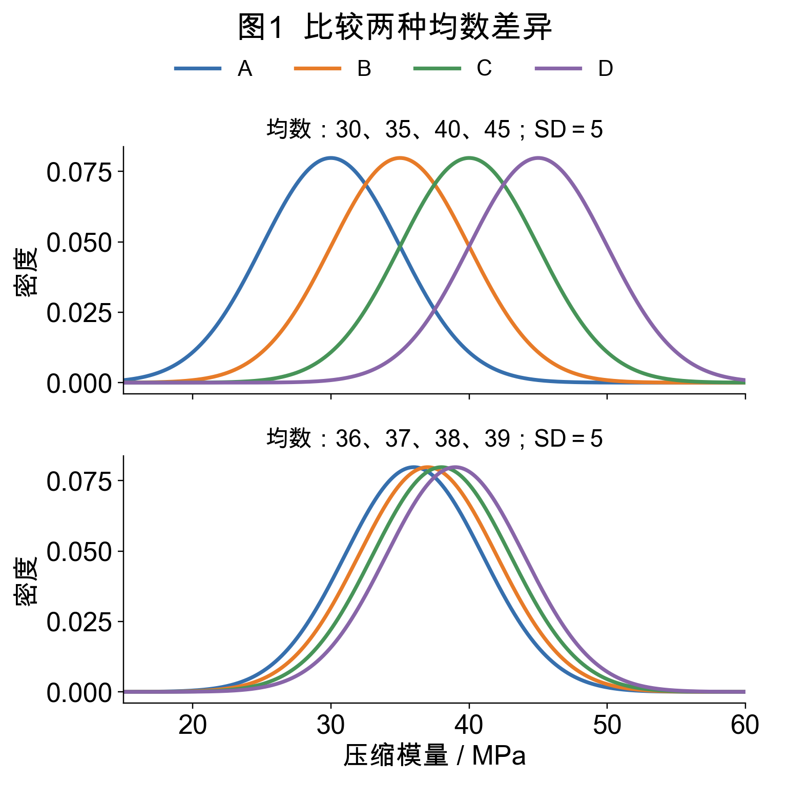
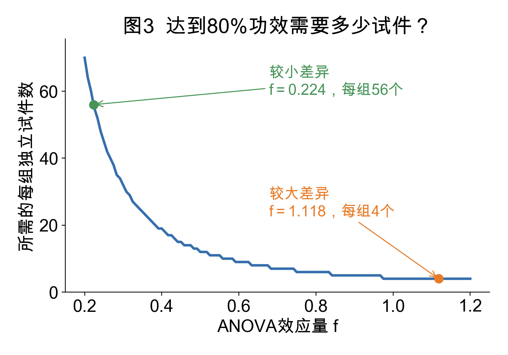
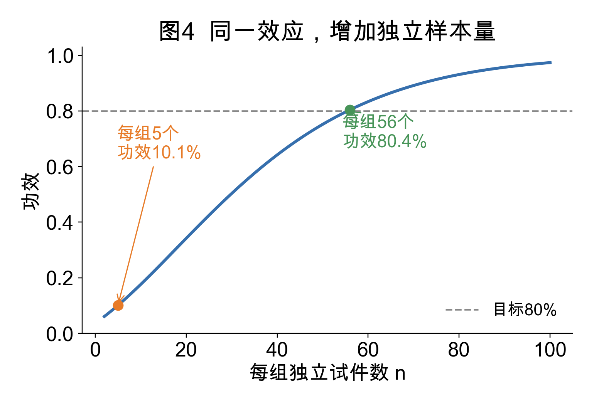

明哥的微生物世界 · 统计课堂 44

# 每组5个够不够？ANOVA的功效与样本量怎样确定？

> 摘要　同样比较四组，为什么一种实验每组几个就能达到要求，另一种却需要几十个？先把“大差异”和“小差异”画在同一尺度上，认识效应、功效与样本量各自回答什么，再用R的pwr包计算。第一次了解功效，可以先抓住这条线：希望看清多小的变化，愿意承担多少漏检，最后需要多少独立样本。


大家好，我是明哥。

上一篇《为什么有些统计检验，我们反而希望P＞0.05？》谈到：小样本可能检不出总体的偏态，P＞0.05还要结合图形来理解。其中提到的“检验能力”，也叫功效。

前文阅读：https://mp.weixin.qq.com/s/6Rk53nqeSrd5xrAw2pjV5Q

前篇配套用了三组、每组5个的教学资料，练习方差齐性检验和观察模型残差。这一次，把问题转到实验开始之前：**如果希望发现几组总体均数之间有实际意义的差异，每组5个够不够？又该怎样确定样本量？**

先想一个直观问题：**在同样的波动里，识别一处很大的变化，和识别一处很小的变化，所需样本会一样吗？**

通常不会。**样本量要围绕希望识别的差异来定。** 小差异更容易被随机波动掩盖，需要把各组均数估得更稳定，才容易分辨。增加独立样本，就是让均数估计变稳定的一种办法。

下面另设四组支架设计的两个规划情形，用明显的大、小差异建立直觉，再把“希望多大概率看清差异”变成统计功效，用pwr求每组n。

## 一、先看图：同样的波动，大差异与小差异

假设我们比较A、B、C、D四种组织工程支架设计的压缩模量，单位MPa。每种设计独立制备n个试件，n就是每组独立试件数；每个试件只贡献一个模量值；各组与试件相互独立，组内服从正态分布，具有相同的总体标准差。

现在设两种总体情形，见表1。它们的**共同SD都为5 MPa**，四个总体均数的平均位置也都为37.5 MPa；区别在于四个均数分散得多远。这里，总体均数表示各组分布的中心，SD表示同组试件之间的散布大小。所有数值都是研究前规划的教学假设，不是已经测到的试验数据。

*表1｜两种假设情形的总体均数，单位MPa；各组SD均为5 MPa*

| 情形 | A | B | C | D |
| --- | ---: | ---: | ---: | ---: |
| 较大差异 | 30 | 35 | 40 | 45 |
| 较小差异 | 36 | 37 | 38 | 39 |

计划采用经典单因素ANOVA的总体F检验，H₀为“四个总体均数全相同”，备择为“均数不全相等”，α事先取0.05。我们希望，在对应的真实情形下，研究有至少80%的机会拒绝H₀。要确定每组需要多少个独立试件，并判断每组5个是否够用。

先不算数，图1把两个情形画在相同坐标上。上半部分的四个均数散得较开，最大差为15 MPa；下半部分只相差3 MPa，四个总体分布挤得更近。两者的组内波动一样大。



*图1｜上：均数30、35、40、45；下：均数36、37、38、39。蓝、橙、绿、紫分别表示A—D组，均为SD＝5 MPa的正态总体。曲线是规划模型，不是样本数据；纵轴为密度。*

**同样要求下，小差异通常需要更多样本。** 因为要看清更小的均数间隔，就需要更精确的均数估计。这里“差异大小”还要相对于波动来衡量：同样3 MPa的差异，在SD很小和很大时，检出的难度也不同。

## 二、“有80%的机会检出”，就是在谈功效

一项研究的数据有随机性。即使总体参数固定，每次重新制备试件、重新测量，得到的样本均数和F值仍会改变。

**统计功效，是在指定总体情形、样本量和检验规则下，正确拒绝H₀的概率。** 本文的“检出”具体指总体F检验得到P＜0.05。功效80%，意味着同样的研究长期反复进行，约80%会拒绝H₀<sup>[1]</sup>。

一次完整研究是这里的计数单位：每次都有四组试件，最后得到一个总体F检验P值。不是把一组中的试件分别数成“检出几个”。

真实均数不全相等，却没有拒绝H₀，称为**第二类错误，也叫β错误**。β表示在这个指定备择情形下的漏检概率。检出与漏检互补，关系见式（1）。

$$
\mathrm{Power}=1-\beta
$$

*式（1）｜功效80%对应β＝20%；提高目标功效，就是希望降低指定情形下的漏检概率。*

α对应另一种错误：总体均数本来全相同，却被报告有差异。这是**第一类错误，也叫α错误**；α描述H₀成立时的误报概率。

图2用怀孕判定作类比。设H₀为“未怀孕”：左边把未怀孕判为“怀孕”，是假阳性，对应α错误；右边把怀孕判为“未怀孕”，是假阴性，对应β错误。


*图2｜以H₀“未怀孕”为前提，左图Type I Error对应α错误，右图Type II Error对应β错误。*

回到本文的ANOVA，真实状态是“四个总体均数是否全相同”，判定结果来自预定的F检验。两类错误也是按这两个维度来区分的。

现在，本题的要求可以说得更完整：4组等分配、经典ANOVA、α＝0.05；对于表1指定的效应情形，希望功效至少达到80%。**这些条件确定后，才能把效应大小换算成需要的每组n。**

## 三、把效应大小换成f，再让pwr求样本量

### （一）f把“均数散开多远”和“组内波动多大”放在一起

ANOVA同时看所有组均数的位置。先量这些均数离中心有多远，再用组内SD作尺子，得到一个无单位的数，这就是效应量f。具体地，先算均数偏离中心的平方、取平均、开平方，最后除以共同SD。式（2）给出写法；μᵢ是第i组总体均数，μ̄是k个总体均数的平均值，σ是共同组内SD。

$$
f=\frac{\sqrt{\frac{1}{k}\sum_{i=1}^{k}(\mu_i-\bar\mu)^2}}{\sigma}
$$

*式（2）｜ANOVA效应量f：均数组合的分散尺度相对于个体组内SD的大小。*

例如，小差异情形的均数围绕37.5，偏离依次为−1.5、−0.5、0.5、1.5 MPa。偏离平方后取平均为1.25 MPa²，开方约1.118 MPa，再除以SD＝5，得到f约0.224。

较大差异情形用同样办法计算，f约1.118，是前者的5倍。**f越大，表示均数信号相对于组内波动越强。** 这里还没有放入n，效应大小与准备收集多少独立信息是分开描述的。

这里的f与课堂由样本算出的η²不是同一个量。本文根据研究前设定的均数组合和组内SD计算f。

### （二）同样要求80%功效，大效应与小效应各需要多少个？

R的`pwr.anova.test()`适用于各组样本量相等的经典单因素ANOVA。告诉它组数k、效应量f、α和目标功效，留下n未知，就能求每组样本量。参数`k`、`f`、`sig.level`、`power`依次对应组数、效应量、α和目标功效；返回对象中的`n`是每组数量<sup>[2]</sup>。首次使用时，先运行一次`install.packages("pwr")`。

把表1两种情形分别输入。代码中的`mean()`对四个规划均数取平均，平方偏离也按4组取平均；`sigma`填个体的组内SD。

```r
mu_large <- c(30, 35, 40, 45)
mu_small <- c(36, 37, 38, 39)
sigma <- 5
alpha <- 0.05
f_large <- sqrt(mean((mu_large - mean(mu_large))^2)) / sigma
f_small <- sqrt(mean((mu_small - mean(mu_small))^2)) / sigma

plan_large <- pwr::pwr.anova.test(
  k = 4, f = f_large, sig.level = alpha, power = 0.80
)
plan_small <- pwr::pwr.anova.test(
  k = 4, f = f_small, sig.level = alpha, power = 0.80
)
c(large = plan_large$n, small = plan_small$n)
```

本次实际输出为：

```text
    large     small
 3.337256 55.499428
```

试件数取整数，向上取整后再回代。表2同时列出80%和90%两种目标；后者只需把函数中的`power`改为0.90。

*表2｜相同组数、SD与α下，不同效应对应的最小整数样本量*

| 情形 | f | 80%目标：每组n | 90%目标：每组n |
| --- | ---: | ---: | ---: |
| 较大差异 | 1.118 | 4 | 4 |
| 较小差异 | 0.224 | 56 | 72 |

较大差异每组3个时功效约72.0%，每组4个已达到约90.3%。**两个目标都取n＝4，是因为试件数只能取整数：从3加到4时，功效已经越过了90%。**较小差异每组55个时约79.6%，每组56个约80.4%，因此80%目标应取56。

**在同一个80%目标下，每组4个与56个的区别，来自效应大小不同。** 图3把固定4组、α＝0.05、80%目标下的f与所需n画成曲线，展示这个变化关系。



*图3｜经典等组ANOVA，k＝4、α＝0.05、目标功效80%。曲线连接各f对应的最小整数n；标记为表1的两种情形。*

## 四、再回头看：每组5个到底够不够？

现在固定每组n＝5，不再求n，而是让pwr返回功效。仍保留表1的两个总体情形、共同SD＝5和α＝0.05。代码末尾的`$power`取出返回结果中的功效项。

```r
power_large <- pwr::pwr.anova.test(
  k = 4, n = 5, f = f_large, sig.level = alpha
)$power
power_small <- pwr::pwr.anova.test(
  k = 4, n = 5, f = f_small, sig.level = alpha
)$power
c(large = power_large, small = power_small)
```

本次实际输出为：

```text
    large     small
0.9709694 0.1010075
```

表3将它们与漏检概率β放在一起。

*表3｜每组5个，在不同效应情形下对应不同检出机会*

| 情形 | 功效：检出概率 | β：漏检概率 |
| --- | ---: | ---: |
| 较大差异 | 97.1% | 2.9% |
| 较小差异 | 10.1% | 89.9% |

所以，“每组5个”没有脱离效应大小的统一答案。对这里的大差异，它超过80%的要求；对这里的小差异，它远未达到要求。两个概率都以各自的真实均数、共同SD、样本量和检验规则为条件。

### 增加样本，改变的是均数估计的稳定性

接下来只看较小差异：均数始终是36、37、38、39，个体SD始终是5，α始终是0.05。图4只改变每组独立试件数n。



*图4｜小差异情形f约0.224不变。每组5个时功效约10.1%，每组56个时约80.4%；虚线为80%目标。*

每个试件自身的波动没有变小，各组总体均数也没有拉开。**变稳定的是各组样本均数，因此原本细小的均数差异更容易分辨。** 这就是在固定效应下，增加独立样本通常能提高功效的原因。

## 五、研究中怎样选效应，而不只是选一个好看的n？

### （一）先决定多小的变化值得发现

大效应通常更省样本，但研究可能恰好需要识别细小变化。如果表1中最大差3 MPa已经具有实际意义，就应围绕相应的小效应规划，而不是为了减少试件数，把期待的均数差异写大。

**用于规划的效应，应连接到研究问题和可接受的最小变化。** 历史研究、可靠的预实验与专业判断可为均数组合和组内SD提供依据。小样本观察效应有波动，不宜把一次偏大的η²直接当成下一项研究的真实效应。

### （二）同一个均数差异，SD判断不同，所需n也会不同

固定小差异的均数36、37、38、39，仍为4个独立正态组、等分配、α＝0.05和80%目标，只将共同SD分别设为2.5、5、10 MPa。表4显示：均数差异没有改变，效应相对噪声的强度改变了。

*表4｜小差异情形的SD敏感性分析*

| 共同SD/MPa | f | 80%目标每组n |
| ---: | ---: | ---: |
| 2.5 | 0.447 | 15 |
| 5 | 0.224 | 56 |
| 10 | 0.112 | 220 |

这也是“效应量决定样本量”需要附带条件的地方：**固定组数、分配、α和目标功效之后，f才对应一个所需n。** 更严格的α、更高的目标功效或不同的设计，也会改变计算结果。

## 六、怎样把计算结果写进研究方案？

小差异情形的规划可以写成：

> 计划比较4种支架设计的压缩模量，采用等组分配及经典单因素ANOVA总体F检验。以总体均数36、37、38、39 MPa、共同组内SD＝5 MPa作为规划情形，α＝0.05、目标功效80%。使用R的pwr包计算并回代整数样本量，每组需56个可分析的独立试件，共224个；该情形下实际功效约80.4%。

若预计10%的试件无法获得有效结果，按56÷0.9向上取整，可准备每组63个。这是按预期损耗补足数量；若失效与组别或性能相关，还需查明原因并调整设计和分析。

n数的是独立实验单位。同一试件重复测量5次，增加的是读数；若处理按批次施加，还应考虑同批试件之间的相关性。对不等组分配，应按实际计划数量重新计算，`pwr.anova.test()`这一接口针对各组n相同的设计。

**总体ANOVA有80%功效，不等于每一对比较都有80%功效。** 如果主要关心某一组对，或准备采用Tukey等多重比较，应针对相应检验另做样本量规划。

## 本篇讲了哪些知识？

- **小效应通常需要更多样本，前提是比较要求相同。** 效应相对组内波动越弱，往往需要越多独立试件，让均数估计足够稳定。本文同为80%目标，大差异每组4个，小差异每组56个。
- **功效是指定情形下的检出概率，等于1−β。** β描述真实差异的漏检；α控制H₀成立时的误报。计数单位是一项项完整研究。
- **f描述信号相对噪声，n描述独立信息量。** 增加n不会把总体效应变大，但能降低样本均数的抽样波动。pwr将f、k、α、目标功效与n联系起来。
- **每组5个是否够用，要连同效应和目标一起判断。** 本文两种效应下，功效分别约97.1%和10.1%；规划结果还要带上SD依据、独立单位和主要检验目标。

回到最初的问题，先确定希望识别多小的变化，再规定检出它的概率，最后才是每组准备多少个。

## 配套练习：先跑两个情形，再改一个输入

R、Python和MATLAB项目都从同一份两情形CSV读取均数与SD。先运行到第03节，核对80%目标下的大差异每组4个、小差异每组56个，以及每组5个时的97.1%与10.1%功效。

第二次只把small情形的SD由5改为10，从首节重新运行，看看为什么80%目标变成每组220个。

R以`pwr.anova.test()`为主要接口；Python、MATLAB原生计算同一个模型，没有跨语言调用pwr。完整项目`article44_anova_power`解压后先读README；RStudio、Spyder、MATLAB的分节入口、安装与保存说明都在其中。

本篇完整项目：https://github.com/fuyuming/statistics-classroom/tree/main/stats_classroom/article44_anova_power

本篇独立ZIP：https://github.com/fuyuming/statistics-classroom/raw/refs/heads/main/stats_classroom/article44_anova_power/统计课堂44_ANOVA功效与样本量_配套项目.zip

系列仓库：https://github.com/fuyuming/statistics-classroom

整个仓库ZIP：https://github.com/fuyuming/statistics-classroom/archive/refs/heads/main.zip

下载本篇独立ZIP后，解压进入`article44_anova_power`，先读`README.md`；若下载整个仓库，则依次进入`statistics-classroom-main/stats_classroom/article44_anova_power`。

这里是“明哥的微生物世界”，一起把统计问题读清楚、算明白。

## 参考文献与软件说明

[1] Navidi W. Statistics for Engineers and Scientists. 6th ed. 2024. §9.1 “Power”，印刷689–691页。

[2] pwr官方说明：pwr.anova.test。https://search.r-project.org/CRAN/refmans/pwr/html/pwr.anova.test.html

pwr官方使用示例：https://cran.r-project.org/web/packages/pwr/vignettes/pwr-vignette.html
