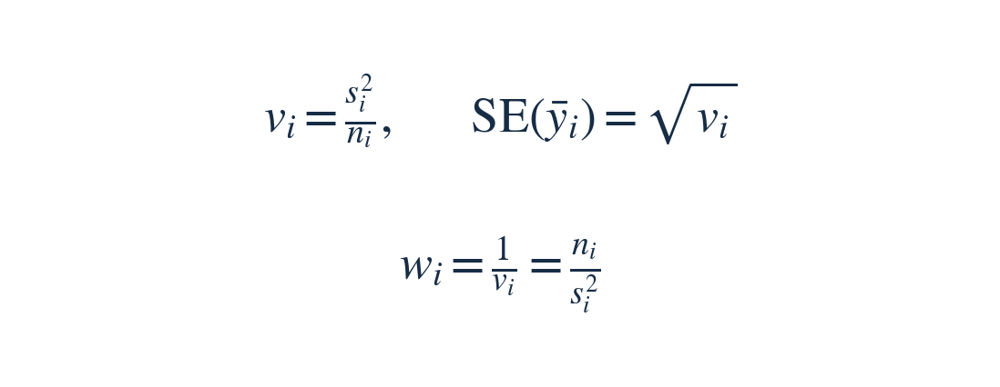
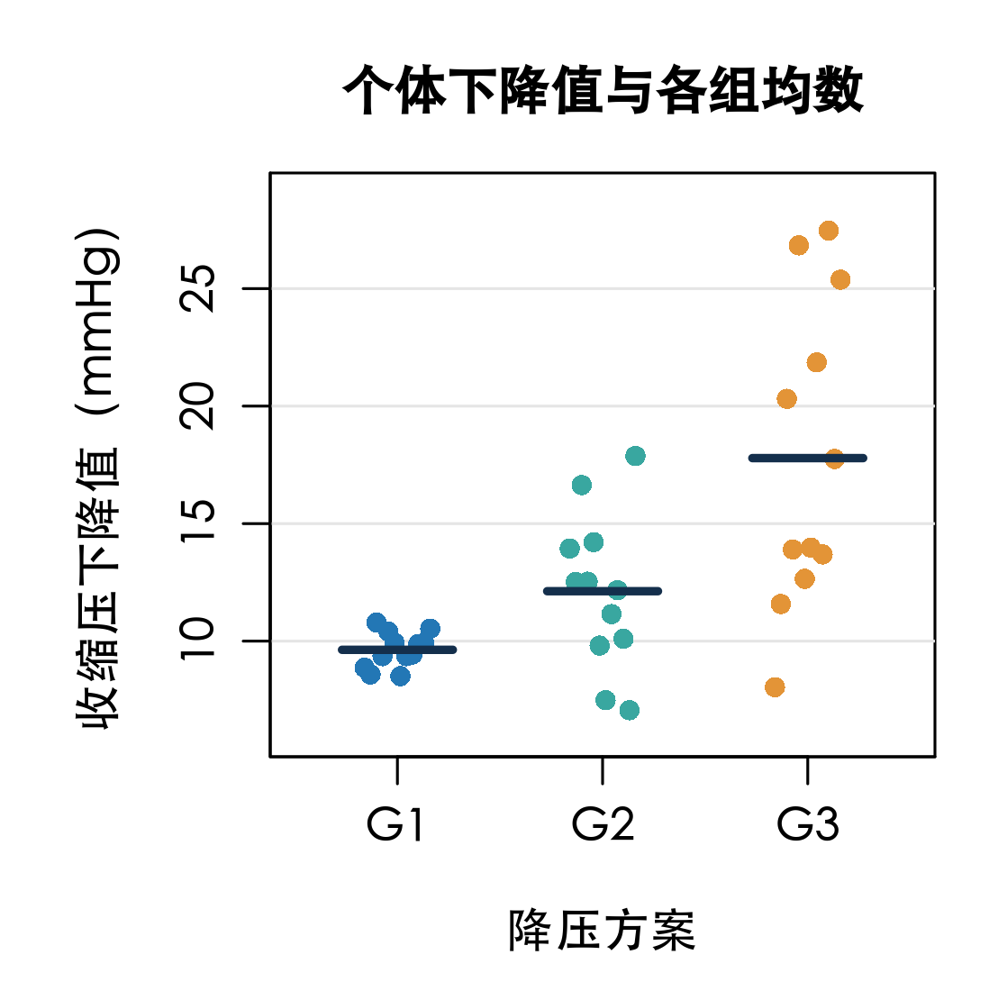
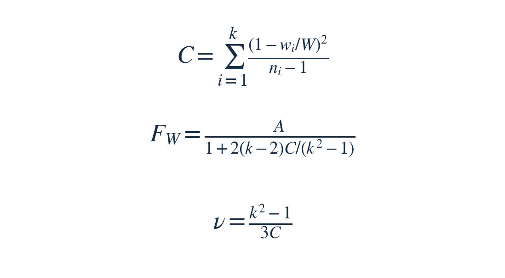
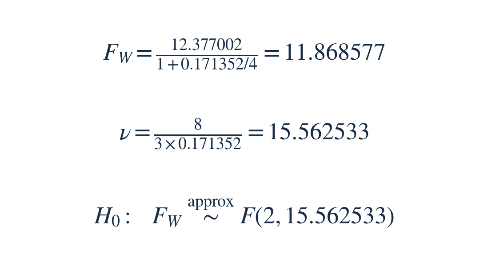
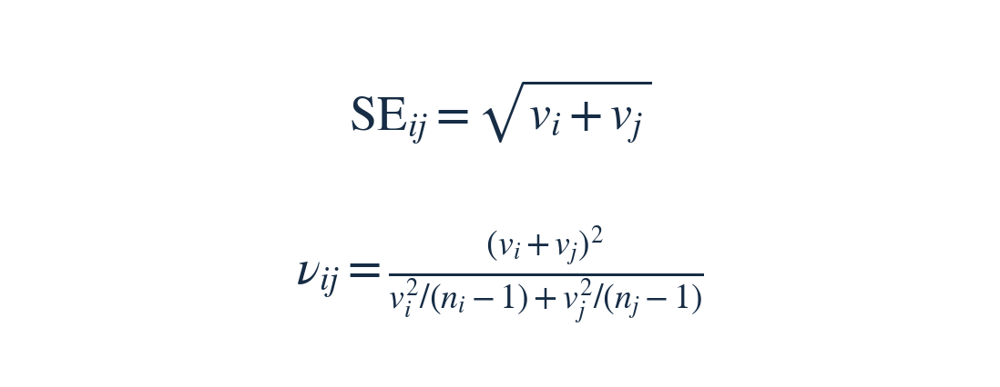
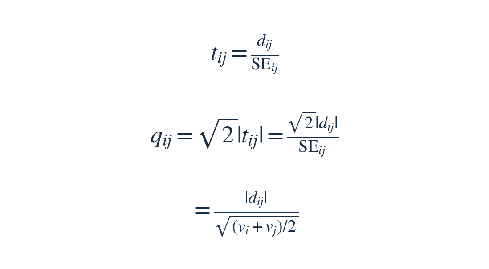
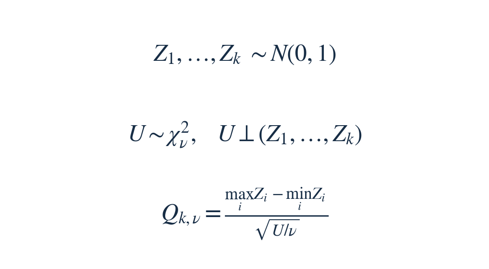
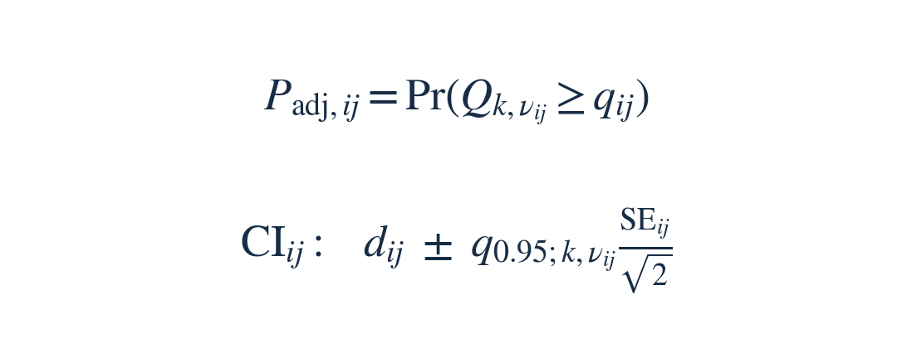
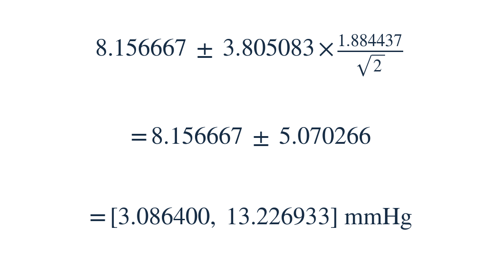
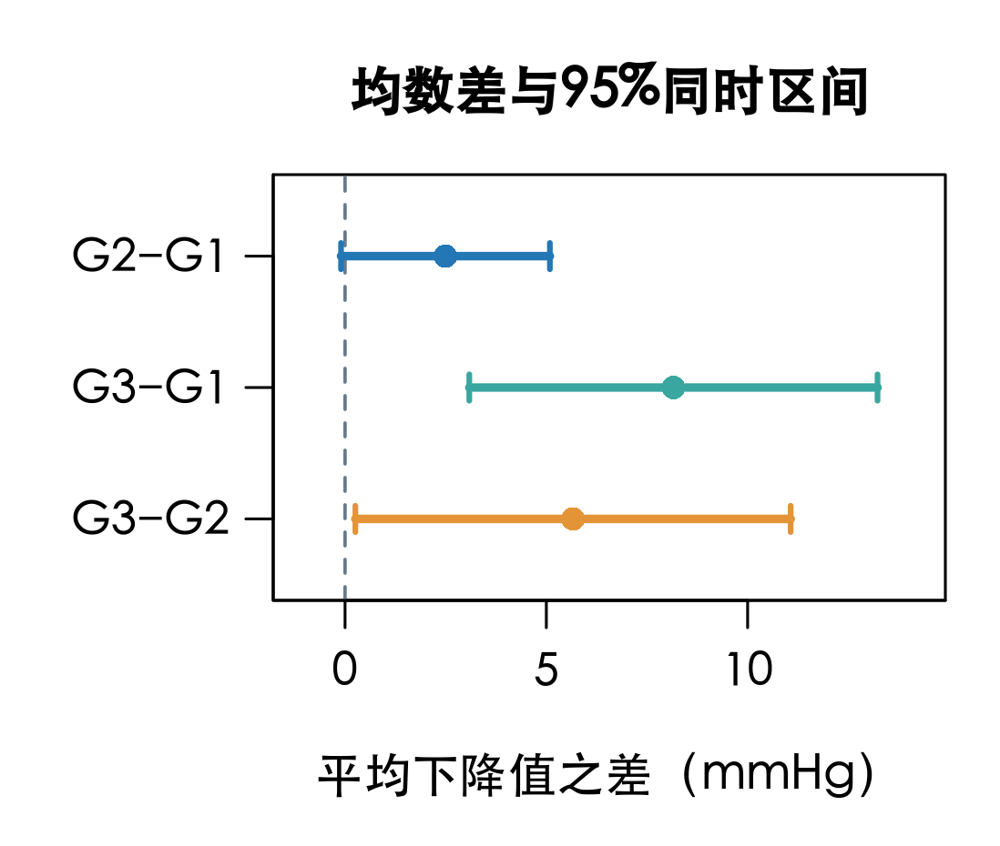

明哥的微生物世界 · 统计课堂 45

# 方差不齐，三个组的均数怎样比较？——Welch与Games–Howell算同一道题

> 摘要　三组资料的波动相差很大，研究目标仍是平均下降多少，这时怎样比较均数？从一道三种降压方案的完整教学题出发，用各组均数的精度构造Welch整体检验，再逐对计算Games–Howell的标准误、近似自由度、调整P值和同时置信区间，看看同一份数据怎样得到带方向、单位与不确定性的结论。最后对照两项近期研究，看看这套方法怎样用于牙釉质硬度和嗅觉评分的比较。


大家好，我是明哥。

11月30日的本科《概率与医学统计学》第12次课，要用到Welch和Games–Howell。课堂会讲选择理由和结果判读，课时有限，背后的统计量怎样构造，就放到公众号接着讲。

第43篇整理了经典方差分析的正态性、方差齐性与残差诊断。接下来要解决的是：**共同方差不合理，而我们仍想比较总体均数，分析该怎样继续？**

Welch把两独立样本的不等方差均数比较推广到多个组；Games–Howell则进一步比较各组之间的两两差异。本篇沿同一道题，从各组均数的抽样波动算起，把统计量、参照分布和最后的研究解释连起来<sup>[1]</sup>。

## 一、先把完整题目摆出来

假设一个团队比较三种降压方案G1、G2、G3。36名不同受试者随机分入三个组，每组12人，随访8周。每人记录基线和8周收缩压，并计算**基线收缩压减去8周收缩压**，得到一个下降值，单位为mmHg；数值越大，表示下降越多。

本题分析的是36名相互独立受试者各自的下降值。一个人的两次测量已经合成为一个差值；不同方案之间是独立组比较。表1给出按正态模型模拟生成的全部教学数据，同一行只是各组内的编号，跨组没有配对关系。

*表1｜三种降压方案的收缩压下降值，单位mmHg*

| 组内编号 | G1 | G2 | G3 |
| --- | ---: | ---: | ---: |
| 1 | 8.87 | 13.94 | 8.04 |
| 2 | 8.58 | 12.52 | 11.58 |
| 3 | 10.79 | 16.64 | 20.31 |
| 4 | 9.36 | 12.53 | 13.90 |
| 5 | 10.40 | 14.21 | 26.84 |
| 6 | 9.94 | 9.81 | 12.65 |
| 7 | 8.51 | 7.49 | 13.98 |
| 8 | 9.36 | 11.15 | 21.86 |
| 9 | 9.43 | 12.17 | 13.69 |
| 10 | 9.88 | 10.10 | 27.47 |
| 11 | 9.92 | 7.06 | 17.75 |
| 12 | 10.53 | 17.88 | 25.38 |

设各组下降值的总体分布近似正态，允许各组总体方差不同。本题的总体均数μ₁、μ₂、μ₃分别表示三种方案下的平均下降值，这三个总体均数未知，需要用样本资料推断。检验水准取α＝0.05，要回答：

1. 三种方案的总体平均下降值是否相等？整体H₀为μ₁＝μ₂＝μ₃，H₁为至少有两个总体均数不同。
2. 如果比较全部三个组对，哪些方案之间的平均下降值有差异？逐对H₀为对应的总体均数差等于0，均作双侧比较，并为全部三对作多重比较调整，报告95%同时置信区间。

先明确方法适用的范围。Welch放宽的是**共同方差**要求，仍需要按研究设计判断独立性，并关注组内分布和极端值。每组只有12人时，严重偏态、重尾或强影响点仍可能使均数及其方差估计不稳定。Welch在这一模型下使用近似参照分布<sup>[2]</sup>。

如果改用Kruskal–Wallis，分析就转向秩及分布差异；在共同形状的位置模型下，才可进一步作位置差异的解释。**研究目标仍为均数时，方差不齐本身并不构成改用秩方法的理由。**

## 二、各组均数的精度为什么不同？

先从表1计算每组样本量、均数和样本标准差。下标i表示组，j表示组内受试者；yᵢⱼ是某人的下降值，ȳᵢ和sᵢ²分别为该组样本均数与样本方差，nᵢ为该组人数。本题i＝1、2、3，各组nᵢ＝12。

在同组受试者独立、具有同一总体方差σᵢ²的模型下，样本均数的方差为σᵢ²/nᵢ。用sᵢ²代替未知的σᵢ²，就得到式（1）的均数方差估计vᵢ，以及相应的精度权重wᵢ。



*式（1）｜vᵢ估计样本均数的抽样方差，单位为mmHg²；其平方根是均数标准误，单位为mmHg；wᵢ为方差倒数，单位为mmHg⁻²。*

**样本标准差描述组内个体的差异，均数标准误描述样本均数的抽样波动。** 人数相同时，组内波动越大，均数估计通常越不精确；在总体方差相同的条件下，人数越多，均数估计通常越精确。wᵢ把这两方面合在一起。

表2列出本题的实际结果；样本方差用nᵢ−1作分母，后面计算均使用未舍入值。

*表2｜三组摘要与均数精度*

| 量 | G1 | G2 | G3 |
| --- | ---: | ---: | ---: |
| 人数nᵢ | 12 | 12 | 12 |
| 均数ȳᵢ/mmHg | 9.6308 | 12.1250 | 17.7875 |
| 标准差sᵢ/mmHg | 0.7454 | 3.2893 | 6.4852 |
| 方差sᵢ²/mmHg² | 0.5556 | 10.8197 | 42.0577 |
| 均数方差vᵢ/mmHg² | 0.0463 | 0.9016 | 3.5048 |
| 精度权重wᵢ/mmHg⁻² | 21.5987 | 1.1091 | 0.2853 |

G3的平均下降值最大，个体差异也最大；G1的数据集中得多。因此，虽然三组人数相等，三个样本均数的精度却很不一样。

图1把个体下降值与各组均数放在一起，帮助区分“均数位置”和“组内分散”。



*图1｜点为36名受试者的模拟下降值，横线为各组样本均数；散点在横向稍作错开以便辨认。*

经典单因素ANOVA在共同方差模型下，把各组方差合并成误差均方MSE。这里允许三个总体方差不同，Welch便分别使用各组的方差估计，让每个均数的精度参与整体比较。

## 三、从精度权重构造Welch统计量

### （一）先找共同均数的加权估计

如果H₀成立，三个总体均数相同，就可以用三个样本均数共同估计这个未知的共同均数。精度高的估计贡献较多，精度低的估计贡献较少。式（2）给出权重总和W与加权均数ȳ<sub>w</sub>。


*式（2）｜求和覆盖全部k个组，本题k＝3；ȳ<sub>w</sub>仍以mmHg计。*

代入表2，W＝22.9931，ȳ<sub>w</sub>＝9.8524 mmHg。G1占总权重约93.94%，所以ȳ<sub>w</sub>靠近G1均数9.6308 mmHg。

Welch用这个加权均数作为共同中心，接着衡量三个组均数偏离它的程度。

### （二）衡量三个均数偏离共同中心多少

有了共同中心，就可以计算每个组均数与ȳ<sub>w</sub>的偏离。式（3）将偏离平方，按精度加权，再除以k−1，得到A。


*式（3）｜偏离平方的单位与权重相消，A无量纲；k−1对应k个均数围绕一个共同中心的偏离。*

同样大的均数偏离，如果发生在估计很精确的组，就更难用抽样波动解释，因此贡献更大。本题A＝12.377002。

可以先看一个理想情形来理解它：假如各组总体方差已知，在独立正态模型下按真实精度加权，那么H₀下的加权离差平方和服从自由度k−1的χ²分布。若把式（3）的权重也换成这些真实精度，得到的量就是上述χ²变量除以k−1。实际资料中，权重来自样本方差，连加权中心也随它们波动。直接沿用“已知方差”的参照会忽略这部分不确定性，Welch因此作有限样本校正。

### （三）把方差估计的不确定性纳入校正

式（4）先写出一般k组的关系：定义校正量C，再给出Welch统计量F<sub>W</sub>及其分母近似自由度ν。这个构造使用各组样本量和权重比例，R的`oneway.test()`也按这一形式实现<sup>[3]</sup>。



*式（4）｜C、F<sub>W</sub>、ν均无量纲；nᵢ−1是各组样本方差的自由度。*

C中每项都包含nᵢ−1，因为每组方差估计的稳定程度与它的自由度有关；同时包含wᵢ/W，因为不同精度的组对共同中心的影响不同。这些因素汇总成C，用来校正A，并确定参照分布的分母自由度。

本题C＝0.171352。式（5）用k＝3把校正和参照分布接起来。



*式（5）｜显示值经过舍入；实际计算保留全部精度。F分布的分子自由度为k−1＝2，分母为近似自由度ν。*

式（5）已经用A和C算出了本题的**F统计量11.868577**。随后得到的ν＝15.562533，用于确定这个统计量的参照分布。

F分布的自由度参数可以取正实数。这里直接使用分子自由度2、分母自由度15.562533的F分布，求临界值或尾部概率。**样本算出的F统计量**与**由参照分布求出的临界F值**，在分析中分别承担这两步的作用<sup>[3]</sup>。

观察到的F<sub>W</sub>越大，说明组均数相对其抽样波动的偏离越大。用上述F分布计算11.868577及更大值的右尾概率，得到P＝0.0007405。这里虽然只取F的右尾，整体备择仍包含任意方向的均数差异，因为偏离在式（3）中已经平方。

## 四、用R核对整体检验，它回答到哪一步？

配套CSV有两列：`group`是方案，`value`是每人的下降值。打开本篇R项目后，从项目根目录读取它；`value ~ group`表示按方案比较下降值，`var.equal = FALSE`明确采用不假定共同方差的Welch方法<sup>[2]</sup>。

```r
h <- read.csv("data/hetero_normal.csv")
h$group <- factor(h$group, levels = c("G1", "G2", "G3"))
fit_welch <- oneway.test(
  value ~ group, data = h, var.equal = FALSE
)
fit_welch
```

返回对象中的`statistic`是F<sub>W</sub>，`parameter`保存两个自由度，`p.value`保存P值。控制台实际输出如下：

```text
One-way analysis of means (not assuming equal variances)

data:  value and group
F = 11.869, num df = 2.000, denom df = 15.563, p-value = 0.0007405
```

如果用临界值判断，右尾检验α＝0.05对应左侧累计概率0.95。R的`qf()`输入这个概率和两个自由度，返回临界F值；`pf()`输入观察到的F和自由度，返回相应概率。代码中的`df_welch[1]`、`df_welch[2]`分别读取分子、分母自由度，保留其小数值。

```r
df_welch <- unname(fit_welch$parameter)
F_cutoff <- qf(0.95, df1 = df_welch[1], df2 = df_welch[2])
F_observed <- unname(fit_welch$statistic)
P_right <- pf(F_observed, df_welch[1], df_welch[2], lower.tail = FALSE)
c(F_observed = F_observed, F_cutoff = F_cutoff, P = P_right)
```

实际算得临界F值为3.654113。观察F＝11.868577大于这个临界值，等价于右尾P＝0.0007405小于0.05。

P＜0.05，在本题模型条件下拒绝三组总体均数相等，支持三种方案的总体平均下降值不全相同。Welch到这里完成的是整体判断；要回答具体哪两种方案之间有差异，还需要逐对比较。

## 五、Games–Howell：每个组对都有自己的不确定性

全部三对比较是G2−G1、G3−G1、G3−G2。下文用i、j表示前、后两个组，统一取**后组减前组**：dᵢⱼ＝ȳⱼ−ȳᵢ，正值表示后组平均下降更多。

### （一）沿用Welch t的标准误和自由度

每个组对先按两独立样本Welch t的方法处理：用这两个组各自的方差估计均数差的标准误，再计算Welch–Satterthwaite近似自由度。

因为两个样本均数相互独立，差值的方差等于两个均数方差之和。式（6）给出SEᵢⱼ和νᵢⱼ，正是两独立样本Welch t使用的标准误和自由度。



*式（6）｜SEᵢⱼ以mmHg计；νᵢⱼ无量纲，只用当前两个组的样本量和方差计算。*

自由度为什么也要逐对算？均数差的标准误使用了两个样本方差，两者估计得是否稳定、各占多少，都影响这个标准误的不确定性。如果其中一组的均数方差远大于另一组，差值的不确定性便主要来自这组，近似自由度也会靠近这组方差的自由度。

例如G3−G1，v₃＝3.504805远大于v₁＝0.046299。按式（6），SE₁₃＝1.884437 mmHg，ν₁₃＝11.290574，接近G3的12−1＝11。其余组对也分别按自己的均数方差和样本量重算SE与ν。

### （二）从Welch t转到学生化极差q

如果只比较预先指定的一对，检验H₀：μⱼ−μᵢ＝0时，差值除以式（6）的标准误得到tᵢⱼ，参照该自由度的t分布作双侧检验。

现在要同时看三对，Games–Howell沿用每对的标准误和自由度，把|tᵢⱼ|乘√2转到q尺度，再用全体组数k的学生化极差参照进行多重比较，控制三次比较中至少一次错误拒绝真实零假设的概率<sup>[4]</sup>。

式（7）把同一个均数差分别写在t尺度和q尺度上。两种统计量使用的分母相差√2。



*式（7）｜tᵢⱼ保留差值方向，qᵢⱼ使用其绝对值；两者均无量纲。*

这里为什么有√2？在等人数、共同方差的Tukey情形，q的分母是单个均数的标准误s/√n，而两个独立均数之差的标准误是√2倍的s/√n。因此，从“均数差标准误”的尺度换到q尺度，要乘√2。Games–Howell保留这个尺度关系，同时将分母换成当前两组各自方差构成的估计。

**GH的方差尺度由当前两个组的均数方差相加得到。** 三个组对分别计算这个尺度，再结合各自的近似自由度使用q分布。

### （三）q分布为什么包含全体组数？

这里的q分布，就是Tukey方法采用的**学生化极差分布**。[统计课堂22《Tukey检验为什么用q分布？多重比较校正在哪里？》](https://mp.weixin.qq.com/s/VE3pGhSa0J2n_NQna0fhqA)已经从均数极差讲过它的来由；这里保留接到GH所需的关系。

为定义这个理论参照分布，取k个相互独立的标准正态变量Z₁、…、Zₖ，再取一个与它们独立、服从自由度ν的χ²分布的变量U。Z的最大值减最小值是极差；把U除以ν再开平方，得到分母的波动尺度。极差除以这个尺度，就得到式（7a）的Q<sub>k,ν</sub><sup>[5]</sup>。



*式（7a）｜Z₁、…、Zₖ相互独立；U与它们独立。k是参与取极差的正态量个数，ν描述分母波动尺度的估计精度。大写Q表示参照随机变量，小写qᵢⱼ表示本题组对的观察值；两者均无量纲。*

k个数里，最大的两两绝对差就是最大值减最小值。在**总体均数相等、观测独立、正态、共同方差且各组样本量相同**的Tukey模型中，各组均数共享同一个标准误。把全部组对放在这个共同尺度上比较，**最大的标准化组对差异就对应Q的极差参照**。

组数k越多，抽样时出现相距较远的一对的机会越多，q参照因此随k改变。ν越大，分母波动尺度的估计通常越稳定。以Q的95%分位点作门槛，在这个参照分布下，超过门槛的概率为5%。

回到本题，三个组对分别使用自己的Welch标准误和近似自由度，GH用Q<sub>k,νᵢⱼ</sub>逐对作近似校准。三对都保留全体组数k＝3，各自使用νᵢⱼ，所以分位点也逐对计算。**√2完成t与q的尺度转换，全体组数k通过极差参照进入多重比较调整。**

### （四）同一套q参照同时给出调整P与区间

将本题每对观察到的q放入相应的Q<sub>k,νᵢⱼ</sub>参照，便可按式（8）计算调整P值和近似95%同时置信区间。R的`ptukey()`在`lower.tail = FALSE`时给出右尾概率，`qtukey()`求分位点<sup>[6]</sup>。



*式（8）｜q₀.₉₅是参照分布的95%分位点；本题所有组对都用k＝3，各自使用νᵢⱼ。区间端点以mmHg计。*

同一个规则可以从两边读：观察q大于95%分位点，对应调整P＜0.05，也对应区间不包含0。式（8）已经把多重比较调整纳入P值和区间，因此不再对这些P值追加一次Bonferroni校正。

“95%同时”针对的是三条区间一起覆盖各自总体均数差的事件，整套覆盖率约为95%；对应检验的目标是把三次比较中至少一次错误拒绝真实零假设的概率控制在约0.05。GH使用近似自由度和q参照，**这里的同时覆盖率与错误控制也都是近似的**。

至此，Welch给出整体判断，GH按式（8）对预定的全部三对进行调整，进一步估计各对差异。

## 六、把三对全部算完，再读结论

先完整算G3−G1。它的样本均数差为17.787500−9.630833＝8.156667 mmHg，刚才已算得SE＝1.884437 mmHg，ν＝11.290574。按式（7），8.156667除以1.884437得到t＝4.328436，乘√2后得到q＝6.121333。

为具体看清t与q的关系，先把G3−G1作为预先指定的单对比较。沿用表1的数据与模型条件，作H₀：μ₃＝μ₁的双侧Welch t检验，α仍为0.05。再把相同t转为q，分别使用k＝2和本题全部三组的k＝3计算尾概率。

R的`pt()`返回t分布累计概率，取负的绝对t值并乘2得到单对双侧P。`ptukey(q, nmeans, df, lower.tail = FALSE)`计算q参照的右尾概率；`nmeans = 3`是比较族的组数，`df`填当前组对的自由度。`qtukey(0.95, 3, df)`返回95%分位点；除以√2把q尺度还原到均数差标准误的尺度<sup>[5]</sup>。

```r
# 这两个v来自G1、G3各自的样本方差除以12。
x1 <- h$value[h$group == "G1"]
x3 <- h$value[h$group == "G3"]
v1 <- var(x1) / length(x1)
v3 <- var(x3) / length(x3)
difference <- mean(x3) - mean(x1)
se <- sqrt(v1 + v3)
nu <- (v1 + v3)^2 / (
  v1^2 / (length(x1) - 1) + v3^2 / (length(x3) - 1)
)
t_observed <- difference / se
q_observed <- sqrt(2) * abs(t_observed)
p_single <- 2 * pt(-abs(t_observed), df = nu)
p_q_two <- ptukey(q_observed, 2, nu, lower.tail = FALSE)
p_adjusted <- ptukey(q_observed, 3, nu, lower.tail = FALSE)
q_critical <- qtukey(0.95, 3, nu)
half_width <- q_critical * se / sqrt(2)
round(c(difference = difference, SE = se, df = nu,
        t = t_observed, q = q_observed, q_critical = q_critical,
        lower = difference - half_width,
        upper = difference + half_width,
        P_single = p_single, P_q_k2 = p_q_two,
        P_adj = p_adjusted), 6)
```

实际得到单对Welch t的双侧P＝0.001128；同一组对转成q后，把`nmeans`设为2，即使用k＝2的q参照，仍得到0.001128。两组时只有一对比较，q参照与双侧t参照按√2对应。改为全部三组的k＝3，GH调整P为0.002974。参照中的组数由2改为3，调整后的尾概率随之改变。

本题k＝3的q临界值为3.805083，区间半宽为5.070266 mmHg。将差值加减这个半宽，便得到式（9）的区间。



*式（9）｜差值和两个端点均为G3减G1的方向。*

配套R脚本对三对分别计算，得到表3的标准化计算量，以及表4的均数差、同时区间和调整P值。

*表3｜各组对自己的标准误、近似自由度和q*

| 比较 | SE/mmHg | νᵢⱼ | qᵢⱼ |
| --- | ---: | ---: | ---: |
| G2−G1 | 0.9736 | 12.1267 | 3.6228 |
| G3−G1 | 1.8844 | 11.2906 | 6.1213 |
| G3−G2 | 2.0992 | 16.3084 | 3.8149 |

*表4｜全部三对Games–Howell结果，差值与区间单位均为mmHg*

| 比较 | 均数差 | 95%同时区间 | 调整P |
| --- | ---: | --- | ---: |
| G2−G1 | 2.4942 | [−0.0997, 5.0880] | 0.059853 |
| G3−G1 | 8.1567 | [3.0864, 13.2269] | 0.002974 |
| G3−G2 | 5.6625 | [0.2561, 11.0689] | 0.039411 |

图2将表4的差值和区间画在同一个尺度上，竖直的0线表示两个方案总体平均下降值相等。



*图2｜点为样本均数差，横线为GH近似95%同时区间；比较族为三组的全部三对。*

在本题模型条件下，G3比G1平均多下降8.16 mmHg，95%同时区间为[3.09, 13.23] mmHg；G3比G2平均多下降5.66 mmHg，区间为[0.26, 11.07] mmHg。两对调整P均小于0.05，支持相应总体平均下降值有差异。

G2比G1的样本均数高2.49 mmHg，区间为[−0.10, 5.09] mmHg，调整P约0.0599。这份样本尚不足以在0.05水平下确认两方案的总体均数差异；区间同时包含轻微的反向差异和一定幅度的正向差异，仍有不确定性。是否足够精确，要结合事先确定的临床重要差异判断。这也延续了[统计课堂11《P＝0.06，该怎样解释？把P值、效应量和置信区间放在一起看》](https://mp.weixin.qq.com/s/ZwcUQoyq5vk4dw5Nhv74Gw)的读法。

## 七、近期研究怎样使用这两个检验？

下面两项2025—2026年的研究，也采用了Welch整体比较与Games–Howell两两比较：一项比较牛牙釉质的硬度，另一项检查同一种气味在不同受试组中的评分差异。

### （一）牙釉质：四组的平均显微硬度有差异吗？

Yerou等2026年的体外研究，将磷酸处理后的siwak植物材料制成牙膏，考察处理后牛牙釉质的显微硬度。研究将20颗不同的牛牙均分为四组：完好牙釉质、脱矿后立即测量、脱矿后接受7天siwak牙膏方案、脱矿后接受7天羟基磷灰石牙膏方案。每颗牙测量5处压痕，取平均值作为一个牙齿硬度值参与分析，因此每组样本量为5颗牙<sup>[7]</sup>。

作者因各组离散程度不同，采用Welch整体检验，再用Games–Howell比较全部六个组对。原文报告F(3, 7.71)=813.21，P<0.0001；但两个牙膏方案组的平均维氏硬度分别为300.19和295.25 HV，前者的样本均数高4.94 HV，GH调整P=0.863，尚未检出这两个方案的总体均数差异。这里同样能看到：**整体比较显著，具体组对仍需分别读结果。** 两个处理组都经历了牙膏处理和人工唾液储存，硬度结果对应这套完整的7天方案<sup>[7]</sup>。

### （二）嗅觉：同一种气味在九个受试组中评分一致吗？

Bierling等2025年发表了一套74种单分子气味的嗅觉数据库。其中1119名健康受试者分属九个受试组，每组评价10种气味：8种只在该组出现，另有2种气味由九组共同评价，供组间对照。受试者通过视觉模拟量表，对每种气味的愉悦度、强度等8个维度评分。作者据此考察同一种共同气味的评分是否随受试组而变化<sup>[8]</sup>。

原文表2对每一种共同气味的每一个评分维度分别做Welch整体比较，每次比较九组均数；相应的GH比较族包含这九组的全部36对。原文表3列出了其中达到显著水平的组对：例如乙酸苄酯的强度评分，第1组均数为54.425分，第8组为71.360分，前者低16.935分，GH调整P<0.001。对应本文，就是把“下降值”换成“同一种气味的某一项评分”，比较九组的总体均数<sup>[8]</sup>。

## 八、本篇知识总结

回到开头的问题：方差不齐时，如果关心的仍是总体平均下降多少，就要保留均数这个目标，按各组自身的波动估计不确定性。

- **均数方差越小，均数估计越精确。** 组内观测独立、总体方差为σᵢ²时，均数方差为σᵢ²/nᵢ；以sᵢ²/nᵢ估计它，倒数就是Welch的精度权重。
- **Welch按各组均数的精度作整体比较，使用近似F参照。** 加权中心、均数偏离和有限样本校正共同构成统计量，用来检验多个总体均数是否全相等。
- **Games–Howell沿用每对Welch t的标准误和自由度，以全组极差参照作近似调整。** √2连接t与q的尺度；全体组数k和当前组对自由度共同确定q参照，给出调整P值与近似同时区间。
- **均数差、同时区间和调整P共同描述差异及其不确定性。** 差值保留方向和单位，区间反映估计精度，调整P对应预定比较族中的检验判断。

## 九、配套代码与动手练习

和前面的统计课堂一样，这次也准备了R、Python和MATLAB三套脚本。用自己熟悉的一种跑通即可。第一次先核对本题的Welch结果和全部三对GH结果；第二次可以把下降值统一从mmHg换成kPa，看看为什么均数差、标准误和区间端点一起缩放，而F、q和P值保持不变。练习沿用表1的全部数据、分组、检验水准和比较族，只改变单位；脚本中的`unit_scale`控制换算。

本篇练习项目ZIP：[下载统计课堂45练习项目](https://github.com/fuyuming/statistics-classroom/raw/main/stats_classroom/article45_welch_games_howell/统计课堂45_练习项目.zip)。下载解压后先读`练习项目/README.md`：R用户打开`统计课堂45.Rproj`，再打开`R/welch_gh.R`；Python用户在Spyder以练习项目为工作目录，打开`Python/welch_gh.py`按单元运行；MATLAB用户将练习项目设为Current Folder，再打开`MATLAB/welch_gh.m`按节运行。

R使用原生Welch检验及学生化极差函数；Python同时对照SciPy的Welch和GH接口；MATLAB按正文关系自编计算，学生化极差使用R2025a工具箱的内部接口，具体版本限制写在README中。SciPy的`tukey_hsd(..., equal_var=False)`在这个参数下执行Games–Howell，返回的矩阵差值需按组序选取方向<sup>[9]</sup>。

本篇完整项目目录：
https://github.com/fuyuming/statistics-classroom/tree/main/stats_classroom/article45_welch_games_howell

系列仓库入口：
https://github.com/fuyuming/statistics-classroom

整个仓库ZIP下载：
https://github.com/fuyuming/statistics-classroom/archive/refs/heads/main.zip

仓库ZIP解压后，进入`statistics-classroom-main/stats_classroom/article45_welch_games_howell/练习项目`，先读README。

这里是“明哥的微生物世界”，一起把统计问题读清楚、算明白。

## 参考文献与资料

[1] Welch BL. On the Comparison of Several Mean Values: An Alternative Approach. *Biometrika*. 1951;38(3/4):330–336.
https://doi.org/10.1093/biomet/38.3-4.330

[2] R官方文档：Test for Equal Means in a One-Way Layout，`oneway.test`。
https://stat.ethz.ch/R-manual/R-devel/library/stats/html/oneway.test.html

[3] R Core Team. `oneway.test`官方源代码与F分布函数文档；Welch统计量、近似自由度及`pf`/`qf`的实现与参数。
https://github.com/wch/r-source/blob/trunk/src/library/stats/R/oneway.test.R
https://stat.ethz.ch/R-manual/R-devel/library/stats/html/Fdist.html

[4] Games PA, Howell JF. Pairwise Multiple Comparison Procedures with Unequal N’s and/or Variances: A Monte Carlo Study. *Journal of Educational Statistics*. 1976;1(2):113–125.
https://doi.org/10.3102/10769986001002113

[5] R官方文档：The Studentized Range Distribution，`ptukey`与`qtukey`。
https://stat.ethz.ch/R-manual/R-devel/library/stats/html/Tukey.html

[6] rstatix作者公开实现：`games_howell_test.R`，均数差标准误与q的√2换算、逐对自由度和区间实现。
https://github.com/kassambara/rstatix/blob/master/R/games_howell_test.R

[7] Yerou A, Elmeguenni M, Bouiadjra BAB, Albedah A. Phosphate-treated siwak as a calcium phosphate–bearing bioactive material for fluoride-free oral care: physicochemical characterization and in vitro enamel microhardness recovery. *Scientific Reports*. 2026；11月10日在线早期发表。
https://doi.org/10.1038/s41598-026-80345-z

[8] Bierling AL, Croy A, Jesgarzewsky T, et al. A dataset of laymen olfactory perception for 74 mono-molecular odors. *Scientific Data*. 2025;12:347.
https://doi.org/10.1038/s41597-025-04644-2

[9] SciPy官方文档与实现：`tukey_hsd`的`equal_var=False`分支及置信区间。
https://docs.scipy.org/doc/scipy/reference/generated/scipy.stats.tukey_hsd.html
https://github.com/scipy/scipy/blob/v1.16.3/scipy/stats/_hypotests.py
