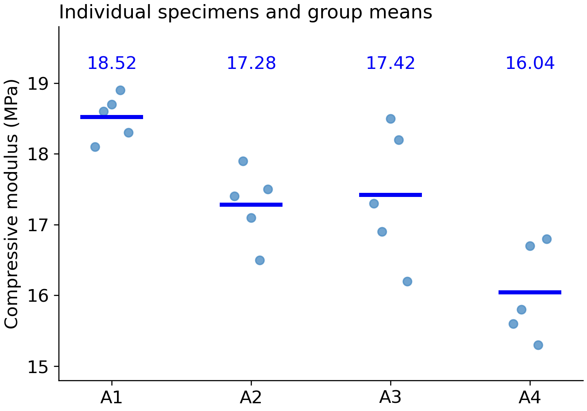
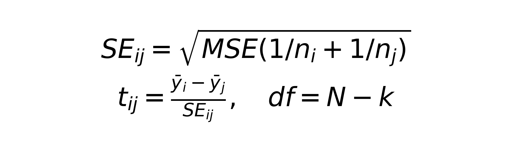
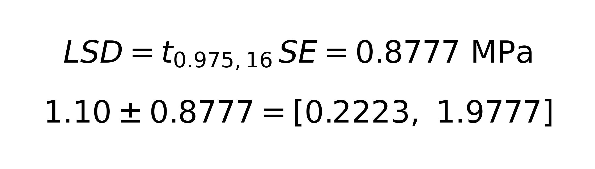
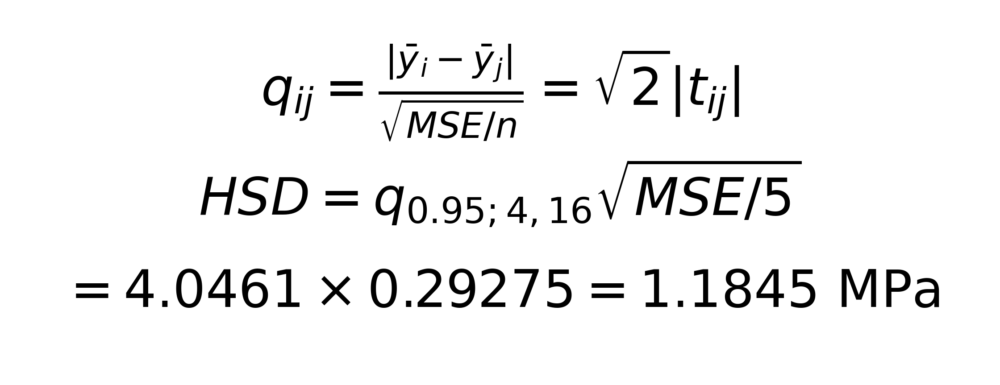
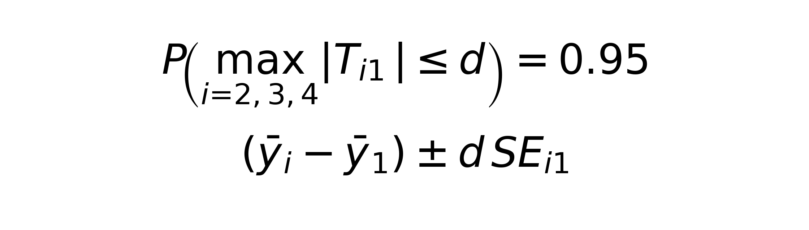
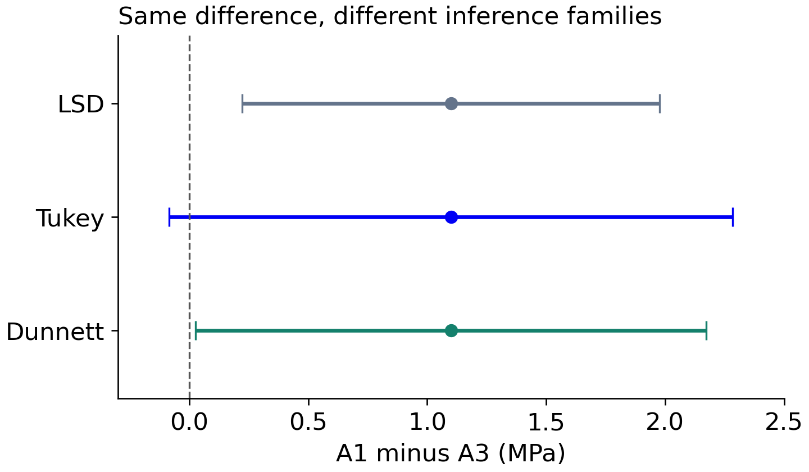
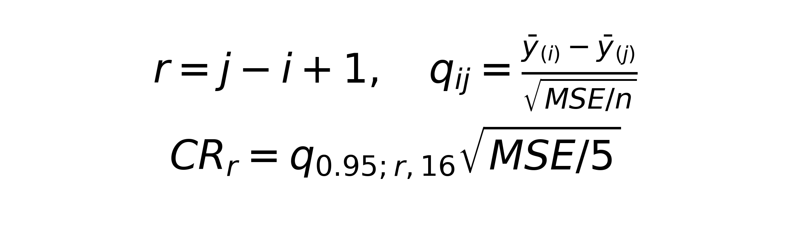

明哥的微生物世界 · 统计课堂 46

# 多组均数怎样比较？LSD、Tukey、Dunnett和SNK怎么选

> 摘要　四组均数可以全部两两比较，也可以只让三个处理分别与同一个对照比较。研究目标不同，需要共同保护的结论范围也不同。本篇沿用课堂的支架教学数据，说明LSD、Tukey、Dunnett和SNK各自的规则与误报控制范围，用同一个均数差读懂临界差、调整P值和置信区间，再看两项2026年研究怎样按目标选择方法。


大家好，我是明哥。

准备11月30日第12次课“单因素方差分析与多组比较”时，课堂材料把LSD和Tukey放在同一道题里：先检验四组总体均数是否全相同，再比较具体组对。教材中还介绍了Dunnett和SNK。

面对这些方法，首先要明确的是：**研究究竟要比较哪些均数，准备把哪些结论放在一起解释？** 全部组对与共同对照比较，所需的方法可以不同；而同样比较全部组对，方法提供的误报保护也未必相同。

[统计课堂22《Tukey检验为什么用q分布？多重比较校正在哪里？》](https://mp.weixin.qq.com/s/VE3pGhSa0J2n_NQna0fhqA)已经解释过q分布。这次从研究目标出发，看四种方法怎样选择、结果怎样报告。

## 一、先确定要比较哪些组

假设某生物医学工程团队比较四种孔结构设计的组织工程支架A1、A2、A3、A4，材料和外形尺寸相同。每种设计独立制备5个试件，共20个；制备和测试顺序随机。按统一程序测量，每个试件得到一个有效压缩模量，单位为MPa。

A1是实验设计时指定的参照结构，A2、A3、A4是三个候选结构。研究可以有不同目标：全面了解四种结构的相互差别；只评价三个候选结构相对A1的变化；或者事先只提出A1与A3这一个比较。本篇用同一份数据演示这三种分析计划。

20个数值取自李春喜等《生物统计学》第6版例7-1，沿用课堂改写的支架情境与单位，用于教学，并非真实支架实验数据<sup>[1]</sup>。表1给出全部观察值，后面的计算均从这些数值出发。

*表1｜四种结构的有效压缩模量（MPa），每行5个独立试件*

| 组别 | 5个观察值 |
| --- | --- |
| A1 | 18.1，18.6，18.7，18.9，18.3 |
| A2 | 17.4，17.9，17.1，16.5，17.5 |
| A3 | 17.3，16.9，18.5，18.2，16.2 |
| A4 | 15.6，15.8，16.7，15.3，16.8 |

本题按**观察独立、各组总体正态且具有共同方差**的经典模型计算。每个试件是一个观察单位；同一试件的多次仪器读数应先按测量方案汇总，不能直接充当多个独立试件。组对比较均采用双侧检验，整体ANOVA按F分布右尾计算P；检验水准α＝0.05，区间采用95%置信水平。

四个总体均数记为μ₁至μ₄。整体ANOVA检验它们是否全相等；具体组对分别检验相应两个总体均数之差是否为0。正态和共同方差的含义、残差检查承接前篇，这里集中讨论这些模型条件适用时的方法选择。

准备作为一批共同解释的检验，组成一个**比较族**。控制整族误报，就是限制这批比较中至少错误拒绝一次真零假设的概率。表2先按研究目标列出比较族，再说明方法的取舍。

*表2｜研究目标、比较族与方法选择*

| 事先确定的研究目标 | 比较族与选择依据 |
| --- | --- |
| 只比较A1与A3 | 1项；共同MSE的单个t比较，可用LSD的临界差计算形式 |
| 四组全部两两比较 | 6项；要求整族误报控制时选Tukey。SNK也比较组对，但保护范围较弱，不能据“同样用q”互换 |
| 三个候选结构各对A1 | 3项；选Dunnett，同时保护这三个共同对照比较 |

如果预先指定了若干比较，但既不是全部组对，也不是共同对照族，可以用模型中的相应比较，再配合Holm或Bonferroni等调整。[统计课堂19](https://mp.weixin.qq.com/s/Ox3tXlD1XchvU6GSmtiuWg)已介绍这些规则。

**比较族应在看结果前确定。** “事先指定”使研究问题清楚，多个事先指定的比较仍有多重性，不能都按唯一比较处理。

## 二、先算出四种方法共用的误差尺度

图1同时画出每个试件的观测点和各组均数，便于区分组间均数差与组内个体波动。



*图1｜圆点为单个试件，蓝横线与上方数字为组均数，单位MPa；横向错开圆点便于观察。*

四组样本均数依次为18.52、17.28、17.42、16.04 MPa。全部四组的组内平方和为6.8560 MPa²，误差自由度为20−4＝16，所以误差均方MSE＝6.8560÷16＝0.4285 MPa²。共同方差模型用这个MSE估计各组共有的误差方差。

整体检验得到F(3,16)＝12.0183，P＝0.0002267，支持四个总体均数不全相同。下面用R读取共享数据、拟合模型，并提取后面需要的MSE和自由度。

`modulus ~ group`表示按结构组别解释压缩模量；`fit`保存完整模型。`deviance(fit)`读取组内平方和，`df.residual(fit)`读取误差自由度。

```r
d <- read.csv("data/scaffold.csv")
d$group <- factor(
  d$group,
  levels = c("A1", "A2", "A3", "A4")
)
fit <- aov(modulus ~ group, data = d)
mse <- deviance(fit) /
  df.residual(fit)
c(MSE = mse, df = df.residual(fit))
```

实际输出为：

```text
    MSE      df
 0.4285 16.0000
```

比较组i和组j时，把各自的样本均数记为ȳᵢ和ȳⱼ，样本量记为nᵢ和nⱼ。两个独立样本均数之差的方差，等于各自方差之和。用MSE代入共同方差，便得到式（1）的均数差标准误和t统计量。



*式（1）｜i、j表示组别；N为总样本量，k为组数，df为误差自由度。均数差与SE以MPa计，t无量纲。*

本例每组5个，所以任何一对的SE都约为0.4140 MPa。它衡量的是**均数差估计的抽样不确定性**。这里的方差估计和16个自由度来自全部四组；如果只抽出两个组重新估计方差，得到的就不再是同一套计算。

LSD、Tukey和Dunnett都利用这个误差尺度，但为均数差设置不同的门槛。SNK还会根据排序后的均数跨度改变门槛。

## 三、LSD什么时候够用，整体F又保护什么？

如果研究事先只关心A1与A3，可以用共同MSE做这一个双侧t比较。样本差值A1−A3＝1.10 MPa，除以SE＝0.4140 MPa，得到t＝2.6570，双侧P＝0.01722。

也可以把t临界值换回MPa尺度。LSD是least significant difference，即最小显著差；均数差的绝对值超过它，就通过相应的单比较门槛。式（2）用本例双侧5%的t临界值2.1199，算出LSD和普通95%置信区间<sup>[2]</sup>。



*式（2）｜LSD及区间端点以MPa计；这是单个均数差的普通95%区间。*

差值1.10 MPa超过0.8777 MPa，区间[0.2223，1.9777] MPa也完全大于0。在这个单比较计划下，有证据支持A1总体平均压缩模量高于A3。

### 整体F显著后，能不能对六对都用LSD？

Fisher保护性LSD先在α＝0.05检验整体F，只有F显著，才继续做未经多重调整的逐对t比较；否则停止。与上面的预定单比较相比，它多了一个整体F的前置步骤<sup>[3]</sup>。

这一步提供的保护有明确范围：**如果四个总体均数全相同，任何组对误报都必须先错误通过整体F这一关。** 因而在所有零假设都成立的情形下，整族至少一次误报的概率不超过0.05。这称为整族错误率（family-wise error rate，FWER）的**弱控制**。

如果一个总体均数确实偏离其他组，整体F就可能很容易显著；其余真正相等的均数仍会接受多次未调整比较。要求无论哪些均数相等、哪些不同，都把整族误报概率控制在0.05以内，才叫**强控制**。四组及更多组的保护性LSD一般没有这个保证，Hayter专门研究过其最大整族错误率<sup>[4]</sup>。

所以，预定单比较可以使用LSD的计算形式；研究全部六对并要求整族保护时，应选择具有相应强控制保证的方法。整体F显著本身不能完成这项多重调整。预定单比较、Tukey和Dunnett各有自己的检验依据，也不以整体F显著为必要条件。

## 四、全部组对都关心，为什么选Tukey？

Tukey把四组的全部六个两两均数差放入同一个推断范围，**在构造门槛、调整P值和同时区间时，已经考虑了这六个比较的多重性**。在本例等组量、独立正态共同方差条件下，它把六对中至少一次误报的概率控制在0.05以内，提供强FWER控制和95%同时置信区间<sup>[5]</sup>。

式（3）把本例的均数差换成学生化极差q统计量，再给出统一临界差HSD。q参照分布中的组数参数始终是全部k＝4组，误差自由度为16。



*式（3）｜n＝5；q₀.₉₅;₄,₁₆＝4.0461，均数尺度的标准误为0.29275 MPa，HSD以MPa计。*

A1−A3的q约为3.7575，未超过4.0461。对应同时区间为1.10±1.1845，即[−0.0845，2.2845] MPa。

Tukey调整P是四组q参照分布超过观察q的右尾概率，本例为0.07352。它大于0.05，与观察q小于4.0461、均数差小于HSD是同一个判定；多重调整已体现在这个联合参照分布中。

[统计课堂22](https://mp.weixin.qq.com/s/VE3pGhSa0J2n_NQna0fhqA)第六节“为什么这里不再调用p.adjust()？”已说明：**Tukey本身已经完成多重比较校正，针对同一比较族，无需再叠加Bonferroni或Holm校正。** 直接使用它给出的调整P值与同时置信区间即可。

R的`TukeyHSD()`读取完整模型，`conf.level = .95`规定整族同时置信水平。返回的`diff`是行名所示方向的差值，`lwr`、`upr`是同时区间端点，`p adj`是Tukey调整P<sup>[5]</sup>。

```r
TukeyHSD(
  fit, "group", conf.level = .95
)
```

表3整理本次实际计算的六个比较，统一为前组减后组。R原输出采用后组减前组；反向时差值取负，区间两端取负并交换，双侧P不变。

*表3｜Tukey全部六对；差值和同时95%区间以MPa计，数字经舍入*

| 比较 | 差值 | 同时95%区间 | 调整P |
| --- | ---: | --- | ---: |
| A1−A2 | 1.24 | [0.0555，2.4245] | 0.03858 |
| A1−A3 | 1.10 | [−0.0845，2.2845] | 0.07352 |
| A1−A4 | 2.48 | [1.2955，3.6645] | 0.000101 |
| A2−A3 | −0.14 | [−1.3245，1.0445] | 0.98619 |
| A2−A4 | 1.24 | [0.0555，2.4245] | 0.03858 |
| A3−A4 | 1.38 | [0.1955，2.5645] | 0.01977 |

结果支持A1高于A2、A4，A2和A3高于A4。以A1−A4为例，估计差值为2.48 MPa，同时95%区间为[1.2955，3.6645] MPa。A1与A3、A2与A3的区间包含0，表示当前同时推断证据不足以判定差异。

“同时95%”指重复抽样时，整套六个区间一起覆盖各自真实差值的比例。若组样本量不同，常用Tukey–Kramer形式，按各组实际样本量计算标准误；本篇等n的统一HSD不能直接照搬。

## 五、各处理只对A1，为什么选Dunnett？

如果研究只评价A2−A1、A3−A1、A4−A1，就有三个共同对照比较。**Dunnett专门保护这一族比较**，在独立、正态、共同方差模型下提供强FWER控制和同时区间<sup>[6]</sup>。

它还利用了共享A1带来的相关性。如果A1样本均数因抽样偏高，三个“处理−A1”差值就会一起变小。

设重复抽样中每个组均数的方差同为v。一个“处理−A1”差值包含两个独立均数，因此方差为2v。两项差值里的A1项同为负号，共有的波动贡献正的协方差v；二者方差相同，所以相关系数为v÷(2v)＝0.5。

用本例MSE估计这些量，各组均数的方差为0.4285÷5＝0.0857 MPa²，一个差值的方差为0.1714 MPa²。两项差值的协方差仍为0.0857 MPa²，除以0.1714便得到0.5。三个比较虽然涉及独立试件，比较统计量却彼此相关。

Dunnett按这三个比较的联合t分布设置临界值d。式（4）说明：在三个零差值的联合参照下，三项t统计量的绝对值同时不超过d的概率为0.95，再由这个d构造同时区间<sup>[7]</sup>。



*式（4）｜Tᵢ₁为处理i与A1的标准化比较量，误差自由度16；本例d约2.59，区间半宽约1.07 MPa。*

与Tukey保护全部六对相比，Dunnett只保护三个共同对照比较，通常可以获得较窄的区间。这个优势来自研究目标更集中，同时利用了比较之间的相关结构。

R中先把A1设为因子的第一个水平，再用`mcp(group = "Dunnett")`生成其余各组减A1的比较。`glht()`把它们连到完整模型，`summary()`默认给出双侧、单步Dunnett调整P，`confint()`给出同时区间<sup>[8]</sup>。

```r
library(multcomp)
set.seed(20261130)
dun <- glht(
  fit,
  linfct = mcp(group = "Dunnett")
)
summary(dun)
confint(dun, level = .95)
```

表4列出这段代码的实际结果，作适当舍入。多元t概率和分位数由数值积分求得，软件与计算精度设置会使末位略有变化；配套项目保留更细的输出及设置。

*表4｜双侧Dunnett共同对照比较；差值与同时95%区间以MPa计，P为约值*

| 比较 | 差值 | 同时95%区间 | 调整P |
| --- | ---: | --- | ---: |
| A2−A1 | −1.24 | [−2.31，−0.17] | 0.022 |
| A3−A1 | −1.10 | [−2.17，−0.03] | 0.044 |
| A4−A1 | −2.48 | [−3.55，−1.41] | ＜0.001 |

三个区间都小于0，支持候选结构的总体平均压缩模量均低于A1。以A3为例，估计降低1.10 MPa，同时95%区间约为降低0.03至2.17 MPa。区间涵盖从很小到超过2 MPa的变化，是否达到工程要求，还要同事先规定的实际有意义差值比较。

图2把同一个A1−A3差值的三种区间放在一起，显示比较范围怎样影响不确定性的表达。图中将Dunnett的A3−A1结果反向，使三条区间方向一致。



*图2｜点估计均为1.10 MPa；竖虚线为无均数差。LSD是普通单比较区间，Tukey与Dunnett分别为六对和三个共同对照比较的同时区间。*

A1与A3在Tukey下调整P＝0.07352，在Dunnett下约为0.044，点估计始终相同。应根据原定的六比较族或三比较族解释结果，不能在看到P值以后临时缩小比较范围。

这里的Dunnett比较均数；**Dunn**则属于秩的多重比较方法，二者的统计对象不同。

## 六、SNK也用q，为什么不能替代Tukey？

若研究要求对全部组对控制整族误报，Tukey有相应的强控制保证。SNK虽然也使用学生化极差q，却改变了逐步比较的规则，**一般不提供全部组对的强FWER控制**。选择它时，需要接受这个保护范围的限制。

SNK是Student–Newman–Keuls多重极差方法。先将样本均数从高到低排列：A1（18.52）、A3（17.42）、A2（17.28）、A4（16.04）MPa。

排序后，第i位到第j位的**跨度r包含两个端点**。A1到A2之间夹着A3，所以r＝3；A1到A3是相邻两位，r＝2。式（5）给出等组量SNK的统计量与临界极差：分母仍是均数尺度的标准误，但q分布中的均数个数改为当前跨度r<sup>[9]</sup>。



*式（5）｜括号下标表示排序位置；本例r＝2、3、4的q临界值约为2.9980、3.6491、4.0461，对应临界极差0.8777、1.0683、1.1845 MPa。*

SNK从最大跨度向较小跨度检查。全跨度拒绝后，再检查三个均数的连续区间，然后检查两个均数的连续区间。若某个区间未拒绝，它所包含的内部组对也不再判为显著；其他未被它包含的区间仍按规则判断<sup>[10]</sup>。

本例中，A1到A2的跨度3区间包含A1−A3和A3−A2两个相邻比较，它们都要保留这个大区间的限制。表5按从大到小的跨度列出实际计算结果；两个跨度3都通过后，才进入相邻比较。

*表5｜等组量SNK逐步比较；差值与临界极差以MPa计，各行判定已考虑包含它的较大区间*

| 排序端点 | r | 差值 | 临界极差 | 判定 |
| --- | ---: | ---: | ---: | --- |
| A1−A4 | 4 | 2.48 | 1.1845 | 拒绝 |
| A1−A2 | 3 | 1.24 | 1.0683 | 拒绝 |
| A3−A4 | 3 | 1.38 | 1.0683 | 拒绝 |
| A1−A3 | 2 | 1.10 | 0.8777 | 拒绝 |
| A3−A2 | 2 | 0.14 | 0.8777 | 不拒绝 |
| A2−A4 | 2 | 1.24 | 0.8777 | 拒绝 |

还可以用局部极差P值记录同一判定。对A1−A3，必须检查包含它的三个区间：

- A1到A3，r＝2，局部P约0.01722；
- A1到A2，r＝3，局部P约0.02207；
- A1到A4，r＝4，局部P约0.000101。

三项都小于0.05，才允许拒绝A1−A3。等价地，可以取这三个P的最大值0.02207，再与0.05比较；只要一个包含区间未通过，这个最大值就不会小于0.05。配套三语脚本按这一规则自编实现并保存逐步判定结果。

A1−A3走到相邻比较时，用r＝2的0.8777 MPa门槛，因此被SNK判为不同；Tukey始终用全部4组的1.1845 MPa门槛，所以本例没有拒绝这一对。

SNK在所有总体均数全相同时有弱FWER控制，但部分均数不同、部分相同时，一般没有强控制保证；上述逐步判定也没有这样的强控制保证。较大跨度可能因为真实差异而通过，接下来对真正相同的均数仍会反复检验，误报便可能累积。加一个整体F前置步骤，也不能一般补足这个保证<sup>[10]</sup>。

因此，对需要全部组对同时推断的新研究，通常优先选择Tukey；采用SNK的分析应报告跨度、逐步规则及其错误控制范围。本例限于等n，组量不等时需要另行核对实现。

教材中还会见到Duncan和Scheffé。Duncan也是多重极差法，但还随跨度改变显著性水平，通常更宽松。Scheffé则保护更广的均数线性对比，例如一个组与另外几个组平均水平的差；目标仅为全部两两比较时，通常无需保护这样大的对比范围<sup>[10]</sup>。

## 七、近期研究怎样选择Tukey和Dunnett？

下面两项2026年的原始研究，一项比较四种组织工程支架配方的组对，另一项按研究问题分别比较各浓度与共同对照、或比较不同化合物。它们把前面的选择依据落到了实际研究中。

### （一）骨修复支架：不同配方之间怎样比较？

Luo等于2026年6月30日在《Bone Research》发表研究，为激素性股骨头坏死设计含多壁碳纳米管（MWCNT）和纳米羟基磷灰石（nHA）的3D打印支架。力学分析比较nHA及MWCNT含量为0.2、0.5、1 wt%（质量百分比）的四种配方，统计方法写明采用单因素ANOVA及Tukey两两比较<sup>[11]</sup>。

按上述配方顺序，论文图2d给出的压缩杨氏模量均数为59.95、49.19、40.13和32.01 MPa。Tukey比较显示，1 wt%组低于nHA及0.2 wt%组；与0.5 wt%组的差异未达显著<sup>[11]</sup>。

这里既比较候选配方与nHA，也比较不同MWCNT含量的候选配方彼此，因而超出了只与一个参照比较的范围，体现了Tukey所服务的组对比较目标。

### （二）细菌生物传感器：为什么同一研究换用两种方法？

Senovilla-Herrero等于2026年10月30日在《FEMS Microbiology Letters》发表研究，用携带*lux*发光基因的恶臭假单胞菌（*Pseudomonas putida*）评价全氟和多氟烷基物质（PFAS）的生物效应。培养液浓度设为0、0.1、1和10 mg/L；原文表2的生长速率与世代时间由每组2或3个批次培养重复计算<sup>[12]</sup>。

分析这两个生长参数时，作者对每个菌株、每种化合物进行单因素ANOVA，整体效应显著后用Dunnett将各暴露浓度与0 mg/L未处理对照比较。研究报道F1菌株在全氟壬酸和全氟己烷磺酸暴露下生长速率降低<sup>[12]</sup>。

同一论文在固定暴露浓度、比较不同PFAS的发光抑制率时，则采用Tukey两两比较。0.1 mg/L时，F1菌株的发光受全氟壬酸抑制最强，全氟己烷磺酸次之，全氟辛酸最低；1和10 mg/L时未检出化合物间的显著差异<sup>[12]</sup>。

前一个问题是“各浓度相对未处理对照怎样”，后一个问题是“化合物彼此怎样不同”。**方法随着当前比较目标改变，而不是一篇论文只能选一种多重比较方法。** 研究采用了某种方法，可以说明它的实际用途；数据是否满足模型条件，仍须按各自设计判断。

## 八、本篇讲了哪些知识？

- **研究问题决定比较族，比较族决定方法的保护范围。** 单个预定比较可用共同MSE的t检验；全部组对可选Tukey；多个处理各对同一个参照可选Dunnett。若有多个预定比较，仍须考虑多重性。
- **LSD的单比较门槛不能自动保护整族。** 本例LSD为0.8777 MPa；保护性LSD增加整体F前置步骤，但四组及更多组一般不提供强FWER控制。
- **Tukey与Dunnett的区间对应不同的一批结论。** 本例Tukey用k＝4、df＝16的q临界值4.0461，HSD为1.1845 MPa；Dunnett利用三个共享A1的比较及其相关性，半宽约1.07 MPa。
- **SNK按排序跨度改变q门槛，并保留较大区间的限制。** r包含两个端点；其较小门槛与较多拒绝，不能替代全部组对的强误报控制。
- **结果要带方向、单位和不确定性一起报告。** 调整P与区间按所属比较族解释；区间包含0表示证据不足，不等于两组等效。实际价值还需结合工程阈值，[统计课堂11](https://mp.weixin.qq.com/s/ZwcUQoyq5vk4dw5Nhv74Gw)有进一步讨论。

这些选择以本篇的独立、共同方差模型为前提。若共同方差不适合，均数比较可考虑Welch整体检验与Games–Howell两两比较；同一对象的多次测量，则应采用保留相关结构的模型。

## 配套练习资料

这次准备了R、Python和MATLAB三套脚本，读取同一份`scaffold.csv`。任选一种，从读取数据开始逐节运行：先核对共同MSE，再看A1−A3的LSD/Tukey结果，随后核对Dunnett的共享对照相关性与SNK的三个包含区间。

第二次将脚本的`UNIT_SCALE`改为1000，把MPa换成kPa。差值、SE和区间都会乘1000，而t、q、P和显著判断保持不变。它们标准化以后，为什么能消除单位变化？可以沿着输出重新解释一遍。

解压后先读`article46_posthoc_selection/README.md`，三种入口分别是：

- R：`代码/posthoc_selection.R`，打开本篇Rproj后按节运行。
- Python：`代码/posthoc_selection.py`，在Spyder中从第1节开始。
- MATLAB：`代码/posthoc_selection.m`，先把Current Folder设为项目根。

本篇完整项目目录：
https://github.com/fuyuming/statistics-classroom/tree/main/stats_classroom/article46_posthoc_selection

系列仓库入口：
https://github.com/fuyuming/statistics-classroom

整个仓库ZIP下载：
https://github.com/fuyuming/statistics-classroom/archive/refs/heads/main.zip

下载整个仓库ZIP并解压后，进入`stats_classroom/article46_posthoc_selection`，先读README；也可以从本篇目录下载单独的三语练习项目ZIP。

这里是“明哥的微生物世界”，一起把统计问题读清楚、算明白。

## 参考文献与资料

1. 李春喜等. 生物统计学. 第6版. 第7章，例7-1及多重比较部分，p158–165。本篇保留20个数值，沿课堂改写为支架教学情境。
2. Rosner B. Fundamentals of Biostatistics. 8th ed. Cengage Learning, 2016. §12.4，p559–565；p561式12.12，共同误差与LSD。
3. SAS/STAT官方说明：Alternative Multiple Comparison Procedures，Fisher保护性LSD的两步程序。https://support.sas.com/documentation/cdl/en/statug/67523/HTML/default/statug_anova_examples02.htm
4. Hayter AJ. The Maximum Familywise Error Rate of Fisher's Least Significant Difference Test. J Am Stat Assoc. 1986;81(396):1000–1004. https://doi.org/10.1080/01621459.1986.10478364
5. R stats官方说明：TukeyHSD，全部两两均数差的同时区间与调整P。https://stat.ethz.ch/R-manual/R-devel/library/stats/html/TukeyHSD.html
6. Dunnett CW. A Multiple Comparison Procedure for Comparing Several Treatments with a Control. J Am Stat Assoc. 1955;50(272):1096–1121. https://doi.org/10.1080/01621459.1955.10501294
7. SciPy官方说明：dunnett，共同对照比较、条件及同时区间。https://docs.scipy.org/doc/scipy/reference/generated/scipy.stats.dunnett.html
8. multcomp官方手册：glht、mcp和single-step联合t分布推断。https://cran.r-project.org/web/packages/multcomp/refman/multcomp.html
9. Keuls M. The use of the “studentized range” in connection with an analysis of variance. Euphytica. 1952;1:112–122. https://doi.org/10.1007/BF01908269
10. SAS/STAT官方说明：Multiple Comparisons，Multiple-Stage Tests及各方法误报控制范围。https://support.sas.com/documentation/cdl/en/statug/68162/HTML/default/statug_glm_details29.htm
11. Luo Y, Li Q, Chen C, et al. Coral-inspired immunoreprogramming scaffold reverses the “immune-freeze” microenvironment to promote bone regeneration in steroid-induced osteonecrosis of the femoral head. Bone Res. 2026;14:69. 2026-06-30发表；图2d及Statistical analysis。https://doi.org/10.1038/s41413-026-00557-x
12. Senovilla-Herrero D, Campbell K, Helyar S, Moore H, Mbadugha L. Assessment of PFAS toxicity using lux-marked bioluminescent Pseudomonas biosensors. FEMS Microbiol Lett. 2026;373:fnag135. 2026-10-30发表；Data treatment and analysis、表2及结果。https://doi.org/10.1093/femsle/fnag135
