明哥的微生物世界 · 统计课堂 47

# 方差分析的差异有多大？η²、ω²与偏η²怎样理解？

> 摘要　四种支架的平均压缩模量有差异，差异究竟占了多少变异？沿用课堂的20个教学数值，从平方和读懂η²，再看ω²为什么要扣除一部分组间变异。用一个完整的小例子理解偏η²换了什么分母，最后回到结果报告，并结合两项2026年研究，看整体比例、带单位的均数差和区间怎样各自补充信息。


大家好，我是明哥。

准备本科《概率与医学统计学》的多组均数比较内容时，我把支架例题的整体检验和效应量放在一起。课堂用η²表示组间平方和占总平方和的比例，先完成定义和代入；这篇接着讨论：这个样本比例怎样联系总体，研究设计改变后又该怎样理解。

**样本中解释了69.3%的变异，能否直接当作总体效应？ω²为什么会小一些？偏η²中的“偏”，又改变了什么？**

[统计课堂11《P＝0.06，该怎样解释？》](https://mp.weixin.qq.com/s/ZwcUQoyq5vk4dw5Nhv74Gw)已经讨论过P值、效应量和置信区间各自的作用。这篇把问题落到普通独立组方差分析：从同一份数据出发，分清样本描述、总体估计和分母的选择。

## 一、先把题目、数据和所求放在一起

假设某生物医学工程团队比较A1、A2、A3、A4四种孔结构设计的组织工程支架。材料和外形尺寸相同，每种设计独立制备5个试件，共20个；制备和测试顺序随机。每个试件按统一程序测试一次，得到有效压缩模量，单位为MPa。**分析单位是独立试件**。

表1给出全部数据。20个数值沿用李春喜等《生物统计学》第6版例7-1，本题只改写情境和单位，用于教学，并非真实支架实验<sup>[1]</sup>。

*表1｜四种孔结构的有效压缩模量，单位MPa*

| 设计 | 5个独立试件的测量值 |
| --- | --- |
| A1 | 18.1，18.6，18.7，18.9，18.3 |
| A2 | 17.4，17.9，17.1，16.5，17.5 |
| A3 | 17.3，16.9，18.5，18.2，16.2 |
| A4 | 15.6，15.8，16.7，15.3，16.8 |

沿普通固定效应单因素ANOVA分析，假定试件之间独立、各组误差正态且具有共同方差。检验水准为0.05，检验四组总体均数相等的假设；组对区间采用全部6个两两比较的Tukey同时95%置信区间。

这篇依次求：组别解释了多少样本变异；对总体变异比例怎样作偏差修正；η²、偏η²与R²有何关系；最后以A1−A3为例，怎样同时报告整体效应与带单位的具体差异。

四组样本均数依次为18.52、17.28、17.42、16.04 MPa，总均数为17.315 MPa。图1把每个试件与本组均数画在一起，便于同时看组间距离和组内分散。

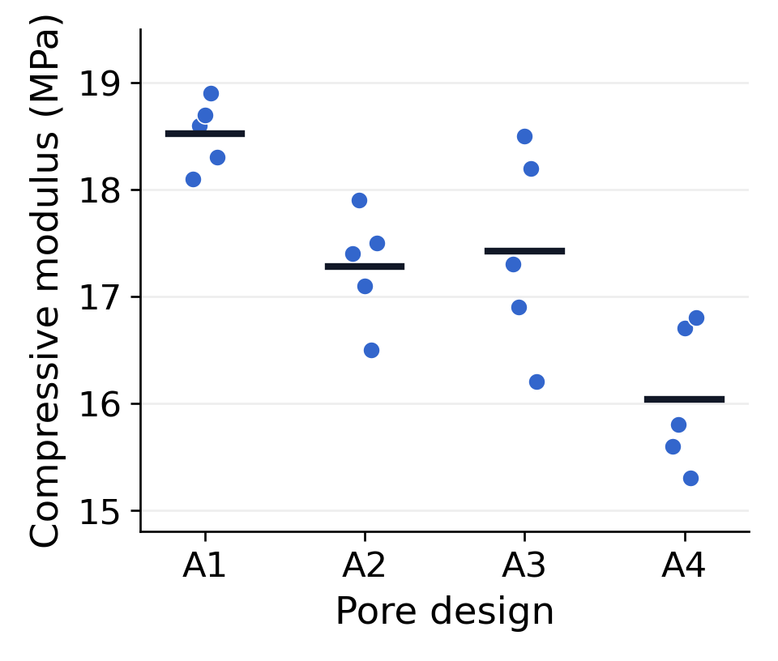

*图1｜每个圆点代表一个独立试件，短横线代表组均数。纵轴为有效压缩模量（MPa）；横向轻微错开仅为避免点重叠。*

## 二、η²：把组间变异放进总变异中看

如果只用总均数17.315 MPa代表所有试件，每个观测值都会留下一个偏差。把20个偏差分别平方再相加，得到**总平方和SST**。

如果知道每个试件属于哪一种设计，就改用本组均数代表它。此时留下的是**组内平方和SSW**，也就是模型的残差平方和。两种代表方式所减少的平方和，正是**组间平方和SSB**。

本题组数记为k＝4，总样本量记为N＝20。式（1）把三种平方和的计算和关系列在一起。

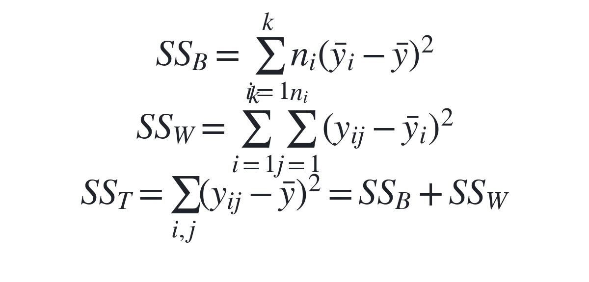

*式（1）｜i表示组，j表示组内试件；nᵢ是各组样本量，ȳᵢ是组均数，ȳ是总均数，yᵢⱼ是单个试件的模量。三种平方和单位均为MPa²。*

例如A1的第一个试件，与本组均数相差18.1−18.52＝−0.42 MPa；它给SSW增加0.1764 MPa²。A1组均数与总均数相差1.205 MPa，这个组有5个试件，给SSB增加5×1.205²＝7.260125 MPa²。

用全部原始数计算，得到SSB＝15.4495、SSW＝6.8560、SST＝22.3055 MPa²。**η²（eta squared）就是组间平方和占总平方和的比例**，式（2）给出本例代入<sup>[2]</sup>。

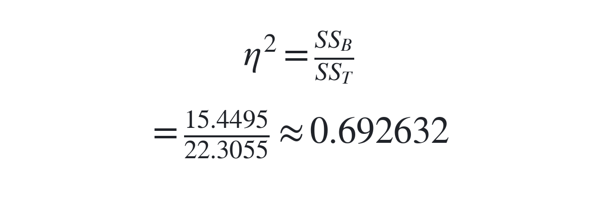

*式（2）｜分子、分母的MPa²相消，η²无单位。*

本例η²≈0.693，意思是：**这20个试件围绕总均数的平方偏差中，约69.3%可以由四组样本均数之间的差异解释。** 其余约30.7%留在各组内部。

图2按同一个SST画出这两部分。这里的“解释”指模型对样本变异的分解；要作因果解释，还需研究设计支持。这个百分比也不表示某种支架的平均模量提高了69.3%。

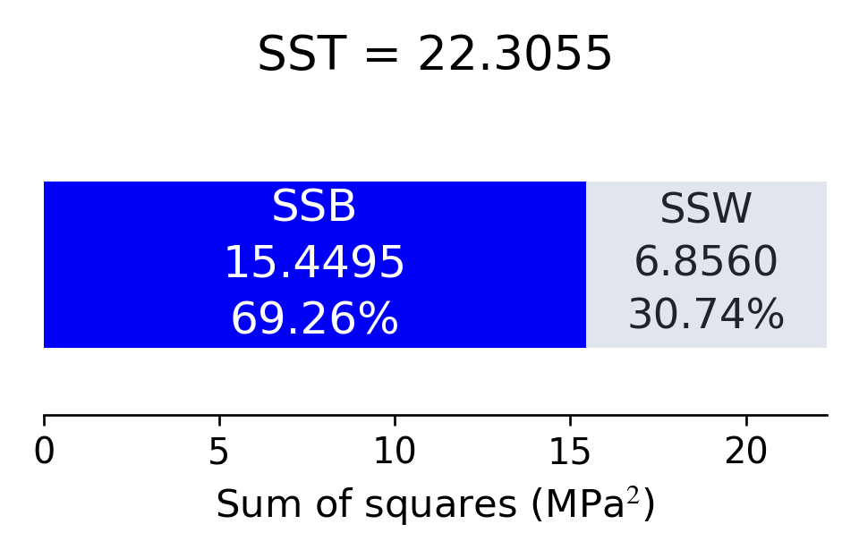

*图2｜长条总长度为SST，蓝色为SSB，灰色为SSW。它描述本样本的平方和分配。*

η²汇总四组均数的整体分离程度，本身不携带某个组对的方向。例如A1−A3＝1.10 MPa，这个正号和单位，要从具体均数差中读取。

## 三、从样本走向总体：ω²为什么要修正？

### （一）样本均数的距离，也混有抽样波动

假如四种设计的总体均数完全相同，每组只抽5个试件，四个样本均数通常仍会有高低。SSB把这些偶然差别也平方后加了进去，因此样本η²用来估计总体变异比例时有向上的偏差，小样本尤其需要留意<sup>[3]</sup>。

“有偏”描述的是同样研究反复抽样时，估计量的平均表现；某一次样本的η²仍可能低于总体值。

先说明要估计什么。记四组总体均数为μᵢ，共同组内方差为σ²；它们描述总体，样本中计算出的组均数用ȳᵢ表示。本题按四种设计各1/4加权，μ是四个总体均数的平均，Vμ则是它们相对μ的平方偏差的平均。把四种设计各按1/4的比例合起来描述总体，总方差由组均数之间的分散Vμ和共同组内方差σ²组成。式（3）用η²的下标pop标明这个**总体比例**。

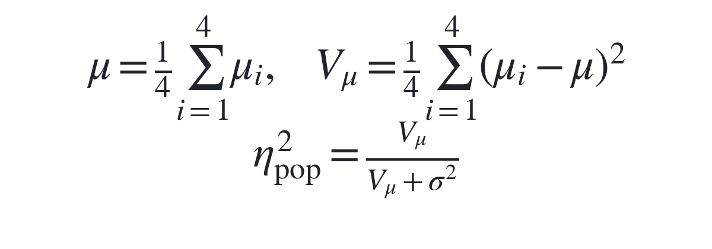

*式（3）｜Vμ和σ²均以MPa²计。这里的总体比例针对这四种设计及等权分配；改变所纳入的设计或权重，所描述的总体比例也可能改变。*

分子表示总体组均数之间的分散，分母再加上组内真实变异。μᵢ和σ²在实际研究中未知，需要用样本估计。

### （二）用误差均方估计那部分偶然变异

回到本例的N＝20、k＝4。组内平方和除以误差自由度N−k，得到**误差均方MSE**。式（4）先算出这个量，再列出普通单因素模型中SSB和SST的期望。

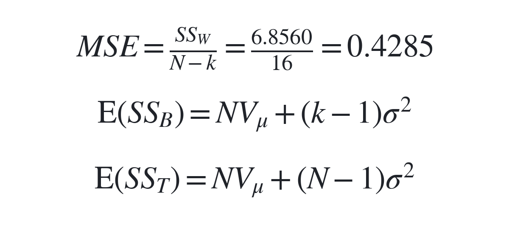

*式（4）｜E表示同样设计反复抽样时的平均值。MSE估计共同组内方差σ²，本例为0.4285 MPa²。期望关系基于各组独立、共同方差和固定的组样本量。*

为什么出现k−1？先把各组样本均数减去固定的总体均数μ，再把参照中心换成本次样本的总均数ȳ。式（4a）写出这次换中心的关系，以及两项平方和的期望。

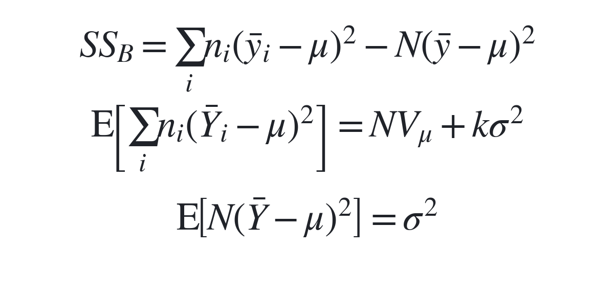

*式（4a）｜本例各组均为5个试件，样本量权重与式（3）的1/4一致。μ是固定的总体加权均数；Ȳᵢ、Ȳ表示重复抽样时会改变的组样本均数和总样本均数，E表示对这些重复样本取平均。小写ȳᵢ、ȳ对应一次样本的实际数值。*

每个组样本均数的方差为σ²/nᵢ，乘回nᵢ后，各组的抽样波动贡献一个σ²，k组共k个。总样本均数的方差为σ²/N，乘回N后贡献一个σ²。按式（4a）相减，就留下(k−1)σ²。

这也说明：即使四组总体均数完全相同，Vμ＝0，SSB的期望仍为3σ²。用(k−1)MSE估计并扣除这部分偶然分离，本例应扣3×0.4285＝1.2855 MPa²，分子由15.4495修正为14.1640 MPa²。

分母也有对应的调整：SST的期望中只有(N−1)个σ²；加上一个估计σ²的MSE后，期望变为N×(Vμ＋σ²)。这样，分子、分母就分别朝向式（3）中同倍数的两个总体量。

普通独立组单因素ANOVA的**ω²（omega squared）**据此写成式（5）<sup>[3]</sup>。

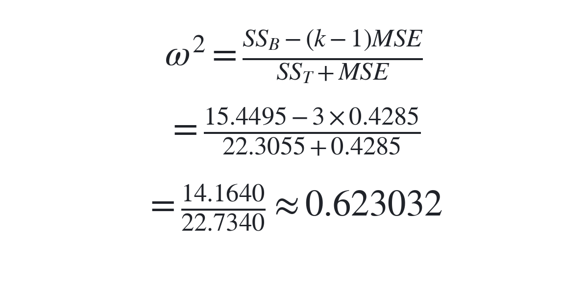

*式（5）｜分子扣除组均数抽样波动的估计，分母加上MSE；本例ω²≈0.6230。*

η²≈0.693描述这份样本的解释比例；ω²≈0.623是针对式（3）总体比例的偏差修正点估计。**ω²仍有抽样不确定性，修正也不保证每一次都更接近总体。** 虽然修正后的分子、分母分别估计相应的总体量，两个随机量相除的期望仍未必等于其期望之比，因此不宜称为严格无偏。

如果SSB小于(k−1)MSE，式（5）会给出负估计，表示扣除估计的抽样波动后，未留下正的效应估计。总体变异比例以0为下界，软件可能把负估计截为0；本篇使用的effectsize 1.0.3就采用这一约定。报告时应说明采用的处理方式，本例ω²为正，不受截断影响<sup>[4]</sup>。

## 四、偏η²：“偏”在分母，和修正偏差不同

**偏η²（partial eta squared，ηp²）以“当前效应平方和＋与该效应对应的误差平方和”为分母**，见式（6）<sup>[2]</sup>。


*式（6）｜效应项和误差项都要从当前研究设计、模型及ANOVA表中确定。*

在表1这个普通独立组单因素模型中，只有组间与组内两种来源，SSB＋SSW就是SST。因此ηp²＝η²≈0.693。这里的“偏”指分母只保留当前效应与相应误差；ω²则修正样本偏差，两者的作用不同。

有其他变异来源时，分母才会显出区别。下面仍围绕支架研究，只用一个小例子看分母。

### （一）把两种设计与两种温度一起安排

假设另做一次教学实验，比较两种孔结构D1、D2，并分别在低温、高温两种测试条件下测量有效压缩模量。材料、外形尺寸与测试程序的其余部分一致；四种组合各有2个独立试件，共8个，试件随机分入组合并随机安排测试顺序，每个试件只测一次。表2给出全部人工教学数值，单位为MPa。

本例采用包含“孔结构、温度及二者交互作用”的完整二因素模型，假定独立、正态及共同误差方差。交互作用表示孔结构的均数差是否随温度而改变。本例要比较的是**孔结构平方和占总平方和的比例，以及孔结构的偏η²**。

*表2｜两种孔结构×两种温度，每格2个独立试件，单位MPa*

| 孔结构 | 低温 | 高温 |
| --- | --- | --- |
| D1 | 9，11 | 13，15 |
| D2 | 11，13 | 15，17 |

两种温度下，D2−D1的样本均数差都是2 MPa。合并两种温度后，D1、D2的均数分别为12、14 MPa；合并两种孔结构后，低温、高温的均数分别为11、15 MPa。这些是相应因素的边际均数，总均数为13 MPa。

在这个辅助例中，A表示孔结构，B表示温度，AB表示交互作用。孔结构的每个边际均数包含4个试件，温度也一样，所以各自平方偏差都乘4。四个组合均数分别为10、12、14、16 MPa；四格各有两个残差−1、＋1 MPa，所以误差平方和为4×(1²＋1²)＝8 MPa²。式（7a）列出各来源的计算。

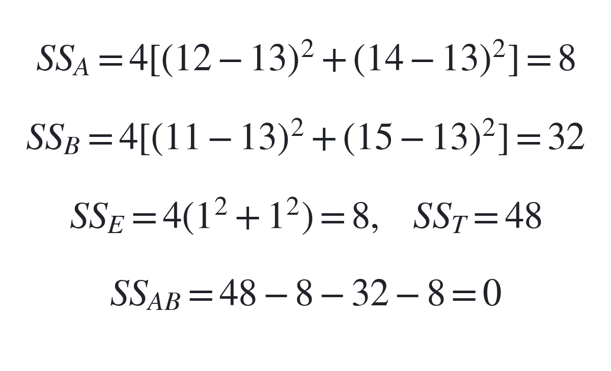

*式（7a）｜本辅助例SSA为孔结构、SSB为温度、SSAB为交互作用、SSE为误差，单位均为MPa²。SST直接由全部8个值相对总均数13的平方偏差求和。*

完整模型为每个组合拟合本格均数，SSE因此是各观测值相对本格均数的平方偏差之和。平衡设计中，总平方和由孔结构、温度、交互作用和误差四部分相加；用总平方和减去其余三项，就得到交互作用平方和0。这也对应两种温度下相同的孔结构均数差。

式（7b）用孔结构平方和8 MPa²分别除以两个参照总量，看分母改变了什么。

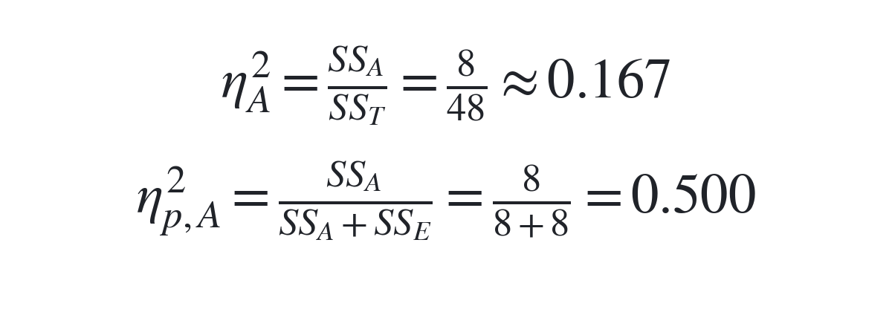

*式（7b）｜普通η²以全部平方和48为分母；偏η²只保留孔结构平方和8与误差平方和8。*

普通η²问：“孔结构占**全部样本变异**的多少？”偏η²问：“只在**孔结构平方和与误差平方和**组成的参照总量中，孔结构占多少？”后者的分母排除了温度和交互作用的平方和，所以比例增大。

**数值从0.167变成0.500，发生变化的是参照总量；同一份数据中的2 MPa均数差保持相同。** 这里的50%只对应“孔结构＋误差”这个分母。比较不同研究时，还要连同因素设置、误差项和平方和口径一起看<sup>[2]</sup>。

本例特意采用各格样本量相同的设计，来源间的分解清楚。更一般的多因素设计还涉及不同类型的平方和；重复测量则有与效应对应的误差项，应按各自模型计算<sup>[4]</sup>。

## 五、回到四组主例：η²为什么又等于R²？

[统计课堂13《t检验，原来也是回归》](https://mp.weixin.qq.com/s/prfW3gQe7kXAUhqaisG6yw)讲过，组均数比较可以写成线性模型。这里把组别作为有四个水平的分类变量，拟合带截距模型`modulus ~ group`。

这个模型为每个试件预测本组样本均数，残差平方和就是SSW。带截距模型的未调整R²，用“1减残差平方和占总平方和的比例”表示，式（8）直接得到它与η²的关系<sup>[5]</sup>。

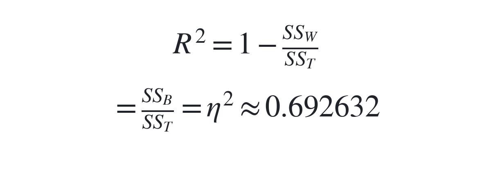

*式（8）｜使用同一份完整数据、同一个带截距的单因素分类模型；本例R²＝η²≈0.692632。*

这个等式来自同一套平方和分解。把A1到A4随意编码成1到4、当连续变量拟合，就换成了“均数沿编码呈直线变化”的模型，通常不再得到相同结果。

调整R²进一步考虑拟合所用的参数个数。四组模型估计四个组均数，误差自由度为N−k＝16；总平方和的自由度为N−1＝19。式（9）给出本例的调整R²。

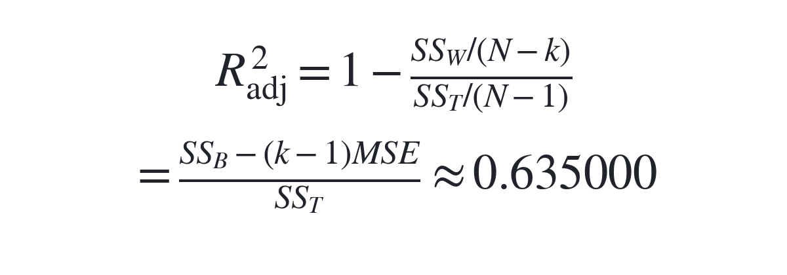

*式（9）｜调整R²≈0.6350；与式（5）的ω²相比，修正后分子相同，分母仍为SST。*

因此，本例未调整R²≈0.6926、调整R²≈0.6350、ω²≈0.6230。后两者都带有修正，但**调整R²与ω²并不是同一个公式**。

## 六、0.01、0.06、0.14，怎样用才合适？

课堂采用effectsize中名为`field2013`的规则，来源条目为Field（2013）《Discovering Statistics Using IBM SPSS Statistics》第4版。表3把软件实际使用的范围列清楚，用于本篇η²的粗略描述<sup>[6]</sup>。

*表3｜本篇采用的η²参考规则：effectsize的field2013*

| η²范围 | 参考描述 |
| --- | --- |
| 小于0.01 | 极小 |
| 0.01至小于0.06 | 小 |
| 0.06至小于0.14 | 中等 |
| 大于或等于0.14 | 大 |

本例η²≈0.693，按这套规则描述为“大效应”。这个词概括的是相对于变异的大小，研究意义还要回到MPa、测量精度、目标组织的力学需求，以及制造成本等具体条件。

这些数字也能与单因素ANOVA常见的Cohen f参考值对应。Cohen（1992）表1第7行给出的f为0.10、0.25、0.40；按式（10）转换成总体变异比例，依次约为0.0099、0.0588、0.1379，四舍五入后便是0.01、0.06、0.14<sup>[7]</sup>。

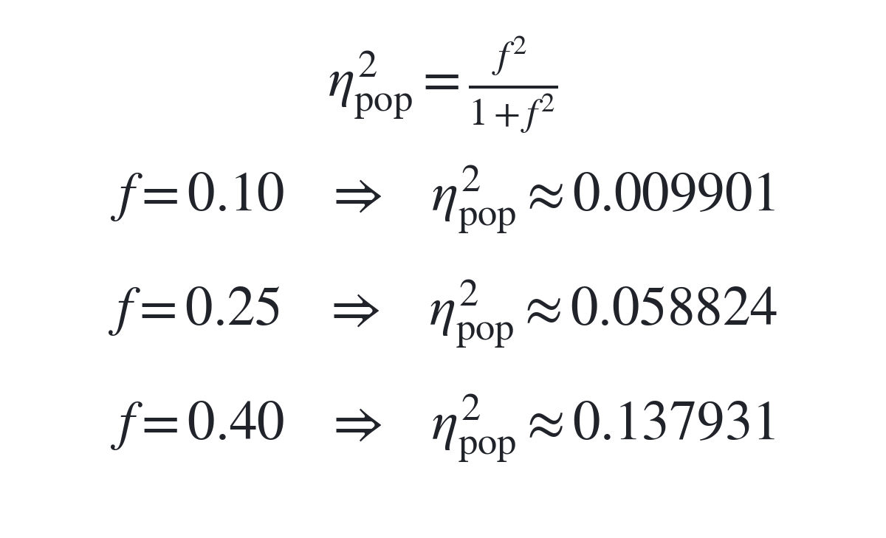

*式（10）｜这里f是共同组内标准差尺度上的总体均数分散程度，用于说明参考值的对应关系。研究前规划的f与本次样本估计的η²要区分。*

参考规则也有语境之分：effectsize中名为`cohen1992`的规则，取自Cohen表1第8行的多重相关语境，转换后的界值为0.02、0.13、0.26。本文采用的`field2013`与课堂一致；使用软件时要把规则名称写清楚<sup>[6]</sup>。

effectsize规则说明：https://easystats.github.io/effectsize/reference/interpret_omega_squared.html

这些界值适合作为缺少领域依据时的粗略参照。**效应量的指标、分母和研究语境，应与参考规则一起报告。** 对重复测量偏η²或其他效应量，不能直接把同一组数字当成通用标准<sup>[2]</sup>。

## 七、把整体比例、MPa差值和区间放回同一结论

主例整体检验得到F(3,16)＝12.0183，P≈0.0002267，支持四组总体平均模量不全相同。η²≈0.693、ω²≈0.623，分别补充样本变异分配和修正后的总体效应估计。

再看题目指定的A1−A3：样本均数差为18.52−17.42＝**1.10 MPa**。这回答具体两种设计差多少，以及方向如何。

由于本题安排四组全部6个两两比较，采用Tukey同时95%置信区间。A1−A3的区间约为**[−0.0845，2.2845] MPa**，调整P≈0.07352。区间方法保护的是全部6个区间的同时覆盖率，不能把它与只针对一个组对的普通95%区间混为一谈<sup>[8]</sup>。

这个结果允许我们同时说：四组整体差异相对于组内变异较大；但A1与A3这一对，数据及模型仍容许总体差值接近0，也容许相当程度的正差值。较大的整体平方和比例，可以与某个组对的区间包含0同时出现。

如果要写成一段研究结果，可以这样表述：

> 四组独立试件的平均压缩模量存在整体差异，F(3,16)＝12.018，P＝0.000227；样本η²＝0.693，偏差修正后的ω²＝0.623。A1和A3的样本均数分别为18.52、17.42 MPa，A1−A3＝1.10 MPa；针对全部6个两两比较的Tukey同时95%置信区间为[−0.084，2.284] MPa，调整P＝0.0735。

η²、ω²这类无单位效应量，把四组整体均数分离放到变异尺度上看；1.10 MPa给出A1与A3的具体幅度和方向，区间则呈现这一组对估计的不确定性。**显著和不显著的结果，都可以报告效应量及适当区间**；是否值得采用某种设计，还需事先明确可接受的力学差异和代价。

本篇的普通ANOVA平方和公式对应独立组、共同方差的模型。Welch、Kruskal–Wallis和重复测量有各自的目标与误差结构，计算效应量时应使用与方法相匹配的定义。

## 八、用R核对，再选一种语言自己跑通

配套的`scaffold.csv`就是表1。`read.csv("data/scaffold.csv")`接收CSV相对路径，返回数据框`scaffold`，其中`group`是设计、`modulus`是模量。`factor(scaffold$group)`把组别向量转为分类因子。

`aov()`中的公式`modulus ~ group`指定用组别解释模量，`data = scaffold`指定数据框，函数返回拟合对象`fit`。`anova(fit)`再把这个对象转换成ANOVA表。`tab["group", "Sum Sq"]`按行名和列名取出组间平方和，误差项同理；最后的`round(..., 6)`只把显示结果保留六位小数，计算中仍保留原精度。

```r
scaffold <- read.csv("data/scaffold.csv")
scaffold$group <- factor(scaffold$group)
fit <- aov(modulus ~ group, data = scaffold)
tab <- anova(fit)
SSB <- tab["group", "Sum Sq"]
SSW <- tab["Residuals", "Sum Sq"]
SST <- SSB + SSW
MSE <- tab["Residuals", "Mean Sq"]
df_group <- tab["group", "Df"]
eta2 <- SSB / SST
omega2_raw <- (
  SSB - df_group * MSE
) / (SST + MSE)
round(c(eta2 = eta2,
        omega2_raw = omega2_raw), 6)
```

实际输出为：

```text
      eta2 omega2_raw
  0.692632   0.623032
```

effectsize的`eta_squared()`和`omega_squared()`也能直接接收拟合对象`fit`，返回效应量数据框。`partial = FALSE`指定普通η²或ω²；`ci = NULL`表示本次只提取点估计，返回表中的`Eta2`或`Omega2`列。`interpret_eta_squared()`接收η²数值，按指定规则返回文字标签<sup>[4,6]</sup>。

```r
eta_obj <- effectsize::eta_squared(
  fit, partial = FALSE, ci = NULL
)
omega_obj <- effectsize::omega_squared(
  fit, partial = FALSE, ci = NULL
)
round(c(eta2 = eta_obj$Eta2,
        omega2 = omega_obj$Omega2), 6)
effectsize::interpret_eta_squared(
  eta_obj$Eta2, rules = "field2013"
)
```

实际输出的两个点估计仍为0.692632和0.623032，文字标签为`"large"`。它们是点估计；第七节的区间针对A1−A3的总体均数差。

effectsize函数说明：https://easystats.github.io/effectsize/reference/eta_squared.html

完整脚本还会核对偏η²、R²、调整R²、Tukey区间以及表2的二因素分母。先读数值，再做一个改动：**把主例全部MPa换成kPa，也就是每个值乘1000。** 看均数差和区间端点是否也乘1000，而η²、ω²与R²保持不变。这个练习能直接检验你是否理解“无单位”的含义。

## 九、近期研究怎样报告这些效应量？

课堂设例帮助我们看清计算，再看两项2026年发表的原始研究：研究者在具体问题中选择什么效应量，又怎样把它与结局和模型连起来。下面的样本量、检验结果和效应量均按原文报告。

### （一）童年逆境与情绪调节：用ω²概括组间差异

Doba等2026年7月发表于《Communications Psychology》的研究，比较不同童年逆境经历与情绪调节困难的关联。匹配后共有416名14～25岁参与者：忽视、虐待及两者并存三类暴露组分别为51、53、104人，各有相同人数的低暴露对照，共六组<sup>[9]</sup>。

研究者把情绪调节困难量表的六个分量表，通过主成分分析归纳成综合得分，再作组间比较。对第一主成分得分，补充材料报告普通单因素ANOVA的F(5,410)＝7.5623、P≈8.27×10⁻⁷、**ω²＝0.07**<sup>[9]</sup>。

这里ω²概括六组综合得分的整体分离程度，具体困难模式还要看分量表和组对结果。它体现了本篇第三节的用法：用修正后的效应量补充F和P。研究是匹配后的观察性比较，效应量描述的是关联强度，因果解释仍需研究设计支持。

原文：https://doi.org/10.1038/s44271-026-00501-z

### （二）脑机接口康复：控制基线以后报告偏η²

Wu等2026年7月发表于《Journal of NeuroEngineering and Rehabilitation》的随机试验，比较三种卒中康复训练：脑机接口同步反馈、异步反馈和假接口；同步组由在线脑电信号触发机器人手套动作。77名患者随机分组，主要临床终点分析纳入68人，干预持续3周。主要结局为Fugl-Meyer上肢运动功能评分（FMA-UE，满分66分，越高表示上肢运动功能越好）<sup>[10]</sup>。

作者用协方差分析（ANCOVA），以干预后评分为结局、组别为因素、基线评分为协变量。FMA-UE的整体组效应为F＝10.067、P＜0.001、**偏η²＝0.239**；同步反馈组比假接口组的调整均数高7.47分，论文给出的95%置信区间为[1.94，13.00]分，Bonferroni调整P＝0.004<sup>[10]</sup>。

这正好把本篇的两条解释放在一起：偏η²描述控制基线后的整体组效应，其分母取自该ANCOVA模型；7.47分及其区间则描述具体两组的评分差异。读到0.239时，要连同模型中的基线调整一起理解，不能把它直接写成“患者改善了23.9%”。

原文：https://doi.org/10.1186/s12984-026-02100-9

## 本篇讲了哪些知识？

- **η²描述效应平方和占总平方和的比例。** 它在本例中汇总四组样本均数的分离程度，具体组对的方向与MPa幅度要另看均数差。
- **ω²修正样本均数间夹带的抽样波动。** 本篇普通独立组单因素公式在分子扣除(k−1)MSE、分母加MSE，以减少总体比例估计的偏差，单次估计仍有不确定性。
- **偏η²更换参照分母，而非修正小样本偏差。** 普通单因素独立组中ηp²＝η²；模型有其他来源时，它以当前效应与相应误差之和为分母。
- **同数据、带截距的单因素分类模型中，η²等于未调整R²。** 调整R²与ω²采用不同分母，本例分别约为0.6350与0.6230。
- **参考界值须与指标及研究语境一起使用。** field2013的0.01、0.06、0.14只作粗略参照，研究意义还需结合带单位的差异和估计精度；效应量与区间可以报告于显著或不显著结果。

## 配套资料与练习入口

和前面的统计课堂一样，这次准备了R、Python、MATLAB三套新手脚本，共用表1和表2的数据。用自己熟悉的一种跑通即可：先核对η²≈0.692632、ω²≈0.623032，再换单位，观察哪些结果随之改变。完整项目包含README、共享数据和实际运行结果。

本篇完整项目目录：
https://github.com/fuyuming/statistics-classroom/tree/main/stats_classroom/article47_anova_effect_sizes

本篇独立项目ZIP：
https://github.com/fuyuming/statistics-classroom/raw/refs/heads/main/stats_classroom/article47_anova_effect_sizes/统计课堂47_三语练习项目.zip

系列仓库：
https://github.com/fuyuming/statistics-classroom

整个仓库ZIP：
https://github.com/fuyuming/statistics-classroom/archive/refs/heads/main.zip

下载本篇独立项目ZIP后，完整解压进入`article47_anova_effect_sizes`，先读README。若下载整个仓库，进入`statistics-classroom-main/stats_classroom/article47_anova_effect_sizes`，再按README进入`练习项目`。逐节运行说明与实际结果都在项目内。

这里是“明哥的微生物世界”，一起把统计问题读清楚、算明白。

## 参考资料

[1] 李春喜等．《生物统计学》第6版．第7章例7-1，p158–159。本篇沿用其20个数值，改写为支架教学情境。

[2] Lakens D. Calculating and reporting effect sizes to facilitate cumulative science: a practical primer for t-tests and ANOVAs. *Frontiers in Psychology*. 2013;4:863. https://doi.org/10.3389/fpsyg.2013.00863

[3] Albers C, Lakens D. When power analyses based on pilot data are biased: Inaccurate effect size estimators and follow-up bias. *Journal of Experimental Social Psychology*. 2018;74:187–195. https://doi.org/10.1016/j.jesp.2017.09.004

[4] effectsize官方文档：η²、ω²及其他ANOVA效应量。本文计算使用1.0.3版本。https://easystats.github.io/effectsize/reference/eta_squared.html

[5] R stats官方文档：`summary.lm`中的R²与调整R²。https://stat.ethz.ch/R-manual/R-devel/library/stats/html/summary.lm.html

[6] effectsize官方文档：ANOVA效应量解释规则，含Field（2013，第4版）来源、`field2013`与Cohen各行规则。https://easystats.github.io/effectsize/reference/interpret_omega_squared.html

[7] Cohen J. A power primer. *Psychological Bulletin*. 1992;112(1):155–159. 表1第7、8行。https://doi.org/10.1037/0033-2909.112.1.155

[8] R stats官方文档：Tukey同时置信区间及返回字段。https://stat.ethz.ch/R-manual/R-devel/library/stats/html/TukeyHSD.html


[9] Doba K, Pezard L, Nandrino JL. Childhood neglect, abuse, and their combination are differentially associated with specific emotion regulation and mental health issues. *Communications Psychology*. 2026;4:154. 正文方法、表1及补充材料§3.1.2.1，p22。https://doi.org/10.1038/s44271-026-00501-z

[10] Wu Y, Dong Q, Chen J, Huang C, Zhang M. Temporal synchrony promotes motor recovery and ipsilesional cortical reorganization in BCI-based stroke rehabilitation: a randomized controlled trial. *Journal of NeuroEngineering and Rehabilitation*. 2026;23:299. Statistical analysis、Clinical outcome measures及表3。https://doi.org/10.1186/s12984-026-02100-9
