明哥的微生物世界 · 统计课堂 48

# Kruskal–Wallis检验：H统计量从哪里来，精确P值与χ²近似怎样算？

> 摘要　多组评分合并编秩以后，为什么要把各组平均秩的偏离平方、加权，再除以一个秩方差？本篇沿用课堂上的24只兔，说明H统计量及并列校正的来由；再完整枚举一个三组小样本例子，看清精确零分布与大样本χ²近似的区别，用置换模拟回到兔实验，最后看看近期研究怎样使用这个检验。


大家好，我是明哥。

准备本科《概率与医学统计学》的多组比较内容时，课件安排了一道四种药物的兔实验：先把24个改善评分合并编秩，求各组秩和，再代入Kruskal–Wallis检验的H公式，进行并列校正，最后读取P值。

课堂课时有限，这部分要求是给定公式会计算。公众号里，我们继续把公式背后的原理接起来：**H在衡量什么？它在零假设下怎样变化？小样本的精确P值与大样本的χ²近似，分别是怎样得到的？**

[统计课堂23《Kruskal–Wallis之后，Dunn检验到底在比较什么？》](https://mp.weixin.qq.com/s/AdlgKC8VX-G0gSZIapxJuw)讲过整体检验之后的组对比较。本篇先把整体H及其参照分布讲清。

## 一、先看完整题目：24只兔，四种药物

Rosner《Fundamentals of Biostatistics》第8版例12.26，用兔眼炎症反应比较四种药物。四个药物组各有6只白化兔，**各组使用不同的兔**。每只兔一眼接受所属组药物，另一眼接受生理盐水；10分钟后，两眼都给予花生四烯酸钠，再记录眼睑闭合评分。完全睁开记0分，完全闭合记3分，1、2分为中间状态。本篇使用花生四烯酸钠挑战后15分钟的观察资料<sup>[1]</sup>。

先分别计算两眼的改善：基线闭合评分减去15分钟闭合评分；再用药物眼的改善减去盐水眼的改善，得到**每只兔一个改善指标**。数值越大，表示药物眼相对盐水眼改善越多，单位为分。表1给出全部24个指标<sup>[1]</sup>。

*表1｜四药组的兔眼改善指标，每个数对应一只不同的兔*

| 药物组 | 6只兔的改善指标/分 |
| --- | --- |
| Indomethacin | 2，3，3，3，3，0 |
| Aspirin | 1，3，1，2，2，3 |
| Piroxicam | 3，1，2，1，3，3 |
| BW755C | 1，0，0，0，0，−1 |

本题假定不同兔之间独立，按四个独立组分析。两眼的配对已经用于形成每兔的改善指标，后面分析的独立单位是**24只兔**。

我们检验的H₀是：四个药物组的改善指标总体分布相同。检验水准预先定为0.05。要回答三个相接的问题：四组的秩怎样分开？这种分开在H₀下有多罕见？采用不同的P值计算方式，结论怎样解释？

这类指标有顺序，却很难把相邻分数理解成精确相等的生物学距离。Kruskal–Wallis检验先利用排序信息，观察某些组是否倾向于占据较高或较低的位置。它不要求原始评分服从正态分布；所用的H统计量主要针对组间的秩位置差异<sup>[2]</sup>。

**只有进一步采用共同形状的位置模型**——各组分布的形状相同、仅整体平移——才可将拒绝H₀解释为位置参数不同；在该模型下也可讨论中位数的差异。一般情况下，均数相等或中位数相等都不等于各组同分布；形状和离散程度变化也会影响秩。H又未必能敏感检出所有类型的分布差异。

方法原文：https://doi.org/10.1080/01621459.1952.10483441

放在本次课的脉络里，普通单因素方差分析比较多个独立组的总体均数，经典推断以组内误差的正态性、共同方差和独立性为条件。**当正态性或方差齐性条件难以满足时，Kruskal–Wallis是应当考虑的非参数方法之一**；对于明显非正态的定量资料或等级资料，它尤其常用。它把多组观测合并编秩，再比较各组的秩位置。若主要问题是方差不齐，研究目标仍是比较总体均数，也可考虑Welch方差分析。选用Kruskal–Wallis以后，应结合各组分布的形状和离散程度解释结果；前述共同形状的位置模型，正是进一步作位置差异解释的依据<sup>[1,2,3]</sup>。

## 二、合并编秩以后，中心在哪里？

先暂时放下药物标签，把24个指标从小到大排列。没有并列时，依次赋秩1到24；相同的数值共同占据几个序号，就都取这些序号的平均值。这样，相同的评分不会因排在前后而被人为区分。

表2列出本例的合并秩。5个0分占据第2至6位，平均秩是4；9个3分占据第16至24位，平均秩是20。

*表2｜兔改善指标的合并编秩*

| 指标/分 | 频数 | 占据序号 | 每个观测的秩 |
| ---: | ---: | --- | ---: |
| −1 | 1 | 1 | 1 |
| 0 | 5 | 2—6 | 4 |
| 1 | 5 | 7—11 | 9 |
| 2 | 4 | 12—15 | 13.5 |
| 3 | 9 | 16—24 | 20 |

记总样本量为N、组数为k，第i组样本量为nᵢ；本例N＝24、k＝4，各nᵢ＝6。单只兔的合并秩记为rⱼ；第i组的秩和记为Rᵢ，平均秩记为r̄ᵢ＝Rᵢ/nᵢ。

并列时用平均秩，保留了所有秩的总和。因此，合并秩的总平均仍由式（1）给出。

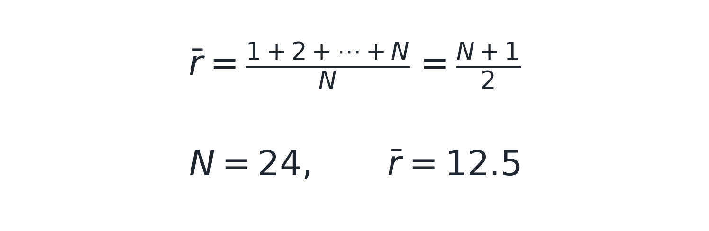

*式（1）｜r̄表示所有观测的总平均秩，秩及H均无物理单位。*

按表2逐只替换评分再求和，就得到表3。例如Indomethacin组的秩和为13.5＋20＋20＋20＋20＋4＝97.5。四组秩和合计300，等于24×12.5。

*表3｜各药物组在同一套合并秩中的位置*

| 药物组 | 秩和Rᵢ | 平均秩r̄ᵢ |
| --- | ---: | ---: |
| Indomethacin | 97.5 | 16.2500 |
| Aspirin | 85.0 | 14.1667 |
| Piroxicam | 91.5 | 15.2500 |
| BW755C | 26.0 | 4.3333 |

前三组平均秩都高于12.5，BW755C组低得多。接下来，需要把四个偏离合成一个量。

## 三、从平均秩的偏离，走到H统计量

### （一）先衡量各组分开了多少

每组平均秩减去总平均秩，表示这一组在共同排序中偏高还是偏低。直接相加会正负抵消，平方以后，两种方向都会增加统计量。

为什么还要乘nᵢ？一组有nᵢ个观测，该组平均位置的偏离应按它代表的观测数计入。把该组每个观测都用组平均秩代表，nᵢ个相同的平方偏离相加，就得到式（2）的组间平方和B。这也正是方差分析中按组大小加权的组间变异构造。

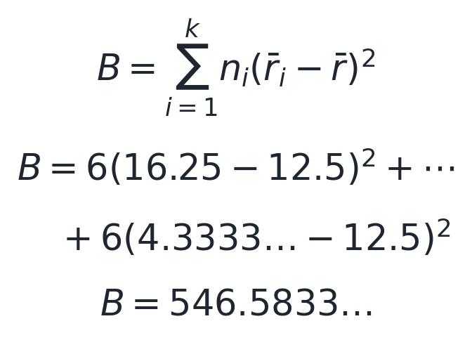

*式（2）｜B衡量组间平均秩的分开程度；数字演示省略的中间两项来自Aspirin和Piroxicam，实际计算包含四组全部贡献。*

**同样的平均秩偏离，出现在较大的组中，提供的证据通常更多**：在相同的合并秩和总样本量下，大组平均秩的随机波动也更小。不过，B的大小还随总样本量和秩的取值范围改变，单看546.5833，仍无法判断异常程度。

### （二）先看随机分组时，平均秩怎样波动

在H₀下，给定已经观察到的24个指标及四组大小，兔与组标签的对应可以交换。可以把24个合并秩写在24张有各自身份的签上，不放回地抽6张给第一组，再抽6张给第二组，直到分完。

分组在变化，签上的数值没有变。式（3）先定义这套固定秩的方差sᵣ²。再把分配顺序中的第a个位置收到的秩记为Yₐ：每个位置都有同样的机会收到任意一张签，平均值是总平均秩r̄。

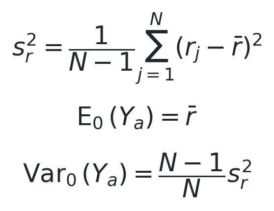

*式（3）｜rⱼ是固定的第j个观测的秩；Yₐ是随机分配到第a个位置的秩。下标0表示在H₀下、给定合并秩计算。*

这里有两个分母：sᵣ²按通常样本方差的定义除以N−1；一个随机位置的秩，则等概率取这N个数，计算方差时除以N，所以它的方差是(N−1)/N倍的sᵣ²。

**两次不放回抽取并不独立。** 一个位置拿走高秩，留给其他位置的平均秩就会降低。更准确地说，所有位置的秩之和固定，因此这个总和的方差为0。各位置地位相同，任意两个不同位置的协方差也相同。式（3a）把总和的方差展开，就能求出这项负协方差。

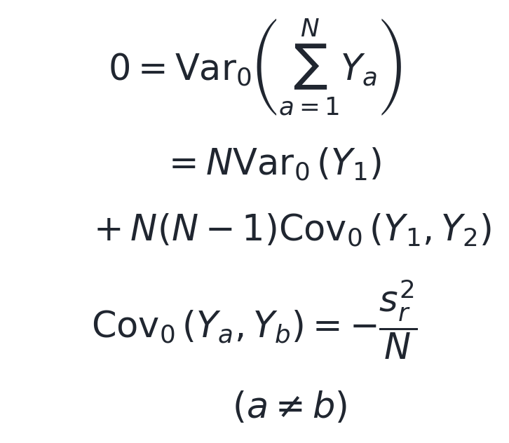

*式（3a）｜a、b为两个不同的分配位置；Cov表示协方差，用来描述两个随机量如何一起变化。*

把重分组后第i组的随机平均秩记为Ȳᵢ，它是该组nᵢ个位置的Y求平均。表3中的r̄ᵢ则是实际分组得到的观察值。计算Ȳᵢ的方差时，要把nᵢ个自身方差和nᵢ(nᵢ−1)个交叉协方差一起计入，再除以nᵢ²。式（3b）代入刚求出的两种波动，得到组平均秩的方差；不同组之间的每一对位置也都贡献同样的负协方差。

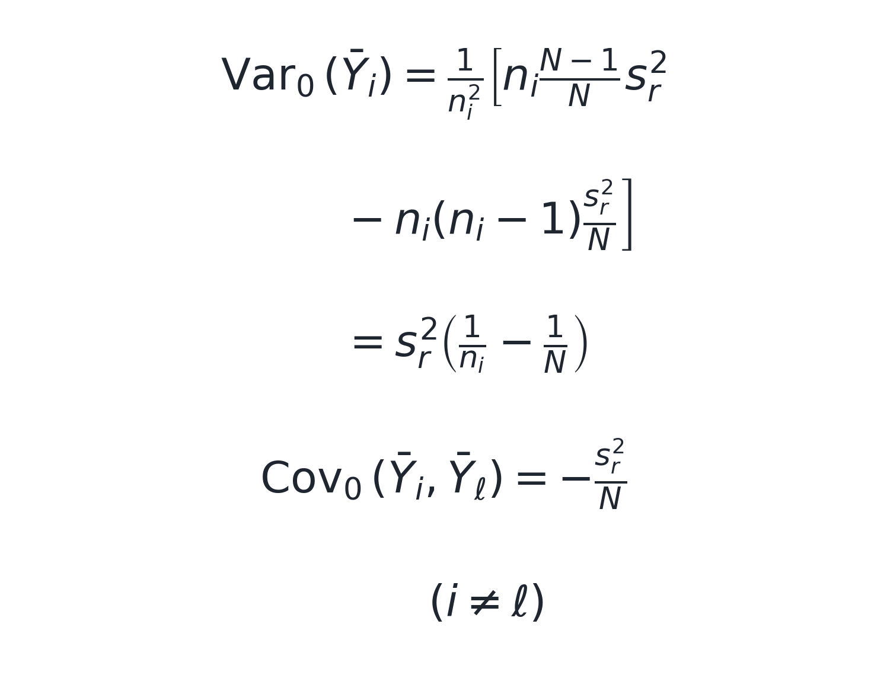

*式（3b）｜Ȳᵢ、Ȳℓ随重分组改变；i与ℓ表示不同组。本例nᵢ＝6、N＝24，所以每组平均秩方差为sᵣ²/8，不同组平均秩协方差为−sᵣ²/24。*

这就是“不放回”的修正从哪里来。研究设计中，不同兔之间独立；在这里，我们固定全部观测后重分组，各组统计量还受共同总秩和的约束。

### （三）用同一套秩波动，给组间平方和定尺度

H₀下，随机平均秩Ȳᵢ都以r̄为中心，所以它离r̄的平方偏离，平均起来就是式（3b）的方差。式（3c）将每组的贡献乘nᵢ相加，得到B的平均水平。

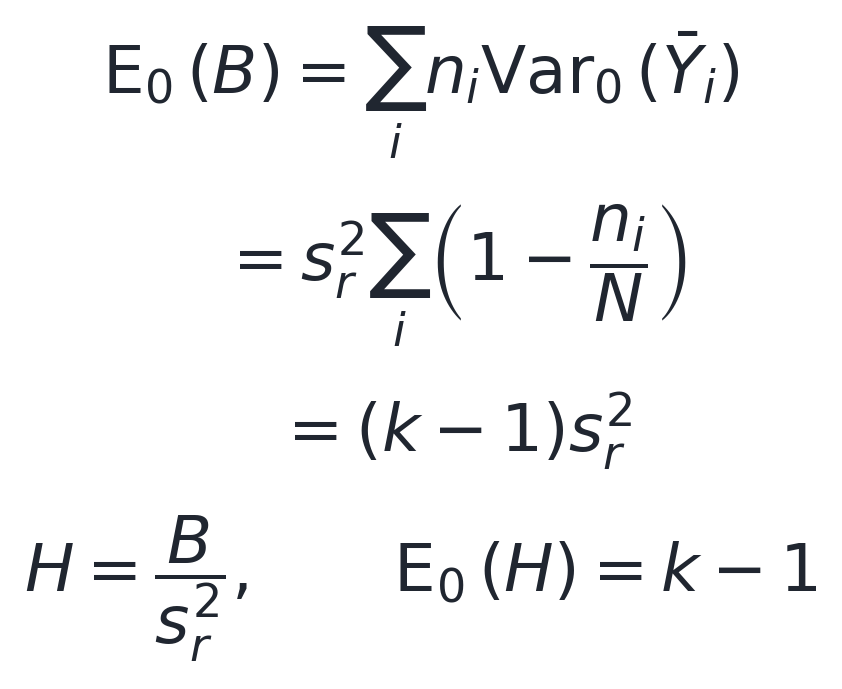

*式（3c）｜期望对随机重分组取；B随分组改变，全部组的nᵢ/N相加为1。这一关系在有限样本下就成立。*

因此，H用**组间的平方偏离B，除以这套合并秩的方差sᵣ²**，将不同样本量和秩范围下的B放到共同尺度上。它与刚才的组平均秩方差、组间协方差使用同一套波动依据。

算出H的平均水平是k−1，还不能据此认定它服从χ²。第六节会继续用式（3b）的方差和协方差，将本例H拆成三个标准化差的平方和，再说明大样本分布。

先看没有并列的情况。秩就是1到N，利用连续整数及其平方的求和公式，式（4）得到围绕总平均秩的平方离差和及秩方差，也就得到未经并列校正的H∗。

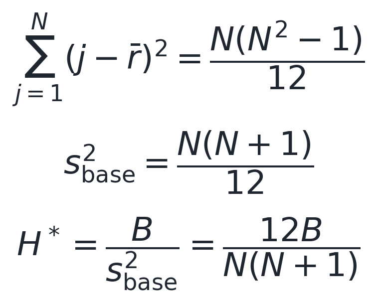

*式（4）｜base下标表示无并列时的基准秩方差；12来自连续整数的方差公式。没有并列时，H＝H∗。*

### （四）熟悉的秩和公式，只是把B展开

课堂常用的公式写成“秩和平方除以组大小，再求和”。式（5）用Rᵢ＝nᵢr̄ᵢ和固定的总秩和，把式（2）展开。

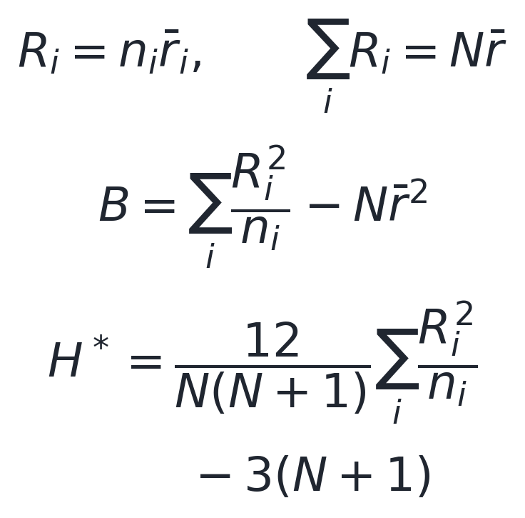

*式（5）｜Rᵢ为第i组秩和，求和涵盖全部k组；末尾的−3(N＋1)来自减去共同中心。*

这样，12、N(N＋1)和−3(N＋1)都有了来处：前两者来自秩波动的尺度，最后一项来自围绕总平均秩计算偏离。H∗的核心始终是“各组平均秩分开了多少”。

## 四、有并列值，为什么要除以C？

本例并列很多，不能继续把1到24互不相同的秩方差直接用到底。

平均秩保留总和，却压缩了波动。就看表2中本例的5个0分：它们原来占第2至6位，现在都取平均秩4。式（6）计算这一步消掉的平方偏离；连续t个序号的一般结果，可由式（4）将N换为t得到。

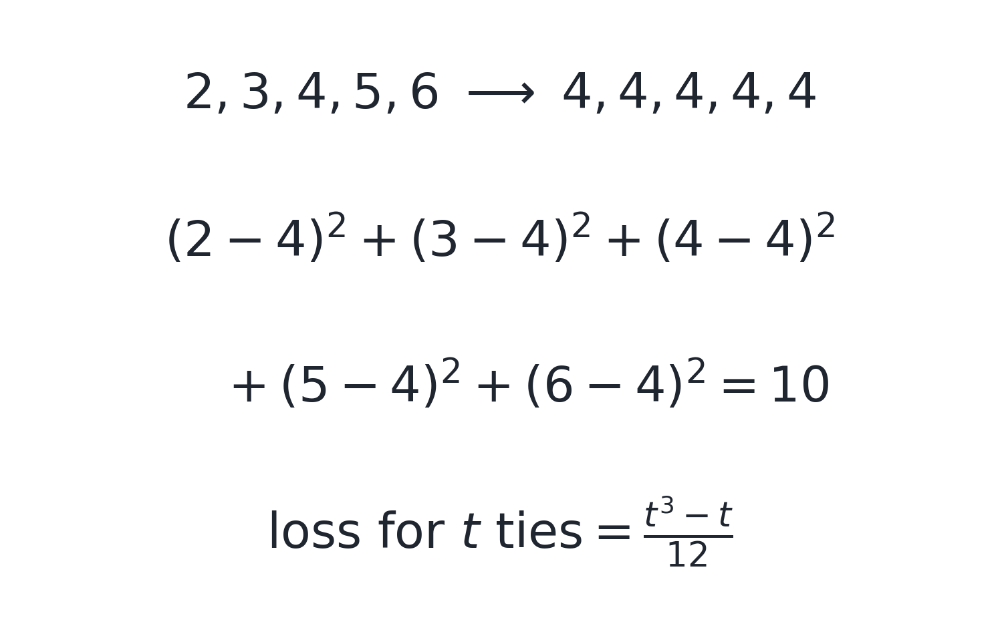

*式（6）｜t是同一观测值的个数。连续序号整体平移不改变它们围绕自身平均数的平方和。*

虽然式（6）先围绕这一小段的平均秩4计算，但围绕总平均秩12.5计算时，损失仍是10：替换前后，这5个秩的总和相同，整段相对总中心的那部分偏离保留下来，只消掉段内的分散。

对表2的五种取值分别计算，并列损失依次是0、10、10、5、60，合计85。若1到24互不并列，总秩平方和为1150、秩方差为50。式（7）从这里一步步得到本例的实际方差及其比例C。

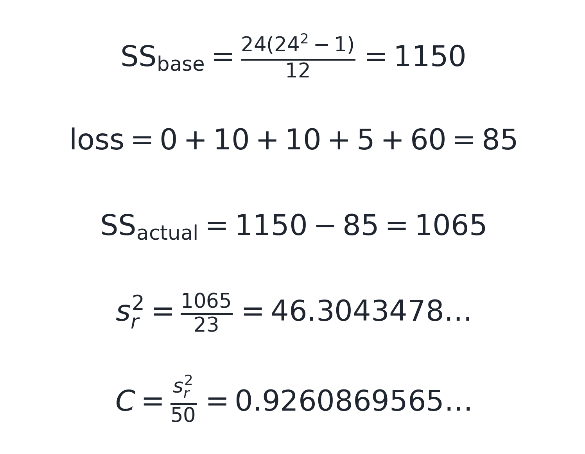

*式（7）｜平方和都围绕总平均秩12.5计算；sᵣ²使用N−1＝23的分母。C是实际秩方差与无并列基准方差的比。*

这样看，C记录的就是**并列以后，还保留了原来多少比例的秩波动**。对任意数据，把每个并列块的损失相加，再除以无并列总平方和，就得到式（7a）的通用校正公式。单个观测t＝1时，损失为0<sup>[2]</sup>。

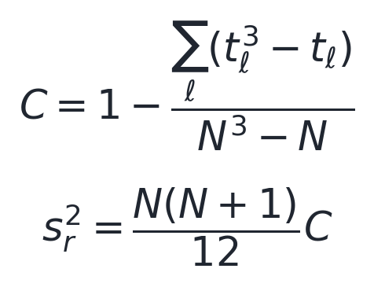

*式（7a）｜tℓ是第ℓ种取值的频数，本例为1、5、5、4、9；各块的tℓ³−tℓ合计1020，除以12就是总损失85。*

**H仍然等于B除以实际合并秩方差。** 原来的H∗除以基准方差50；现在分母换成50C，便得到式（8）的H∗除以C。

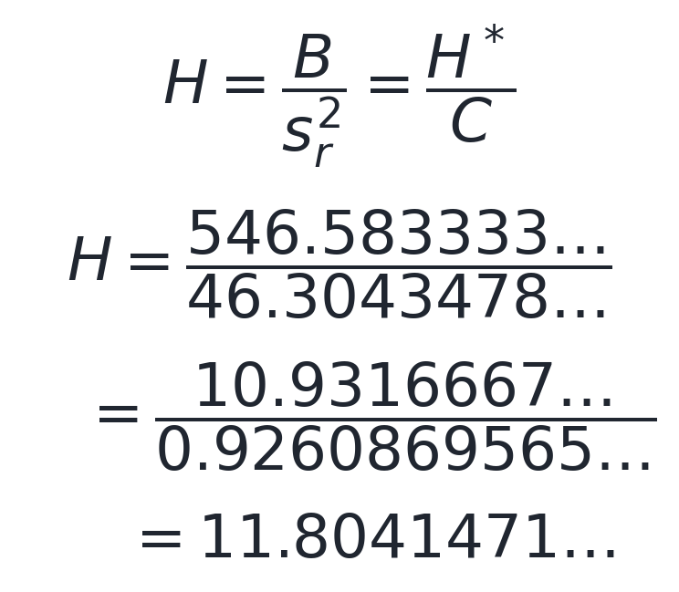

*式（8）｜程序使用未舍入的中间量；分母从无并列基准改为实际秩方差，说明了为什么是除以C。*

若所有观测都相同，实际秩方差为0，所有组平均秩也完全相同，H成为0/0，没有可供这种检验使用的秩变异。通常只要秩方差非零，便可按式（8）计算。

把秩代入普通ANOVA，也能得到同一个组间平方和B和总平方和；但普通ANOVA构造的是组间与组内均方之比F，并使用F参照。**变异分解相通，不等于可以把普通ANOVA的F检验P值直接当作KW的P值。**

## 五、零分布从哪里来：固定观测，重分组标签

现在H已经算出11.8041。P值所问的是：**如果四组总体分布相同，像这样大、甚至更大的H会有多常见？**

原始评分的分布，描述一只兔可能取得哪些分数；H的零分布，描述H₀下反复分组时，整个统计量会取得哪些值、各有多大概率。两者是不同的概率对象。

在独立、各组同分布的H₀下，给定这些观测和各组大小，组标签可交换。保留四组各6只，把24只**有各自身份的兔**重新分到四个有名称的组；每一个允许的身份划分等概率。每轮对新分组求秩和、B和H，就产生H的条件零分布。秩方法与置换推断正是在这里接起来的<sup>[2]</sup>。

“固定观测”也意味着并列频数不变，因此总平均秩、秩方差及C每轮都相同，只有秩怎样分到各组发生变化。在这套固定观测上，H、H∗和B给出同一尾部排序，按大值选出的分组完全相同。

如果逐一计算全部合法划分，式（9）就给出精确条件P值。M是合法划分的总数，#表示满足条件的划分个数。

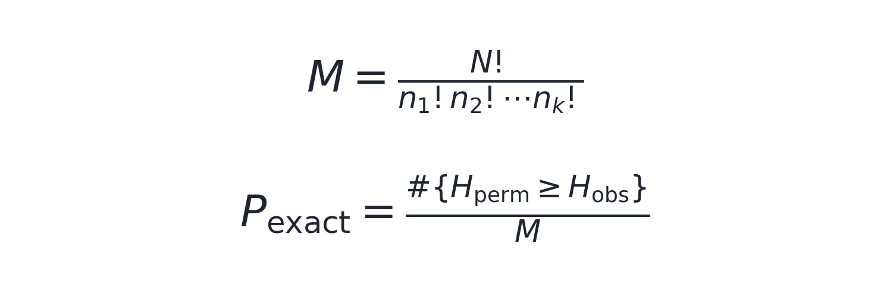

*式（9）｜固定各组大小、单位身份划分等概率；尾部包含H等于观察值的情况，也包括观察到的划分。*

这正是**小样本精确检验**的思路。它不靠原始评分正态，也不靠把H先近似成某条连续曲线。精确算法还可以用递推等办法汇总同样的概率，不一定要实际列出每个划分。

并列值不会破坏这个思路，但会使多个身份划分产生同一套组内秩。如果为了加速把重复秩格局合并，就必须保留它们对应的**组合数权重**。等概率的是合法的身份划分，合并后的不同秩格局未必等概率。

## 六、大样本为什么能用χ²，为什么自由度是k−1？

前面已经知道H的尺度，还需要知道它在H₀下怎样分布。沿着同一兔例，先看四组平均秩可以拆成哪三个差。

### （一）把四组分开，拆成三步比较

四组顺序仍是Indomethacin、Aspirin、Piroxicam、BW755C。随机重分组后的平均秩记为Ȳ₁至Ȳ₄；表3的r̄₁至r̄₄是它们的观察值。各组n＝6，合并秩方差sᵣ²＝46.3043478。

先比较第一组与第二组；再把前两组作为一个合并组，比较它们的平均秩与第三组；最后把前三组合并，与第四组比较。四组就这样经过三次合并，成为一个总体。

每个差都需要除以它在H₀下的标准差。以第一步为例，差的方差是“两组各自的方差之和，减去两倍协方差”。代入式（3b），两项−sᵣ²/N会与协方差项抵消，得到2sᵣ²/n。

这个抵消对任意两个互不重叠的合并块也成立：两块各有m、n个观测，差的方差便是sᵣ²(1/m＋1/n)。因此，三步所用的块大小分别为6与6、12与6、18与6。式（10）先写出通用的差方差，再列出对应的三个标准化差Z₁、Z₂、Z₃。

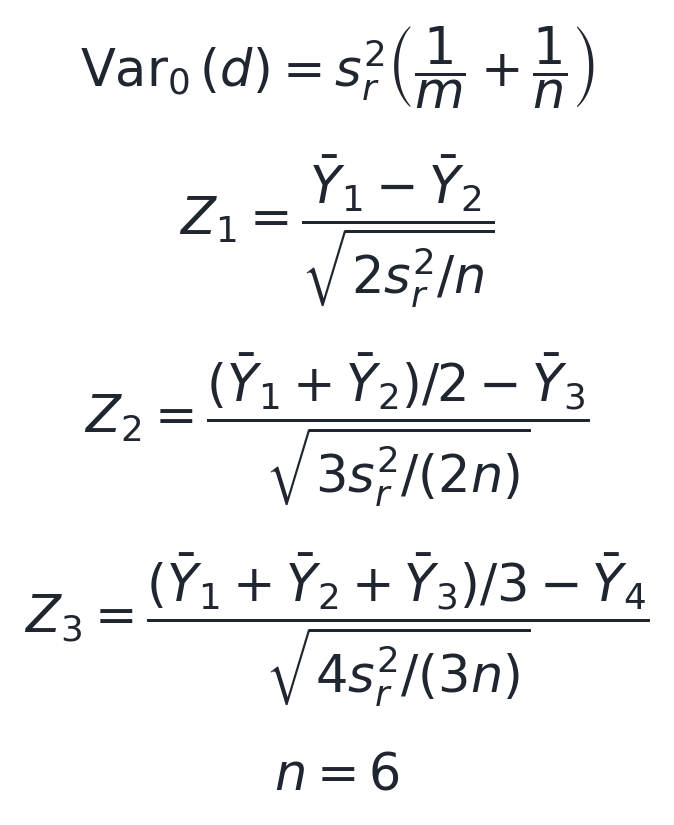

*式（10）｜d表示两个互不重叠块的随机平均秩之差。三个Z的分母分别对应块大小6与6、12与6、18与6；这里n＝6。等组量的合并平均，就是各组平均秩的算术平均。*

代入本次观察值，第一步的差为2.083333，标准差约3.928713，Z₁约0.530284；第二步按式（10）代入m＝12、n＝6，标准差约3.402365。表4列出三个Z的观察值和各自平方贡献。

*表4｜兔例H分解成三个标准化差的平方贡献*

| 合并步骤 | 观察Z值 | Z²贡献 |
| --- | ---: | ---: |
| 第1组与第2组 | 0.530284 | 0.281201 |
| 前2组与第3组 | −0.012246 | 0.000150 |
| 前3组与第4组 | 3.394524 | 11.522796 |
| 平方贡献合计 | — | 11.804147 |

前三药之间在前两步贡献很小，前三药与BW755C的分离贡献了大部分H。这里的三步是理解整体统计量的一种分解；整体检验的结论仍由一个H判断。

为什么平方贡献相加，恰好等于H？四组等量，在任意一次重分组中，四个Ȳᵢ的平均都是固定的总平均秩r̄。把式（10）的三个平方展开，利用四个Ȳᵢ偏离r̄的和为0，就得到式（10a）的恒等式。

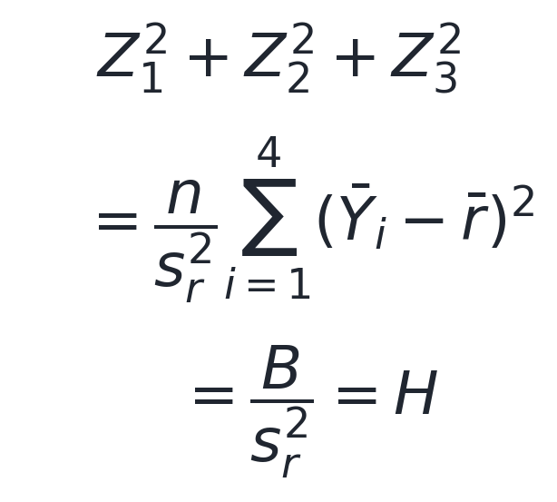

*式（10a）｜这是本例四组等量时的代数恒等式，有限样本也成立；它本身还没有使用正态近似。*

### （二）为什么这三个差，在大样本下可以当作独立标准正态量？

式（3b）已经说明，四个组平均秩彼此相关。经过式（10）这种安排，三个差的系数却会让交叉协方差抵消。

看前两步就能理解：第一步中，前两组一正一负；第二步中，前两组各占一半，权重相同。因为两组的方差相同、与其余组的协方差也相同，正负两部分的协方差贡献恰好抵消。第三步与前两步也有相同的抵消结构。式（10b）把前两步的未标准化差D₁、D₂实际展开一次：各组方差相同、不同组协方差相同，正负项便逐项抵消。除以固定标准差后，协方差仍为0。

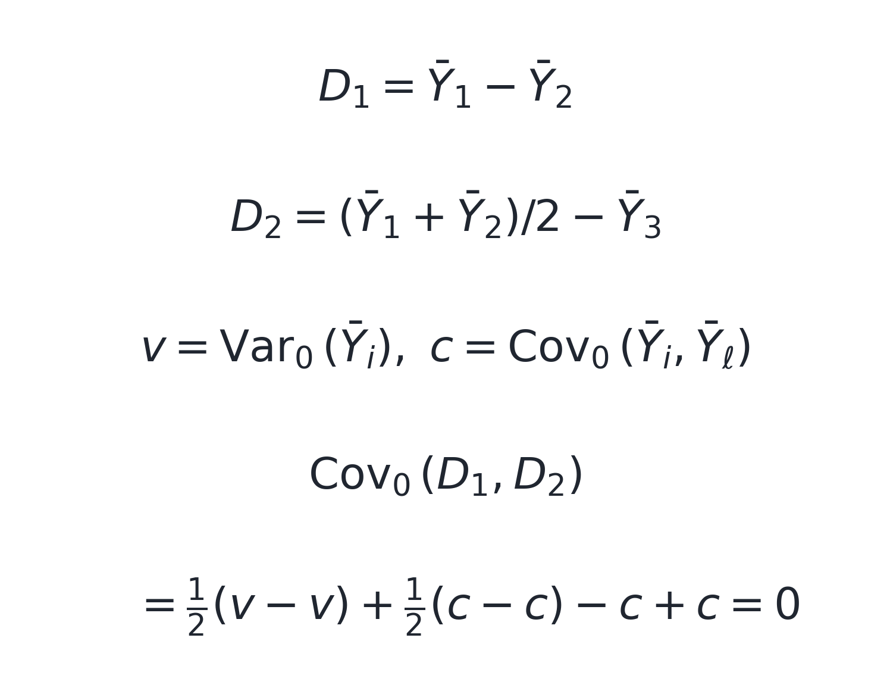

*式（10b）｜v是每组随机平均秩的方差，c是任意不同组平均秩的协方差；本例v＝5.7880435、c＝−1.9293478。D₁、D₂分别是式（10）Z₁、Z₂的分子。*

因此，三个Z的均值均为0、方差均为1，彼此协方差为0。

**有限样本下，零协方差还不能推出独立或正态。** 当组数固定、各组样本量增长、各组比例不趋于0，且秩的总变异非零、没有极少数观测支配它，满足秩和中心极限定理的常规条件时，这些组秩统计量才有联合正态极限。趋近正态的是H₀下重分组产生的统计量；原始评分不必正态<sup>[2]</sup>。

在联合正态极限中，零协方差才进一步给出独立。于是Z₁、Z₂、Z₃趋近三个独立标准正态量，它们的平方和H就趋近χ²(3)。

### （三）为什么一般是k−1个方向？

组大小不等时，每次合并要按人数加权。若前面的合并组有m个观测，新加入的组有n个观测，式（10c）给出两者平均秩差的标准差，以及这一步记录的组间平方和贡献。

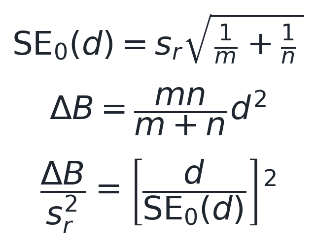

*式（10c）｜d为合并前两部分的平均秩之差；ΔB表示这一步记录的组间平方和贡献，sᵣ仍来自全部N个合并秩。*

每加入一组，就增加一个标准化差。k组需要k−1次合并；各次新增平方和加起来，就是总的B。因此，不等组量也能将H写成k−1个这类标准化差的平方和。按人数加权后，新一步对前面各组的同向权重，与先前差中的正负权重相抵消，仍得到零协方差。它们在上述渐近条件下具有独立标准正态极限，所以得到式（10d）的χ²(k−1)参照。

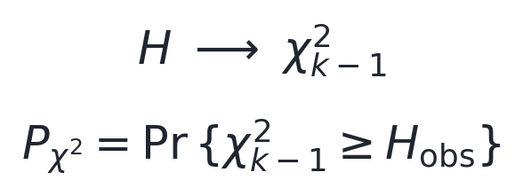

*式（10d）｜箭头表示大样本分布趋近；近似的是前一节由标签重分配产生的条件零分布及其右尾概率。*

总秩和固定，使k组平均秩的偏离受一个约束；逐次合并只需k−1步，也从计算上看到了同一个自由度。小样本时，前面的代数分解仍成立，但正态极限未必足够接近，不能把它直接当作精确χ²分布。

兔例k＝4，自由度为3。按式（10d）算得χ²近似P＝0.00808509。R的`kruskal.test()`接受“响应变量～分组变量”的公式；`data`指定数据表，返回的检验对象包含校正后统计量、近似自由度和P值。**这个函数采用χ²近似，小样本也不会自动切换到精确枚举**<sup>[3]</sup>。

R官方说明：https://www.stat.ethz.ch/R-manual/R-devel/library/stats/html/kruskal.test.html

在配套项目根目录运行下面代码。`read.csv()`读入每兔一行的数据，返回数据框，`score ~ drug`指定按药物组比较改善指标；`c()`把三个返回字段并列显示。

```r
rabbit <- read.csv("数据/rabbit.csv")
fit <- kruskal.test(score ~ drug, data = rabbit)
c(H = unname(fit$statistic),
  df = unname(fit$parameter), P = fit$p.value)
```

实际输出舍入为：H＝11.8041471，df＝3，P＝0.00808509。按预先规定的0.05水准，χ²近似结果支持四组改善指标分布存在差异。

教材与NIST资料常用“每组至少5个”提示χ²近似的适用范围<sup>[1,4]</sup>。这是一条经验建议，不能保证任意不平衡、强并列或很小的尾部概率都足够准确。总样本量大，也不能补足某一组始终极小的问题。本例虽各组6只，并列明显，值得再用条件置换核对。

NIST说明：https://itl.nist.gov/div898/software/dataplot/refman1/auxillar/kruskwal.htm

## 七、只有6个培养瓶时，把精确分布完整算出来

假设另有一个培养实验：6个相互独立的培养瓶随机分到A、B、C三种培养条件，每组2瓶。在相同培养时间结束时，每瓶测一次产物浓度，单位为mg/L。全部假设数据为：**A组1、2；B组3、4；C组5、6**。本例无缺失、无并列。

本例检验H₀：三组浓度总体分布相同；在H₀下，给定这6个观测及每组2瓶，培养条件标签可交换。检验水准为0.05。我们要计算观察到的H、完整枚举的精确P，以及χ²近似P，比较两种推断方式。

六个数的秩恰为1到6，总平均秩是3.5。式（11）先算这次实际分组的H。

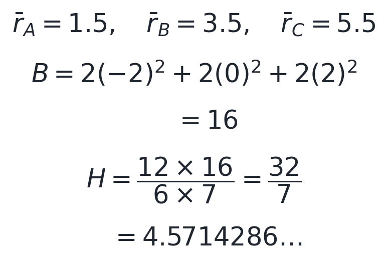

*式（11）｜本例N＝6、k＝3、各nᵢ＝2；无并列，无需并列校正。*

接下来，从6个有身份的瓶中选2个给A组，有15种选择；再从剩下4个中选2个给B组，有6种；最后2个自动归C组。于是，总共15×6＝90个等概率划分。

比如原划分的三组秩和是3、7、11，H约4.5714；若A取1、6，B取2、5，C取3、4，三个秩和都为7，H就是0。逐个计算90次，再把相同H的划分数加起来，就得到表5的**完整条件零分布**。

*表5｜三组各2瓶、固定六个观测时，H的全部可能值及频数*

| H | 划分数 | 概率 |
| ---: | ---: | ---: |
| 0 | 6 | 6/90 |
| 2/7 | 12 | 12/90 |
| 6/7 | 12 | 12/90 |
| 8/7 | 12 | 12/90 |
| 2 | 12 | 12/90 |
| 18/7 | 6 | 6/90 |
| 24/7 | 12 | 12/90 |
| 26/7 | 12 | 12/90 |
| 32/7 | 6 | 6/90 |

本次H恰好达到这套零分布的最大值32/7。达到或超过它的划分有6个，即把三对连续秩{1,2}、{3,4}、{5,6}分配给三个组名的6种方式。因此，精确P＝6/90＝**0.0666667**。

同一个H若参照χ²(2)，近似P为**0.1017014**。两者在0.05水准下都不足以拒绝H₀，但数值明显不同。区别来自零分布：真实条件分布只有9个离散取值，χ²则是一条连续分布。

图1把两者画成累计概率，纵轴表示“统计量不超过横轴数值”的概率。阶梯到32/7时已经达到1，而χ²曲线在更大数值处仍有尾部。精确右尾需要包含观察值处的概率质量，因此要用“1减去该点左侧的累计概率”，不能直接用1减去该点的阶梯高度。

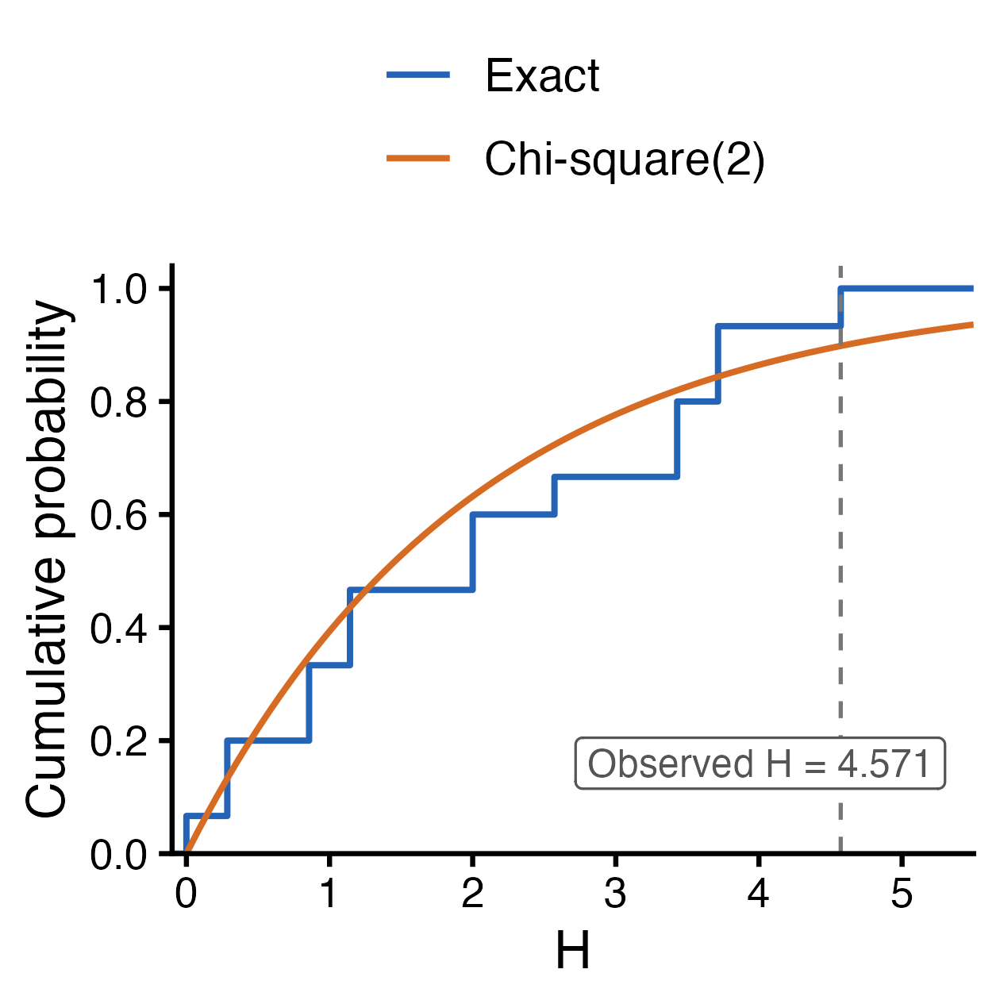

*图1｜Exact为90个合法划分得到的完整条件分布，Chi-square为χ²(2)近似；竖线标记本次H＝32/7。图中两条线均为累计概率。*

配套脚本直接枚举这些划分。下面是可独立运行的R实现：`combn(瓶编号, 2)`列出每种选2瓶的组合；`setdiff()`取剩余瓶；每次用三组秩和计算一个H，最后`mean()`对“是否达到观察值”的逻辑结果取平均，得到尾部比例。`h_all`保存全部90个H，不是随机模拟结果。

```r
ranks <- 1:6
h_all <- numeric(0)
for (a in combn(1:6, 2, simplify = FALSE)) {
  remaining <- setdiff(1:6, a)
  for (b in combn(remaining, 2, simplify = FALSE)) {
    cc <- setdiff(remaining, b)
    rank_sums <- c(sum(ranks[a]), sum(ranks[b]),
                   sum(ranks[cc]))
    h <- 12 / (6 * 7) * sum(rank_sums^2 / 2) - 21
    h_all <- c(h_all, h)
  }
}
h_observed <- 32 / 7
c(total = length(h_all),
  tail = sum(h_all >= h_observed - 1e-10),
  P_exact = mean(h_all >= h_observed - 1e-10),
  P_chisq = pchisq(h_observed, df = 2, lower.tail = FALSE))
```

`1e-10`用于容纳浮点运算产生的极小差别，使本应相等的H计入尾部。`pchisq()`按指定自由度计算χ²概率，`lower.tail = FALSE`取右尾。实际输出依次为90、6、0.0666667和0.1017014，与表5一致。

## 八、兔例划分太多，用Monte Carlo估计同一条尾部

回到表1的24只兔，仍保留四组各6只、原来的24个改善指标，以及各组同分布、标签可交换的H₀。现在只改变计算方式：用随机置换估计精确条件分布的尾部。

这时合法身份划分有**2,308,743,493,056**个。完整逐一枚举已不适合课堂练习。每轮均匀打乱24只兔的标签对应，按6、6、6、6重新分组，就能从同一个条件零分布抽取一个H；多轮之间允许抽到重复划分。

本篇进行**199999次独立随机置换**，记其中H达到或超过11.8041471的次数为b。式（12）用加1的Monte Carlo P值处理观察到的划分，同时给出近似Monte Carlo标准误，用来衡量有限模拟次数带来的计算波动<sup>[5]</sup>。

加1的计算依据：https://doi.org/10.2202/1544-6115.1585

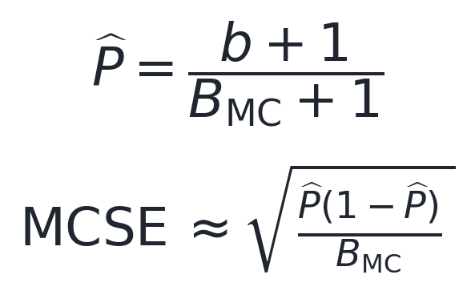

*式（12）｜B_MC表示模拟次数，区别于前文组间平方和B；b只数随机置换中进入尾部的次数。*

Python本次实际有679次进入尾部，按式（12）得到P̂＝680/200000＝**0.003400**，Monte Carlo标准误约**0.000130**。以约两倍标准误描述计算波动，大致是0.00314至0.00366。

R和MATLAB本次各有644次进入尾部，估计P均为0.003225，与Python结果的差异约为一个合并Monte Carlo标准误。不同语言即使用相同种子，也未必产生相同的随机序列。

本例的χ²近似P＝0.008085，比置换估计明显偏大，这个差距远大于本次Monte Carlo标准误。因此，两者的差别主要反映参照分布近似的差异，而不只是模拟次数有限。四组各6只、并列较多，正好提醒我们：每组达到经验门槛，也不能据此断言近似尾部足够精确。这里两种方法仍给出相同的0.05水准判断。

这个标准误描述的是**在同一份数据上重新运行模拟，P值估计会抖动多少**。它不衡量药物效应的生物学不确定性，也不是对H₀成立概率的估计。增加模拟次数可以减小计算波动；无法把χ²近似误差或实验设计问题一并消除。

R的coin包提供条件推断框架，可用`asymptotic`作渐近推断，或用`approximate`作Monte Carlo重抽样。其文档中的`exact`计算限定于单变量两样本问题，不能给三组以上KW随意设置这个选项就宣称算出了精确P。本篇三组精确结果来自透明的完整枚举，兔例则是有限次数的Monte Carlo估计<sup>[6]</sup>。

coin官方说明：https://search.r-project.org/CRAN/refmans/coin/html/LocationTests.html

因此，“小样本应考虑精确检验”说的是应根据实际条件零分布计算概率；**枚举规模**决定能否直接完整算出。精确条件分布对大样本同样有定义，小样本也可能因组数较多而产生很大的组合空间。

## 九、回到兔实验，怎样解释结果？

兔例BW755C组平均秩为4.3333，前三组约14.17至16.25，样本中确实呈现明显的秩位置分离。H将这种分离汇总为11.8041。报告时要同时写明独立单位、整体检验及P值的计算方式。

可以写成：“以每只兔的药物眼相对盐水眼改善指标为分析对象，四独立组的Kruskal–Wallis统计量H＝11.8041；χ²近似P＝0.00809，199999次条件置换的Monte Carlo P＝0.00340（MC标准误约0.00013）。结果支持四药组改善指标的总体分布存在差异。”

整体拒绝只支持至少一组分布存在差异，不能单凭这个P值判定每一对药物都不同。若要回答具体哪些组有差异，再按事先确定的比较范围进行Dunn等组对比较，连同多重比较调整和样本分布一起解释，可接着阅读第23篇。

## 十、近期研究怎样使用Kruskal–Wallis？

课堂上的药物组可以换成疾病阶段，也可以换成术前风险分层。下面两项2026年的研究，都按临床分组比较每位参与者的一个指标。

### （一）肠道微生物组：不同肾病阶段的多样性是否不同？

Krukowski等2026年发表于《Nature Microbiology》的研究，纳入130人：非慢性肾病对照11人，慢性肾病1/2期36人、3期44人、4/5期29人，以及接受腹膜透析的5期患者10人。论文图2a比较这五组的物种丰富度、Shannon多样性和Pielou均匀度。方法部分说明采用非参数检验处理非正态的微生物指标，图注明确使用Kruskal–Wallis整体检验，再用Dunn检验作组对比较并进行BH调整。腹膜透析组的物种丰富度低于4/5期组，而Shannon多样性和均匀度未检出组间差异<sup>[7]</sup>。

对应本文，就是每位参与者提供一个多样性指标，比较不同临床组在该指标上的秩位置。这里的组间比较本身不能证明肾功能变化导致了菌群改变；论文进一步用含协变量的模型分析宿主因素与肾功能的关联。

### （二）口腔外科：术前难度分组能否区分手术时长？

Önder等2026年发表于《BMC Oral Health》的前瞻性研究，纳入215名接受下颌阻生第三磨牙拔除的患者，按术前评分分为容易、中等困难和非常困难三组，分别为166、37、12例。作者用Kruskal–Wallis比较三组手术时长，报告H＝14.29、自由度2、P＜0.001；三组时长中位数分别为11、15、17分钟。这个整体结果支持难度分组与手术时长的分布差异有关，具体组对的差异仍由后续多重比较判断<sup>[8]</sup>。

## 本篇讲了哪些知识？

- **H是组间平均秩的加权平方偏离，除以合并秩的实际方差。** nᵢ体现每组代表的观测数；共同中心为(N＋1)/2；12来自无并列整数秩的方差公式。
- **并列校正来自平均秩压缩了秩波动。** t个并列观测使总秩平方和减少(t³−t)/12，C记录实际方差相对无并列基准的比例，所以H＝H∗/C。
- **精确P值由H₀下允许的标签重分配产生。** 固定组大小、保持单位身份划分等概率，按H达到或超过观察值求右尾；合并并列秩格局时保留组合权重。
- **χ²(k−1)是大样本参照。** k组逐次合并产生k−1个标准化差，平方和就是H；它们在适当联合正态极限下独立，才使H趋近χ²。小样本的离散零分布可与它明显不同。
- **有限次数Monte Carlo给出带计算误差的条件尾概率估计。** 它可应对庞大的枚举空间，需同时说明轮数、估计规则与误差；原始评分不必正态，标签可交换仍有赖于研究设计和同分布H₀。

## 配套资料：用自己熟悉的一种语言跑通

和前面的统计课堂一样，这次准备了R、Python和MATLAB三套脚本，共享同一份兔数据与六瓶教学数据。第一次按节运行，核对平均秩、B、C、H、90个划分及P值；第二次保留六瓶观测与各组大小，把分组改为A={1,6}、B={2,5}、C={3,4}，观察平均秩相同以后H与精确P怎样改变。

本地完整项目见随稿提供的“统计课堂48_练习项目.zip”，解压后先读README。R打开Rproj；Python在Spyder中打开项目文件夹；MATLAB把Current Folder设为项目根目录，再打开对应语言入口分节运行。模拟结果在三种语言中会有正常的抽样波动，确定性计算应一致。

本篇项目目录：https://github.com/fuyuming/statistics-classroom/tree/main/stats_classroom/article48_kruskal_wallis

系列仓库：https://github.com/fuyuming/statistics-classroom

仓库ZIP入口：https://github.com/fuyuming/statistics-classroom/archive/refs/heads/main.zip

下载并完整解压仓库后，进入`stats_classroom/article48_kruskal_wallis`，先读README。

这里是“明哥的微生物世界”，一起把统计问题读清楚、算明白。

## 参考文献

[1] Rosner B. *Fundamentals of Biostatistics*. 8th ed. Cengage Learning, 2016. §12.7，p596—600；表12.17，p597；表12.18，p599。

[2] Kruskal WH, Wallis WA. Use of ranks in one-criterion variance analysis. *Journal of the American Statistical Association*. 1952;47(260):583—621. https://doi.org/10.1080/01621459.1952.10483441

[3] R Core Team. stats::kruskal.test：Kruskal–Wallis Rank Sum Test；stats::oneway.test：Test for Equal Means in a One-Way Layout. https://www.stat.ethz.ch/R-manual/R-devel/library/stats/html/kruskal.test.html ；https://stat.ethz.ch/R-manual/R-patched/library/stats/html/oneway.test.html

[4] NIST. Dataplot Reference Manual：Kruskal Wallis. https://itl.nist.gov/div898/software/dataplot/refman1/auxillar/kruskwal.htm

[5] Phipson B, Smyth GK. Permutation P-values should never be zero: calculating exact P-values when permutations are randomly drawn. *Statistical Applications in Genetics and Molecular Biology*. 2010;9:Article39. https://doi.org/10.2202/1544-6115.1585

[6] Hothorn T, Hornik K, van de Wiel MA, Zeileis A. Implementing a class of permutation tests: the coin package. *Journal of Statistical Software*. 2008;28(8):1—23. https://doi.org/10.18637/jss.v028.i08 。接口范围见官方文档：https://search.r-project.org/CRAN/refmans/coin/html/LocationTests.html ；https://search.r-project.org/CRAN/refmans/coin/html/IndependenceTest.html

[7] Krukowski H, Valkenburg S, Vich Vila A, et al. Host factors dictate gut microbiome alterations in chronic kidney disease more strongly than kidney function. *Nature Microbiology*. 2026;11:664—677. 2026年2月5日在线发表；图2a及Statistical analysis。https://doi.org/10.1038/s41564-026-02259-w

[8] Önder H, Önder ME, Atıl F, Tekin U. Development and validation of a comprehensive clinical–radiographic difficulty scale for impacted mandibular third molar extractions: a prospective study. *BMC Oral Health*. 2026;26:568. 2026年2月26日发表；表3、表4及Statistical analysis。https://doi.org/10.1186/s12903-026-07970-y
