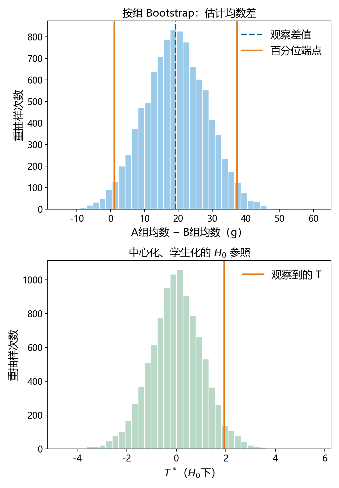
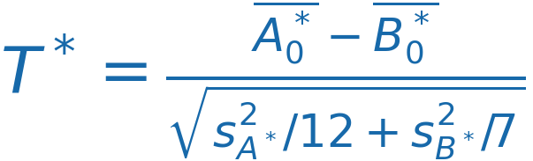
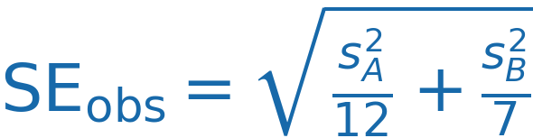
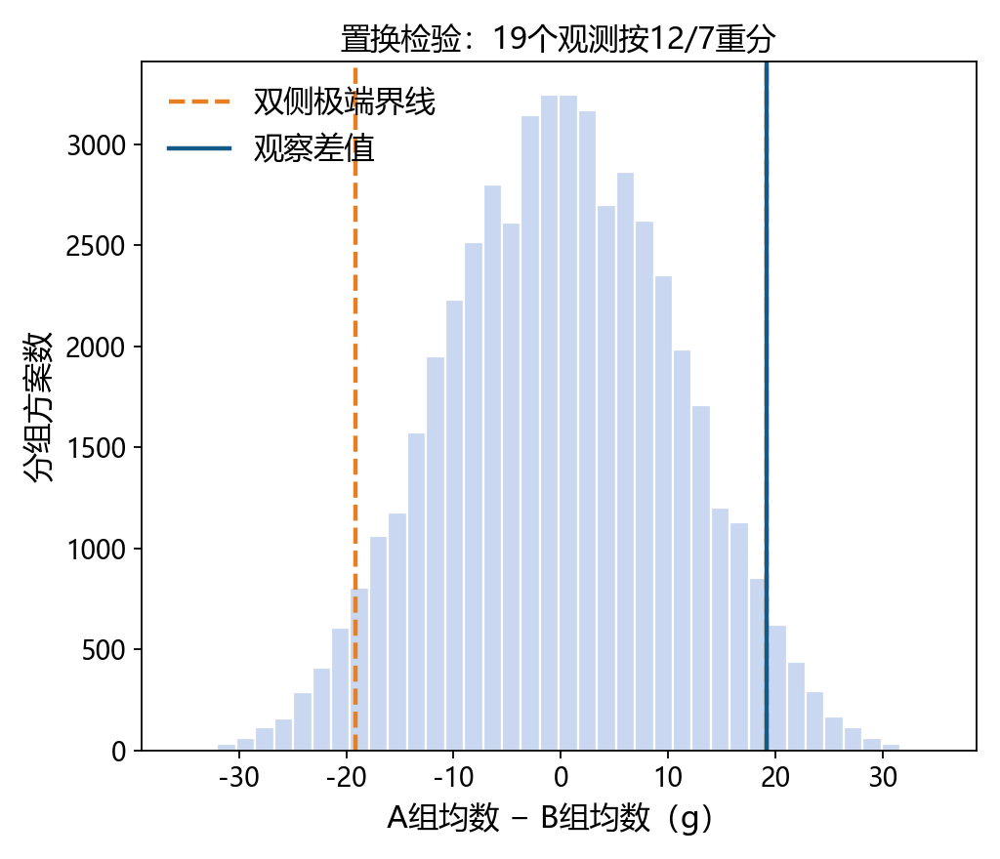

# Bootstrap与置换检验：反复抽样，究竟在模拟什么？

> 明哥的微生物世界 · 统计课堂 12
>
> 摘要：同样叫“反复抽样”，Bootstrap与置换检验模拟的对象并不相同。本文用两组大鼠增重量数据，说明两种方法每轮到底怎么做，怎样得到区间或P值，以及小样本时要注意什么。


大家好，我是明哥。

第9课上，我们已经讲了Bootstrap的重抽样原理，以及怎样用重抽样结果估计置信区间和计算P值。受课堂时间限制，还有两个相互关联的问题没有展开：Bootstrap与置换检验究竟有什么区别？用Bootstrap做假设检验时，怎样构造H₀成立时的参照分布？

课堂上用“标准化”概括的处理，在这里需要拆开说明：本例通过中心化，让重抽样所依据的两组经验总体满足均数相等的H₀；再通过学生化，用每轮估计的标准误作分母，把差值放到可比较的尺度上。两步各有作用，不能只记住“重复抽样，再数极端次数”。

这篇就沿用课堂上的大鼠增重量数据，补上这部分因时间有限未能展开的解释，同时看看小样本为什么会给Bootstrap带来困难。

先把本例两种操作分清：**Bootstrap是在原来各组里有放回地抽取观测，组成新的样本；置换检验是保留原来的全部观测，只重新安排谁属于A组、谁属于B组。** 前者某个观测可以被抽到多次，也可以没有被抽到；后者每个观测都保留一次。

置换检验每次重新分组后都计算均数差，再看实际观察到的差值在这些结果中有多极端，从而计算P值。Bootstrap常用来估计标准误和置信区间，也可以做假设检验；做检验时，还要像下面第三节那样构造H₀下的参照分布。

## 一、先看一份真实的差值

李春喜《生物统计学》第6版例4-8（pp.97–98）给出两组大鼠增重量数据，单位是g。原题是从1月龄开始分别饲喂高、低蛋白饲料，到3月龄测定增重量；下面把两组记为A、B：

| 组别 | 观测值 | n | 样本均数 |
| --- | --- | ---: | ---: |
| A（高蛋白） | 134, 146, 106, 119, 124, 161, 107, 83, 113, 129, 97, 123 | 12 | 120.1667 |
| B（低蛋白） | 70, 118, 101, 85, 107, 132, 94 | 7 | 101.0000 |

观察到的均数差定义为 A−B，所以：

> Δ̂ = 120.1667 − 101.0000 = 19.1667 g。

这19.17 g是这一次样本算出的效应量。它回答“本次样本中两组均数差多少”，却没有单独回答“如果重新抽取同样设计的大鼠，差值会怎样变化”。

Bootstrap先从这个问题开始。

## 二、普通按组Bootstrap：估计差值有多不稳定

把每一组的样本看作该组总体的经验分布。每轮在A组内部有放回抽取12个，在B组内部有放回抽取7个；算出这一轮的均数差。重复B=10000轮，得到：

> Δ̂*₍b₎ = mean(A*₍b₎) − mean(B*₍b₎)，b=1,…,10000。

“有放回”意味着同一只大鼠的数值可能在一轮中出现多次，也可能一轮没有被抽到；每一轮的样本量仍是12和7。B是重抽样次数，不是新增的大鼠数，也不是样本量n。



*图1｜上图是普通按组Bootstrap的均数差分布，围绕观察差值19.17 g；下图是后面要介绍的中心化、学生化H0参照分布。橙色线在上图标出百分位端点，在下图标出观察T。图由配套Python脚本生成。*

上图中Bootstrap分布围绕19.17 g，而不是围绕0。这正是普通按组Bootstrap用于**估计**时想保留的中心：原始样本的经验均数差。

把这10000个差值排序，取2.5%和97.5%分位点，得到普通百分位区间：

> 95%百分位Bootstrap区间：[1.048, 37.369] g。

这个区间是本例对均数差不确定性的演示。它没有把“均数相等”放进抽样机制，也没有自动产生一个与某个检验P值配套的区间。若要做检验，必须另行构造原假设下的参照分布。

## 三、检验时为什么要中心化，还要学生化？

现在问题换了：

> H₀：μ_A−μ_B=0；  
> H₁：μ_A−μ_B≠0。

如果仍从A和B的原始经验分布各自重抽，差值分布会围绕19.17 g。它模拟的是“观察到的经验总体下，估计量怎样波动”，不是“假定H₀成立时，统计量有多异常”。

本例用一个有目的的中心化参照：各组都减去自己的样本均数，

> A₀ = A − mean(A)，B₀ = B − mean(B)。

两组经验均数都变成0，组内的离散和形状仍来自各自数据。然后按同一组内Bootstrap索引重抽。这里的中心化是在构造“均数相等的经验总体”这个H₀模型，不等于所有Bootstrap推断都必须先改原始数据。估计总体均数、分位数或预测量时，是否中心化要由目标参数和零假设决定。

每一轮还计算自己的标准误：



s²_A*和s²_B*分别是本轮重抽样数据的样本方差：先计算各值与本轮均数的差，平方后相加，再除以本轮样本量减1。这里的两组样本方差分别估计，因此采用的是分开方差的 Welch 型统计量；它不同于下一篇普通回归使用的合并方差 t。分母不是固定的原始SE，而是本轮重抽样得到的SE。这一步叫**学生化**：把每轮差值放到“几个估计标准误”的共同尺度上。原始数据也按同样方法求两组样本方差，得到原始标准误 SE_obs，再用原始均数差除以它：



观察统计量为：

> SE_obs=9.9210 g，T_obs=19.1667/9.9210=1.9319。

用固定的10000组课堂索引核对，中心化学生化的H₀参照中，T*≤T_obs有9636轮，T*≥T_obs有364轮。按预先规定的双侧等尾规则，取两个尾部比例中较小的一个，再乘2：

> P̂_boot = 2×364/10000 = 0.0728。

本例使用分开方差的 Welch 型统计量和重抽样参照分布；普通 Welch t 检验使用近似 t 参照分布，下一篇的普通回归又采用合并方差。三者的 P 值不必相同。

这是固定10000轮下的蒙特卡洛估计，仍有有限模拟次数带来的波动；固定索引使结果可复现，并不使它变成精确P值。

所以在这个抽样模型和这套重抽样规则下，不能在0.05水平拒绝“总体均数相等”的H₀。这里的“未拒绝”不等于证明两组总体均数相等。

在上述独立两组、分开方差的中心化学生化规则下，由同一个T*分布反演回原单位，得到本例与该检验配套的近似Bootstrap-t区间：

因为两组各减去了原样本均数，重抽后的中心化差值恰好等于“本轮原始差值 − 观察差值”。所以这里的T*也可以写成 `(本轮原始差值 − 观察差值) / 本轮SE`，正是下面区间反演要用的量。

先把T*排序，记2.5%和97.5%分位点为q低、q高，本例分别约为−2.193和2.162。把“标准误单位”换回克，区间是：

> [观察差值 − q高 × SE_obs，观察差值 − q低 × SE_obs]。
>
> 95% Bootstrap-t CI：[−2.285, 40.922] g。

之所以先减q高，是因为减去更大的数得到下限。这与直接对均数差排序取百分位点，是两种不同的区间构造。

要把两件事分开记住：普通百分位区间[1.048, 37.369] g是前面的估计演示；P=0.0728和[−2.285, 40.922] g来自中心化、学生化的H₀参照。不能把百分位区间和学生化检验P拼成一个方法的结果。

## 四、置换检验：把19个观测混在一起

**置换就是重新分组；置换检验就是用重新分组得到的结果，判断实际组间差异有多极端。** 本节演示的是独立两组、H₀下两组来自相同总体分布时的普通置换检验。

沿用前面的19只大鼠，每轮这样做：

1. 把A组12个、B组7个观测放在一起，保留全部19个原始数值。
2. 随机挑出12个分到A组，其余7个分到B组，每个观测只用一次。
3. 计算这次重新分组后的“A组均数−B组均数”。
4. 反复重新分组，得到一系列均数差，再与实际差值19.1667 g比较。

**这里没有从原组里反复抽同一个观测，也没有给数据增加新的数值，只改变组别。** 这就是它与前面按组Bootstrap的操作区别。对于本例的双侧检验，我们数的是：重新分组得到的均数差，其绝对值至少达到19.1667 g的情况有多少。

本例的组合数并不大：

> C(19,12)=50388。

配套脚本直接枚举了这50388种分组，所以三种语言得到同一置换分布。按 |A−B|≥|19.1667| 的双侧极端规则，极端分组有3705个：

> 置换双侧精确P = 3705/50388 = 0.07353。



*图2｜固定19个数值，只改变哪12个被标成A；蓝线是观察到的均数差，橙色虚线是双侧极端界线。图中每个分组都使用全部19个观测。*

## 五、小样本和边界：Bootstrap会把样本的信息原样带进去

Bootstrap的优点也是它的边界：它以经验分布近似未知总体。如果样本很小、尾部偏斜、极端值重要，或者观测之间有依赖，经验分布可能没有把目标总体的关键部分表示好。重复次数B变大，只能减小模拟误差，不能补回原样本没有包含的信息。

看一个率的例子。若10次观察中9次成功，普通百分位Bootstrap相当于从9个“1”和1个“0”组成的经验分布反复抽10次。用离散分布的分位点定义，得到：

> 9/10的普通百分位95%区间：[0.7, 1]。

这不是说总体率一定在这个区间，也不是把这个区间直接当作检验某个固定率的P值。更极端地，如果10次全失败，经验分布里只有“0”，任何Bootstrap重抽样仍全是0，百分位区间退化为：

> 0/10的普通百分位95%区间：[0, 0]。

作为对照，二项模型下的Clopper–Pearson（CP）95%区间为[0, 0.308497]。本文只借这个端点作边界对照，CP区间的来源与推导另作专题说明。

还可以把覆盖问题算得更具体。给定一个教学模型：真实p=.9、每次抽10次独立Bernoulli试验；指定使用上面的普通百分位区间算法，并把Bootstrap次数理想化为无限。若刚好观察到10/10成功，概率是：

> 0.9¹⁰= 0.3487（34.87%）。

此时经验分布只有“1”，区间是[1,1]，会漏掉真实的0.9。因此，仅这一种样本结果就足以说明该区间程序的覆盖率不可能达到95%。

为避免把上面的说明误写成模拟结果，我们把观察到的x=0,1,…,10逐一枚举：每个x先按Binomial(10,x/10)计算无限Bootstrap百分位端点，再按真实Binomial(10,.9)概率加权。在这个给定真值、给定算法、精确枚举的教学模型下，覆盖率是：

> 0.6497（64.97%）。

这个数字针对的是这套普通百分位程序和这个模型；它不是所有Bootstrap方法的统一定理。BCa、学生化或参数模型各有自己的近似条件，也不能靠改一个方法名称就自动解决边界、偏斜、极端值和依赖问题。小样本也不是“一律不能Bootstrap”：关键是目标统计量、数据结构、经验分布能否支持所需近似，以及是否做了相应诊断。

## 六、把三种“反复抽样”放回各自的问题

可以把本篇的三条线压缩成一句话：

| 方法 | 每轮在模拟什么 | 主要回答 |
| --- | --- | --- |
| 普通按组Bootstrap | 从各组经验分布有放回抽样，组内样本量固定 | 估计量的波动和区间 |
| 中心化、学生化Bootstrap | 从中心化经验总体重抽，并用每轮SE标准化 | H₀下观察T有多极端 |
| 置换检验 | 19个观测各用一次，重新分成12个与7个 | 实际均数差在重新分组的结果中有多极端 |

所以，看到“Bootstrap”“置换”“10000次”时，不要只数次数。先问三件事：重抽的是观测值还是标签？每轮是否放回？零假设或研究设计提供了什么条件？这些问题比方法名称更能决定结果应该怎样解释。

## 七、先定问题，再选重抽样

Bootstrap和置换检验常被放在同一页，是因为它们都能用计算机把抽样分布画出来；这不表示它们可以互相替换。前者把观察到的样本当作经验总体，用来近似估计量在重复抽样下的波动；后者把观测值固定下来，改变标签或分配，用来近似零假设允许的随机分配。

实际使用时，先明确要估计什么或检验什么，再选择相应的重抽样方法。本文的12/7分组操作针对独立两组；配对资料需要保留配对关系。无论重复多少次，都不能增加原样本已经提供的信息。

方法的名字也不能替代结果报告。至少应写出效应量的方向和单位、区间算法、检验的零假设、重抽样对象、放回与否，以及有限重抽样或精确枚举的方式。这样读者看到一个数字时，才知道它是在什么模型下回答什么问题。

## 八、实际分析用什么包？

理解上面的过程，是为了知道软件在做什么。实际分析时，**R的两样本均数Bootstrap检验可以直接使用 `boot.pval` 包的 `boot_t_test()`**，不必每次自己编写抽样循环。本例仍使用前面两组大鼠增重量A、B：

```r
# 首次使用时安装：install.packages("boot.pval")
set.seed(20261023)
fit <- boot.pval::boot_t_test(
  A, B, var.equal = FALSE,
  R = 10000, type = "stud"
)
fit
fit$estimate[1] - fit$estimate[2]  # A−B：19.167 g
fit$conf.int                     # 95%CI：[-2.319, 40.928] g
fit$p.value                      # P：0.0730
```

这是 `boot.pval` 0.7.0下的实跑结果。`type="stud"`指定学生化区间，`var.equal=FALSE`使用分开方差的统计量；输出里的 `R=10000` 是重抽样次数，不是t分布的自由度。它与前面固定索引演示的P=0.0728略有不同：包使用另一批重抽样结果，并按包内规则计算区间与P值。固定种子并不意味着不同实现共用同一批抽样。

学生可以先用这段代码完成分析，再回看后面的原理演示。`boot.pval`内部仍调用 `boot`，但使用者不必直接编写 `boot::boot()` 的统计函数。因此，应当区分“使用现成的Bootstrap检验函数”与“自己实现重抽样过程”。官方示例：https://www.stat.ethz.ch/CRAN/web/packages/boot.pval/vignettes/boot_t_test.html

Python和MATLAB也有现成工具，并非只能依赖AI从头写：

| 语言 | 现成工具 | 可以直接完成什么 |
| --- | --- | --- |
| R | `boot.pval::boot_t_test()` | 本例的两样本均数Bootstrap检验，返回区间与P值 |
| Python | `scipy.stats.bootstrap()` | 根据给定统计函数计算Bootstrap区间和标准误；该接口不直接返回本例的检验P值 |
| MATLAB | `bootstrp()`、`bootci()` | 重抽样与区间计算；本例的两组独立抽样、零假设参照及P值仍需补充相应逻辑 |

例如Python计算两组均数差的区间，只需提供一个“返回两组均数之差”的短函数，抽样和区间由SciPy处理。MATLAB则要特别注意：`bootci`的多个非标量数据参数要求行数相同，不能把本例12个A值和7个B值直接作为两列输入；两组各自独立抽样的结构必须保留。

若要在Python、MATLAB中复现本文同一套检验，可以由AI辅助编写中心化、学生化和尾部计数，再用固定索引与R结果核对。**AI是编程助手，不是统计方法正确性的保证；只求区间时，通常无需重写整个抽样程序。** 配套R脚本第0.1节已加入专用包调用，后面的显式循环保留为原理演示。

Python官方说明：https://docs.scipy.org/doc/scipy/reference/generated/scipy.stats.bootstrap.html

MATLAB官方说明：https://www.mathworks.com/help/stats/bootci.html

### 和代码一起核对

和前面的统计课堂一样，这次也准备了R、Python和MATLAB三套脚本。用自己熟悉的一种跑通即可：第一次先核对数据、索引和关键结果，第二次可在读入固定索引后取前2000行，看看较少重抽样时区间端点怎样受到模拟误差影响；也可以把均数差改写成B−A，观察双侧P和区间如何变化。

三套脚本共用固定的Bootstrap索引，所以大鼠例的差值、百分位端点、中心化学生化P和Bootstrap-t区间可以逐值核对。置换部分直接枚举50388种12/7分组，因此也使用同一精确置换分布。脚本会检查运行环境中的中文字体；若缺少字体，会保留数值结果并改画英文图，避免悄悄生成方框字。

数据与教材出处：李春喜：《生物统计学》第6版，例4-8，pp.97–98。方法背景可参阅：

- Hesterberg, 2015，*What Teachers Should Know About the Bootstrap*：https://pmc.ncbi.nlm.nih.gov/articles/PMC4784504/
- R boot 官方说明：https://stat.ethz.ch/R-manual/R-devel/library/boot/html/boot.html
- SciPy permutation_test 官方说明：https://docs.scipy.org/doc/scipy/reference/generated/scipy.stats.permutation_test.html

配套项目目录：https://github.com/fuyuming/statistics-classroom/tree/main/stats_classroom/bootstrap_permutation

全仓库ZIP：https://github.com/fuyuming/statistics-classroom/archive/refs/heads/main.zip

完整解压后进入 stats_classroom/bootstrap_permutation，再按README打开R项目、Python脚本或MATLAB脚本。代码目录、数据和运行结果都保留在同一项目中，便于从“这10000次到底在模拟什么”继续往下核对。

反复抽样不是一个脱离问题的按钮。它模拟什么，取决于我们保留了哪些观测、改变了什么随机机制，以及这些改变是否由研究设计和零假设支持。把这三点说清楚，Bootstrap与置换检验才真正成为统计推断，而不只是循环语句。

