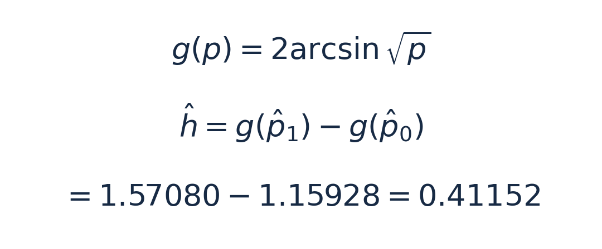
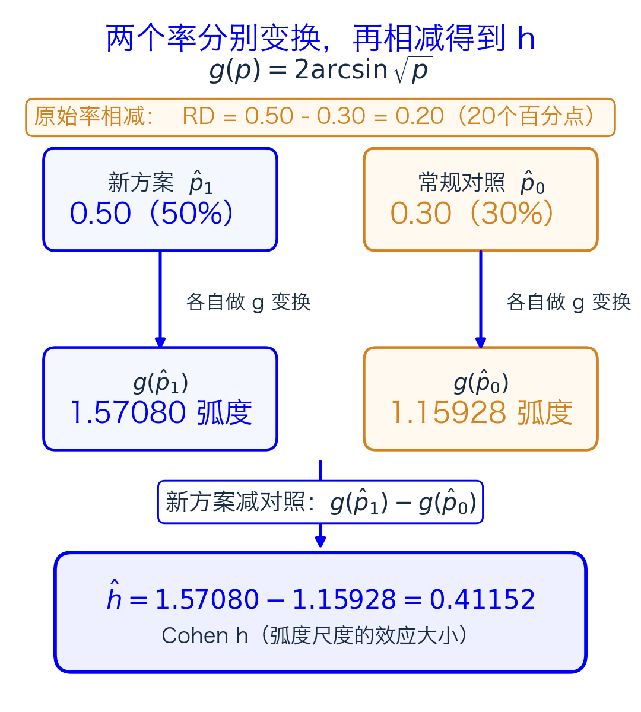
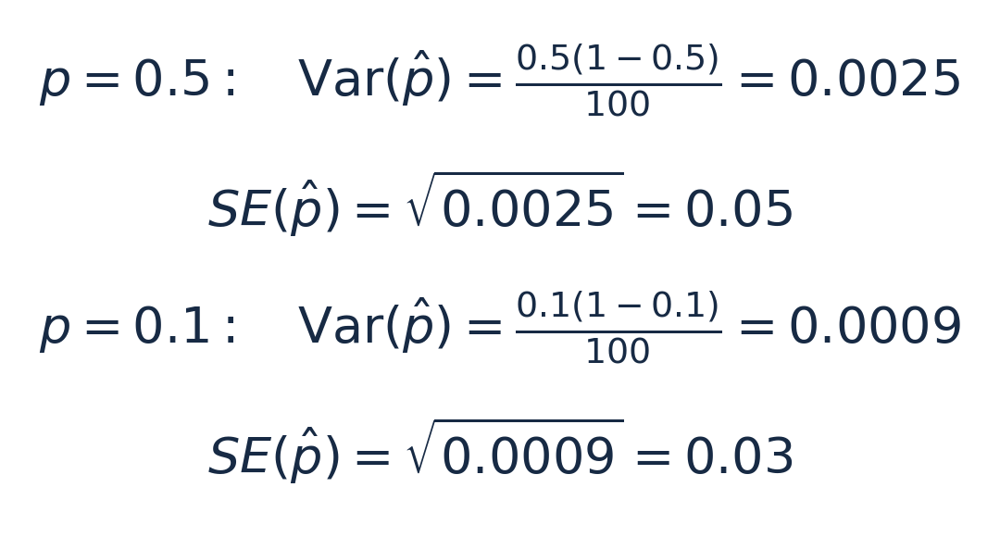
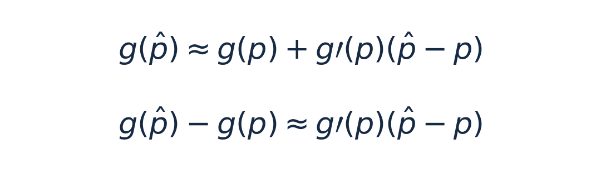
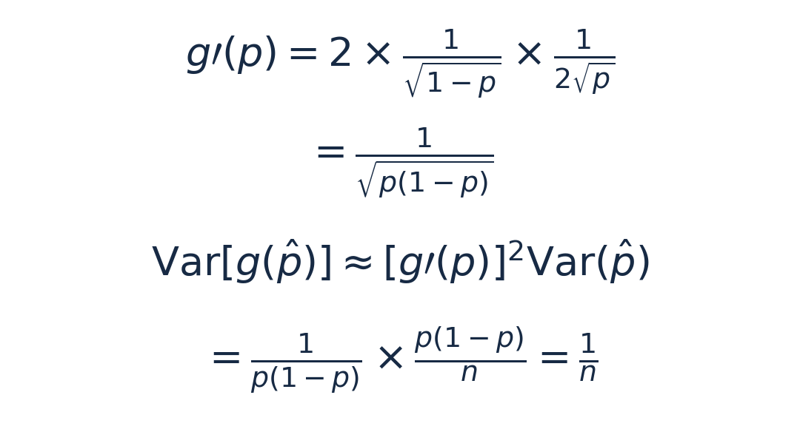
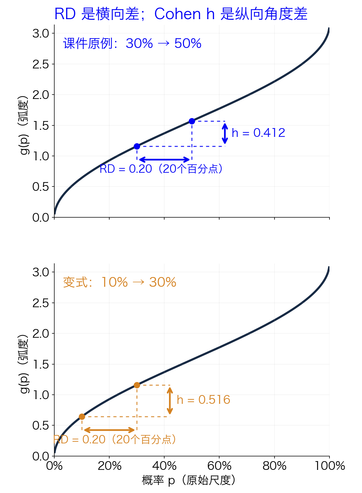
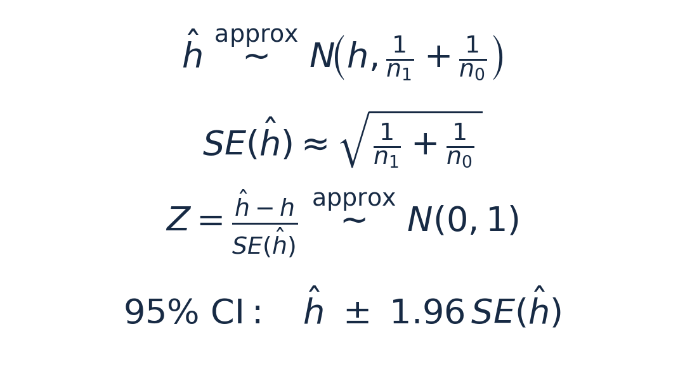
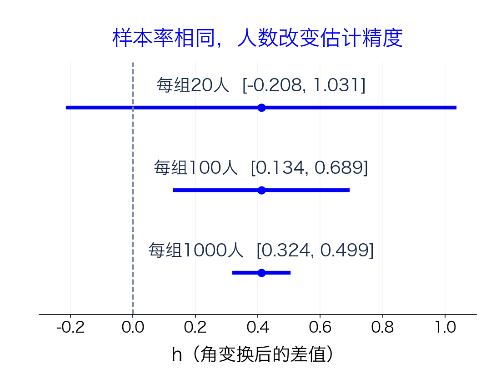

# 独立两率的效应大小：Cohen h为什么先作角变换？

> 明哥的微生物世界 · 统计课堂 30
>
> 摘要　接续统计课堂29对独立样本率差及其置信区间的讨论，沿用第10课康复例题：两组4周达标率为50%和30%，相差20个百分点。理解Cohen h为什么先作角变换、怎样解释小中大效应，再由变换后的抽样分布得到h的区间估计。


大家好，我是明哥。

前面的[统计课堂25](https://mp.weixin.qq.com/s/yFWPQNnmvm_OKQO4ZgsEBA)从二项计数出发，推到了样本率和两个独立样本率之差的抽样分布，为计算标准误和构造区间打下了基础。

随后，统计课堂29《独立样本率之差：置信区间怎样算？》把抽样分布、点估计与区间估计接起来，比较了Wald、Newcombe和Agresti–Caffo三种区间构造。

**本篇接着第29篇往下讲：从原始率差及其区间，走到角变换后的差h及其区间。** 沿用第10课的独立两组康复例题，我们接着回答：两个率相减已经得到20个百分点，为什么还要换一个尺度？换算后的h怎样描述效应大小，它的区间又从哪里来？

## 一、先看课件原题：相差20个百分点

假设患者随机分配至新康复方案和常规对照，各100人。两组由不同患者组成，患者之间相互独立，按同一标准在4周时评价康复是否达标。结果如下。

| 组别 | 达标 | 未达标 | 合计 |
| --- | --- | --- | --- |
| 新方案 | 50 | 50 | 100 |
| 常规对照 | 30 | 70 | 100 |

本篇统一按**新方案减对照**计算。把两组未知的总体达标概率记为p₁和p₀，本次样本率分别为p̂₁＝0.50和p̂₀＝0.30。

原始率差RD＝0.50−0.30＝**0.20，即新方案高20个百分点**。在这两组样本中，每100人分别有50人和30人达标，相差20人。这个差值保留了原始概率尺度，下面再看Cohen h增加了怎样的比较尺度。

## 二、h为什么先把率换成角度？

RD保留了原始概率尺度。Cohen的h则先取每个概率的平方根，求反正弦后乘以2，再把两个变换值相减<sup>[1]</sup>。



*式（1）｜g是本文为角变换取的函数名；arcsin是反正弦，计算采用弧度。总体h＝g(p₁)−g(p₀)，样本估计ĥ则代入两个样本率。*

本题中，50%变成1.57080，30%变成1.15928，相减得到**ĥ＝0.41152**。这是无量纲的角变换差，这里采用弧度。它表示两个概率变换后的位置差，0.41152不能再读成41.152个百分点。

图1把这两步拆开：先对新方案和对照的率**分别作变换**，再按新方案减对照求差。原始率相减得到RD，变换值相减得到ĥ。



*图1｜上层是课件原例的两个样本率，原始率差为20个百分点；中层是各自的角变换值，以弧度计；下层将新方案的变换值减去对照的变换值，得到ĥ＝0.41152。计算使用完整精度，角变换值与ĥ显示到小数点后5位。*

这个算法可以在Cohen原书第6.2节找到：第181页的式（6.2.1）、（6.2.2）定义了角变换及h，第183页的表6.2.2则列出各个率的变换值。按该表，0.50对应1.571，0.30对应1.159，相减为h≈0.412，与上面的公式计算一致<sup>[1]</sup>。

中文教材也有对应的计算。马寨璞、石长灿《基础生物统计学》第145—146页先对两组样本率各自作相同变换，再求两个变换值的差，并用它构造率比较的检验统计量；这个差值与式（1）中ĥ的计算相同<sup>[2]</sup>。Kabacoff的《R in Action》第3版第10.2.5节则直接给出h的公式，并将它用于两率比较的功效分析<sup>[3]</sup>。

为什么做这个变换？要从率的抽样波动说起。对固定的总体达标概率p，反复抽取n个人，每次得到的样本率p̂会改变。在二项模型下，**它的方差为p(1−p)/n**。总体概率p是固定参数，样本率p̂是随抽样改变的量。

同样观察100个人，即n＝100，分别将p＝0.5和p＝0.1代入方差公式。先算出方差，再开平方，就得到样本率的标准误SE：



*式（2）｜前两行取p＝0.5，方差为0.0025，标准误为0.05；后两行取p＝0.1，方差为0.0009，标准误为0.03。两种情形的样本量均为100，SE为方差的平方根。*

**原始样本率在中间位置波动较大，靠近两端时波动较小。** 我们希望变换之后，这种波动对p的位置不再那么敏感。

**先看变换怎样影响一个小偏差。** 一次抽样得到p̂，它离总体率p有一个偏差p̂−p。先对变换函数g求导，得到p处的导数g′(p)，它就是曲线在该点的切线斜率。如果p̂就在p附近，再用这条切线近似相应的一小段曲线。切线上的“竖向变化＝斜率×横向变化”，于是得到式（3）。



*式（3）｜g(p)是总体概率在变换尺度上的位置，g′(p)是曲线在p处的斜率。求导得到斜率，再用切线作局部近似，第二行便将变换后的小偏差写成原始偏差乘以斜率。这就是这里的一阶近似。*

例如，在p＝0.5附近，斜率为2。如果样本率从0.50增加到0.51，横向增加0.01，变换值就约增加2×0.01＝0.02。直接用角变换计算，实际增量为0.020001，与直线近似很接近。在p＝0.1附近，斜率约为3.333，同样增加0.01，近似增量为0.03333，实际为0.03263；曲线的弯曲已带来一些差别。

**再看为什么方差要乘斜率的平方。** 对固定p，这个斜率是常数。原始偏差如果统一乘以a，其平方偏差就乘以a²，方差也随之乘以a²；加上固定的g(p)则不改变方差。因此，将式（3）的局部直线近似用于重复抽样，就得到“变换后的方差≈斜率平方×原始方差”。

角变换的斜率恰好具有所需的形式。对式（1）的角变换求导，外层反正弦和内层平方根的导数相乘，前面的2与平方根导数中的2抵消，得到式（4）的前两行。再把这个斜率的平方和二项率方差相乘：



*式（4）｜前两行求出角变换的斜率，后两行使用Var(aX+b)＝a²Var(X)。原始方差中的p(1−p)，与斜率平方中的倒数抵消，留下1/n。近似发生在用局部直线表示曲线这一步。*

用几个数看这种补偿。暂设n＝100，总体率p分别取0.10、0.30和0.50，比较三个给定的二项模型；其中0.30和0.50对应课件两组样本率所在的位置。

| p | 原始SE | 斜率 | 变换后近似SE |
| --- | --- | --- | --- |
| 0.10 | 0.0300 | 3.333 | 0.1000 |
| 0.30 | 0.0458 | 2.182 | 0.1000 |
| 0.50 | 0.0500 | 2.000 | 0.1000 |

每一行最后一列，都是原始SE乘以变换斜率的结果，计算时使用未舍入的数值。原来波动小的位置被放大得更多，原来波动大的位置被放大得较少，变换后的近似标准误都为0.10，近似方差都为0.01＝1/100。**这就是方差稳定：同样的样本量下，变换后的抽样波动近似不再依赖p。**

这里稳定的是重复抽样的方差，角变换函数本身仍是一条曲线。上述近似要求p在0与1之间，并且样本率通常落在p附近，使局部直线近似的误差可以接受；p非常接近端点、或达标/未达标计数稀少时，这个误差可能较大。两组独立时，先将两个变换值各自的方差相加，再开平方，便得到后文h区间所用的标准误。

把两个率放到变换曲线上，可以同时观察原始率差和变换差。pwr包官方教程用横、纵投影来比较这两个尺度，图2沿用这一思路展示课件原例和一个变式<sup>[4]</sup>。



*图2｜两幅面板采用相同坐标范围。上图为课件原例30%→50%，下图为变式10%→30%；水平双箭头表示RD，两者均为0.20，即20个百分点。竖直双箭头表示变换值之差h，分别约为0.412和0.516。虚线将端点投影到相应箭头处；数值由式（1）计算。*

看图2中的两种距离：两幅图的横向跨度相同，纵向跨度却不同。**h是两个率分别变换后再相减；只有RD＝0.20，还不能唯一算出h，还需要知道其中一个率。** 例如，再给定对照率为0.30，就能确定另一率为0.50，从而算出h≈0.412。

## 三、h的小、中、大依据什么？

Cohen在1988年第2版《Statistical Power Analysis for the Behavioral Sciences》第6.2.1节，直接把h＝**0.20、0.50、0.80**分别作为小、中、大效应的约定参照，用于描述两个率的差异及功效分析<sup>[1]</sup>。

沿用统计课堂25按这三个参照分段的描述方式，本篇采用以下分档。它们是便于交流的约定，具体结局仍需结合专业背景解释。

| h估计的绝对值 | 本篇报告用语 |
| --- | --- |
| 小于0.20 | 低于小效应参照 |
| 0.20至小于0.50 | 小效应 |
| 0.50至小于0.80 | 中等效应 |
| 大于或等于0.80 | 大效应 |

**正负号保留比较方向，大小分档看绝对值。** 本题ĥ＝＋0.412，绝对值落在0.20至小于0.50之间，因此按本篇分档报告为**小效应，幅度介于“小”和“中等”两个参照之间**；正号表示新方案达标率更高。若交换组别，h变成−0.412，效应分档相同，方向相反。

这三个数提供一套共同的描述尺度。解释本题时，同时报告“4周达标率高20个百分点”，便能把原始结局与h的参照联系起来；若某个专科已有明确的最小重要差异，也应放回对应结局和概率尺度上考察。

## 四、同样20个百分点，为什么h还会不同？

从课件主例的30%→50%出发，保持新方案比对照高20个百分点，只改变对照的基线率。表中第二行沿用主例的两个样本率，其余三行是改变基线率的演算情境。

| 对照→新方案 | h |
| --- | --- |
| 10%→30% | 0.516 |
| 30%→50% | 0.412 |
| 40%→60% | 0.403 |
| 70%→90% | 0.516 |

第一行情境的h达到“中”的参照，第二行则尚未达到。差别来自同样长的一段概率差发生在曲线的什么位置，图2已显示了这一点。靠近两端的位置，角变换的斜率更大，同样20个百分点对应的变换距离也更大。

10%→30%与70%→90%关于0.5对称，角变换距离相同，h均约为0.516。由此也能看到：**只知道两个率相差20个百分点，还不足以确定h；还要知道两个率各是多少。**

## 五、效应幅度相同，精度与P值可以不同

沿用课件主例的50%和30%，比较每组20、100、1000人的三种情境。其中每组100人是课件原例，20人和1000人是观察样本量作用的变式。h的点估计都相同：ĥ＝0.412；原始率差仍为20个百分点。

这里接着第29篇构造区间的思路：**先描述估计量的抽样分布，再由标准误构造区间。** 两组独立、样本量足以支持前述局部近似和正态近似时，式（4）给出两组变换值的方差分别约为1/n₁、1/n₀。相减后方差相加，得到ĥ的近似方差；再开平方，便是ĥ的标准误。

在同样的近似条件下，ĥ的抽样分布近似以真实h为中心。把“ĥ−h”除以标准误后，可用标准正态分布近似。标准正态分布约95%的概率位于−1.96至1.96之间，由此得到式（5）的区间构造。



*式（5）｜N的第二个参数为方差，n₁、n₀分别为两组样本量。前3行依次给出ĥ的近似抽样分布、标准误和标准化形式，最后一行构造双侧95%区间。按此方法反复抽样并构造区间，约95%的区间覆盖真实h；稀疏计数或概率靠近端点时近似可能较差。*

| 每组人数 | h的95%区间 | Pearson检验P值 |
| --- | --- | --- |
| 20 | −0.208～1.031 | 0.1967 |
| 100 | 0.134～0.689 | 0.003892 |
| 1000 | 0.324～0.499 | 6.93×10⁻²⁰ |

表中的P值统一来自**无连续性校正的Pearson四格表检验**，检验两总体达标率相等；h区间另按式（5）计算。这里的P值是在等率假设及检验模型下，得到至少像本次这样偏离等率的结果的尾部概率。Pearson检验与h区间采用不同近似构造，数值不要求严格反演对应。



*图3｜圆点均为ĥ＝0.412，横线为式（5）的双侧95%区间，竖虚线为h＝0。三份资料是保持样本率不变的人数对照情境。*

每组20人时，区间很宽，正、负方向都包含；每组100人时区间仍跨越多个效应参照；每组1000人时估计明显更精确。图3把这三件事分开了：**点估计描述幅度，区间描述估计精度，P值描述数据与等率假设之间的相容程度。**

按第3节的分档，三个h点估计均为小效应。P从0.1967降到极小，并没有把h从“小”推成“大”。每组100人时，区间下端0.134低于小效应参照，上端0.689进入中等效应范围；“小效应”是对当前点估计的分档，区间没有限定在同一档内。

本题可以这样写结果：

> 新方案组和对照组各100人，4周达标率分别为50%和30%，样本率差为20个百分点。Cohen h＝0.412，角变换正态近似95%置信区间为0.134～0.689。按Cohen的0.20、0.50、0.80参照分档，点估计为小效应，方向为新方案达标率更高；无连续性校正的Pearson检验P＝0.003892。

## 六、在R中核对，并尝试两种变式

直接录入第10课例题1的四个计数，按“组在行、结局在列”排成表；h的计算入口与课件一致：

```r
independent_table <- matrix(
  c(50, 50, 30, 70),
  nrow = 2, byrow = TRUE,
  dimnames = list(
    group = c("new", "control"),
    outcome = c("success", "failure")
  )
)
h_fit <- effectsize::cohens_h(
  t(independent_table), ci = 0.95
)
h_fit
# Cohen's h |       95% CI
# -----------------------
# 0.41      | [0.13, 0.69]
```

`matrix()`将四个计数按行排成2×2表。`t()`转置后，每一列是一组，第一行是达标人数；这是`cohens_h()`读取两组率的方向。`ci = 0.95`指定双侧95%置信水平，返回的`Cohens_h`是估计，`CI_low`、`CI_high`是区间两端<sup>[5]</sup>。本次effectsize 1.0.3的未舍入结果为0.4115168、0.1343361、0.6886976。

**pwr包也可以直接算h。** 已安装pwr时，将新方案样本率作为p1、对照样本率作为p2传入`ES.h()`，返回的就是式（1）的角变换差<sup>[4]</sup>：

```r
pwr::ES.h(p1 = 0.50, p2 = 0.30)
# [1] 0.4115168
```

本次使用pwr 1.3.0实际运行，结果与前面的计算一致。`ES.h()`返回h点估计，按第3节规则将本题解释为小效应；h的区间仍按式（5）计算，或由前面的`cohens_h()`返回。Python的statsmodels官方文档也给出了同一两率角变换差定义，可对照阅读<sup>[6]</sup>。

和前面的统计课堂一样，这次准备了R、Python和MATLAB三套脚本，用自己熟悉的一种跑通即可。配套练习依次核对主例h、置信区间、基线率与样本量情境，以及“原始SE×斜率”怎样得到变换后的近似SE。

可以先把30%→50%改成10%→30%，率差仍为20个百分点，观察h怎样变化；再保持两率不变、只增加人数，看看h的点估计与区间分别发生什么变化。

## 七、本篇讲了哪些知识？

- **h是两个率的角变换值之差。** 本题由50%和30%得到ĥ＝0.412；正号表示新方案达标率更高，按0.20、0.50、0.80参照分档为小效应，数值在角变换尺度上解释。
- **方差稳定来自局部斜率的补偿。** 一阶近似下，原始二项率方差乘以斜率平方，p(1−p)抵消，变换后的方差近似为1/n；接近端点或计数稀疏时要留意近似误差。
- **同样的原始率差可以对应不同h。** h还依赖两个率在概率尺度上的位置。0.20、0.50、0.80是Cohen直接给出的约定参照，解释时同时保留具体结局与实际率差。
- **抽样分布是构造区间的依据。** 第29篇由率差的抽样波动构造区间，本篇进一步由变换后的近似抽样分布得到h的标准误和区间；固定样本率、增加人数，h点估计不变，区间变窄，等率检验P值改变。

这道题的两个结果可以并列读：4周达标率高20个百分点，Cohen h约为0.412。

## 配套资料

本篇配套项目提供R、Python和MATLAB三套脚本、课件原例数据及参考结果：

https://github.com/fuyuming/statistics-classroom/tree/main/stats_classroom/cohens_h_proportions

只下载本篇三语练习项目ZIP：

https://github.com/fuyuming/statistics-classroom/raw/refs/heads/main/stats_classroom/cohens_h_proportions/三语练习项目.zip

系列仓库入口：

https://github.com/fuyuming/statistics-classroom

整个仓库ZIP下载：

https://github.com/fuyuming/statistics-classroom/archive/refs/heads/main.zip

下载“三语练习项目.zip”并完整解压后，先读README。R打开项目文件，从第一节逐节运行；Python用Spyder打开项目文件夹；MATLAB将Current Folder设为项目目录后按节运行。若下载整个仓库ZIP，解压后进入stats_classroom/cohens_h_proportions即可找到本篇项目。

## 参考文献与官方说明

1. Cohen J. *Statistical Power Analysis for the Behavioral Sciences*. 2nd ed. Lawrence Erlbaum Associates; 1988. h的定义、计算与查表见第6.2节，式（6.2.1）、（6.2.2）及表6.2.1、6.2.2，印刷页181–183；小、中、大参照见第6.2.1节，印刷页184–185。原书：https://www.utstat.toronto.edu/brunner/oldclass/378f16/readings/CohenPower.pdf
2. 马寨璞，石长灿.《基础生物统计学》. 北京：科学出版社；2018. 第3章，印刷页145–146，式（3-67）至（3-70）及例12，讲解书中称为Fisher变换的角变换、两个变换值之差及其检验。ISBN：978-7-03-057603-3。
3. Kabacoff RI. *R in Action*. 3rd ed. Manning; 2022. 第10.2.5节“Tests of proportions”，印刷页257–258，给出h的公式和两率功效计算示例。出版社入口：https://www.manning.com/books/r-in-action-third-edition
4. pwr. *Basic Functions for Power Analysis*. `ES.h`定义见官方手册第4页：https://cran.r-project.org/web/packages/pwr/pwr.pdf#page=4 ；横纵投影图解见官方教程“pwr.2p.test - two-sample test for proportions”：https://cran.r-project.org/web/packages/pwr/vignettes/pwr-vignette.html#pwr.2p.test---two-sample-test-for-proportions
5. effectsize. Cohen's h for 2-by-2 Contingency Tables. `cohens_h()`的输入方向、估计和CI字段见官方函数说明：https://easystats.github.io/effectsize/reference/oddsratio.html
6. statsmodels. `proportion_effectsize()`. 官方文档给出两个率的角变换差定义：https://www.statsmodels.org/stable/generated/statsmodels.stats.proportion.proportion_effectsize.html

这里是“明哥的微生物世界”，我们下次见。
