# 配对样本率差怎样分布？从每个人的变化到精确区间

> 明哥的微生物世界 · 统计课堂 26
>
> 摘要　同一批人前后检测，先算每个人的变化，再求平均，就得到配对样本率差。从20人的例题出发，用一个小模型算清它的精确分布、均值和方差，再用R计算总体率差的精确区间。


大家好，我是明哥。

最近开始接手本科生《概率与生物医学统计》这门课后半部分的教学。一些需要继续展开的知识点，会和研究生课程的补充内容一起，放在“统计课堂”里，相互衔接、相互补充。

前篇统计课堂25讲了两个独立样本率之差。这次继续配套本科生第9课《率与率差的估计和检验》，看同一批人前后各测一次的情形。

这时，每个人都带着前、后两次结果进入样本。把同一个人的两次结果相减，就能保留这层配对关系。本篇沿着一个问题往下走：**我们观察到的率差，怎样由每个人的变化形成；换一批人时，它又会怎样变化？**

## 一、先把20人的例题算清楚

假设从某个目标人群随机抽取20名成年人，相隔两周，用同一方法、同一判定标准各检测一次。每个人的两次记录都完整，不同人的记录相互独立。结果为：

- 8人两次都是阳性。
- 6人两次都是阴性。
- 1人由阴性变为阳性。
- 5人由阳性变为阴性。

我们关注**后测阳性率减前测阳性率**，回答三个问题：样本率差是多少；反复抽样时这个率差怎样分布；根据20人的资料，总体率差的95%置信区间是多少。

前测有8 + 5 = 13人阳性，样本率为13/20 = 0.65；后测有8 + 1 = 9人阳性，样本率为9/20 = 0.45。因此，样本率差为−0.20，即后测低20个百分点。

还可以从每个人的变化来算。把阴性记为0、阳性记为1，个人后测减前测记为Z：阴转阳取＋1，阳转阴取−1，两次相同取0。

这20个人中，1人贡献＋1，5人各贡献−1，其余14人贡献0。总差值为−4，除以全部20个人，仍得到−0.20。把一般样本量记为n，本例n = 20；式（1）的下标i表示第几个人。

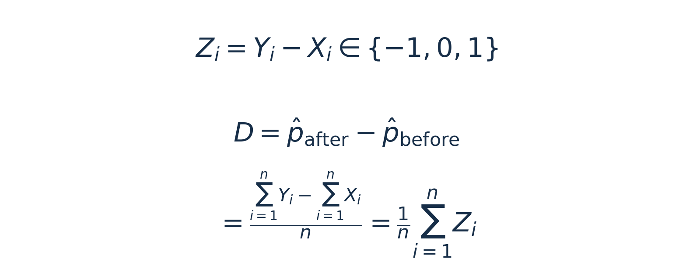

*式（1）｜前测为Xᵢ，后测为Yᵢ，个人差值为Zᵢ；样本率差D是这些差值的平均数。*

**配对率差可以先逐人作差，再求平均。** 分母包括全部20个人，两次未变的14人也保留在样本中。后文讨论的随机量D，就是这样得到的。

## 二、怎样计算一组三类人数的概率？

要研究重复抽样，需要先有一个概率模型。设一个人出现＋1、0、−1的总体概率分别为q₊、q₀、q₋，三者之和为1。总体后测率减前测率记为θ。

两次均阳性者对前、后两率的贡献相同，相减后抵消；两次均阴性者对两边都贡献0。因此，**总体率差θ等于阴转阳概率减去阳转阴概率。**

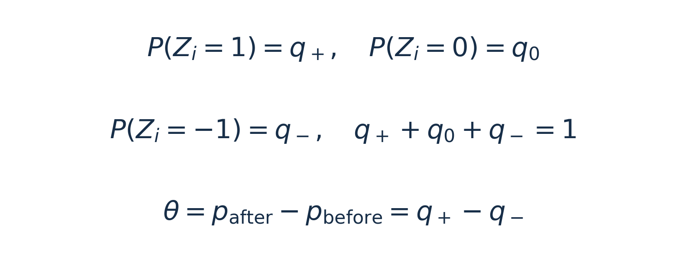

*式（2）｜三种变化概率之和为1，θ = q₊ − q₋。*

下面先假定q₊ = 0.05、q₀ = 0.70、q₋ = 0.25，用来说明概率怎样计算。在这个给定模型中，θ固定为0.05 − 0.25 = −0.20。这组概率只用于解释重复抽样的分布；真实研究中的总体概率仍需估计。

抽n个人后，＋1的人数记为N₊，取0的人数记为T，−1的人数记为N₋。如果不同人独立，并采用相同的三种概率，这三类人数共同服从多项分布；只有三类时，也称三项分布。它回答的是：**三类人数同时取到某一组数值的概率是多少？**<sup>[1]</sup>

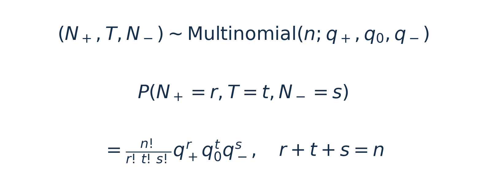

*式（3）｜r、t、s分别是＋1、0、−1的人数，相加等于n。*

这个公式可以分成两部分理解。后面的q₊ʳq₀ᵗq₋ˢ，是**已经指定哪些人属于哪一类时，这一种人员安排的概率**；前面的阶乘系数，数的是**有多少种人员安排会产生同样的三类人数**。

这段用3个人把阶乘系数拆开看，主例仍保留20人。把甲、乙、丙排成一列，规定前两位取＋1，最后一位取0。第一位有3人可选，第二位剩2人，第三位剩1人，共3! = 6种人员排列。

| 人员排列 | 对应的实际结果 |
| :--- | :--- |
| 甲乙丙、乙甲丙 | 甲乙取＋1，丙取0 |
| 甲丙乙、丙甲乙 | 甲丙取＋1，乙取0 |
| 乙丙甲、丙乙甲 | 乙丙取＋1，甲取0 |

两个取＋1的人交换顺序，类别分配没有改变，每种结果被重复数了2! = 2次，所以要除以2!。取0的只有1人，内部只有1! = 1种顺序；取−1的有0人，空类别只有一种安排，约定0! = 1。这两项除数均为1。

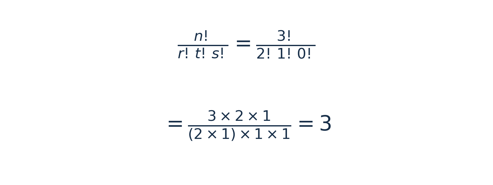

*系数示例｜式（3）中的人数取r = 2、t = 1、s = 0。*

去掉重复后，得到3种类别分配。每一种的概率都是0.05 × 0.05 × 0.70 = 0.00175，总概率为3 × 0.00175 = 0.00525。式（3）就是这样计算：**安排种数乘以一种安排的概率。**

人数增加到n时，同一类别内的r!、t!、s!种顺序同样需要去重，这就得到式（3）的阶乘系数。不同人的记录独立，但三类人数受到总和为n的约束，不能把这三个总人数看成相互独立。

## 三、有了人数概率，怎样得到率差的分布？

三类人数确定以后，D = (N₊ − N₋)/n也就确定了。但不同的人数组合，可能得到相同的D。**先算每个人数组合的概率，再把产生同一率差的组合归在一起、将概率相加，就得到D的分布。**

为了能把每一种结果列完，先把演示模型的样本量缩小到2人，仍用q₊ = 0.05、q₀ = 0.70、q₋ = 0.25。计算D = 0的概率。

第一种情况，两人都不变，即（N₊，T，N₋）＝（0，2，0）。概率为0.70 × 0.70 = 0.49。

第二种情况，一人＋1、一人−1，即（1，0，1）。有两种人员安排：第一人＋1、第二人−1，概率0.05 × 0.25 = 0.0125；交换两人的结果，概率仍为0.0125。合起来为0.025。

这两组人数都产生D = 0，而且互斥，所以P(D = 0) = 0.49 + 0.025 = 0.515。

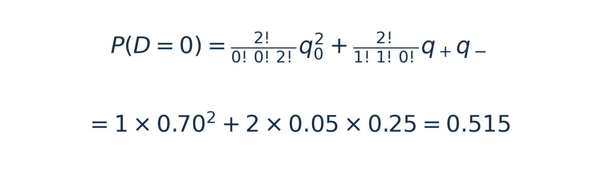

*式（4）计算示例｜两人都不变，或两人发生相反变化，都能得到D = 0。*

其余率差也这样计算，就得到全部分布：

| 率差D | 产生这一率差的情况 | 概率 |
| :--- | :--- | :--- |
| −1 | 两人都取−1 | 0.0625 |
| −0.5 | 一人−1，另一人0，两种安排 | 0.35 |
| 0 | 两人都0，或一人＋1、一人−1 | 0.515 |
| 0.5 | 一人＋1，另一人0，两种安排 | 0.07 |
| 1 | 两人都取＋1 | 0.0025 |

五个概率相加等于1。**这就是给定上述三种总体概率时，2人配对样本率差的精确分布。**

写成一般形式，就得到式（4）。其中k是＋1人数减去−1人数，是整数；率差为D = k/n。公式把所有满足r − s = k的人数组合概率相加<sup>[1]</sup>。

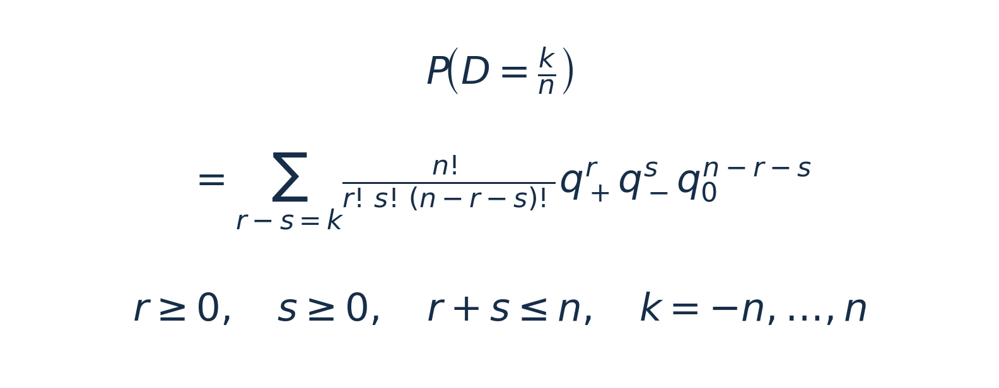

*式（4）｜先用式（3）计算每组人数的概率，再按同一率差归类求和。*

回到20人，可以先固定＋1人数来枚举：＋1有0人时，其余两类有21种分配；＋1有1人时有20种；依次减少，＋1有20人时只剩1种。

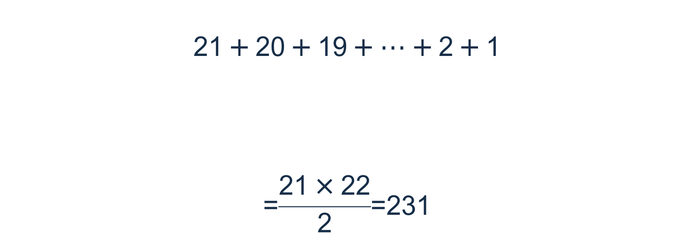

*式（5）｜21项从21减到1，平均数为11，总和为21 × 11 = 231。*

例如观察人数（1，14，5）：从20人选1人取＋1，有20种选法；剩余19人选14人取0，有11628种；余下5人取−1，共232560种人员安排。每种安排的概率为0.05 × 0.70¹⁴ × 0.25⁵，乘以安排种数，得到这组人数的概率约为0.07701541。

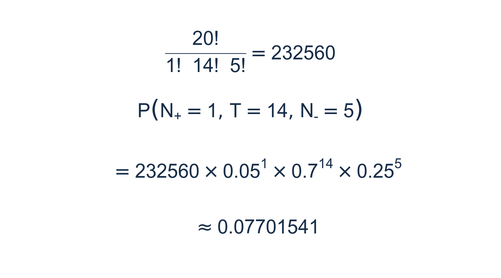

*式（6）｜沿用q₊ = 0.05、q₀ = 0.70、q₋ = 0.25，计算恰好出现（1，14，5）的概率。*

全部231组也各用式（3）计算，概率之和为1。再按D归类相加，就得到20人时D的41个可能取值及其概率。配套的基础练习把这两步分别保存为“231组人数概率表”和“率差概率表”，可以逐行对照。

## 四、平均率差和抽样波动由什么决定？

这里E表示按总体概率计算的平均值，即期望；Var表示方差。一个人的Z取＋1、0、−1，E(Z) = q₊ − q₋。平方以后，两种变化都变成1，所以E(Z²) = q₊ + q₋。再用Var(Z) = E(Z²) − [E(Z)]²求方差；这些性质在[统计课堂08](https://mp.weixin.qq.com/s/QkG1VROHLoOtyDgxEonrDw)讲过<sup>[2]</sup>。

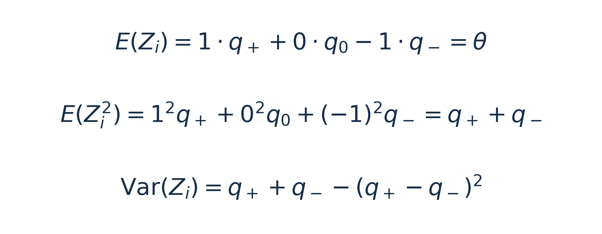

*式（7）｜两个方向相减决定均值，两个方向的变化总量也进入方差。*

D是n个独立个人差值的平均数。因此，D的均值仍为θ，方差为个人差值方差除以n。

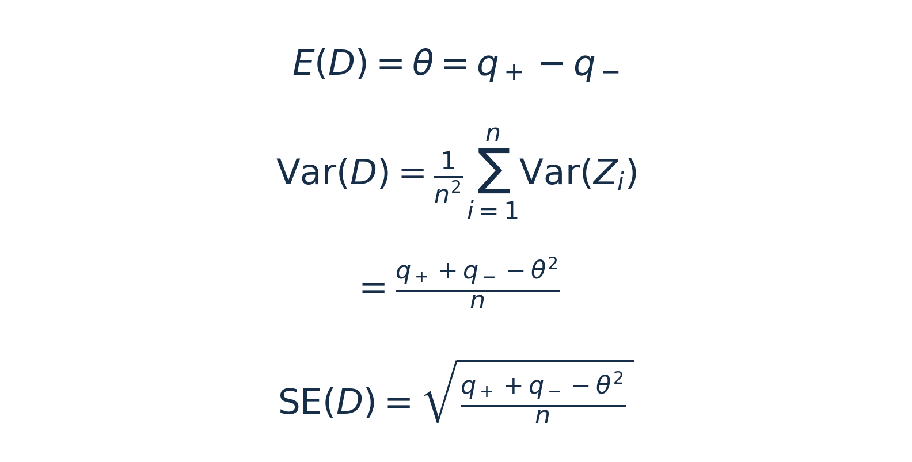

*式（8）｜标准误是D的标准差，描述重复抽样时样本率差的波动。*

在给定的概率模型中，θ = 0.05 − 0.25 = −0.20；个人差值方差为0.05 + 0.25 − 0.20² = 0.26。抽2人时，D的方差为0.13；抽20人时为0.013；抽1000人时为0.00026。人数增加，平均率差不变，抽样波动减小。

这里保留配对关系的方法，仍然是先对每个人作差。也可以从“后测率方差＋前测率方差−两倍协方差”推导，同一个人的两次结果之间的联系保留在协方差中。

## 五、用20人的观察资料，估计总体率差

现在回到最初实际观察到的20人。样本率差D = −0.20已经算出，但总体率差θ还未知。前面回答的是“已知总体概率，样本会怎样变化”；这一步回答的是“已有样本，总体率差怎样估计”。PairedCI直接使用观察人数1、14、5，并不把演示模型的三种概率当作已知总体概率传入。

`ExactCIdiff::PairedCI()`用于两个配对总体率之差的精确区间，输入的是三类人数。它依据三项联合分布构造区间，并处理模型中未知的概率<sup>[3,4]</sup>。

```r
ExactCIdiff::PairedCI(
  n12 = 1,   # 后测阳性、前测阴性，即＋1
  t = 14,    # 两次结果相同，即0
  n21 = 5,   # 后测阴性、前测阳性，即−1
  conf.level = 0.95,
  CItype = "Two.sided"
)
```

实际输出如下。

```text
$conf.level
[1] 0.95

$CItype
[1] "Two.sided"

$estimate
[1] -0.2

$ExactCI
[1] -0.44923  0.06303
```

**点估计为−20个百分点，95%区间约为−44.92至6.30个百分点。** 区间同时包含负值、0和正值，说明这20人的资料还不能把总体净变化的方向估计得很确定。

区间写成[L，U]时，L是左端点，称为置信下限；U是右端点，称为置信上限。95%说的是区间构造方法的长期覆盖水平：在模型成立时重复抽样、反复构造区间，理论上至少95%的区间会包含真实θ。

**精确区间可以用于小样本，计算可行时也适用于大样本。** “精确”指依据有限样本分布构造区间；软件仍需数值求解，区间可能偏保守，计算时间也随样本量和算法变化<sup>[3]</sup>。本例直接采用精确区间，不以单一人数门槛决定是否采用近似。

本篇第八节继续解释这个区间的计算过程，包括哪些人数组合的概率需要相加，以及怎样搜索区间端点。

## 六、样本增加以后，分布怎样变化？

先看分布形状：仍采用同一组给定概率，比较重复抽样的结果。不同人的Z独立同分布、个人差值方差大于0时，随着n增加，标准化后的D分布趋近标准正态，这是中心极限定理的应用<sup>[5]</sup>。式（9）用N表示正态分布。


*式（9）｜用式（8）的均值与方差，写出D的大样本近似。*

**式（9）中N的第二个参数表示方差。** 图1上半部分抽20人，下半部分抽1000人，三种总体概率保持不变。横轴是D；例如总差值k = −4、n = 20时，D = −0.20。下半部分横轴作了局部放大。

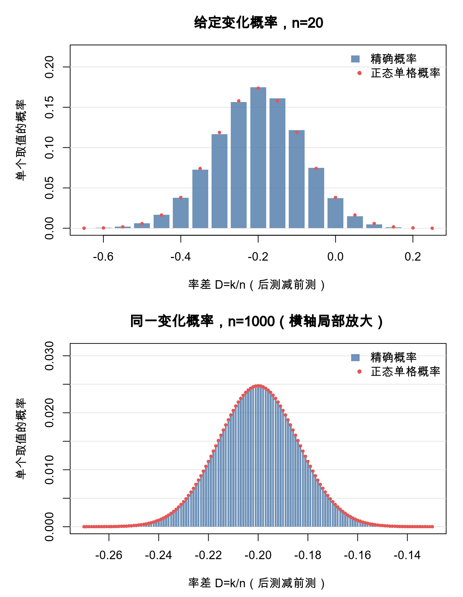

*图1｜q₊ = 0.05、q₀ = 0.70、q₋ = 0.25。柱为精确概率，点为正态分布在对应单格区间内的概率；两幅图的横轴范围不同。*

率差的一格宽度为1/n，所以每格左右边界分别离中心0.5/n；这就是图中把连续面积与离散概率对应起来的边界处理。随着人数增加，分布更集中，正态近似与精确分布也更接近。

但总人数大，仍可能只有很少的人发生变化。图2固定n = 1000，改为q₊ = 0.001、q₀ = 0.997、q₋ = 0.002，每次抽样平均只有3人变化，分布仍呈明显的离散形状。

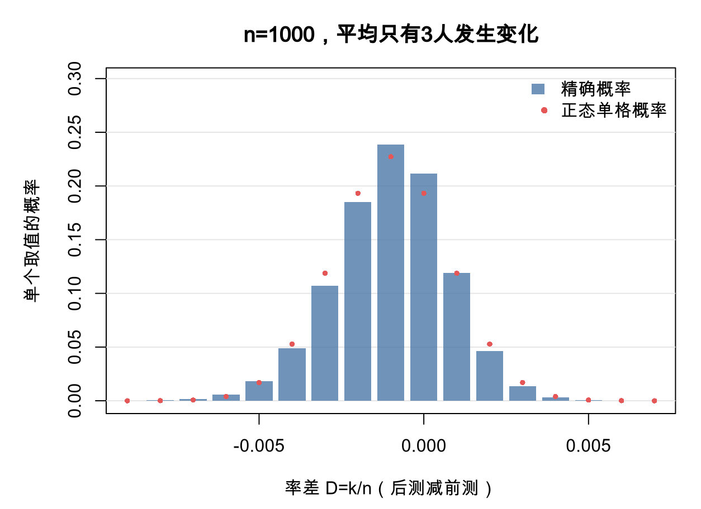

*图2｜大样本的形状要结合变化概率判断；本图与图1采用不同概率模型。*

单个二项率常用np ≥ 5且n(1−p) ≥ 5，或更保守地两项均≥10作为经验检查，其中两项是期望阳性和期望阴性人数<sup>[6]</sup>。配对率差涉及三类变化，不能只看前、后各自的率是否通过这类检查。精确方法提供了不依赖正态近似的计算路径。

接下来另做区间演算。假设1000人采用同样的配对设计：400人两次阳性、300人两次阴性、50人阴转阳、250人阳转阴。前后率仍为0.65和0.45，D仍为−0.20。把三类样本比例代入式（8），得到估计标准误0.01612；据此计算Wald近似区间。

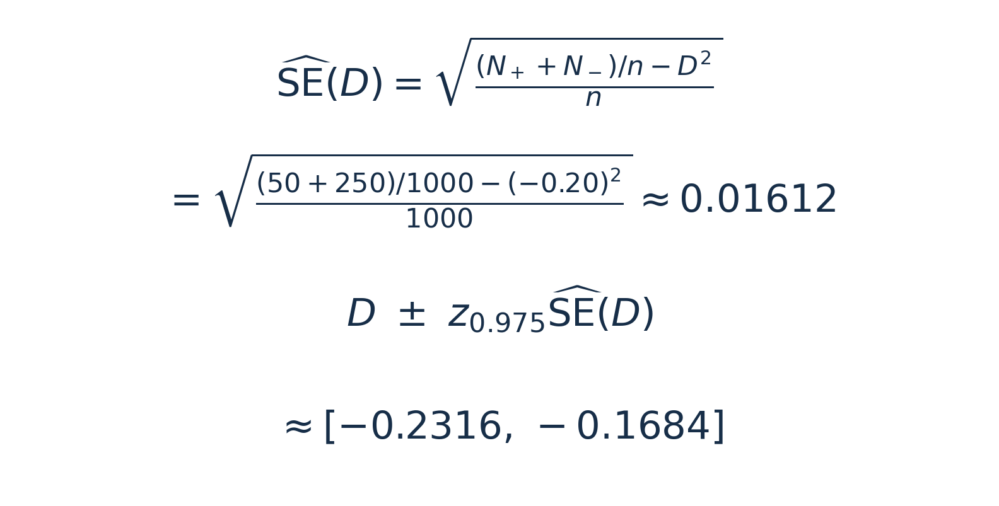

*式（10）｜区间约为[−0.2316，−0.1684]，与20人主例的精确区间采用不同构造。*

```r
n <- 1000
n_plus <- 50
n_minus <- 250
difference <- (n_plus - n_minus) / n
se <- sqrt(((n_plus + n_minus) / n - difference^2) / n)
difference + c(-1, 1) * qnorm(0.975) * se
```

实际输出如下。

```text
[1] -0.2316035 -0.1683965
```

这个大样本例题用于看清标准误与近似区间怎样计算。实际分析仍可在计算可行时采用精确方法；20人与1000人的点估计虽然相同，估计精度却不同。

## 七、率差本身就是效应量

总体率差θ是原始尺度上的效应量，D是它的样本估计。主例的−0.20表示**后测阳性率净下降20个百分点**。5人阳转阴、1人阴转阳，净变化为4人；真正发生变化的是6人，占30%。

原始率差没有通用的小、中、大分界。它是否重要，需要结合指标、前测水平、研究人群和事先关心的差异幅度，同时报告置信区间。前后观察到变化，也还需要研究设计和其他证据来解释变化原因。

## 八、继续看精确区间是怎样得到的

第五节已经给出了20人资料的精确区间。下面接着看端点怎样计算：观察人数始终是（1，14，5），软件改变的是用来计算概率的候选总体参数。第二、三节已经用式（3）计算人数组合概率，并用式（5）数出了全部231组；这里在这些计算上继续往下走。

### （一）给定总体率差，为什么还要考虑另一个概率？

`ExactCIdiff::PairedCI()`依据式（3）的三项联合分布。它把两次结果相同的概率记为pₜ，并将另外两个概率用θ和pₜ表示<sup>[3,4]</sup>。

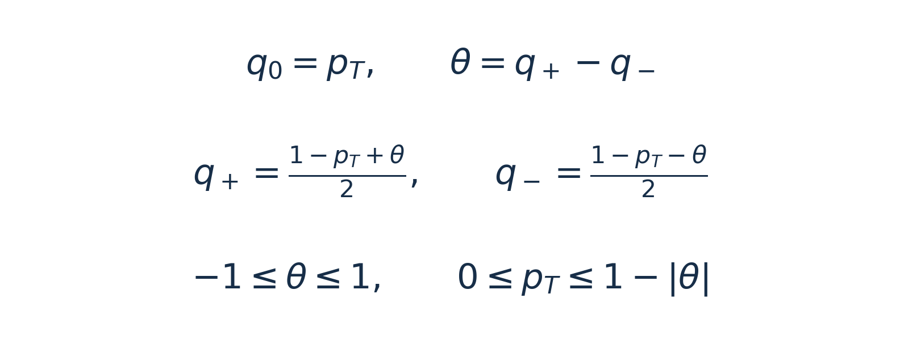

*式（11）｜PairedCI的参数表示，θ为总体后测率减前测率。*

给定候选θ，还要考虑不同的pₜ。例如先考察θ = −0.20。按式（11），pₜ可以在0至0.80之间取值。如果pₜ = 0.70，三种概率为q₊ = 0.05、q₀ = 0.70、q₋ = 0.25；如果pₜ = 0.50，三种概率则为0.15、0.50、0.35。两种模型的总体率差都为−0.20，但变化总量不同，三类人数的分布也不同。**因此，给定θ还不能唯一确定分布，pₜ也不能直接固定为样本中的14/20。**

### （二）哪些结果的概率需要合在一起？

计算下限时，需要把观察结果与一批朝较大θ方向的结果合在一起计算概率。PairedCI用Wang次序确定这批结果：排在观察组之前或与其同层的结果，合称下限尾部。下面说明这个次序怎样产生。

**Wang排序是逐步建立队列：固定已经排好的部分，让几组待排结果分别试算，再选临时下限最高的一组接到后面。** 它同时遵守下面的方向规则<sup>[3]</sup>。

**先规定哪些结果应当在前。** “20人全部取＋1”，即（20，0，0），排第一。如果把其中一人的＋1改成0，或者把一人的0改成−1，支持较大θ的程度会降低，这样得到的相邻结果不能排到原结果前面。算法据此逐步向外寻找待排组合。

每一轮，先从已经排好的组合出发，各做一次上述改变，找出邻近、尚未排入队列的组合。若这批邻近组合中，某一组可以由另一未排邻近组合再作一次上述改变得到，就先让它等待，优先比较改变之前的组合。留下的才是本轮参加试算的候选。

**从排序算法开头几步的实际计算，看这一过程。** 第一位是（20，0，0）；下一步只有（19，1，0）可以接上，因此它排第二。接着出现两个可以竞争第三位的组合：

- A＝（19，0，1）：把第二位组合中唯一的0改成−1，得到19人＋1、0人不变、1人−1。
- B＝（18，2，0）：把第二位组合中的1个＋1改成0，得到18人＋1、2人不变、0人−1。

A与B的样本率差都是0.90，但三类人数构成不同，精确概率也不同，不能只凭D判定谁排第三。这里考察的是231种可能人数结果中的开头几组；真正观察到的资料仍为（1，14，5）。

这里的A、B是待排序的人数组合，θ则是计算模型概率时要改变的总体参数。

**接下来分别试排A、B。** 试排A时，临时尾部只包括已经排好的前两组，加上A；试排B时，则包括前两组加上B。**A与B分别试算，这一步不把两者同时加入尾部。** 用式（3）计算三个组的概率并相加，得到式（12）的两条临时尾部概率。

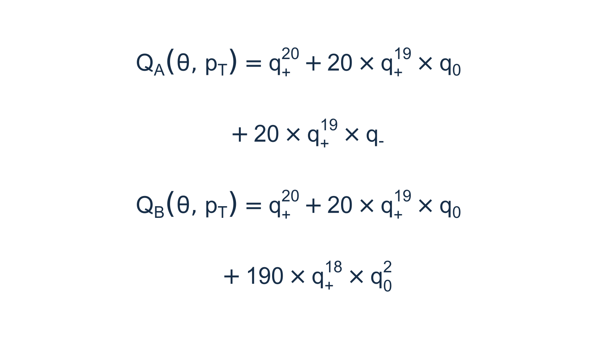

*式（12）｜上、下两式分别是试排A、B时的尾部概率，三种q由式（11）的候选θ和pₜ确定。*

两式前两项相同，分别对应（20，0，0）和（19，1，0）；最后一项才是本轮试排的A或B。其中20和190分别是相应人数组合的安排种数。

每个候选都按同一办法求临时下限：先固定一个θ，在合法范围内改变pₜ，寻找该临时尾部概率的最大值；再改变θ，找到这个最大值达到0.025的位置，取最小解。概率求和与端点搜索在下面两小节继续展开。这里采用97.5%单侧构造，所以单侧错误概率为0.025。

| 第三位的待排组合 | 临时尾部 | 试算下限（约） |
| :--- | :--- | :--- |
| A＝（19，0，1） | 前两组＋A | 0.503 |
| B＝（18，2，0） | 前两组＋B | 0.609 |

表中的0.503和0.609只用于比较A、B的排序，不是20人观察资料的最终置信下限。**B的试算下限更高，因此B排第三。** 对应的单侧区间约为[0.609，1]，比A试算得到的[0.503，1]更短；这次比较是在同一置信水平及规定的排序约束下进行。把B正式加入已经排好的部分以后，重新寻找候选，再分别试算。尚未选中的A也要重新计算，不能一直沿用刚才的0.503，因为它的临时尾部已随排好的部分增加而改变。

例如，此时（18，1，1）也出现在邻近未排组中，但它可以由尚未排入的A＝（19，0，1）把1人的＋1改成0得到，因此它先等待，不能越过A参加本轮比较。若多个合格候选具有相同的最大临时下限，就排在同一层级。

**整个过程是：分别试排→各自求临时下限→比较→正式加入胜者→重新试算。** 这样逐步推进，就能建立后续次序。**每次试算只用已经排好的组和当前试排的一组，不需要预先知道所有231组的次序。** 本例三套语言脚本复现了A与B争第三位的计算，分别得到约0.502534与0.608596；它们演示这一步选择，完整区间仍由`PairedCI()`计算。

把Wang排定的次序编号，排在前面的号数较小。**计入下限尾部的标准是：排在观察组前面，或与观察组处在同一排序层级；并列的组一起计入。** 本例运行软件的Wang排序后，观察组（1，14，5）排第141；这是97.5%单侧下限构造所用的次序，前141组没有并列。因此，**第1至141组计入尾部，第142组及以后不计入。** 这个界点由观察组的排序位置决定，各组的发生概率要在给定候选θ和pₜ后另行计算<sup>[3]</sup>。

**全部可能结果有231组，本例计入下限尾部的结果包括观察组在内共141组；尾部概率就是这141组各自概率的和。**

### （三）固定候选率差，怎样用网格搜索？

给定θ和某个合法的pₜ，就能用式（3）算出每组三类人数的概率，再把前一小节确定的尾部中各组概率相加。随后改变pₜ，在合法范围内寻找这个尾部概率的最大值。这样做，是为了让区间在不同真实pₜ下都能控制误差，而不是只在pₜ恰好等于14/20时成立。

为了看清“网格搜索”，现在换一个靠近区间下限的候选值：**固定θ = −0.45，观察资料仍为（1，14，5）。** 此时pₜ的合法范围为0至0.55。下限尾部已经按上述次序确定，本例共包含141组三类人数。接下来只改变pₜ，比较这个尾部的概率怎样变化。

**所谓网格，就是在待搜索的范围里，先选一排具体数值逐个试算。** 例如先在0至0.55之间等距选11个点：0、0.055、0.110，依次到0.550。相邻两点间隔0.055。每试一个pₜ，就按式（11）得到一组三种概率，再用式（3）逐组计算并累加尾部中141组结果的概率。

例如试pₜ = 0.440时，式（11）给出q₊ = 0.055、q₀ = 0.440、q₋ = 0.505。先完整计算观察组合（1，14，5）的概率。

**先算一种指定人员安排的概率。** 指定哪1人取＋1、哪14人取0、哪5人取−1以后，不同人独立，将20个人各自结果的概率相乘，就是0.055乘1次、0.440乘14次、0.505乘5次，约为0.0000000184144。

**再乘以产生这组人数的安排种数。** 从20人中选1人取＋1，有20种选法；从剩下19人中选14人取0，有11628种选法；余下5人全部取−1。两步合起来，有20 × 11628 = 232560种人员安排。各安排互斥，而且具有相同的概率，因此用安排种数乘以一种安排的概率，得到这组人数的总概率。

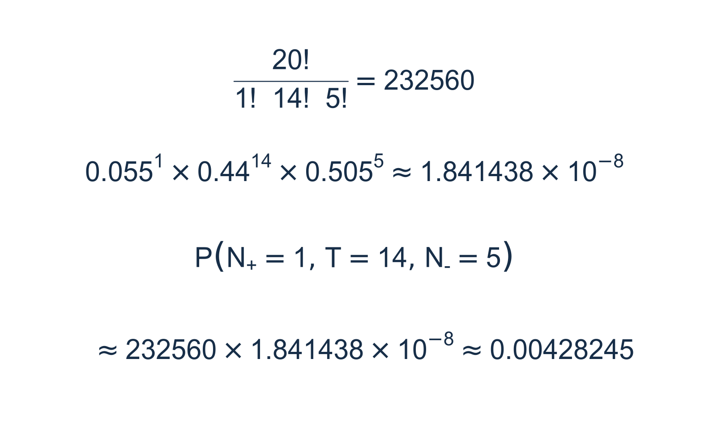

*式（13）｜固定θ = −0.45、pₜ = 0.440时，将（1，14，5）代入式（3）。*

式（6）和式（13）使用不同的总体概率，所以同一组人数得到的模型概率不同。式（13）得到约0.00428245，即在这组给定总体概率下，反复抽取20人，恰好出现“1人＋1、14人0、5人−1”的概率约为0.428%。它只是231组结果中的一项。用R的`dmultinom()`也可以核对这一项：

```r
# 三类人数与三种概率按相同次序输入：＋1、0、−1。
dmultinom(x = c(1, 14, 5), size = 20,
          prob = c(0.055, 0.440, 0.505))
```

实际输出如下。

```text
[1] 0.004282448
```

再列两组人数作对照。下表同时展示软件计算的Wang排序位置，以及在θ = −0.45、pₜ = 0.440时按式（3）算出的概率。**以观察组的第141位为界，就能逐行判断是否计入。**

| 三类人数（N₊，T，N₋） | Wang排序位置 | 该组概率 | 下限尾部 |
| :--- | :--- | :--- | :--- |
| （2，13，5） | 第135位 | 0.00374714 | 计入 |
| （1，14，5） | 第141位（观察组） | 0.00428245 | 计入 |
| （1，13，6） | 第152位 | 0.01146852 | 不计入 |

第135位排在观察组之前，第141位就是观察组，两组都计入；第152位排在观察组之后，不计入。第三组的概率0.01146852虽然更大，但**是否计入按Wang次序判断，不按单组概率大小判断，也不把样本率差D作为唯一排序依据。** 安排种数及完整概率仍列在配套的231组表中。

**其余230组也各自代入式（3）计算。** 全部231组的概率相加为1；其中，观察组与另外140组构成下限尾部，141项相加约为0.023753，余下90组的概率之和约为0.976247。三套配套脚本都逐组列出人数、安排种数、单种安排概率、该组总概率及是否属于尾部，供对照查看。也可[直接查看R计算的完整231组概率表](https://github.com/fuyuming/statistics-classroom/blob/main/stats_classroom/paired_proportion_difference/%E9%85%8D%E5%A5%97%E9%A1%B9%E7%9B%AE/%E8%BF%90%E8%A1%8C%E7%BB%93%E6%9E%9C/R/%E4%B8%89%E7%B1%BB%E4%BA%BA%E6%95%B0%E7%9A%84231%E7%BB%84%E6%A6%82%E7%8E%87.csv)。**图3的每一个点，都是这样完成一次“给定pₜ→计算每组三类人数结果的概率→累加指定尾部”的结果。**

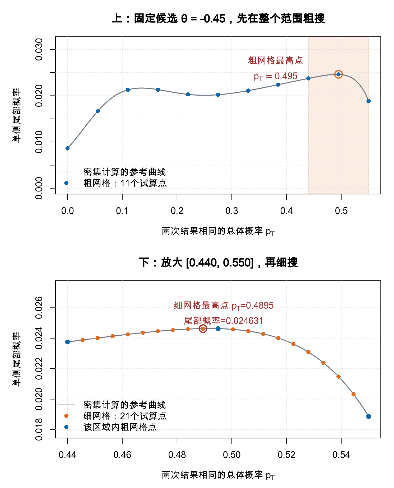

*图3｜依据主例Wang下限尾部计算的概率。横轴为pₜ，纵轴为141组尾部结果的概率之和。上半部分在[0，0.55]试11个粗网格点，阴影标出细搜区域；下半部分放大[0.44，0.55]，试21个细网格点。灰线为密集计算的参考曲线。11与21用于展示步骤，本节末尾另用60与40计算区间；两幅图的横轴和纵轴范围不同。*

**先看图3上半部分，比较全部11个粗网格点。** 最高的蓝点在pₜ = 0.495，尾部概率约为0.024627。接着取它左右相邻的粗网格点0.440和0.550，把这个范围圈出来。图中还存在另一个局部高点，因此先查看整个合法范围，才能避免只盯着一个局部区域。

**再看图3下半部分，在圈出的范围里细找。** 将[0.440，0.550]重新等距放入21个试算点，相邻间隔缩小为0.0055。峰顶附近几次试算如下。

| pₜ的试算值 | 累加得到的尾部概率 |
| :--- | :--- |
| 0.4785 | 0.024538 |
| 0.4840 | 0.024598 |
| **0.4895** | **0.024631** |
| 0.4950 | 0.024627 |
| 0.5005 | 0.024578 |

这轮细网格的最高点在pₜ = 0.4895，尾部概率约为0.024631，比粗网格找到的值略高。进一步用密集网格核对，峰位约在pₜ = 0.4919，尾部概率约为0.024634。这也说明，继续加密网格可以细化极值的位置与末位数值。**网格搜索找的是“哪一个pₜ使尾部概率最大”；它没有把pₜ估计为0.4895，也还没有求出θ的区间端点。** 这里的θ始终固定为−0.45。

按函数文档，`grid.one`用于先粗略寻找极值区域，`grid.two`用于在相应邻域细找；`precision`控制置信限的数值精度。本节末尾调用的60与40表示采用较密的搜索设置，置信水平仍由`conf.level`指定<sup>[3,4]</sup>。

### （四）怎样从尾部概率找到区间端点？

双侧95%区间将两侧的错误概率各控制在2.5%。求最终区间时，要对不同候选θ重复计算：每换一个θ，就重新在相应合法范围内搜索pₜ并取最大尾部概率。计算下限时，寻找这个最大尾部概率达到0.025的位置，按该方法取最小解；无解时按参数边界处理。计算上限时，交换＋1与−1的人数，用同样的方法求下限，再反号。由下限形成的单侧区间为[L，1]，由上限形成的单侧区间为[−1，U]；取两者的共同部分[L，U]，得到双侧95%区间。

**PairedCI使用完整的三类人数信息，区间随率差及变化人数共同改变。** n12与n21共同给出净变化及两个方向的变化人数，t则给出结果相同的人数。只给一个率差，无法还原这些信息。

下面给出较密网格设置的调用，提取区间字段。

```r
ExactCIdiff::PairedCI(
  n12 = 1, t = 14, n21 = 5,
  conf.level = 0.95,
  CItype = "Two.sided",
  grid.one = 60,
  grid.two = 40
)$ExactCI
```

实际输出如下。

```text
[1] -0.44923  0.06303
```

保留五位小数时，结果与第五节默认设置相同。较密网格用于细化数值搜索，置信水平仍为95%。

## 九、本篇讲了哪些知识？

1. **配对率差来自个人变化。** 后测减前测取＋1、0、−1，D是全部个人差值的平均数。
2. **先算人数组合的概率。** 不同人独立时，用“安排种数 × 一种安排的概率”计算三项概率。
3. **再按相同率差归类相加。** 这就从三类人数的联合分布得到D的精确分布。
4. **均值看两个方向之差，方差还看变化总量。** 给定变化概率，人数增加会减小平均率差的抽样波动。
5. **真实研究还要估计未知总体率差。** 20人的主例用PairedCI计算精确区间；大样本时，精确方法在计算可行时仍可使用。
6. **区间构造还要确定尾部并处理未知概率。** PairedCI按Wang次序确定要累加的结果，对每个候选率差搜索未知概率，再寻找区间端点。
7. **效应大小与不确定性一起解释。** 报告率差和百分点，区分净变化与实际发生变化的人数比例。

## 配套练习

和前面的统计课堂一样，保留R、Python、MATLAB三套对应脚本。先运行本语言的`distribution_basics`：查看两人小模型，再对照20人的231组人数概率与41个率差概率。它们统一采用q₊ = 0.05、q₀ = 0.70、q₋ = 0.25。

正文统计图由R生成。完整项目保留分析、精确区间和第八节的排序算法演示；具体入口见配套README，按需要逐步运行。

本篇完整项目：
https://github.com/fuyuming/statistics-classroom/tree/main/stats_classroom/paired_proportion_difference

[下载本篇完整ZIP](https://github.com/fuyuming/statistics-classroom/raw/refs/heads/main/stats_classroom/paired_proportion_difference/%E9%85%8D%E5%AF%B9%E6%A0%B7%E6%9C%AC%E7%8E%87%E5%B7%AE_%E5%AE%8C%E6%95%B4%E9%A1%B9%E7%9B%AE.zip)。解压后进入`paired_proportion_difference`，先读README。

系列仓库：https://github.com/fuyuming/statistics-classroom

[下载整个仓库ZIP](https://github.com/fuyuming/statistics-classroom/archive/refs/heads/main.zip)，解压后进入`stats_classroom/paired_proportion_difference`。

这里是明哥的微生物世界，我们下次再见。

## 参考资料

[1] Chen Y-C. University of Washington STAT 512, Lecture 7: Multinomial distribution. https://faculty.washington.edu/yenchic/20A_stat512/Lec7_Multinomial.html

[2] 明哥的微生物世界．期望、方差、协方差：统计公式是怎样一步步推出来的？统计课堂08。https://mp.weixin.qq.com/s/QkG1VROHLoOtyDgxEonrDw

[3] Shan G, Wang W. ExactCIdiff: An R Package for Computing Exact Confidence Intervals for the Difference of Two Proportions. The R Journal. 2013;5(2):62–70. https://journal.r-project.org/articles/RJ-2013-026/index.html

[4] ExactCIdiff官方手册，PairedCI。https://cran.r-project.org/web/packages/ExactCIdiff/ExactCIdiff.pdf

[5] Penn State STAT 414. Lesson 27: The Central Limit Theorem. https://online.stat.psu.edu/stat414/Lesson27

[6] Penn State STAT 500. Lesson 4, Section 4.2.2: Sampling Distribution of the Sample Proportion. https://online.stat.psu.edu/stat500/Lesson04
