# 配对样本率差怎样分布？从个人变化到多项分布

> 明哥的微生物世界 · 统计课堂 27
>
> 摘要　同一批人前后检测，率差怎样由每个人的变化形成？先用两个人列全9种变化组合，逐项计算率差和概率，再借助多项分布回到20人的例题，理解率差的精确分布、均值和方差。

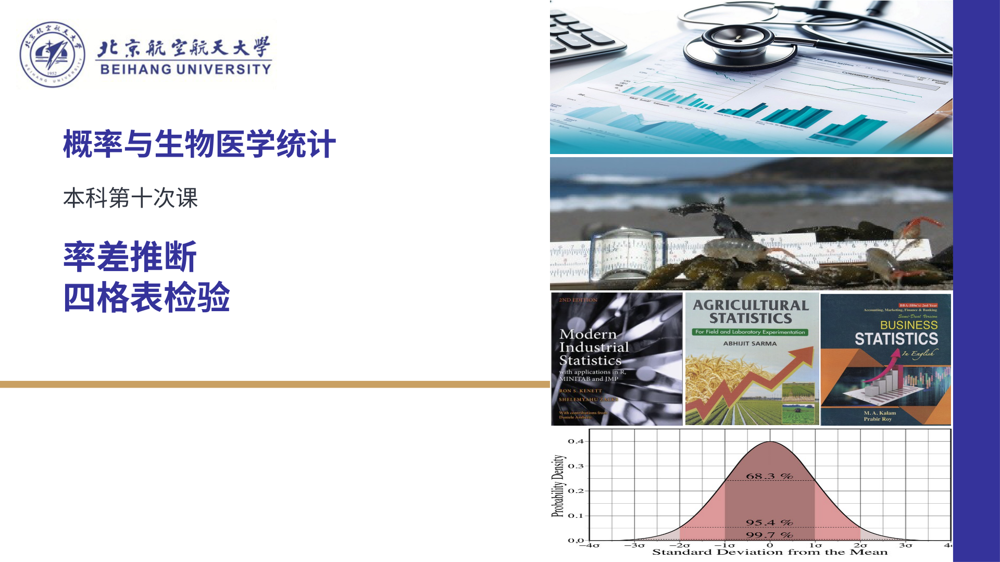

大家好，我是明哥。

下次课要讲率差的估计与假设检验。这里先说清楚：配对样本率差有哪些可能取值，每个值有多大概率，以及它在重复抽样中会怎样波动。

[统计课堂25](https://mp.weixin.qq.com/s/yFWPQNnmvm_OKQO4ZgsEBA)讨论过两个独立样本率之差。这次换成同一批人前后各测一次：前后率可以直接相减，但要判断这个差值的波动，就需要知道每个人怎样变了。

## 一、率差为−0.20，具体是什么意思？

假设从某个目标人群随机抽取20名成年人，相隔两周，用同一方法、同一判定标准各检测一次。每个人都有完整的两次记录，不同人的记录相互独立。结果为：

- 8人两次都是阳性。
- 6人两次都是阴性。
- 1人由阴性变为阳性。
- 5人由阳性变为阴性。

我们关注**后测阳性率减前测阳性率**，先算这批人的率差，再在给定的概率模型下研究：重新抽取同样人数时，率差可能取哪些值，各有多大概率；它的均值与方差是多少。

前测有8 + 5 = 13人阳性，样本率为13/20 = 0.65；后测有8 + 1 = 9人阳性，样本率为9/20 = 0.45。两者相减，得到−0.20，即后测阳性率低20个百分点。

这个差值也可以逐人计算。把阴性记为0、阳性记为1，每个人的后测结果减前测结果，记为Z：阴转阳是＋1，阳转阴是−1，两次相同是0。

本例1人贡献＋1，5人各贡献−1，14人贡献0，合计−4。除以全部20人，仍然得到−0.20。一般样本量记为n，第i个人的前测、后测分别记为Xᵢ、Yᵢ。

**Zᵢ = Yᵢ − Xᵢ，表示第i个人的后测结果减去前测结果。下标i标记第几个人。**

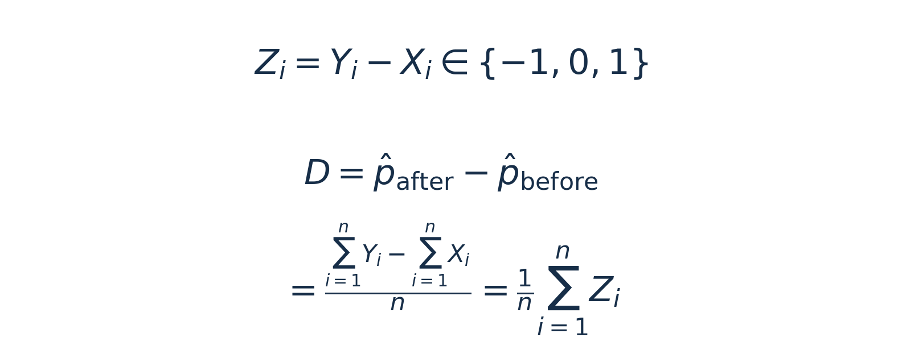

*式（1）｜先对同一个人的两次结果作差，再对全部n个人求平均，得到样本率差D。*

**配对率差是个人变化的平均数。** 两次未变的14人也在分母中。真正发生变化的有6人，占30%；净变化是减少4名阳性者，占20%。净下降与发生变化的人数比例，回答的是不同问题。

若按同一设计重新抽20人，三类人数可能改变，D也会改变。本次观察值是−0.20；下面研究D的分布，就是研究重复抽样时各个可能率差出现的概率。

## 二、为什么这里会用到多项分布？

研究重复抽样，需要给个人变化指定概率。设一个人阴转阳、不变、阳转阴的总体概率分别为q₊、q₀、q₋。一个人只能属于其中一类，三种概率之和为1。

总体后测率减前测率记为θ。两次均阳性者对前后两率贡献相同，相减后抵消；两次均阴性者对两边都贡献0。因此，**θ等于阴转阳概率减去阳转阴概率**。

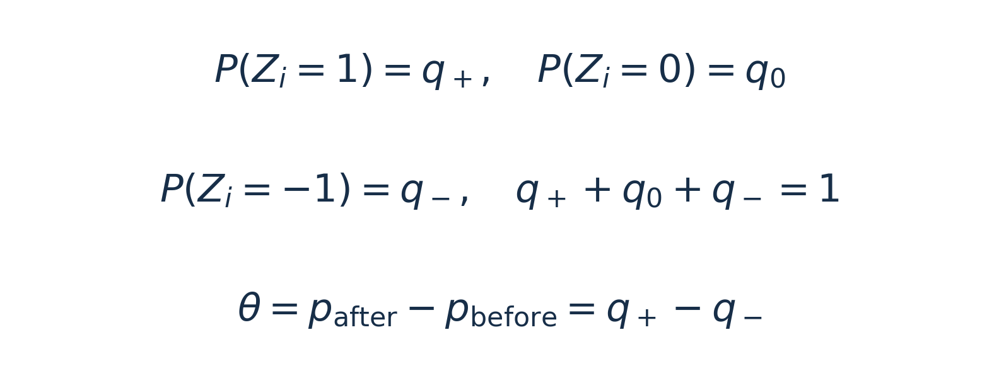

*式（2）｜q₊、q₀、q₋描述个人变化，θ = q₊ − q₋描述总体净变化。*

例如，先给定q₊ = 0.05、q₀ = 0.70、q₋ = 0.25。这表示每个人有5%的概率阴转阳、70%的概率不变、25%的概率阳转阴，总体率差θ = −0.20。

抽n个人后，阴转阳人数记为N₊，不变人数记为T，阳转阴人数记为N₋，三类人数相加为n。T合并了两次均阳性与两次均阴性的人数，因为这两种情况的个人差值都为0。

**固定抽取n个人，每个人独立地按相同概率归入这些类别，各类人数共同服从多项分布，英文是multinomial distribution。** 这里有三个类别，具体就是三类别的多项分布。它计算的是三类人数同时取到某个组合的概率，例如恰好出现“1人阴转阳、14人不变、5人阳转阴”的概率<sup>[1]</sup>。

这组给定的总体概率用于演算分布。它们恰好等于本例观察到的三个样本比例，但真实研究中，总体概率仍未知，不能因此认定它们就是0.05、0.70、0.25。

## 三、两个人的9种结果，怎样变成率差的分布？

为了把所有可能结果列全，<u>**先看一个只抽取2个人的假想样本**</u>。**每个人仍然各测前、后两次**：第一人的前后差值为Z₁，第二人为Z₂。两人的记录相互独立，每个人都可能取−1、0或＋1，概率分别为0.25、0.70、0.05。

现在n = 2，按式（1），D = (Z₁ + Z₂)/2。对每一对个人变化，先回答两件事：两个人的变化相加、再除以2，率差是多少；这对结果同时出现的概率是多少。

例如，第一人阳转阴，Z₁ = −1；第二人不变，Z₂ = 0。此时D = (−1 + 0)/2 = −0.5。这对结果出现的概率是0.25 × 0.70 = 0.175。**相乘用的是不同人的独立性，同一个人的前后关系已经包含在Z中。**

第一人有3种可能，每一种又能与第二人的3种可能配成一对，共3 × 3 = 9种。第一人的变化写在前、第二人写在后，所以（−1，0）与（0，−1）分别列出。下表每一行都是一对具体的个人变化。

两个样本率都在0至1之间，因此后测率减前测率所得的D在−1至1之间：最小是0 − 1 = −1，最大是1 − 0 = 1。D为正表示后测率更高，为负表示后测率更低，为0表示前后率相等。

| 第一人Z₁ | 第二人Z₂ | 样本率差D | 概率怎样相乘 | 这对结果的概率 |
| :--- | :--- | :--- | :--- | :--- |
| −1 | −1 | −1 | 0.25 × 0.25 | 0.0625 |
| −1 | 0 | −0.5 | 0.25 × 0.70 | 0.175 |
| −1 | ＋1 | 0 | 0.25 × 0.05 | 0.0125 |
| 0 | −1 | −0.5 | 0.70 × 0.25 | 0.175 |
| 0 | 0 | 0 | 0.70 × 0.70 | 0.49 |
| 0 | ＋1 | 0.5 | 0.70 × 0.05 | 0.035 |
| ＋1 | −1 | 0 | 0.05 × 0.25 | 0.0125 |
| ＋1 | 0 | 0.5 | 0.05 × 0.70 | 0.035 |
| ＋1 | ＋1 | 1 | 0.05 × 0.05 | 0.0025 |

比如第一行，两人都由阳性变为阴性：前测率为2/2 = 1，后测率为0/2 = 0，率差为0 − 1 = −1。按个人变化计算时，两个人各贡献−1，要**把两个变化相加后除以2**，即D = [（−1）＋（−1）]/2 = −1，得到同样结果。这一行的概率为0.25 × 0.25 = 0.0625。

最后一行，两人都由阴性变为阳性，前测率为0、后测率为1，D = 1 − 0 = 1；按个人变化计算，同样得到D = [（＋1）＋（＋1）]/2 = 1。这一行的概率为0.05 × 0.05 = 0.0025。

但9行只产生了5个不同的D。有的结果不同，率差却相同。例如（−1，0）与（0，−1）都得到−0.5。一次抽样只能落在其中一行，这两种结果互斥，所以**D = −0.5的概率是0.175 + 0.175 = 0.35**。

把得到同一个D的结果归在一行。先列出两个人的变化怎样算成D，再把对应的概率相加：

| 率差D | 两人的变化怎样算成D | 对应结果的概率怎样相加 |
| :--- | :--- | :--- |
| −1 | [（−1）＋（−1）]/2<br>= −1 | 0.25 × 0.25<br>= 0.0625 |
| −0.5 | [（−1）＋0]/2 = −0.5<br>[0＋（−1）]/2 = −0.5 | 0.25 × 0.70<br>＋0.70 × 0.25<br>= 0.175＋0.175<br>= 0.35 |
| 0 | [（−1）＋（＋1）]/2 = 0<br>(0＋0)/2 = 0<br>[（＋1）＋（−1）]/2 = 0 | 0.25 × 0.05<br>＋0.70 × 0.70<br>＋0.05 × 0.25<br>= 0.0125＋0.49＋0.0125<br>= 0.515 |
| 0.5 | [0＋（＋1）]/2 = 0.5<br>[（＋1）＋0]/2 = 0.5 | 0.70 × 0.05<br>＋0.05 × 0.70<br>= 0.035＋0.035<br>= 0.07 |
| 1 | [（＋1）＋（＋1）]/2<br>= 1 | 0.05 × 0.05<br>= 0.0025 |

第二列每个算式中的第一个变化属于第一人，第二个变化属于第二人；第三列按同样次序列出对应的概率乘积，再相加。现在每个D的概率都找到了，五项相加为1，这才得到两人样本率差的完整分布。

这5个率差的概率求出后，还可以回头看看它们与三类人数的关系。以D = 0的三行为例：两人都不变是一组人数（N₊，T，N₋）＝（0，2，0），概率为0.49；两人分别取＋1和−1是另一组人数（1，0，1），虽然有两种先后安排，三类人数相同，合计概率为0.025。

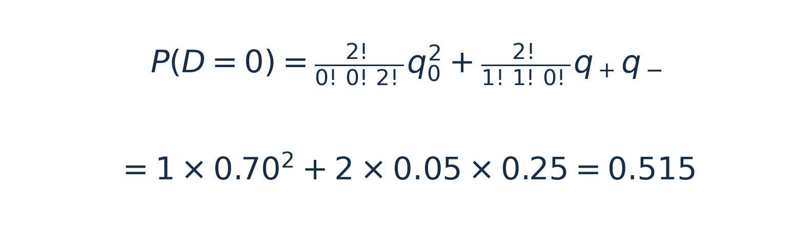

*式（3）｜0.49与0.025分别来自两组人数；合起来得到P(D = 0) = 0.515。*

**个人结果的排列可以不同，三类人数也可以不同，却产生同一个率差。** 上面先列个人结果，再按D合并。人数增加后，直接按三类人数归组，能使计算更方便。

## 四、回到20人，怎样计算每组人数的概率？

两人时可以逐项列出人员安排。人数增加后，可以把“有多少种安排”和“一种安排的概率”分开计算。

一般地，＋1有r人、0有t人、−1有s人，三者相加为n。个人变化的总和为r − s，所以D = (r − s)/n：三类人数确定后，率差也就确定了。这组三类人数的概率由式（4）给出<sup>[1]</sup>。

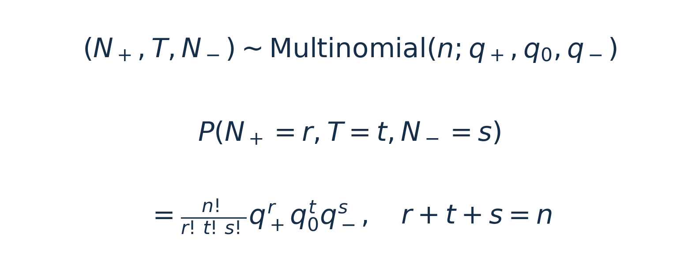

*式（4）｜阶乘系数计算安排种数，q₊ʳq₀ᵗq₋ˢ计算一种指定人员安排的概率。*

### （一）这个阶乘系数怎样得到？

先用3个人看：甲、乙、丙中，2人取＋1，1人取0，没有人取−1。我们要数的是，这三类人可以怎样分配。

**角度一：分步选人，把组合数相乘。**

先从3个人中选2人取＋1，可以选甲乙、甲丙或乙丙，共有C(3, 2) = 3种选法。C(3, 2)表示“从3人中选2人”的组合数，只看选中了谁，甲乙与乙甲算同一种。

再从剩下的1个人中选1人取0，有C(1, 1) = 1种选法。每一种第一步的选择，都能与这1种第二步的选择配在一起，所以共有C(3, 2) × C(1, 1) = 3 × 1 = 3种类别分配。取−1的类别没有人，无须再选。

推广到n个人，也是先从n人中选r人取＋1，再从剩下的n − r人中选t人取0；余下的s人全部取−1。因此，安排种数是C(n, r) × C(n − r, t)。

把两个组合数写成阶乘形式，再相乘。这里s = n − r − t，分子、分母中共同的(n − r)!可以约去：

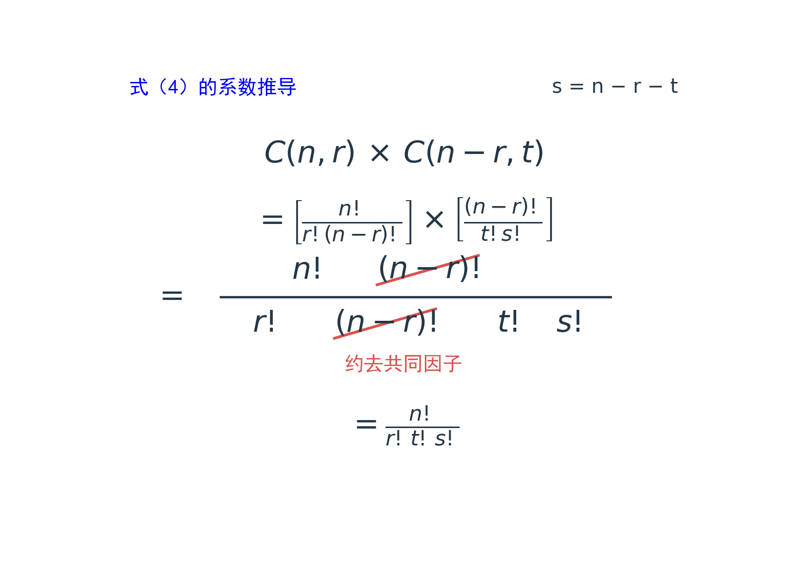

*式（4）的系数推导｜红色划线标出分子、分母中相同的(n − r)!；约去后，得到安排种数n!/(r!t!s!)。*

**角度二：先排列，再去掉重复。**

也可以把甲、乙、丙排成一列，规定前两位取＋1，最后一位取0。三个人共有3! = 3 × 2 × 1 = 6种排列。

| 人员排列 | 对应的实际结果 |
| :--- | :--- |
| 甲乙丙、乙甲丙 | 甲乙取＋1，丙取0 |
| 甲丙乙、丙甲乙 | 甲丙取＋1，乙取0 |
| 乙丙甲、丙乙甲 | 乙丙取＋1，甲取0 |

两个取＋1的人交换顺序，类别分配没有改变，每种实际结果被数了2!次，所以要除以2!。取0的只有1人，内部有1! = 1种顺序；取−1的有0人，空类别有一种安排，约定0! = 1。这两项除数都是1。

一般情况下，三个类别内部各有r!、t!、s!种人员排列。这些内部顺序可以相互搭配，同一个类别分配在全部n!种排列中被重复计算了r!t!s!次；除去这些重复，同样得到n!/(r!t!s!)。

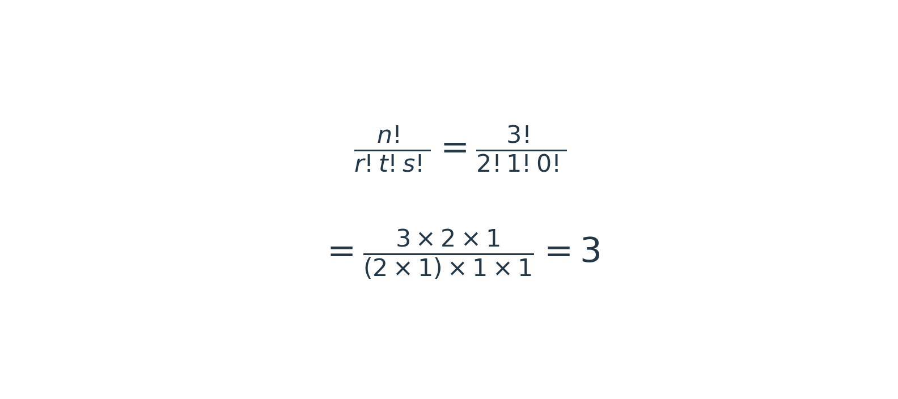

*系数示例｜r = 2、t = 1、s = 0，两种算法得到的安排种数都是3。*

每种指定人员安排的概率都是0.05 × 0.05 × 0.70 = 0.00175，乘以3，得到这组人数的概率0.00525。式（4）就是把安排种数乘以一种指定人员安排的概率。

### （二）观察到的（1，14，5），概率是多少？

回到20人的模型，（1，14，5）按＋1、0、−1的人数排列。从20人选1人取＋1，有20种选法；从剩余19人选14人取0，有11628种；余下5人取−1。共有20 × 11628 = 232560种安排。

每种指定安排的概率为0.05 × 0.70¹⁴ × 0.25⁵。乘以安排种数，得到约0.07701541。

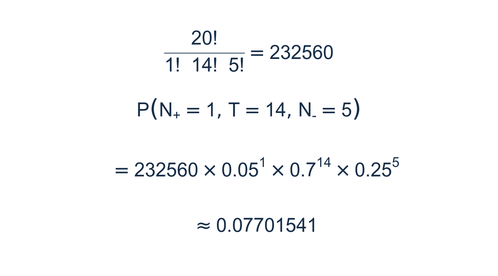

*式（5）｜这是恰好出现（1，14，5）这组人数的概率。*

R的`dmultinom()`可以直接核对这项概率。三类人数与三种概率按＋1、0、−1的相同次序输入，`size`为总人数。

```r
# 类别顺序统一为：＋1、0、−1。
dmultinom(c(1, 14, 5), size = 20, prob = c(0.05, 0.70, 0.25))
```

```text
[1] 0.07701541
```

这个调用回答的是“一组人数的概率是多少”。要得到D的分布，还需要合并产生相同D的人数组合。

### （三）为什么D = −0.20的概率更大？

观察组（1，14，5）给出D = (1 − 5)/20 = −0.20。其他人数也可能给出这个率差：例如（0，16，4）和（2，12，6），＋1人数减去−1人数都为−4。

符合这一条件的共有9组，从（0，16，4）、（1，14，5）一直到（8，0，12）。每次＋1与−1人数同时增加1，不变人数减少2，总人数仍为20，人数之差仍为−4。

分别用式（4）计算这9组的概率，再相加，得到**P(D = −0.20) ≈ 0.17484084**。0.07701541只是一组人数的概率，0.17484084才是这个模型下D恰好取−0.20的概率。

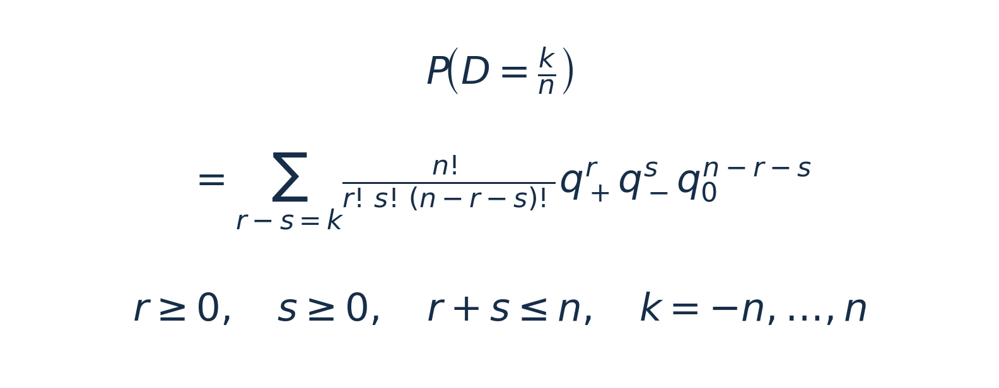

*式（6）｜k是＋1人数减去−1人数；要使D = k/n，就将所有满足r − s = k的人数组合概率相加。*

全部可能的人数组合也能逐一列出。固定＋1人数：有0人＋1时，其余两类有21种分配；有1人＋1时有20种；依次减少，到20人都取＋1时只剩1种。

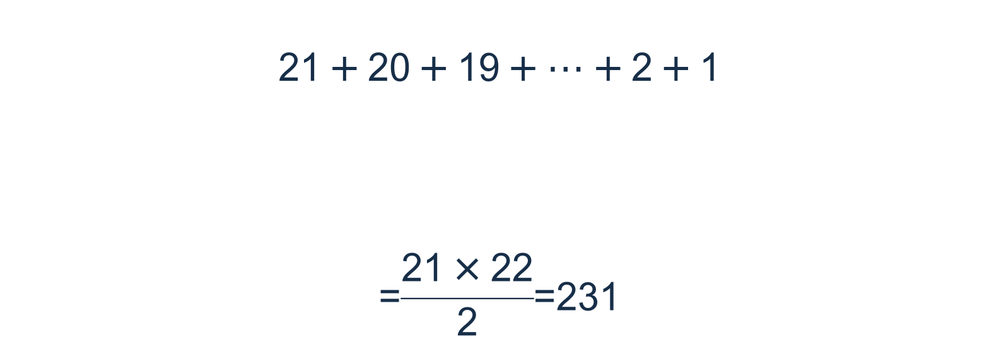

*式（7）｜21项从21减到1，平均为11，合计231组。*

231组人数的概率之和为1。再按D归类，就得到从−1到1、间隔1/20的41个率差及其概率，合计仍为1。配套基础入口分别保存了231组人数概率、9组同率差概率及41项率差分布，三套语言可以逐行对照。

## 五、率差的平均水平和波动怎样计算？

列出全部概率可以认识分布。如果只关心平均水平和波动，还可以直接从个人变化Z计算。

### （一）先求一个人的均值和方差

**Zᵢ是第i个人“后测结果减前测结果”的差值，即Zᵢ = Yᵢ − Xᵢ；下标i表示第几个人。** 阴转阳时取＋1，两次结果相同时取0，阳转阴时取−1，对应概率依次为q₊、q₀、q₋。

将Zᵢ的每个可能取值乘以它的概率，再相加，就得到均值E(Zᵢ) = q₊ − q₋ = θ。

还要计算E(Zᵢ²)，即差值平方后的平均数。**平方的是差值的取值，概率仍是原来的概率。** ＋1与−1平方后都变成1，0平方后仍为0，所以E(Zᵢ²) = q₊ + q₋。

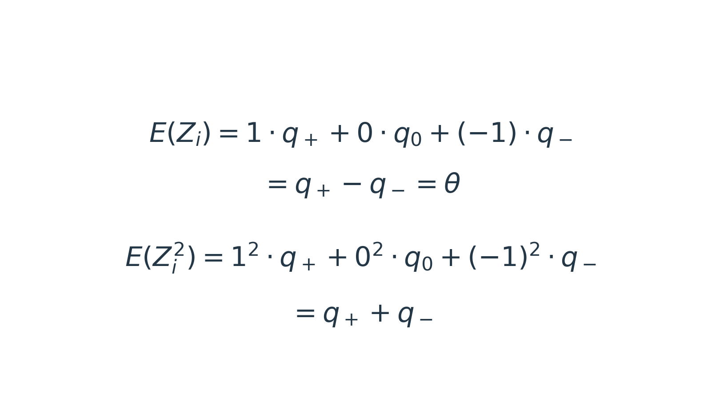

*式（8）前半｜先求E(Zᵢ)，再求E(Zᵢ²)；后者将两个方向的变化概率相加。*

直接使用[统计课堂08](https://mp.weixin.qq.com/s/QkG1VROHLoOtyDgxEonrDw)讲过的方差性质：**方差等于随机变量平方的期望，减去随机变量期望的平方。** 前面已算出这两个期望，现在代入即可<sup>[2]</sup>。

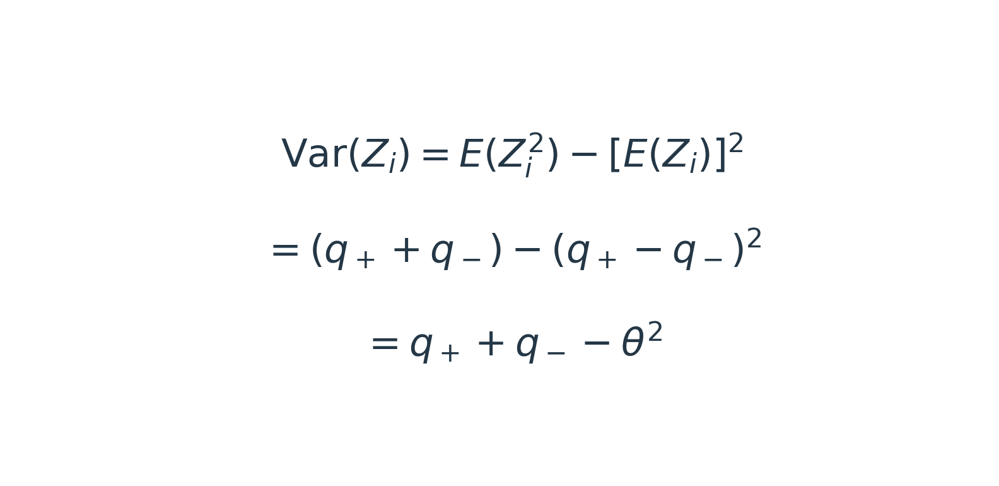

*式（8）后半｜代入E(Zᵢ²) = q₊ + q₋和E(Zᵢ) = q₊ − q₋，再用q₊ − q₋ = θ。*

这里，q₊ + q₋对应“随机变量平方的期望”，θ²对应“随机变量期望的平方”。因此，方差中减去的θ²就是均值的平方。

### （二）再求平均数D的方差

D是n个个人差值的平均数。每个Zᵢ的均值都是θ，取平均后，D的均值仍为θ。

方差要分两步算。**把总和除以n，方差要乘以1/n²**，用的是Var(aX) = a²Var(X)。再利用不同人的差值相互独立：他们之间的协方差为0，总和的方差就是n个个人方差相加，即n倍个人方差。

这样，1/n²再乘以n，便剩下1/n。因此，D的方差等于个人差值方差除以n；最后对方差取平方根，得到标准误。

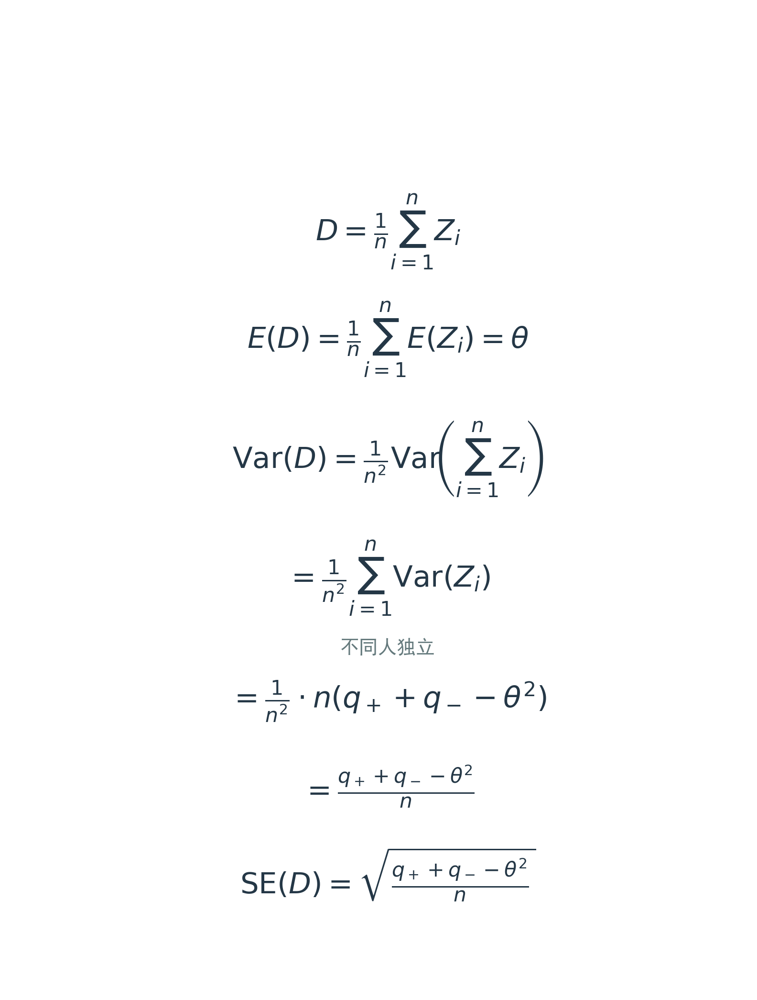

*式（9）｜先提出1/n²，再将n个相同方差相加，得到个人方差的1/n；标准误是D的标准差。*

给定模型中，θ = 0.05 − 0.25 = −0.20，因此θ² = 0.04；E(Zᵢ²) = 0.05 + 0.25 = 0.30。两者相减，个人差值方差为0.30 − 0.04 = 0.26。

抽20人时，D的方差为0.26/20 = 0.013；再取平方根，标准误约为0.114，即11.4个百分点。同样，抽2人时D的方差为0.13，抽1000人时为0.00026。人数增加，D仍围绕同一θ波动，分布会更集中。

**同一个率差还不足以确定波动。** θ只给出q₊ − q₋，方差还用到q₊ + q₋。实际数据中，除了净变化，也要保留两个方向各有多少人变化。若从前后两个率分别推导，方差中同样要保留两次测量之间的协方差<sup>[2]</sup>。

## 六、样本增加以后，分布怎样变化？

仍采用q₊ = 0.05、q₀ = 0.70、q₋ = 0.25，比较抽20人与1000人的分布。不同人的Z独立同分布、方差大于0时，随着n增加，标准化后的D分布趋近标准正态，这是中心极限定理的应用<sup>[3]</sup>。总人数是否足够，还要结合实际发生变化的概率判断。

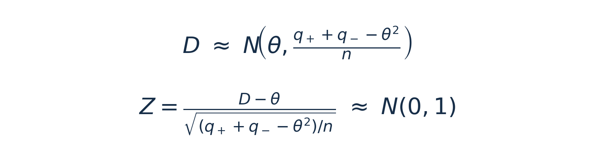

*式（10）｜将式（9）的均值、方差用于大样本近似。*

**式（10）中N的第二个参数表示方差。**

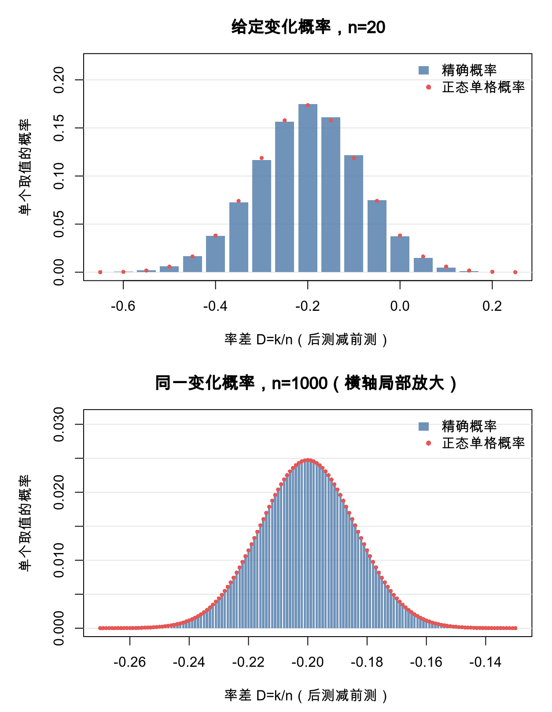

*图1｜柱为精确概率，点为正态分布在对应单格区间内的概率；下图横轴局部放大。*

横轴是率差D。总差值k = −4、n = 20时，对应D = −0.20。D每相邻一格差1/n，将正态曲线下的面积对应到这一格时，左右边界分别离中心0.5/n。图中的正态单格概率按这两个边界计算。

总人数大，也可能很少有人变化。图2把n固定为1000，改为q₊ = 0.001、q₀ = 0.997、q₋ = 0.002，平均只有3人变化。

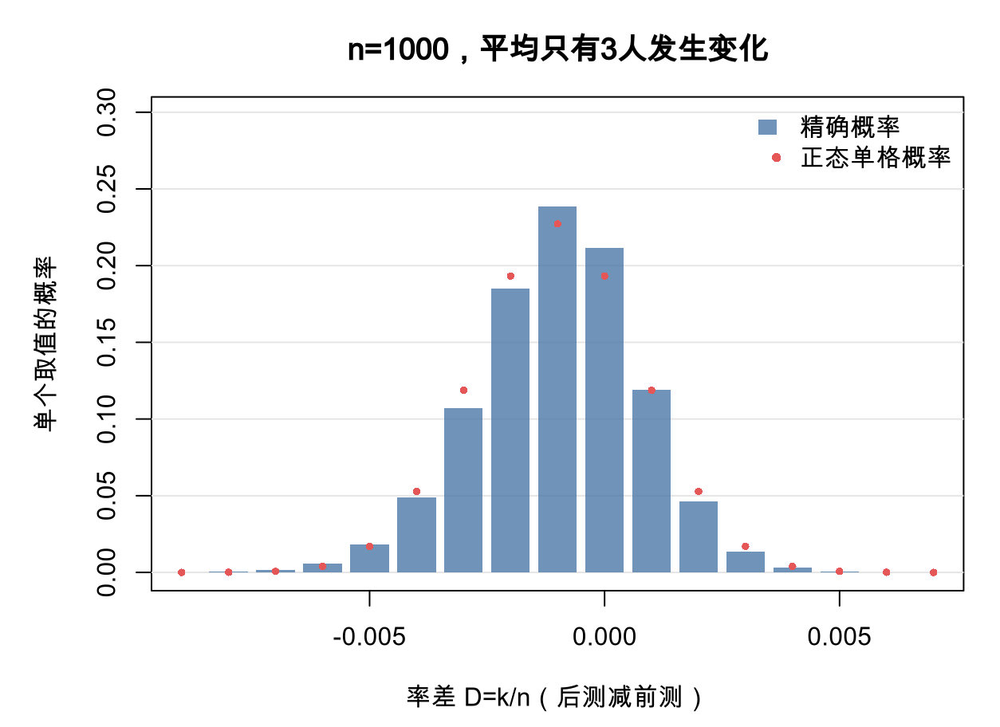

*图2｜变化概率不同，分布形状也不同，判断近似不能只看总人数。*

这个例子说明，变化概率也影响近似效果，不能只凭总人数判断。精确分布则仍可按前面的方法计算：将各人变化的概率合并，或枚举人数组合后按D归类。

## 七、用哪些现成函数计算？

R的`dmultinom()`、Python的`scipy.stats.multinomial.pmf()`和MATLAB的`mnpdf()`都能计算指定三类人数的概率。Python、MATLAB下面的调用，与第四节R的调用使用同样的（1，14，5）和三种概率<sup>[4,5]</sup>。

```python
from scipy.stats import multinomial
probability = multinomial.pmf([1, 14, 5], n=20, p=[0.05, 0.70, 0.25])
print(f"{probability:.8f}")
```

```text
0.07701541
```

```matlab
probability = mnpdf([1 14 5], [0.05 0.70 0.25]);
fprintf('%.8f\n', probability);
```

```text
0.07701541
```

这些函数返回的是一组人数的概率，完整率差分布还需要按相同D相加。配套`distribution_basics.R/.py/.m`会列出两人的9种组合，再生成5个D的概率；回到20人后，还会分别保存231组人数概率、同一率差的9组结果与41项率差分布。

人数更多时，可以逐人合并差值的概率。Python的`numpy.convolve()`与MATLAB的`conv()`用于这一步，R也有对应计算。配套主入口按同样的四组参数比较n = 2、20、1000，以及1000人但变化稀少的情形。正文两幅统计图由R生成，Python与MATLAB的对照图分别保存。

MATLAB现成`mnpdf()`需要Statistics and Machine Learning Toolbox；基础分布练习同时保留直接按公式计算的版本，不要求这个工具箱。具体入口、依赖与输出见README。

## 八、本篇讲了哪些知识？

1. **配对率差是个人变化的平均数。** 后测减前测取＋1、0、−1，全部人都进入平均数的分母。
2. **先列具体结果，再按率差归类。** 两人有9种个人变化组合，合并后得到5个D及其概率。
3. **多项分布描述各类人数的联合概率。** 安排种数乘以一种安排的概率，得到某组人数出现的概率。
4. **一组人数的概率，还不是一个率差的全部概率。** 20人例题中，9组人数都给出D = −0.20，需将它们的概率相加。
5. **均值看变化之差，方差还看变化总量。** 给定模型下，人数增加会减小样本率差的方差；近似效果也与变化概率有关。

本篇从给定的三种概率出发，求出了样本率差的分布。实际研究中，这些总体概率未知，怎样根据观察资料估计总体率差及其区间，留到下一篇讨论。

## 配套练习

这次仍准备了R、Python、MATLAB三套对应脚本。先运行`distribution_basics`，对照两人的9行组合与5项率差概率，再看20人的归类计算；`package_functions`演示现成概率函数，`paired_rate`比较不同样本量并生成两幅图。选择熟悉的一种语言跑通即可，文件与输出说明见配套README。

本篇完整项目：
https://github.com/fuyuming/statistics-classroom/tree/main/stats_classroom/paired_proportion_difference

[下载本篇完整ZIP](https://github.com/fuyuming/statistics-classroom/raw/refs/heads/main/stats_classroom/paired_proportion_difference/%E9%85%8D%E5%AF%B9%E6%A0%B7%E6%9C%AC%E7%8E%87%E5%B7%AE_%E5%AE%8C%E6%95%B4%E9%A1%B9%E7%9B%AE.zip)。解压后进入`paired_proportion_difference`，先读README。

系列仓库：https://github.com/fuyuming/statistics-classroom

[下载整个仓库ZIP](https://github.com/fuyuming/statistics-classroom/archive/refs/heads/main.zip)，解压后进入`stats_classroom/paired_proportion_difference`。

从每个人的变化出发，把每种结果的概率算出来，再将产生同一率差的结果归在一起，配对样本率差的分布就有了具体含义。

这里是明哥的微生物世界，我们下次再见。

## 参考资料

[1] Chen Y-C. University of Washington STAT 512, Lecture 7: Multinomial distribution. https://faculty.washington.edu/yenchic/20A_stat512/Lec7_Multinomial.html

[2] 明哥的微生物世界．期望、方差、协方差：统计公式是怎样一步步推出来的？统计课堂08。https://mp.weixin.qq.com/s/QkG1VROHLoOtyDgxEonrDw

[3] Penn State STAT 414. Lesson 27: The Central Limit Theorem. https://online.stat.psu.edu/stat414/Lesson27

[4] SciPy官方文档，scipy.stats.multinomial。https://docs.scipy.org/doc/scipy/reference/generated/scipy.stats.multinomial.html

[5] MathWorks官方文档，mnpdf。https://www.mathworks.com/help/stats/mnpdf.html
