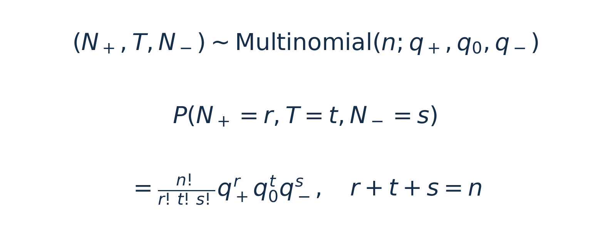
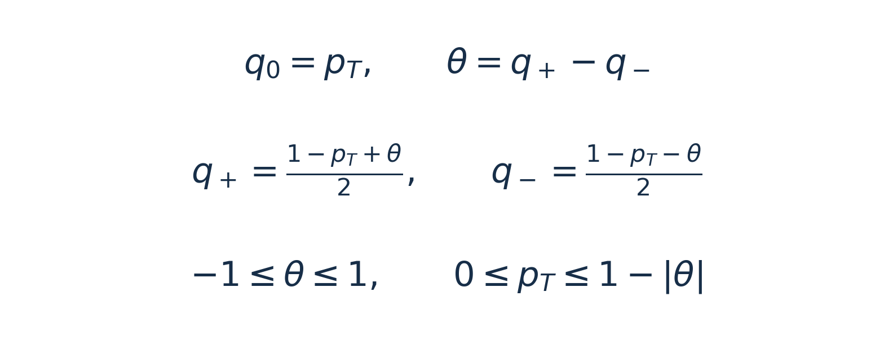
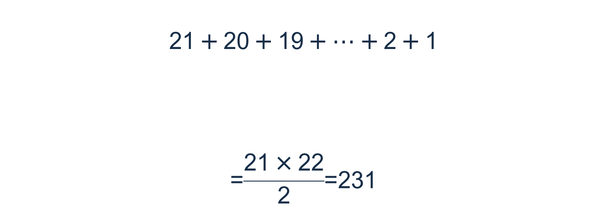
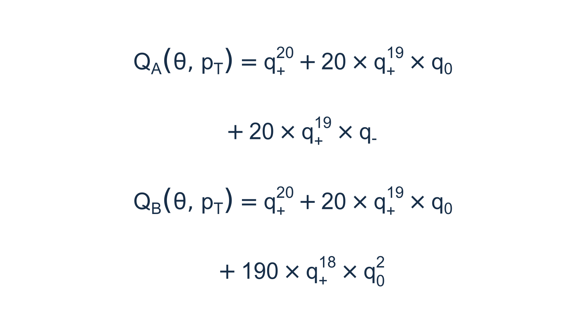
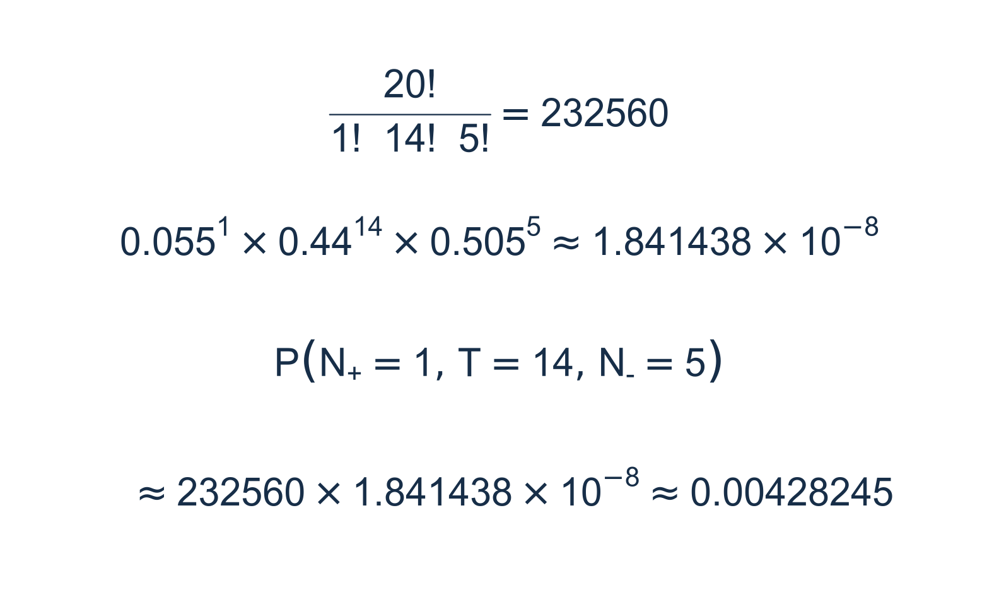
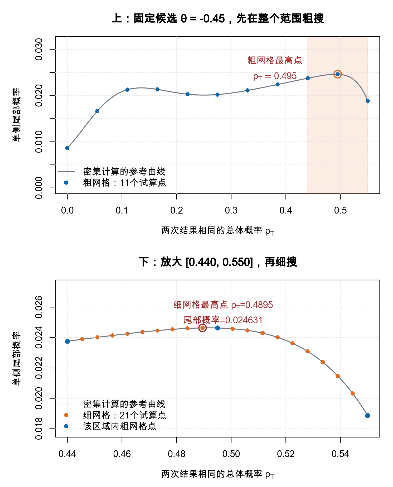

# 方法补充：配对率差的精确区间怎样构造？

> 明哥的微生物世界 · 统计课堂 26
>
> 本页保留未知参数、尾部选择、Wang排序和网格搜索的完整演算。[基础正文](配对样本率差_手机预览_v2.html)先解释个人变化与率差分布；本页接着回答软件怎样从样本得到区间。

## 一、先接回所用的三项模型

不同人的记录独立。每个人后测减前测取＋1、0、−1，总体概率分别为q₊、q₀、q₋。三类人数记为N₊、T、N₋，样本率差D = (N₊ − N₋)/n，总体率差θ = q₊ − q₋。



*补充式（1）｜每组人数的概率等于人员安排种数乘以一种安排的概率。*

下面采用的配对三项模型及Wang区间构造，依据ExactCIdiff作者的说明<sup>[1]</sup>。本页的参数及排序试算专门用于解释区间算法。

## 二、从20人的资料进入区间计算

回到20人的主例题。三种人数为1、14、5，已经观察到的率差是−0.20。总体变化概率仍未知，需要根据这些资料估计总体率差θ。

**先说清楚我们要找的“下限”。** 率差的双侧区间写成[L，U]，L是区间左端点，称为置信下限；U是右端点，称为置信上限。以本例最终算出的95%区间[−0.44923，0.06303]为例，下限L = −0.44923，即−44.923个百分点；上限U = 0.06303，即6.303个百分点。**下限与上限描述的是总体率差θ的估计范围，二者都要由样本资料计算。** 95%说的是这种区间方法的长期覆盖水平：在模型下重复抽样并构造区间，理论上至少95%的区间会包含真实θ。下面解释这些端点怎样得到。

`ExactCIdiff::PairedCI()`依据的正是第二节的三项联合分布。它把两次结果相同的概率记为pₜ，并将另外两个概率用θ和pₜ表示<sup>[1,2]</sup>。



*补充式（2）｜PairedCI的参数表示，θ为总体后测率减前测率。*

接下来，函数怎样从观察到的“1人＋1、14人0、5人−1”，找到θ的区间？可以沿着下面四步理解<sup>[1,2]</sup>。

**第一步，给定候选θ，还要考虑不同的pₜ。** 例如先考察θ = −0.20。按补充式（2），pₜ可以在0至0.80之间取值。如果pₜ = 0.70，三种概率为q₊ = 0.05、q₀ = 0.70、q₋ = 0.25；如果pₜ = 0.50，三种概率则为0.15、0.50、0.35。两种模型的总体率差都为−0.20，但变化总量不同，三类人数的分布也不同。**因此，给定θ还不能唯一确定分布，pₜ也不能直接固定为样本中的14/20。**

**第二步，列出所有可能的人数结果，再确定尾部包括哪些组。** 三类人数按（N₊，T，N₋）记，三者都是非负整数，相加必须等于20。先固定＋1的人数，再分配其余两类，就能一组不漏地列出来。

- ＋1有0人时，剩余20人分为0和−1两类，可以是（0，20，0）、（0，19，1），依次到（0，0，20），共21组。
- ＋1有1人时，剩余19人分为两类，可以是（1，19，0）、（1，18，1），依次到（1，0，19），共20组；主例（1，14，5）就在其中。
- ＋1有2人时，同样得到19组；继续这样列下去。
- ＋1有19人时，只有（19，1，0）和（19，0，1），共2组；＋1有20人时，只有（20，0，0）这一组。



*补充式（3）｜20人的三类人数组合怎样数出来。*

这里的21项从21逐次减到1，首项与末项的平均数为11，因此总和为21 × 11 = 231。

**231数的是三类人数的组合种数。** 每组人数的概率要另用补充式（1）计算，而且各组的概率通常不同。例如（20，0，0）要求20人全都取＋1，（1，14，5）则容许许多不同的人员安排。每次抽取20人，得到的人数必然落在这231组中的某一组，而且只能属于其中一组。因此，给定三种总体概率后，将全部231组的概率相加，结果等于1。

计算下限时，关注的是：在一个较小的候选θ下，出现观察组这样、或更支持较大θ的结果，有多大概率。Wang次序用于确定哪些结果应当一起累加。

计算下限还需要确定：哪些人数结果与观察组一起进入单侧尾部。**Wang排序是逐步建立队列：固定已经排好的部分，让几组待排结果分别试算，再选临时下限最高的一组接到后面。** 它同时遵守下面的方向规则<sup>[1]</sup>。

**先规定哪些结果应当在前。** “20人全部取＋1”，即（20，0，0），排第一。如果把其中一人的＋1改成0，或者把一人的0改成−1，支持较大θ的程度会降低，这样得到的相邻结果不能排到原结果前面。算法据此逐步向外寻找待排组合。

每一轮，先从已经排好的组合出发，各做一次上述改变，找出邻近、尚未排入队列的组合。若这批邻近组合中，某一组还能由另一组再下降一步得到，那么下面的组先等待，先比较上面的组。留下的才是本轮参加试算的候选。

**用排序开头的真实计算看这一过程。** 第一位是（20，0，0）；下一步只有（19，1，0）可以接上，因此它排第二。接着出现两个可以竞争第三位的组合：

- A＝（19，0，1）：把第二位组合中唯一的0改成−1，得到19人＋1、0人不变、1人−1。
- B＝（18，2，0）：把第二位组合中的1个＋1改成0，得到18人＋1、2人不变、0人−1。

A与B的样本率差都是0.90，但三类人数构成不同，精确概率也不同，不能只凭D判定谁排第三。这里考察的是231种可能人数结果中的开头几组；真正观察到的资料仍为（1，14，5）。

这里的A、B是待排序的人数组合，θ则是计算模型概率时要改变的总体参数。

**接下来分别试排A、B。** 试排A时，临时尾部只包括已经排好的前两组，加上A；试排B时，则包括前两组加上B。**A与B分别试算，这一步不把两者同时加入尾部。** 用补充式（1）计算三个组的概率并相加，得到补充式（4）的两条临时尾部概率。



*补充式（4）｜上、下两式分别是试排A、B时的尾部概率，三种q由补充式（2）的候选θ和pₜ确定。*

两式前两项相同，分别对应（20，0，0）和（19，1，0）；最后一项才是本轮试排的A或B。其中20和190分别是相应人数组合的安排种数。

每个候选都按同一办法求临时下限：先固定一个θ，在合法范围内改变pₜ，寻找该临时尾部概率的最大值；再改变θ，找到这个最大值达到0.025的位置，取最小解。这与下面第三、四步使用的概率求和与端点搜索相同。这里采用97.5%单侧构造，所以单侧错误概率为0.025。

| 第三位的待排组合 | 临时尾部 | 试算下限（约） |
| :--- | :--- | :--- |
| A＝（19，0，1） | 前两组＋A | 0.503 |
| B＝（18，2，0） | 前两组＋B | 0.609 |

**B的试算下限更高，因此B排第三。** 对应的单侧区间约为[0.609，1]，比A试算得到的[0.503，1]更短；这次比较是在同一置信水平及规定的排序约束下进行。把B正式加入已经排好的部分以后，重新寻找候选，再分别试算。尚未选中的A也要重新计算，不能一直沿用刚才的0.503，因为它的临时尾部已随排好的部分增加而改变。

例如，此时（18，1，1）也出现在邻近未排组中，但它可以由尚未排入的A＝（19，0，1）把1人的＋1改成0得到，因此它先等待，不能越过A参加本轮比较。若多个合格候选具有相同的最大临时下限，就排在同一层级。

**整个过程是：分别试排→各自求临时下限→比较→正式加入胜者→重新试算。** 这样逐步推进，就能建立后续次序。**每次试算只用已经排好的组和当前试排的一组，不需要预先知道所有231组的次序。** 本例三语言脚本复现了A与B争第三位的计算，分别得到约0.502534与0.608596；它们演示这一步选择，完整区间仍由`PairedCI()`计算。

把Wang排定的次序编号，排在前面的号数较小。**计入下限尾部的标准是：排在观察组前面，或与观察组处在同一排序层级；并列的组一起计入。** 本例的97.5%单侧下限构造中，观察组（1，14，5）排第141，前141组没有并列。因此，**第1至141组计入尾部，第142组及以后不计入。** 这个界点由观察组的排序位置决定，各组的发生概率要在给定候选θ和pₜ后另行计算<sup>[1]</sup>。

**全部可能结果有231组，本例的下限尾部包括观察组及其之前的141组，尾部概率就是这141组各自概率的和。**

**第三步，累加精确概率，并处理未知的pₜ。** 给定θ和某个合法的pₜ，就能用补充式（1）算出每组三类人数的概率，再把第二步确定的尾部中各组概率相加。随后改变pₜ，在合法范围内寻找这个尾部概率的最大值。这样做，是为了让区间在不同真实pₜ下都能控制误差，而不是只在pₜ恰好等于14/20时成立。

为了看清第三步的“网格搜索”，现在换一个靠近区间下限的候选值：**固定θ = −0.45，观察资料仍为（1，14，5）。** 此时pₜ的合法范围为0至0.55。下限尾部已经按第二步确定，本例共包含141组三类人数。接下来只改变pₜ，比较这个尾部的概率怎样变化。

**所谓网格，就是在待搜索的范围里，先选一排具体数值逐个试算。** 例如先在0至0.55之间等距选11个点：0、0.055、0.110，依次到0.550。相邻两点间隔0.055。每试一个pₜ，就按补充式（2）得到一组三种概率，再用补充式（1）逐组计算并累加尾部中141组结果的概率。

例如试pₜ = 0.440时，补充式（2）给出q₊ = 0.055、q₀ = 0.440、q₋ = 0.505。先完整计算观察组合（1，14，5）的概率。

**先算一种指定人员安排的概率。** 指定哪1人取＋1、哪14人取0、哪5人取−1以后，不同人独立，将20个人各自结果的概率相乘，就是0.055乘1次、0.440乘14次、0.505乘5次，约为0.0000000184144。

**再乘以产生这组人数的安排种数。** 从20人中选1人取＋1，有20种选法；从剩下19人中选14人取0，有11628种选法；余下5人全部取−1。两步合起来，有20 × 11628 = 232560种人员安排。各安排互斥，而且具有相同的概率，因此用安排种数乘以一种安排的概率，得到这组人数的总概率。



*补充式（5）｜固定θ = −0.45、pₜ = 0.440时，将（1，14，5）代入补充式（1）。*

补充式（5）得到约0.00428245，即在这组给定总体概率下，反复抽取20人，恰好出现“1人＋1、14人0、5人−1”的概率约为0.428%。它只是231组结果中的一项。用R的`dmultinom()`也可以核对这一项：

```r
# 三类人数与三种概率按相同次序输入：＋1、0、−1。
dmultinom(x = c(1, 14, 5), size = 20,
          prob = c(0.055, 0.440, 0.505))
```

实际输出如下。

```text
[1] 0.004282448
```

再列两组人数作对照。下表同时展示软件计算的Wang排序位置，以及在θ = −0.45、pₜ = 0.440时按补充式（1）算出的概率。**以观察组的第141位为界，就能逐行判断是否计入。**

| 三类人数（N₊，T，N₋） | Wang排序位置 | 该组概率 | 下限尾部 |
| :--- | :--- | :--- | :--- |
| （2，13，5） | 第135位 | 0.00374714 | 计入 |
| （1，14，5） | 第141位（观察组） | 0.00428245 | 计入 |
| （1，13，6） | 第152位 | 0.01146852 | 不计入 |

第135位排在观察组之前，第141位就是观察组，两组都计入；第152位排在观察组之后，不计入。第三组的概率0.01146852虽然更大，但**是否计入按Wang次序判断，不按单组概率大小判断，也不把样本率差D作为唯一排序依据。** 安排种数及完整概率仍列在配套的231组表中。

**其余230组也各自代入补充式（1）计算。** 全部231组的概率相加为1；其中，观察组与另外140组构成下限尾部，141项相加约为0.023753，余下90组的概率之和约为0.976247。三套配套脚本都逐组列出人数、安排种数、单种安排概率、该组总概率及是否属于尾部，供对照查看。也可[直接查看R计算的完整231组概率表](https://github.com/fuyuming/statistics-classroom/blob/main/stats_classroom/paired_proportion_difference/%E9%85%8D%E5%A5%97%E9%A1%B9%E7%9B%AE/%E8%BF%90%E8%A1%8C%E7%BB%93%E6%9E%9C/R/%E4%B8%89%E7%B1%BB%E4%BA%BA%E6%95%B0%E7%9A%84231%E7%BB%84%E6%A6%82%E7%8E%87.csv)。**图3的每一个点，都是这样完成一次“给定pₜ→计算每组三项概率→累加指定尾部”的结果。**



*图3｜依据主例Wang下限尾部计算的概率。横轴为pₜ，纵轴为141组尾部结果的概率之和。上半部分在[0，0.55]试11个粗网格点，阴影标出细搜区域；下半部分放大[0.44，0.55]，试21个细网格点。灰线为密集计算的参考曲线。11与21用于展示步骤，正文函数调用采用60与40；两幅图的横轴和纵轴范围不同。*

**先看图3上半部分，比较全部11个粗网格点。** 最高的蓝点在pₜ = 0.495，尾部概率约为0.024627。接着取它左右相邻的粗网格点0.440和0.550，把这个范围圈出来。图中还存在另一个局部高点，因此先查看整个合法范围，才能避免只盯着一个局部区域。

**再看图3下半部分，在圈出的范围里细找。** 将[0.440，0.550]重新等距放入21个试算点，相邻间隔缩小为0.0055。峰顶附近几次试算如下。

| pₜ的试算值 | 累加得到的尾部概率 |
| :--- | :--- |
| 0.4785 | 0.024538 |
| 0.4840 | 0.024598 |
| **0.4895** | **0.024631** |
| 0.4950 | 0.024627 |
| 0.5005 | 0.024578 |

这轮细网格的最高点在pₜ = 0.4895，尾部概率约为0.024631，比粗网格找到的值略高。进一步用密集网格核对，峰位约在pₜ = 0.4919，尾部概率约为0.024634。这也说明，继续加密网格可以细化极值的位置与末位数值。**网格搜索找的是“哪一个pₜ使尾部概率最大”；它没有把pₜ估计为0.4895，也还没有求出θ的区间端点。** 这里的θ始终固定为−0.45。

按函数文档，`grid.one`用于先粗略寻找极值区域，`grid.two`用于在相应邻域细找；`precision`控制置信限的数值精度。正文调用的60与40表示采用较密的搜索设置，置信水平仍由`conf.level`指定<sup>[1,2]</sup>。

**第四步，寻找区间端点。** 双侧95%区间将两侧的错误概率各控制在2.5%。到这里才改变候选θ：每换一个θ，就重新在相应合法范围内搜索pₜ并取最大尾部概率。计算下限时，寻找这个最大尾部概率达到0.025的位置，按该方法取最小解；无解时按参数边界处理。计算上限时，交换＋1与−1的人数，用同样的方法求下限，再反号。由下限形成的单侧区间为[L，1]，由上限形成的单侧区间为[−1，U]；取两者的共同部分[L，U]，得到双侧95%区间。

**PairedCI使用完整的三类人数信息，区间随率差及变化人数共同改变。** n12与n21共同给出净变化及两个方向的变化人数，t则给出结果相同的人数。只给一个率差，无法还原这些信息。

```r
ExactCIdiff::PairedCI(
  n12 = 1,   # 后测阳性、前测阴性，即＋1
  t = 14,    # 两次相同，即0
  n21 = 5,   # 后测阴性、前测阳性，即−1
  conf.level = 0.95,
  CItype = "Two.sided",
  grid.one = 60,
  grid.two = 40
)
```

实际运行输出如下。

```text
$conf.level
[1] 0.95

$CItype
[1] "Two.sided"

$estimate
[1] -0.2

$ExactCI
[1] -0.44923  0.06303
```

`$estimate`给出配对率差−0.20，`$ExactCI`给出95%区间，约为后测比前测低44.92个百分点至高6.30个百分点。区间同时包含负值、0与正值，这批小样本尚不能把总体净变化的方向估计得很确定。20人与1000人的教学例题有相同的点估计，精度却相差很大。

**精确区间的“精确”指统计构造依据有限样本分布。** 软件仍需要数值搜索，网格设置会影响计算时间与末位结果。区间末位结果可能随网格设置略有变化。

## 参考资料

[1] Shan G, Wang W. ExactCIdiff: An R Package for Computing Exact Confidence Intervals for the Difference of Two Proportions. The R Journal. 2013;5(2):62–70. 第2节。https://journal.r-project.org/articles/RJ-2013-026/index.html

[2] ExactCIdiff官方手册，PairedCI。https://cran.r-project.org/web/packages/ExactCIdiff/ExactCIdiff.pdf
