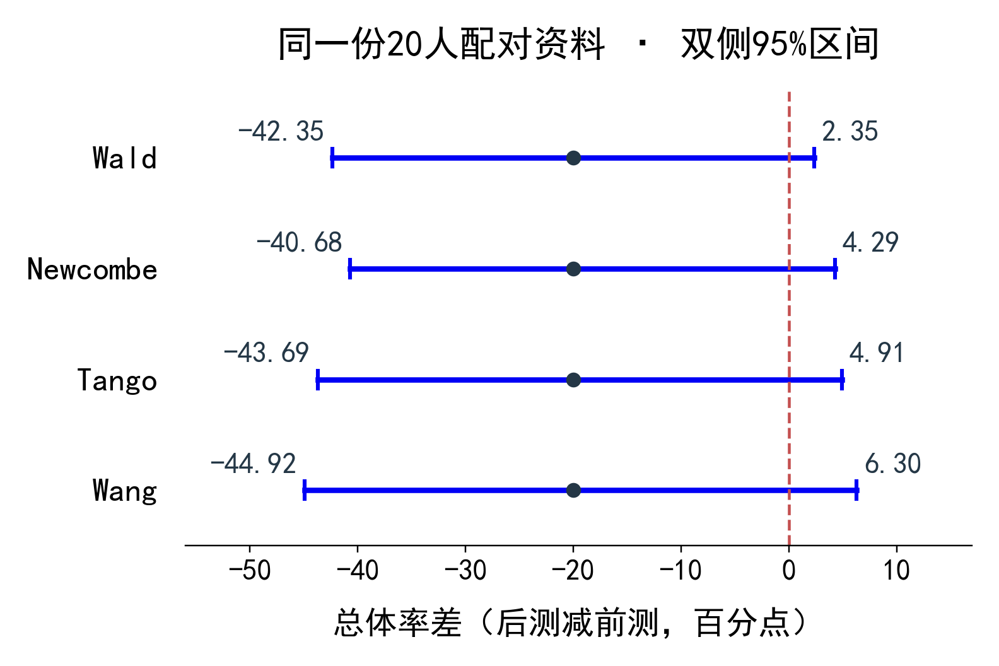

> 明哥的微生物世界 · 统计课堂 28

# 同一份配对资料，为什么会得到不同的率差置信区间？

> 摘要　同一批人前后检测，样本阳性率下降20个百分点，总体中的变化可能有多大？本篇用同一份20人资料比较Wald、配对Newcombe、Tango和Wang四种区间，了解各自怎样表达不确定性，再用现成R函数复算。


大家好，我是明哥。

[上一篇《配对样本率差怎样分布？》](https://mp.weixin.qq.com/s/HWRYFiDUJDqSPlONx8qCnw)从每个人的前后变化出发，介绍了样本率差的有限样本分布、均值和方差<sup>[1]</sup>。这一篇接着问：**拿到一份配对资料后，怎样给未知的总体率差估计一个范围？为什么换一种方法，区间端点也会改变？**

## 一、同一份20人资料，先明确估计什么

假设从某个目标人群随机抽取20名成年人，相隔两周，用同一方法、同一判定标准各检测一次。每个人都有完整的两次记录，不同人的记录相互独立，并共享同一组变化概率。要求总体“后测阳性率减前测阳性率”的双侧95%置信区间。

**表1　20人的前后检测结果（单位：人）**

| 前测结果 | 后测阳性 | 后测阴性 | 合计 |
| --- | --- | --- | --- |
| 阳性 | 8 | 5 | 13 |
| 阴性 | 1 | 6 | 7 |
| 合计 | 9 | 11 | 20 |

*表1｜5人阳转阴，1人阴转阳，8＋6＝14人前后不变。每个人的两次记录属于同一个配对。*

前测样本阳性率为13/20＝65%，后测为9/20＝45%。按后测减前测，样本率差为−0.20，即下降20个百分点。

沿用上一篇的记号：q₊、q₀、q₋分别是总体中阴转阳、不变、阳转阴的概率；三类样本人数记为N₊、T、N₋。“不变”包括两次均阳性和两次均阴性。本例人数为（N₊，T，N₋）＝（1，14，5）。

**总体率差θ＝q₊−q₋，其样本估计为D＝(N₊−N₋)/n，这里的n是完整配对人数。** 因而D＝(1−5)/20＝−0.20。

**对同一总体按相同设计反复抽样，θ保持不变，D会随抽样波动。** 点估计给出本次资料的一个概括值，区间则进一步表达估计的不确定性。

置信水平描述方法的反复抽样表现：按同一规则得到的一系列区间中，有多大比例包含固定的真实θ。95%是本篇各方法设定的覆盖目标；实际覆盖表现，还要看具体构造。

## 二、资料和置信水平相同，区间为何不同？

先保持三件事一致：**同一份配对资料、后测减前测、双侧95%。** 只更换区间构造，结果如下。前三种由`ratesci::rdpairci()`计算，Wang由`ExactCIdiff::PairedCI()`另行计算<sup>[2]</sup>。

**表2　四种构造对同一总体率差的估计**

| 构造 | 95%区间（百分点） | 宽度（百分点） |
| --- | --- | --- |
| Wald（公式参照） | −42.35至2.35 | 44.69 |
| 配对Newcombe | −40.68至4.29 | 44.97 |
| Tango得分法 | −43.69至4.91 | 48.60 |
| Wang精确法 | −44.92至6.30 | 51.23 |

*表2｜四种方法的样本点估计都是−20个百分点。本文采用无连续性校正的前三种实现；配对Newcombe对应软件中的MOVER-NW，Tango对应AS(Tango)。*



*图1｜圆点是同一个D＝−20个百分点，横线是各方法的区间，竖虚线标出总体率差0。四条区间都跨过0。*

这些方法估计的是同一个θ，区别在于怎样利用资料确定上下限：有的围绕点估计加减一个误差范围，有的从两个率的区间合并，有的检查候选总体率差，还有的直接按有限样本概率控制区间漏失。

因此，**点估计相同，不要求区间相同；区间也不一定以点估计为中心。** 下面分别看四种构造的基本思路。

## 三、四种构造，各自怎样得到区间？

### （一）Wald：点估计加减“临界值乘标准误”

Wald用“点估计±临界值×标准误”构造区间。标准误描述样本率差的抽样波动；将上一篇配对方差中的总体概率换成样本比例，本例估计的标准误约为0.11402。双侧95%的正态临界值约为1.96，因此得到：


*式（1）｜在D＝−0.20两侧各加减约1.96倍标准误。本篇采用分母n的方差估计，与表2的Wald实现一致。*

这个算法简便，但小样本或变化人数很少时，正态近似和插件标准误的表现可能不好。例如样本中人人都不变，插件方差就会等于0，Wald区间也会缩成一点。**本篇用Wald作理解公式的参照，不把它作为小样本配对资料的默认选择**<sup>[2,3]</sup>。

### （二）配对Newcombe：从两个率的区间合并

本文选用Newcombe hybrid，即软件中的MOVER-NW。它先用Wilson得分区间描述前测率、后测率各自的不确定性，再合并为率差区间，并纳入配对相关性<sup>[3]</sup>。

这里的配对信息来自四格表。它影响两个率之差的波动，因而也要进入区间构造。这部分计算与前后两次检测率的区间一并进入最终结果<sup>[2,7]</sup>。

这也解释了为什么要保留完整的配对记录：仅知道前测65%、后测45%，可以算出−20个百分点，却还没有交代前后结果怎样配在同一个人身上。

### （三）Tango：检验哪些总体率差与资料相容

Tango先假设一个总体率差，在这个限制下拟合其余总体概率，再用得分检验判断它与观察资料是否相容；保留通过检验的假设值，就得到区间<sup>[4]</sup>。

与Wald使用固定的一次标准误估计相比，Tango会随假设的总体率差更新拟合，再分别确定两端。本例得到−43.69至4.91个百分点，属于近似构造。

### （四）Wang：按有限样本概率控制漏失

Wang承接上一篇的有限样本分布：考虑各种可能的人数组合及其概率，同时处理未知的总体变化概率，确定使区间未包含真值的概率受到控制的端点<sup>[5]</sup>。

**在本篇独立、同分布配对记录的有限样本模型下，精确Wang构造的双侧覆盖至少达到95%。** 样本结果离散，实际覆盖还可能更高。本例得到−44.92至6.30个百分点。

这里“精确”说的是有限样本模型下的覆盖要求。现成函数`PairedCI()`用数值搜索求端点，输出还受计算精度影响<sup>[5,6]</sup>。

## 四、用软件复算，三种语言各有哪些工具？

先用R复算表2的前三种区间。`ratesci::rdpairci()`要求四个格子按条件1、条件2组织。**本题把条件1设为后测、条件2设为前测，b代表阴转阳，c代表阳转阴。** 输入依次是：两次均阳性8人、仅后测阳性1人、仅前测阳性5人、两次均阴性6人<sup>[2]</sup>。

```r
x <- c(a = 8, b = 1, c = 5, d = 6)
fit <- ratesci::rdpairci(
  x = x, level = 0.95,
  std_est = TRUE, cc = FALSE
)
fit$estimates[
  c("Wald", "MOVER-NW", "AS(Tango)"),
  c("est", "lower", "upper")
]
```

`level`指定置信水平；`std_est = TRUE`统一报告通常的样本点估计D；`cc = FALSE`选择本次比较采用的无连续性校正版本。`$estimates`是返回的多方法结果表，这里只取本篇介绍的三行；`est`、`lower`、`upper`依次是点估计、下限和上限。

Wang用另一个包。`n12`放阴转阳人数1，`t`放不变人数14，`n21`放阳转阴人数5，方向同样是后测减前测<sup>[6]</sup>：

```r
wang <- ExactCIdiff::PairedCI(
  n12 = 1, t = 14, n21 = 5,
  conf.level = 0.95,
  CItype = "Two.sided"
)
wang$estimate
wang$ExactCI
```

`CItype = "Two.sided"`选择双侧形式；`$estimate`返回−0.20，`$ExactCI`返回约[−0.44923，0.06303]。把这行与前面三行合并，就得到表2。

**<u>针对本系列涉及的专门统计区间，R有较丰富的现成函数和参数选择，适合作为主要计算语言。</u>** 本篇用`rdpairci()`比较多种配对区间，用`PairedCI()`计算Wang区间；置信水平、区间侧别、校正设置或数值精度，也都能通过相应参数指定，便于围绕同一份资料组织计算<sup>[2,6]</sup>。

**Python**方面，statsmodels开发版的`confint_proportions_paired()`支持Wald和Newcombe两种构造，输入是配对四格表；用本篇资料核对，所得端点与表2相符。0.15.0正式版尚未包含该接口，所附Python脚本采用Wald公式复算；开发版接口可用于进一步扩展Newcombe计算<sup>[8]</sup>。

**MATLAB**的Statistics and Machine Learning Toolbox可用`norminv`计算Wald所需的正态分位数；`bootci`则可对整行配对记录重抽样，计算bootstrap区间<sup>[9,10]</sup>。所附MATLAB脚本用基础函数复算Wald，并比较置信水平变化；表2四种构造的完整比较由R入口完成。

## 五、读表2的区间时，重点比较什么？

**先看区间容纳哪些总体差异。** 本例四个区间都包含负值、0和正值：点估计提示下降20个百分点，资料仍容纳没有净变化及一定程度的上升，总体变化方向尚有不确定性。

**再看宽度，并同时看覆盖性质。** 本例Wald最窄、Wang最宽，但窄区间的价值取决于它是否具有所要求的覆盖表现。一个方法若经常漏掉真值，即使区间较窄，也不能据此判为更好；另一方法在本例较宽，也不表示它在所有资料中都最宽。

**比较要固定设计、方向、置信水平和校正设置。** 方法选择应依据研究设计与覆盖要求事先说明，报告时写出所用构造、点估计和区间。

## 六、本篇讲了哪些知识？

1. **配对率差的区间需要配对信息。** D由净变化人数决定，区间计算还要反映前后结果在同一人身上的联系。
2. **相同点估计可以对应不同区间。** Wald、配对Newcombe、Tango、Wang确定端点的方式不同，区间可以有不同宽度，也可以不对称。
3. **名义95%与实际覆盖表现要区分。** 本篇前三种采用近似构造；精确Wang构造在所述模型下保证至少95%的覆盖，软件数值求解另需核对。

配套练习从这20人的共享记录读起。先复算D和Wald区间，再把置信水平由95%改为90%或99%，观察区间宽度怎样变化。

## 配套资料

本篇完整练习ZIP：
https://raw.githubusercontent.com/fuyuming/statistics-classroom/main/stats_classroom/paired_proportion_exact_ci/paired_proportion_ci_project.zip

本篇代码、数据与运行结果：
https://github.com/fuyuming/statistics-classroom/tree/main/stats_classroom/paired_proportion_exact_ci

解压本篇ZIP后，先读README，再按所用语言从准备节开始运行，默认直接查看结果与图。

系列仓库：https://github.com/fuyuming/statistics-classroom

整个仓库ZIP：https://github.com/fuyuming/statistics-classroom/archive/refs/heads/main.zip

从整个仓库解压后，进入`stats_classroom/paired_proportion_exact_ci`，先读README。

这里是明哥的微生物世界，我们下次再见。

## 参考资料

[1] 明哥的微生物世界．配对样本率差怎样分布？从个人变化到多项分布．统计课堂27。https://mp.weixin.qq.com/s/HWRYFiDUJDqSPlONx8qCnw

[2] ratesci官方手册，rdpairci及moverpairci。https://cran.r-project.org/web/packages/ratesci/ratesci.pdf

[3] Newcombe RG. Improved confidence intervals for the difference between binomial proportions based on paired data. Statistics in Medicine, 1998, 17(22):2635–2650。https://pubmed.ncbi.nlm.nih.gov/9839354/

[4] Tango T. Equivalence test and confidence interval for the difference in proportions for the paired-sample design. Statistics in Medicine, 1998, 17(8):891–908。https://pubmed.ncbi.nlm.nih.gov/9595618/

[5] Shan G, Wang W. ExactCIdiff: An R Package for Computing Exact Confidence Intervals for the Difference of Two Proportions. The R Journal, 2013, 5(2):62–70。https://journal.r-project.org/articles/RJ-2013-026/

[6] ExactCIdiff官方手册，PairedCI。https://cloud.r-project.org/web/packages/ExactCIdiff/ExactCIdiff.pdf

[7] 陆梦洁，钟伟华，刘玉秀，等．配对二项资料两组率差置信区间估计方法与评价．中国临床药理学与治疗学，2016，21(8)：909–914。https://manu41.magtech.com.cn/Jweb_clyl/CN/Y2016/V21/I8/909

[8] statsmodels官方开发版文档与0.15.0源码，配对率差区间接口。https://www.statsmodels.org/dev/generated/statsmodels.stats.proportion.confint_proportions_paired.html https://github.com/statsmodels/statsmodels/blob/v0.15.0/statsmodels/stats/proportion.py

[9] MathWorks官方文档，norminv。https://www.mathworks.com/help/stats/norminv.html

[10] MathWorks官方文档，bootci。https://www.mathworks.com/help/stats/bootci.html
