# 样本率为什么能用Z检验？从一个率走到两个独立率之差

> 明哥的微生物世界 · 统计课堂 25
>
> 摘要　从二项计数出发，理解样本率与两个独立样本率之差的抽样分布，分清精确关系、正态近似，以及合并和未合并标准误的用途。


大家好，我是明哥。

最近开始接手本科生《概率与生物医学统计》这门课后半部分的教学。备课和授课中，一些还没有讲清楚、需要继续展开的知识点，也会像之前的研究生课程一样，继续整理到这里。

把概念讲明白，把公式的来龙去脉和适用条件弄清楚，对本科生和研究生都同样有必要。因此，两类课程的补充内容仍放在同一个“统计课堂”系列中，相互衔接、相互补充。

这一篇配套本科生第9课《率与率差的估计和检验》。从二项计数走到样本率，再比较两个独立样本率，公式里为什么会出现Z？它的分母从哪里来？

这一篇以Rosner《Fundamentals of Biostatistics》第8版为线索，把“二项计数—样本率—两个独立率之差—Z近似检验”串起来。下面先从一次检测得到的样本率说起<sup>[1]</sup>。

## 一、一次观察得到一个率，反复抽样得到一种分布

假设从某个目标人群随机抽取100名受试者，记录某项检测是否阳性。每个人的结果只有阳性和阴性两类。

用p表示这个人群的阳性概率，q = 1 − p表示阴性概率。先采用一个简单模型，**不同受试者的结果相互独立，每个人的阳性概率相同**。

用n表示抽取的人数，用X表示这n人中阳性的人数。还没抽样时，X可能取0、1、2，一直到n。这个计数服从二项分布。将阳性人数除以总人数，就得到样本率p̂ = X/n，读作“p帽”。抽样前，p̂随X一起变化，是一个随机量。

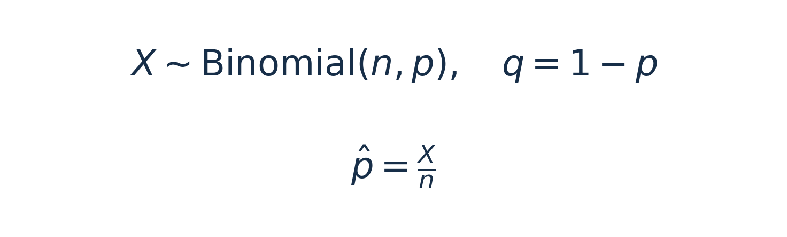

*式（1）｜二项计数与样本率的定义。*

例如这次抽到20名阳性，观察到的样本率就是20/100 = 0.20。换一批100人，阳性人数可能改变，样本率也随之改变。

**抽样分布描述的是，按同一规则反复抽取同样大小的样本时，统计量可能取哪些值，各自有多大概率。** 一次观察到的0.20是这个分布中的一个具体结果。

本文的“率”指二分类事件的比例，分母是人数。按人时计算的发生率（事件数/人时）需要另一套模型。

## 二、样本率的均值和方差，可以精确算出来

二项计数X的均值为np，方差为npq。这里的均值指反复抽样后阳性人数的长期平均，方差衡量这些人数的波动<sup>[1]</sup>。

从X推到样本率，需要用到前文[《期望、方差、协方差：统计公式是怎样一步步推出来的？》](https://mp.weixin.qq.com/s/QkG1VROHLoOtyDgxEonrDw)（统计课堂08）第二节讲过的性质。一个随机量乘以常数，它的期望乘以这个常数，方差乘以这个常数的平方。

样本率是X除以n，相当于把X乘以1/n。因此，期望乘以1/n，方差乘以1/n²<sup>[2]</sup>。

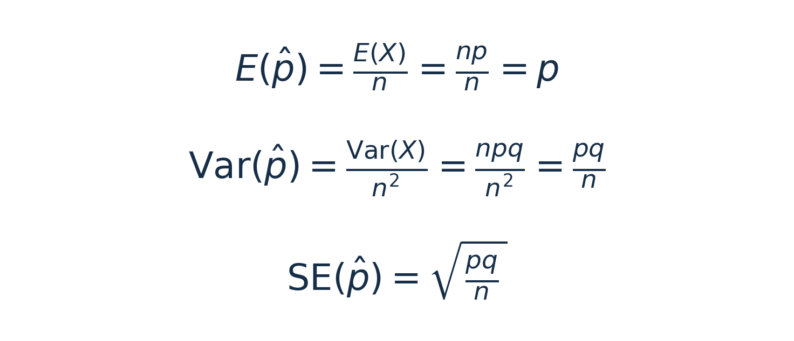

*式（2）｜样本率的精确期望、方差与理论标准误。*

其中E表示期望，Var表示方差，SE表示标准误。**理论标准误就是统计量抽样分布的标准差**，这里衡量样本率在不同样本之间的波动。

实际研究中，总体p通常未知。用样本率p̂代替p，就得到依据当前样本计算的估计标准误。


*式（3）｜样本率的理论标准误与估计标准误。*

式（3）中的两种标准误，需要分清总体参数p与样本估计p̂。理论标准误由总体p和样本量n决定。估计标准误还会随抽到的样本而变化。做检验和区间估计时，标准误的算法还要与相应的研究问题对应。

到这里，我们已经求出了样本率的中心和波动尺度。式（2）的均值、方差和理论标准误，在二项模型下都是精确的，但这些结果尚未确定抽样分布的形状。

例如n = 100时，样本率只能取0、0.01、0.02，一直到1。把阳性人数除以100，只改变了数值刻度，样本率仍然是离散的。这些离散概率能否用正态分布近似，还需要判断分布的形状。

## 三、什么时候能把这串离散的点近似看成正态？

如果n足够大，同时p没有过分靠近0或1，二项分布的形状可以接近正态，样本率的抽样分布也随之接近正态。

**本篇实际计算采用乘积门槛10作为近似筛查标准。** 单率检验按零假设给定的率检查，单率区间估计用样本率代入；两组比较时，每组都要检查，所用共同率或各组率在第五、六节说明。先看分布为什么需要这些检查，随后再对照教材的不同门槛。

Rosner在第5章给出的经验检查是 **npq ≥ 5，即np(1−p) ≥ 5**。这里npq是阳性人数X的方差。它同时考虑样本量与事件概率，不能只检查总人数<sup>[1]</sup>。

先看同样抽100人的两种情况。

- p = 0.50时，npq = 25。阳性人数在50附近波动，分布比较对称。
- p = 0.01时，npq = 0.99。平均只有1名阳性，结果集中在0、1、2等少数取值，右侧拖着尾巴。

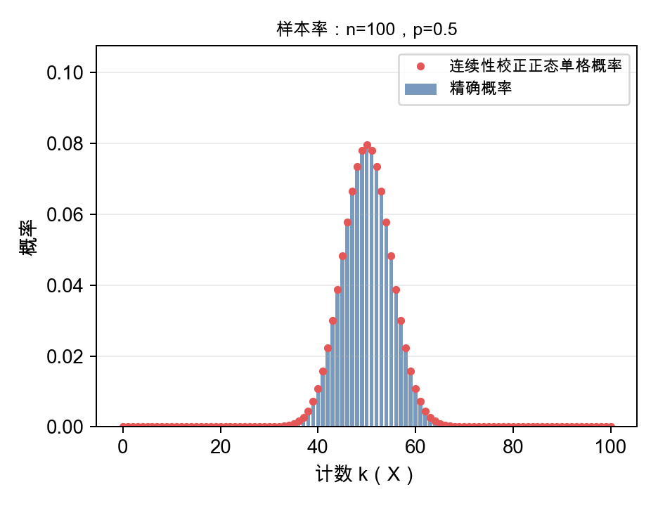

*图1｜教学模型n = 100、p = 0.50。横轴为阳性计数k，除以100即为样本率。蓝柱是精确二项概率。每个红点是正态曲线在对应整数两侧半格之间的面积，例如k = 50对应49.5至50.5。*

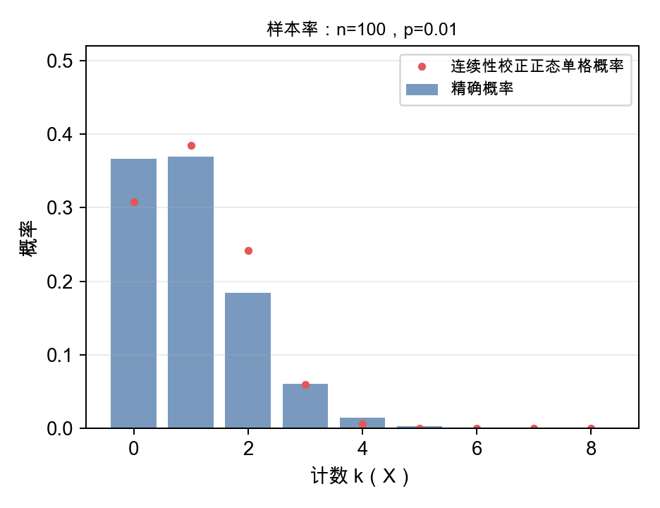

*图2｜教学模型n = 100、p = 0.01，仅显示计数0至8。阳性人数取0的精确概率约为36.6%。各图纵轴均为概率，显示范围和纵轴尺度分别设置。*

图1中的概率集中在50附近，正态近似与精确概率比较接近。图2中的概率则集中在0、1、2等少数整数上，正态近似与精确概率已有明显差别。两图的差异来自事件概率改变后，二项分布形状的变化。

再把样本量增加到1000，同时令p = 0.001。期望阳性人数仍只有1，npq = 0.999，完全没有达到上述经验条件。样本量上千，仍可能主要看到0名或1名阳性。

为什么这里要做连续性校正？先看图1，阳性人数只能取49、50、51这样的整数。画成每格宽1的柱形时，50位于这一格的中心，左右边界分别是49.5和50.5。用正态曲线近似这些柱形的概率，就要让曲线下面积的边界与整数格对应。

例如，要计算“50人及以下”的概率，就应包含50这一整格。**如果正态曲线下的面积只算到50，就会漏掉50这一格的右半部分。把边界移到50.5，才能把这一格完整地包含进来。** 这就是这里要挪半格的原因。

本例“50人及以下”的精确二项概率约为0.53979。正态近似只算到50时为0.50000，算到50.5时约为0.53983。连续性校正通过调整边界，减少用连续分布近似离散计数时的误差。前文[统计课堂14“R默认的连续性校正”一节及图2](https://mp.weixin.qq.com/s/RE66xquSoQAtDH3g1_7xjw)已经解释过这种半格处理<sup>[3]</sup>。

图1和图2的红点采用同样的办法。**对于“恰好k人”，取k − 0.5至k + 0.5之间的正态曲线面积。** 图1中，二项计数X的均值为50、方差为25，对应正态变量Y的均值为50、标准差为5。X恰好等于50的精确概率约为0.07958924，Y落在49.5至50.5之间的概率约为0.07965567。图上的蓝柱与红点分别对应这两个数。

用R可以逐项核对。

```r
# 蓝柱：恰好50名阳性的精确二项概率。
dbinom(50, size = 100, prob = 0.5)
# [1] 0.07958924

# 红点：50两侧各取半格，计算正态曲线下的面积。
pnorm(50.5, mean = 50, sd = 5) -
  pnorm(49.5, mean = 50, sd = 5)
# [1] 0.07965567
```

图中的横轴使用人数，所以半格为0.5人。换成样本率刻度，半格相应为0.5/n，本例为0.005。

图2也使用这种半格面积计算。0和n两个端点分别将外侧尾部并入端点格，使全部近似概率之和为1。这种边界调整保留了逐格比较的方式，图2中的偏差仍然明显，因此还要检查正态近似本身是否合适。

前面的例子按Rosner的条件检查。其他教材对同一种近似采用的经验门槛有所不同。

下面按本篇记号整理各教材的经验检查。颜艳教材原书用p表示样本率，这里写成p̂。

| 教材 | 经验检查 |
| --- | --- |
| Rosner第8版 | np(1 − p) ≥ 5，检查二项计数的方差<sup>[1]</sup> |
| Ross第9版 | np(1 − p) ≥ 10，采用更保守的方差门槛<sup>[4]</sup> |
| 颜艳、王彤《医学统计学》第5版 | n p̂ > 5且n(1 − p̂) > 5，分别检查阳性和阴性人数<sup>[5]</sup> |

为什么Rosner只写一个乘积条件？将两种检查代入同一个率，以样本率p̂为例。**若n p̂(1 − p̂) ≥ 5，就能同时推出n p̂ > 5和n(1 − p̂) > 5。** 因为满足这个乘积条件时，p̂与1 − p̂都在0和1之间，乘积n p̂(1 − p̂)既小于n p̂，也小于n(1 − p̂)。

例如，12人中6人阳性，p̂ = 0.5。阳性、阴性各6人，两类人数都大于5，而n p̂(1 − p̂) = 12 × 0.5 × 0.5 = 3，尚未达到5。**因此，代入同一个率、采用相同门槛时，乘积条件更严格。**

前面的统计课堂14[《小样本率的置信区间从哪里来？从6/13一步步找到上下限》](https://mp.weixin.qq.com/s/RE66xquSoQAtDH3g1_7xjw)也介绍过两类计数至少5、或采用更保守的10的粗略检查。例题有6次事件、7次非事件，仍重点讨论了Clopper–Pearson精确区间<sup>[3]</sup>。

Rosner和Ross给出的门槛用于评估正态近似。前文区间篇的两类计数检查，用于提醒估计率区间时关注事件数与非事件数。达到门槛后仍可使用精确方法。

这些经验条件都不能保证每一个尾部概率近似得足够准确。事件稀少、接近边界时，直接使用二项概率往往更便于核对。

在固定的0 < p < 1下，随着n增大，中心极限定理支持式（4）第一行的近似。将样本率减去p，再除以理论标准误，就得到第二行的Z。若要检验H₀给定的总体率p₀，分子和分母中的p都取p₀，得到第三行的检验统计量Z₀。**式中正态分布记号N(·,·)的第二个参数表示方差。**

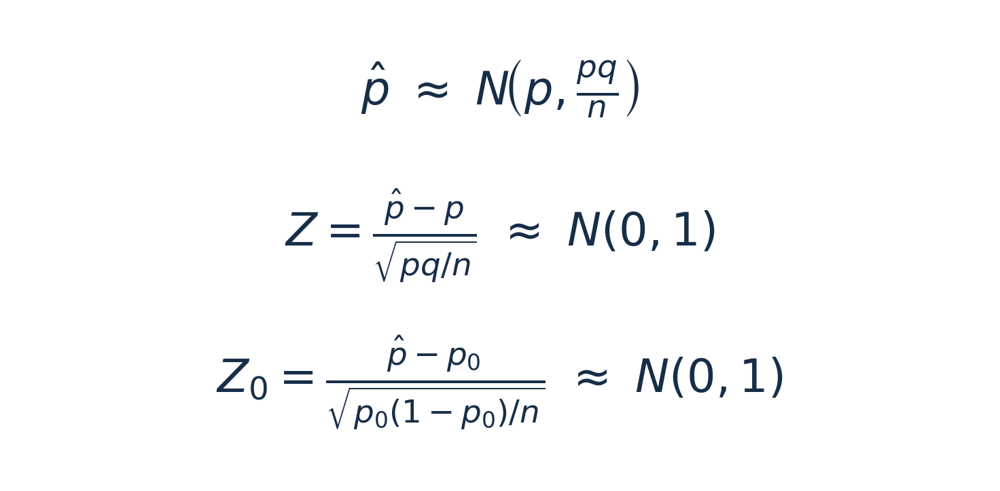

*式（4）｜前两行描述给定总体率p时的抽样分布与标准化。第三行用于检验H₀给定的p₀，在H₀成立且正态近似适用时参照标准正态分布。*

式（4）中的Z衡量样本率偏离真实p多少个理论标准误。Z₀则衡量样本率偏离假设值p₀多少个零假设标准误。Z₀的分母按p₀计算，因为检验要回答的是，假如H₀成立，样本率会怎样波动。

**只有正态近似适用时，才可以进一步用标准正态分布计算P值。** 均值变成0、方差变成1，本身不能保证正态。

本篇单样本率检验按前述Ross的10作方法选择的参考，在H₀下检查n p₀(1 − p₀)。**若这个乘积小于10，包括已经达到5但未达到10的情形，优先使用精确二项检验。** 这就把教材的经验门槛与本篇的实际计算选择对应起来了<sup>[1,4]</sup>。

以上讨论针对二项率的Z近似。对于来自正态总体、总体标准差已知的样本均数，Z标准化在任意样本量下都可以严格服从标准正态。

## 四、两个独立样本的率差怎样计算？

### 例题　比较两个社区的检测阳性率

假设要比较甲、乙两个社区成年居民的幽门螺杆菌检测阳性率：分别从甲社区随机抽取300人、乙社区随机抽取200人。两组为不同受试者，每人检测一次，采用相同的检测方法和阳性判定标准。分析时假定不同受试者的检测结果相互独立，各社区内采用共同阳性概率的二项模型。

甲社区有60人检测阳性，乙社区有20人检测阳性，其余均为阴性。把甲社区记为第一组，乙社区记为第二组。

| 社区 | 阳性人数 | 阴性人数 | 总人数 | 样本率 |
| --- | --- | --- | --- | --- |
| 甲社区（第一组） | 60 | 240 | 300 | 60/300 = 0.20 |
| 乙社区（第二组） | 20 | 180 | 200 | 20/200 = 0.10 |

这道题要回答三个问题。

1. 两个社区的样本阳性率分别是多少？甲社区减乙社区的样本率差是多少？
2. 在双侧检验水准α = 0.05下，这些数据是否提供两个社区总体检测阳性率存在差异的证据？
3. 甲社区减乙社区的总体检测阳性率差，其95%置信区间是多少？

先计算第一个问题，再在第五、六节分别完成检验与区间估计。

**样本率差就是第一组样本率减去第二组样本率。** 本例为0.20 − 0.10 = 0.10，即第一组高10个百分点。我们把相减的方向固定为“第一组减第二组”。

用记号表示，第一组抽n₁人，阳性人数为X₁，样本率p̂₁ = X₁/n₁。第二组抽n₂人，阳性人数为X₂，样本率p̂₂ = X₂/n₂。两组样本率相减，得到D = p̂₁ − p̂₂。

研究中想了解的是两个总体的阳性率相差多少。甲社区的总体检测阳性率记为p₁，乙社区记为p₂，**总体率差就是p₁ − p₂**。实际研究中p₁和p₂通常未知，本例样本中观察到的0.20和0.10分别是对它们的估计，算出的D = 0.10则用于估计总体率差。

假定两组各自符合二项模型，且两组样本相互独立。每次从这两个总体重新抽样，样本率和D都可能改变，总体率p₁、p₂保持固定。前面已说明，每组样本率的期望等于相应总体率。因此，D的期望为p₁ − p₂，这表示反复抽样时，样本率差围绕总体率差变化。

令q₁ = 1 − p₁，q₂ = 1 − p₂，下面进一步计算D的方差和标准误。

方差的计算用到统计课堂08[《期望、方差、协方差：统计公式是怎样一步步推出来的？》](https://mp.weixin.qq.com/s/QkG1VROHLoOtyDgxEonrDw)第三节讲过的关系。**两个量作差的方差等于各自方差之和，再减去两倍协方差**<sup>[2]</sup>。

协方差描述两个量共同变动的程度。这里两组独立，协方差为0，便只留下两个方差之和。

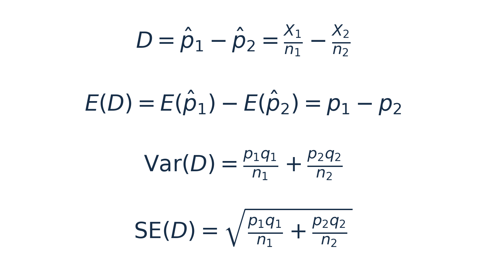

*式（5）｜第一行由两组阳性人数及样本量计算样本率差。第二行说明D的期望等于总体率差。后两行为独立样本率差的方差与理论标准误。*

**因此，率差的标准误要先将两组方差相加，再开平方。** 标准误直接相加得不到这个结果。

式（5）的均值和方差在二项模型下是精确的。分布能否近似为正态，还要检查各组的正态近似条件。Rosner第8版第10.2节沿用第5章独立正态变量作差的性质，解释两组样本率之差的正态近似<sup>[1]</sup>。

具体地说，两组样本率各自近似正态且相互独立时，它们的差也近似正态。一般情况下，差值的中心是p₁ − p₂，方差是式（5）中的两项之和。如果假设两个总体率相等，即H₀为p₁ = p₂ = p，那么中心变为p − p = 0，方差中的p₁q₁和p₂q₂都变为共同的pq。

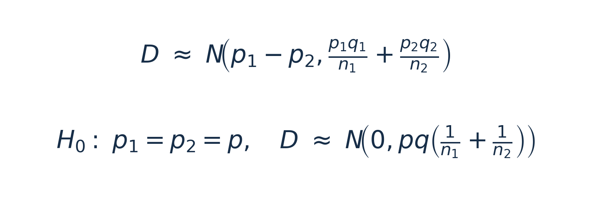

*式（6）｜独立样本率差的正态近似。第一行适用于一般总体率差，第二行在H₀为两总体率相等时使用。N的第二个参数均为方差。*

这样就把单个样本率的正态近似，接到了两个样本率之差的正态近似。下一节再用共同率p估计零假设下的标准误，计算Z。颜艳、王彤《医学统计学》第5版第94页将这类标准正态近似检验的统计量记为u，本篇统一记为Z<sup>[5]</sup>。

图3给出两个教学模型。上半部分两组都满足Rosner的经验条件，率差的正态近似与精确概率比较接近。下半部分两组的事件概率都很小，正态近似条件不足，率差保留明显的离散尖峰。


**先看横轴表示什么。** 图3每个面板内，两组的样本量相同，都记为n。把第一组阳性人数减去第二组阳性人数，得到人数差k。横轴0表示两组阳性人数相同，正值表示第一组更多，负值表示第二组更多。

式（5）第一行已经将样本率差写成“两组阳性人数分别除以各自样本量，再相减”。图3中两组的分母相同，因此可以先算人数差k，再除以每组样本量n，得到**率差D = k/n**。

例如，上半部分每组50人，横轴k = 1表示第一组多1名阳性，对应D = 1/50 = 0.02，即高2个百分点。下半部分每组1000人，同样的k = 1对应D = 1/1000 = 0.001，即高0.1个百分点。两个面板都以人数差作横轴，换算为率差时要使用各自的n。

前面社区例题的样本量分别为300和200，计算率差时仍分别求两组样本率，再将它们相减。下面直接计算图3上半部分的一根柱形，说明它的精确概率从哪里来。

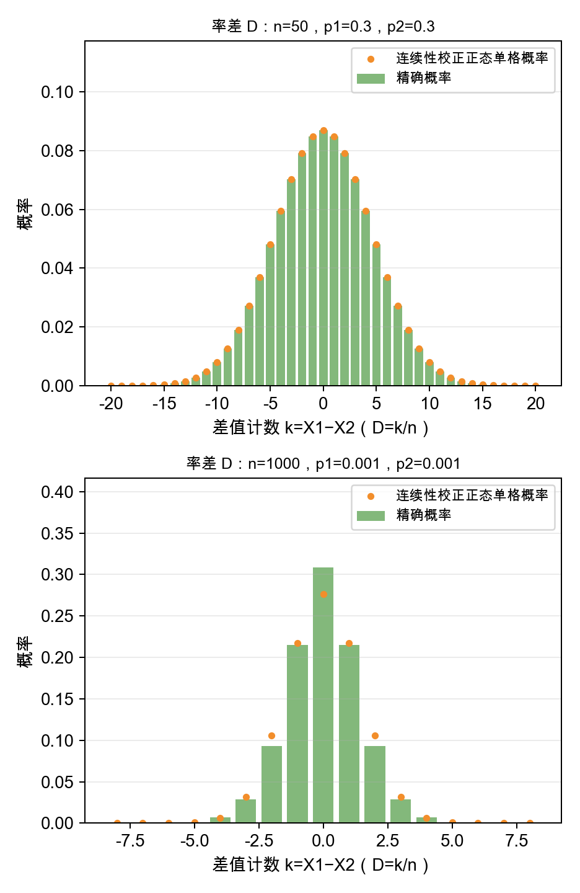

*图3｜教学模型。上半部分每组n = 50、p₁ = p₂ = 0.30，各组npq = 10.5。下半部分每组n = 1000、p₁ = p₂ = 0.001，各组npq = 0.999。横轴显示阳性人数之差k，率差D = k/n。柱形为按二项概率逐项相加得到的精确概率，标记点为连续性校正后的正态单格概率。两个面板分别截取中央范围，纵轴尺度不同。*

### 图3中的精确概率怎样算？

先看上半部分，两组各抽50人，总体阳性概率都设为0.30。这个教学模型的总体率差是0.30 − 0.30 = 0，每次抽样得到的两个样本率仍可能不同。

例如，第一组有15人阳性，样本率为15/50 = 0.30。第二组有14人阳性，样本率为14/50 = 0.28。两组相差1人，样本率差为0.02。

第一组恰好15人阳性的二项概率约为0.12234686，第二组恰好14人阳性的概率约为0.11894834。**两组独立，这一对结果同时出现的概率，就是两个概率相乘**，约为0.01455296。

但率差0.02还有其他产生方式。例如，第一组16人阳性、第二组15人阳性，两组样本率为0.32和0.30，差也为0.02。这个计数组合同时出现的概率约为0.01403321。

因此，要计算“率差恰好为0.02”的总概率，就要找全所有相差1人的结果，从第一组1人、第二组0人，一直列到第一组50人、第二组49人。**先将每一对的两个二项概率相乘，再把这50个互斥结果的概率相加**。

用R可以直接完成这一步。

```r
# 图3上半部分的模型参数，两组各50人，阳性概率都为0.30。
n <- 50
p1 <- 0.30
p2 <- 0.30

# 列出相差1人的全部结果，对应样本率差1/50 = 0.02。
x2 <- 0:(n - 1)
x1 <- x2 + 1

# 两组独立，每个组合的概率由两个二项概率相乘得到。
prob_each_pair <- dbinom(x1, size = n, prob = p1) *
  dbinom(x2, size = n, prob = p2)

# 所有这些互斥组合的概率相加，得到率差恰好为0.02的概率。
sum(prob_each_pair)
# [1] 0.08488994
```

**图3横轴k = 1处的柱高就是0.08488994，对应率差D = 1/50 = 0.02。** 对其他人数差k，按同样办法找全计数组合、相乘后相加，就得到图中其余柱形。下半部分采用n = 1000、p₁ = p₂ = 0.001，计算方法相同，人数差除以1000才是对应的率差。


图3下半部分的率差虽然关于0对称，仍明显保留离散尖峰。**对称性与正态性是两个不同的性质。**

## 五、检验两个总体率相等，为什么把阳性人数合并？

回到甲社区60/300、乙社区20/200的数据，观察到的率差是0.10。第四节在给定总体率时计算D的分布；现在总体率未知，要回答例题的第二个问题：如果两个社区的总体率相等，观察到这样的率差有多常见？

零假设H₀为p₁ = p₂，备择假设H₁为p₁ ≠ p₂，采用双侧检验，检验水准α = 0.05。若H₀成立，两组共享同一个总体阳性概率p，率差的零假设均值为0。在式（5）的方差公式中令p₁ = p₂ = p，便可以提取公因子pq，得到式（7）。

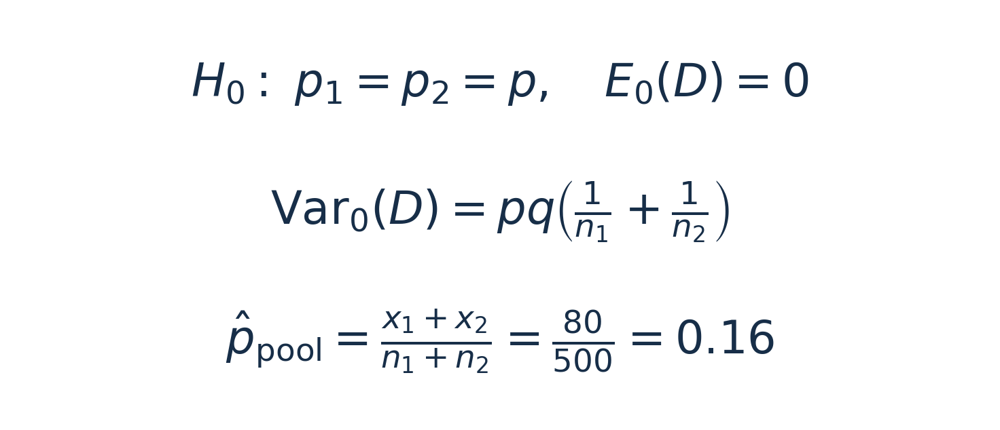

*式（7）｜两总体率相等时的零假设方差与合并率。*

这个共同的p未知。既然零假设把两组视为拥有相同阳性概率，就用两组共同的信息估计它，得到合并率p̂pool。阳性人数合并后为80人，总人数为500人，合并率为0.16<sup>[1]</sup>。

两组样本量不同，合并率按人数加权。直接将0.20和0.10平均，得到的0.15没有反映两组人数的差异。

将合并率代入式（7）的零假设方差并开平方，得到式（8）的估计标准误，再用观察到的率差除以它。

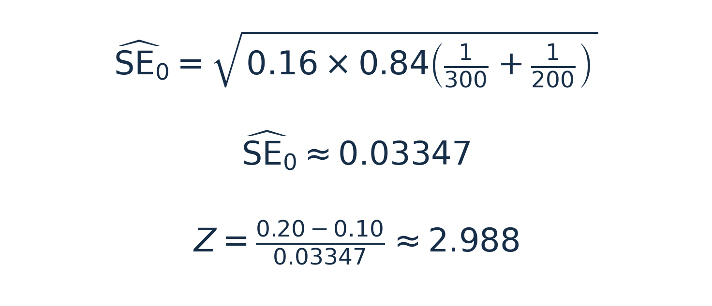

*式（8）｜本例的合并标准误与未校正Z值。*

这里检查的是H₀共同率下各组阳性人数计数的方差，代入合并率后用nᵢp̂pool(1 − p̂pool)计算。合并率对应H₀下各组的期望阳性、阴性人数，分别为nᵢp̂pool与nᵢ(1 − p̂pool)。Rosner第375页要求两组各自满足nᵢp̂pool(1 − p̂pool) ≥ 5。本例两组分别为40.32和26.88，均超过5，也超过10。采用未作连续性校正的双侧Z近似，Z约为2.988，P约为0.00281<sup>[1]</sup>。

这个P值回答的是，在总体率相等的模型下，出现当前这样或更极端的率差有多大概率。判断“更极端”时，双侧检验同时考虑正、负两个方向。本例就是在零假设的标准正态近似下，计算|Z| ≥ 2.988的两侧尾部概率。按本次未校正Z近似，P约为0.00281，小于0.05，拒绝H₀，数据提供两个社区总体检测阳性率存在差异的证据。

Rosner第10章给出的检验公式还加入了连续性校正。这里先用`correct = FALSE`关闭校正，对照式（8）的未校正Z值<sup>[1,6]</sup>。

```r
prop.test(x = c(60, 20), n = c(300, 200),
          alternative = "two.sided", correct = FALSE)
```

R实际运行输出如下。

```text
2-sample test for equality of proportions
without continuity correction

data: c(60, 20) out of c(300, 200)
X-squared = 8.9286, df = 1,
p-value = 0.002807
alternative hypothesis: two.sided
95 percent confidence interval:
 0.03853916 0.16146084
sample estimates:
prop 1 prop 2
   0.2    0.1
```

输出中的`without continuity correction`说明本次关闭了连续性校正。`X-squared`是Pearson卡方统计量，约为8.929，等于式（8）中Z的平方。`df = 1`表示自由度为1，双侧P值与Z检验一致<sup>[6]</sup>。

**为什么还要考虑连续性校正？** 阳性人数只能取整数，正态曲线和卡方曲线却是连续的。校正会调整离散计数与连续参考分布之间的边界，在本例四格表中，第一组阳性人数为60，H₀下的期望人数为300 × 0.16 = 48，绝对偏差为12。Yates校正先将12减去0.5，得到11.5，再用校正后的偏差计算Pearson卡方统计量。其余三格同样处理。

在本例两独立率的双侧Z/u检验中，换到率差尺度，校正量为0.5/n₁ + 0.5/n₂，即0.5/300 + 0.5/200 ≈ 0.0041667。将绝对率差0.10减去这个量，再除以合并标准误0.0334664，得到校正后的|Z|约2.86357，平方后为卡方统计量约8.2000。

偏差较小时，软件会限制校正量，避免将绝对偏差减成负数。统计课堂16[《四格表的卡方检验：为什么自由度是1？》](https://mp.weixin.qq.com/s/ZLu8MdeLFrye3bMc5mroDA)第五节已经用实际输出解释了这个过程<sup>[7]</sup>。

李春喜《生物统计学》第6版第103页，用np、nq两类计数的5与30作为连续性校正的经验分界，列出两类均大于5、至少一类小于30时采用校正，两类均大于30时可省略校正。这里的30指两类计数。本文沿用Rosner的检验框架，同时展示校正前后的结果，并明确软件设置<sup>[8]</sup>。

将同一段代码改成`correct = TRUE`，实际结果如下。

| 设置 | Pearson卡方 | 自由度 | 双侧P值 |
| --- | --- | --- | --- |
| FALSE，关闭校正 | 8.9286 | 1 | 0.002807 |
| TRUE，采用校正 | 8.2000 | 1 | 0.004189 |

本例校正后统计量减小、P值增大，自由度仍为1，采用的仍然是近似检验。**连续性校正不能保证稀疏数据的近似足够准确。** 比较两个结果，是理解软件设置怎样改变计算的练习，不能根据哪一个P值更小来选择设置。

R输出还给出了率差的95%区间。计算这个区间，需要回到两组总体率可以不同的一般情形。

## 六、估计率差时，为什么又各用各的率？

下面回答例题的第三个问题，估计甲社区减乙社区的总体检测阳性率差p₁ − p₂，并给出95%区间。因此分别用两组样本率估计各自的总体率，再计算率差区间。

一种常见的大样本方法，是分别用p̂₁估计p₁、用p̂₂估计p₂，代入一般率差方差公式，得到**未合并标准误**。再用观察率差加减1.96个估计标准误，构成近似95% Wald区间。

估计一般率差时，两组总体率可以不同。检查各组的正态近似，需要分别用各自的样本率计算nᵢp̂ᵢ(1 − p̂ᵢ)。本例第一组为48，第二组为18。这里将Rosner第6.8节对单个率的经验检查分别用于两组，是本篇对率差Wald近似的筛查步骤。具体区间的覆盖表现还与所用方法有关<sup>[1]</sup>。

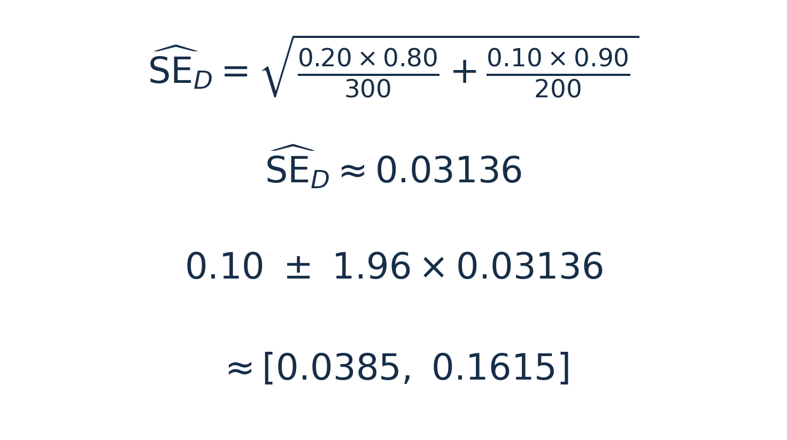

*式（9）｜本例的未合并标准误与率差Wald区间。*

式（9）中，本例未合并标准误约为0.03136，区间约为0.0385至0.1615，即3.85至16.15个百分点。本例观察到甲社区比乙社区高10个百分点，按这套大样本方法估计，总体检测阳性率差的95%区间为3.85至16.15个百分点。

这也对应上一节R输出的区间0.03853916至0.16146084。本次两组率比较中，`correct = FALSE`调用采用未合并标准误，R使用的正态分位数约为1.959964，手算写成1.96，所以最后几位有微小差异。

软件还将区间限定在率差的合法范围内<sup>[9]</sup>。

这样就能看清两种标准误各自对应的问题。**检验p₁ = p₂时，合并标准误依据共同率假设计算。估计一般率差时，未合并标准误保留两组各自的概率。**

Wald区间依赖大样本近似，在边界附近尤其容易出问题。[统计课堂14的区间篇](https://mp.weixin.qq.com/s/RE66xquSoQAtDH3g1_7xjw)已经并列解释了Wald、Wilson和Clopper–Pearson三种率区间的计算思路，可以回看前文的例题<sup>[3]</sup>。这里再看一个边界情形，20人中没有观察到阳性，样本率为0。将0代入估计标准误，便得到0，Wald区间随之退化成[0, 0]。

可是再抽20人，仍可能观察到阳性。依据二项模型，R的`binom.test(0, 20)`给出的双侧95% Clopper–Pearson精确区间约为[0, 0.1684]，保留了这种不确定性<sup>[10]</sup>。

**零次观察到事件，仍有估计不确定性。** 选择区间方法时，要看事件数、非事件数与边界位置。回到社区主例，除了报告率差0.10及其区间，还需要解释这个差异有多大。

### 率差有多大，怎样解释？

效应量用一个数概括差异的大小。这里的总体率差p₁ − p₂是原始尺度上的效应量，两组样本率之差是它的估计。本例观察到甲社区比乙社区高10个百分点，95%区间约为3.85至16.15个百分点。**原始率差没有通用的“大、中、小”分界，其医学意义需要结合疾病、结局与研究目的判断。** 单个率描述一组对象的事件发生水平，讨论差异时，需要明确它与哪一组或哪个给定率比较。

如果还想用一个带有惯常大小参考值的指标，可以计算**Cohen’s h**。它先将每个率开平方，再作反正弦变换并乘以2，最后用第一组的结果减去第二组的结果。用两组样本率代入，就得到h的估计值<sup>[11]</sup>。

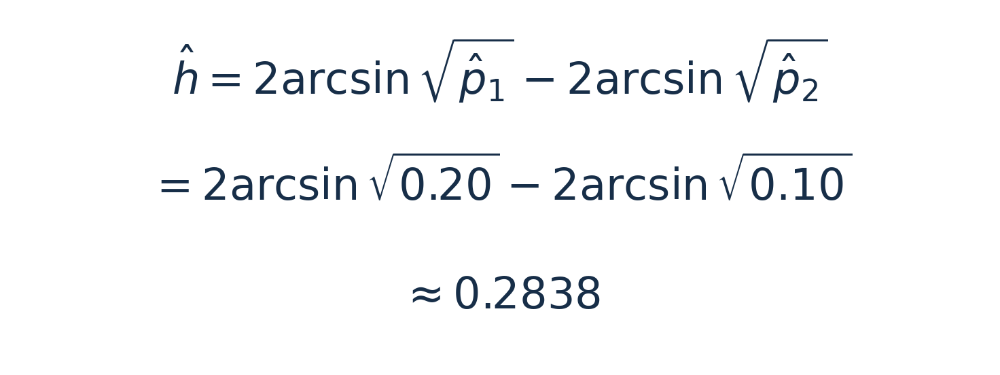

*式（10）｜用两组样本率估计Cohen’s h，相减方向仍为第一组减第二组。*

式（10）中的arcsin是反正弦函数，角度按弧度计算。h的正负号保留差异方向，判断大小时看其绝对值。Cohen在行为科学背景下提出0.20、0.50、0.80作为小、中、大效应的惯常参考值。按这些参考值分段时，可作如下描述<sup>[11]</sup>。

| h的绝对值 | 惯常描述 |
| --- | --- |
| 小于0.20 | 低于小效应参考值 |
| 0.20至小于0.50 | 小效应范围 |
| 0.50至小于0.80 | 中等效应范围 |
| 大于或等于0.80 | 大效应范围 |

在R中，无需安装额外包就能计算本例的h。

```r
# sqrt开平方，asin计算反正弦，返回弧度。
# 相减方向为甲社区减乙社区。
p1_hat <- 60 / 300
p2_hat <- 20 / 200
h_hat <- 2 * asin(sqrt(p1_hat)) - 2 * asin(sqrt(p2_hat))
h_hat
```

实际运行输出如下。

```text
[1] 0.2837941
```

结果与式（10）一致，也可用`pwr::ES.h(p1_hat, p2_hat)`复算<sup>[12]</sup>。本例h约为0.284，按上述惯例属于小效应范围。它把两组率的差异放到变换后的尺度上比较；**这些参考值适用于h，不能直接套在原始率差上，也不能代替医学意义判断。** Cohen同样建议优先依据具体领域的理论与经验解释效应<sup>[11]</sup>。

同样相差10个百分点，55%与45%得到的h约为0.2003，20%与10%得到的h约为0.2838。这说明h同时取决于两个率所在的位置。报告本例结果时，应同时给出两组率、率差及其95%区间。率差和h描述效应大小，区间表达估计的不确定性，P值则用于评价数据对两总体率相等假设的反对证据，医学意义还需结合研究问题判断。

## 七、什么时候用正态近似，什么时候用精确计算？

**在二项模型下，精确方法同样适用于大样本。** 计算可行时，可以直接使用精确方法计算检验P值或率差置信区间，无需先满足正态近似的经验门槛<sup>[13,14]</sup>。

正态近似提供了计算简便的另一种方法，也便于理解标准误、Z/u检验与区间估计之间的关系。**前面的样本量与概率检查，用于判断正态近似是否合适。** 两组独立且各自符合二项模型时，具体检查如下。

- **检验两总体率是否相等。** 按Rosner第10.2节，先用合并率检查两组的nᵢp̂pool(1 − p̂pool)。两组均达到5时，符合书中的正态近似经验条件<sup>[1]</sup>。
- **估计一般率差的区间。** 按上一节分别检查两组的nᵢp̂ᵢ(1 − p̂ᵢ)，并关注零事件、全部阳性等边界情形。
- **本篇的保守取舍。** 对上述近似检查，任一组低于10，包括达到5但未达到10的情形，本篇优先采用精确方法。10是结合Ross经验门槛作出的本篇选择，Rosner上述检查的原文门槛为5<sup>[1,4]</sup>。

对于两个独立率之差，可以直接使用下面两个R函数。计算规模增大时，需要关注具体算法的运行时间和数值精度。

| 包与函数 | 本篇使用的功能 |
| --- | --- |
| `exact2x2::uncondExact2x2()` | 无条件精确检验及率差置信区间，设置`parmtype = "difference"` |
| `ExactCIdiff::BinomCI()` | 两个独立率之差的精确置信区间 |

`uncondExact2x2()`在两个独立二项模型下计算，对零假设中未知的共同率等参数作处理，得到检验P值及匹配区间。`BinomCI()`采用另一种区间构造方法，直接估计p₁ − p₂。两种区间的端点可以不同，下面分别报告各自的结果<sup>[13,14]</sup>。

### 小样本例子　第一组2/10，第二组0/10

另设一个小样本教学例题，仍比较甲、乙两个社区成年居民的幽门螺杆菌检测阳性率。这次各社区分别随机抽取10名不同受试者，每人检测一次，采用相同检测方法和判定标准，并沿用独立二项模型。甲社区有2人阳性，乙社区有0人阳性。要求在双侧α = 0.05下比较两个总体率，并估计甲社区减乙社区的总体率差及其95%区间。

两组样本率分别为0.20和0，观察到的率差为0.20，即20个百分点。共同率估计为2/20 = 0.10，H₀下每组的近似检查值都是10 × 0.10 × 0.90 = 0.90，低于5。估计区间时，第二组观察到零事件，代入Wald标准误的这一组方差项也变为0。这里采用精确计算。


**两个函数的相减方向需要对应。** `uncondExact2x2()`把率差定义为“函数中的第2组减第1组”，所以将本例0/10输入为第1组、2/10输入为第2组，结果对应本文的第一组减第二组。`BinomCI()`按x/n₁ − y/n₂计算，直接输入2/10与0/10。

```r
# 本例第一组2/10，第二组0/10，关注第一组减第二组。
# exact2x2的接口计算第2组减第1组，因此交换接口中的组别顺序。
exact_result <- exact2x2::uncondExact2x2(
  x1 = 0, n1 = 10, x2 = 2, n2 = 10,
  parmtype = "difference", nullparm = 0,
  alternative = "two.sided", method = "score",
  tsmethod = "central", midp = FALSE,
  conf.int = TRUE, conf.level = 0.95,
  control = exact2x2::ucControl(nPgrid = 1000, nCIgrid = 1000)
)
exact_result
```

实际运行输出如下。

```text
	Unconditional Exact Test on Difference in Proportions, method= score,
	central

data:  x1/n1=(0/10) and x2/n2= (2/10)
proportion 1 = 0, proportion 2 = 0.2, p-value = 0.215
alternative hypothesis: true p2-p1 is not equal to 0
95 percent confidence interval:
 -0.1291264  0.5560955
sample estimates:
p2-p1
  0.2
```

输出中的`p-value`约为0.2150，`sample estimates`下的`p2-p1`为0.20，对应本例甲社区减乙社区的率差。`95 percent confidence interval`给出的区间约为[−0.12913, 0.55610]。在α = 0.05下，现有小样本对两个社区总体检测阳性率差异的证据不足。

```r
# BinomCI直接计算第一组减第二组的率差区间。
ci_result <- ExactCIdiff::BinomCI(
  n1 = 10, n2 = 10, x = 2, y = 0,
  conf.level = 0.95, CItype = "Two.sided",
  grid.one = 60, grid.two = 40
)
ci_result
```

实际运行输出如下。

```text
$conf.level
[1] 0.95

$CItype
[1] "Two.sided"

$estimate
[1] 0.2

$ExactCI
[1] -0.12914  0.56654
```

输出中的`$estimate`是率差点估计0.20，`$ExactCI`给出95%区间[−0.12914, 0.56654]。两个区间都包含0，表示这批小样本仍与多种总体率差相容。

两个函数实现了精确推断方法，软件计算仍涉及数值网格搜索。本例使用加密网格复算后，差异出现在所报告结果的末几位。上面列明了搜索设置，包版本、完整输出与复算结果见配套README。

### 与前文其他方法怎样衔接？

- 单个率与给定概率比较，在独立同概率的二项模型下，正态近似适用时可调用`prop.test()`，精确二项检验使用`binom.test()`。检验时将函数的p参数指定为H₀给定的总体率。[统计课堂14的区间篇](https://mp.weixin.qq.com/s/RE66xquSoQAtDH3g1_7xjw)介绍了二项尾概率及单率区间<sup>[3,6,10]</sup>。
- 两个独立组比较总体率是否相等，稀疏2×2表也可使用Fisher条件精确检验。[统计课堂21](https://mp.weixin.qq.com/s/HKPL2P8PG3v6H652hFwSkA)解释了固定边际下的概率与双侧P值<sup>[15]</sup>。
- 同一批对象前后测量或一一匹配的二分类结果，按配对设计处理。[统计课堂18](https://mp.weixin.qq.com/s/pdhCl9mFrJONR23349ESKQ)讨论了McNemar检验、连续性校正及精确二项计算<sup>[16]</sup>。

Fisher通过固定边际的条件分布处理未知共同率，可以直接输入2×2计数表。R的`fisher.test()`还会报告优势比及其区间。关注率差时，可报告上面两个函数提供的率差区间<sup>[17]</sup>。

**独立性由抽样和研究设计判断。** 样本量增加，也不能把同一个人的重复测量变成相互独立的观察。

## 八、本篇讲了哪些知识？

1. **样本率的中心和波动可以从二项模型得到。** 阳性人数除以样本量得到样本率；反复抽样时，期望等于总体率，标准误描述抽样波动。
2. **正态近似先做经验筛查。** Rosner检查二项计数方差是否达到5，Ross采用10；颜艳教材分别检查阳性和阴性人数。本文采用乘积门槛10。
3. **连续性校正要随尺度换算。** 计数尺度半格为0.5，率尺度为0.5/n；两独立率检验的率差校正量为0.5/n₁ + 0.5/n₂，并在`prop.test()`中明确`correct`设置。
4. **率差的标准误取两组方差之和的平方根。** 主例甲减乙为10个百分点，独立性使两组方差直接相加。
5. **检验和区间使用不同的率。** 检验两总体率相等时用合并率；估计一般率差时分别用两组样本率，区间同时表达估计不确定性。
6. **效应解释要保留尺度。** 主例率差95%区间约为3.85至16.15个百分点，Cohen’s h约为0.284，h的惯常分类不能替代医学意义判断。

| 研究问题 | 本文采用的筛查与函数 |
| --- | --- |
| 单率与给定率比较 | 检查n p₀(1−p₀) ≥ 10；近似用`prop.test()`，精确用`binom.test()` |
| 两独立率相等检验 | 两组分别检查nᵢ p̂pool(1−p̂pool) ≥ 10；用`prop.test()`并写明`correct`设置 |
| 两独立率之差的Wald区间 | 两组分别检查nᵢ p̂ᵢ(1−p̂ᵢ) ≥ 10；本例`prop.test(correct = FALSE)`使用未合并标准误 |
| 两独立率之差的精确推断 | 检验与区间用`uncondExact2x2(parmtype = "difference")`；另一种区间用`ExactCIdiff::BinomCI()` |

低于本文门槛时优先精确计算；达到门槛、样本量较大时，计算可行也仍可采用精确方法。使用函数前核对相减方向和参数设置。

## 配套练习

这次准备了R、Python和MATLAB三套脚本，选择自己熟悉的一种即可。R中的二项概率使用官方二项分布函数计算<sup>[18]</sup>。先核对图形和上面的数值，随后再改参数。

可以固定n = 100，比较p = 0.50与0.01，再把n增加到1000、p改为0.001，分别算出期望阳性人数np和计数方差npq，判断是否满足经验条件，再观察分布怎样变化。然后核对率差检验中的合并标准误，以及率差区间中的未合并标准误。脚本还列出20%对10%、55%对45%两种情形，两者都相差10个百分点，比较各自的Cohen’s h，观察原始率差与h的区别。

在R中打开项目脚本并运行Source，Python用Spyder打开项目文件夹后按F5，MATLAB设置Current Folder后运行主脚本。详细步骤和运行状态见项目README与VALIDATION。

本篇完整项目
https://github.com/fuyuming/statistics-classroom/tree/main/stats_classroom/proportion_sampling_difference

整个仓库
https://github.com/fuyuming/statistics-classroom

整个仓库ZIP
https://github.com/fuyuming/statistics-classroom/archive/refs/heads/main.zip

下载仓库ZIP并完整解压，进入`stats_classroom/proportion_sampling_difference/配套项目`，先读README。R打开`样本率与率差.Rproj`，Python打开`代码/样本率与率差.py`，MATLAB运行`代码/sample_proportions.m`。率差精确推断的三语言扩展入口、所用方法及对应输出也在README中。

这里是明哥的微生物世界，我们下次再见。

## 参考资料

[1] Rosner B. Fundamentals of Biostatistics. 8th ed. §5.7，印刷133—138页，尤其式5.12。§6.8，187—189页。§7.9，249—250页。§10.2，373—377页。

[2] 明哥的微生物世界．《期望、方差、协方差：统计公式是怎样一步步推出来的？》．统计课堂08，第二、三节。 https://mp.weixin.qq.com/s/QkG1VROHLoOtyDgxEonrDw

[3] 明哥的微生物世界．《小样本率的置信区间从哪里来？从6/13一步步找到上下限》．统计课堂14。 https://mp.weixin.qq.com/s/RE66xquSoQAtDH3g1_7xjw

[4] Ross SM. Introduction to Probability Models. 9th ed. Academic Press, 2007. §2.7，印刷80页，二项分布正态近似的经验条件np(1 − p) ≥ 10。原书在线本 https://ndl.ethernet.edu.et/bitstream/123456789/33839/1/Sheldon%20M.%20Ross_2007.pdf

[5] 颜艳、王彤主编．《医学统计学》第5版．人民卫生出版社，2020．印刷92、94页，总体率区间估计与率比较。

[6] R官方文档，prop.test。https://stat.ethz.ch/R-manual/R-devel/library/stats/html/prop.test.html

[7] 明哥的微生物世界．《四格表的卡方检验：为什么自由度是1？》．统计课堂16，第五节。 https://mp.weixin.qq.com/s/ZLu8MdeLFrye3bMc5mroDA

[8] 李春喜、姜丽娜、邵云、张黛静、马建辉．《生物统计学》第6版．科学出版社，2023．印刷103—104页，两样本频率比较及连续性校正经验分界。

[9] R官方源代码，stats::prop.test，两组率差区间与连续性校正的实现。https://svn.r-project.org/R/trunk/src/library/stats/R/prop.test.R

[10] R官方文档，binom.test。https://stat.ethz.ch/R-manual/R-devel/library/stats/html/binom.test.html

[11] Cohen J. Statistical Power Analysis for the Behavioral Sciences. 2nd ed. Lawrence Erlbaum Associates, 1988. §6.2，印刷180—185页，反正弦变换及h的小、中、大效应惯例。 https://www.utstat.toronto.edu/brunner/oldclass/378f16/readings/CohenPower.pdf

[12] pwr官方文档，ES.h，两率的Cohen’s h计算。 https://search.r-project.org/CRAN/refmans/pwr/html/ES.h.html

[13] exact2x2官方文档，uncondExact2x2，两个独立二项样本的无条件精确检验及置信区间。https://search.r-project.org/CRAN/refmans/exact2x2/html/uncondExact2x2.html

[14] ExactCIdiff官方手册，BinomCI，两个独立率之差的精确区间。https://cran.r-project.org/web/packages/ExactCIdiff/ExactCIdiff.pdf

[15] 明哥的微生物世界．《Fisher精确检验：双侧P值为什么不能直接乘2？》．统计课堂21。 https://mp.weixin.qq.com/s/HKPL2P8PG3v6H652hFwSkA

[16] 明哥的微生物世界．《McNemar为什么减1？精确检验与mid-P又差在哪？》．统计课堂18。 https://mp.weixin.qq.com/s/pdhCl9mFrJONR23349ESKQ

[17] R官方文档，fisher.test，固定边际、超几何分布与优势比输出。https://stat.ethz.ch/R-manual/R-devel/library/stats/html/fisher.test.html

[18] R官方文档，二项分布函数与参数说明。https://stat.ethz.ch/R-manual/R-devel/library/stats/html/Binomial.html
