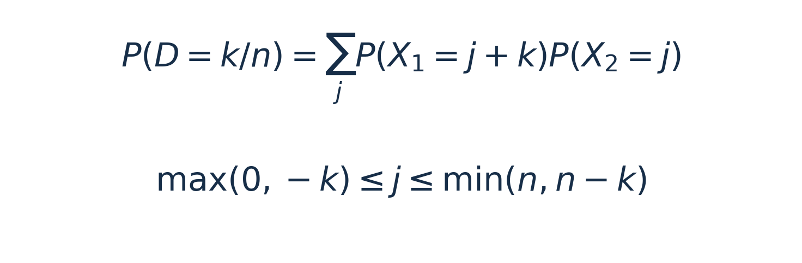

# 样本率与率差：抽样分布配套项目

这是一个**教学构造的确定性练习项目**。图中蓝柱是精确二项概率，红点是连续性校正后的正态单格概率，帮助初学者逐项比较两种计算。

## 先跑起来

完整下载并解压后：

1. R：双击 `样本率与率差.Rproj`，打开 `代码/样本率与率差.R` 后点击 Source。结果在 `运行结果/R/`，语言专属图片在 `运行结果/R/配图/`；文章配图由 Python 最后生成，避免不同绘图设备互相覆盖。
2. Python：用 Spyder 打开项目文件夹，打开 `代码/样本率与率差.py` 按 F5；也可在项目目录运行 `python 代码/样本率与率差.py`。结果在 `运行结果/Python/`，并生成文章配图（含中文字体和图例）。
3. MATLAB：把 Current Folder 设为 `代码`，运行 `sample_proportions.m`。结果在 `运行结果/MATLAB/`，图片在其 `figures/` 子目录；脚本只用基础函数（`gammaln`、`erf`），不假设 Statistics Toolbox。

Python 依赖见 `requirements.txt`（pandas、numpy、matplotlib、scipy）。R主脚本使用base R；新增率差精确方法脚本使用exact2x2和ExactCIdiff；MATLAB使用基础MATLAB。脚本都按 UTF-8 保存。

## 例题背景与问题

主例题为教学构造的两个社区成年居民幽门螺杆菌检测阳性率比较。甲社区随机抽取300人，其中60人阳性；乙社区随机抽取200人，其中20人阳性。不同受试者各测一次，采用相同检测方法及判定标准，分析采用独立二项模型。依次求样本率差、在双侧α=0.05下比较总体率，并估计甲社区减乙社区的总体率差及95%区间。

新增精确方法脚本另设小样本教学例题，两个社区各抽10人，分别2人和0人阳性，完成相同方向的比较与区间估计。

## 输入与模型

`数据/共享教学数据.csv` 是三种语言共用的输入。`one` 行表示 `X~Binomial(n,p)`；`difference` 行表示两组独立计数 `X1~Binomial(n,p1)`、`X2~Binomial(n,p2)`，且本课示例等 n，`D=(X1-X2)/n`。这里 p 是单次试验成功概率，q=1-p 是失败概率；率的期望是 p，方差是 `pq/n`。率差的方差为 `p1(1-p1)/n+p2(1-p2)/n`。

## 课堂练习

先核对脚本打印的率方差 `pq/n`、`P(X=0)`、观察比较的 pooled Z/P、Pearson Q、Wald CI 与边界的 Wald/Clopper–Pearson 区间；再把 CSV 中 n 或 p 改成另一个教学值，观察精确曲线和正态近似如何变化。率差的精确概率 是两个二项计数分布的卷积；图中正态点是对应连续性校正单格概率。CSV 已含 `n=1000,p=0.001` 的单率场景。

R 中 `prop.test(correct=FALSE)` 与 `binom.test` 只作核对。由于 0/20 的 Wald 标准误把观测率代入，`p̂(1-p̂)` 为 0，区间退化为 [0,0]；精确二项方法仍给出非零的区间上限，保留总体率的估计不确定性。

样本率方差在三个单率场景下依次为0.0025、0.000099、0.000000999。脚本打印rate_variance(pq/n)可用于核对。MATLAB源码使用UTF-8，字符串内的中文是固定目录名。

## 依赖与常见报错

Python首次运行若提示缺少模块，在Spyder使用的同一Python环境中执行 `python -m pip install -r requirements.txt`。先将终端目录切换到本项目目录。R主脚本无需安装额外包。率差精确方法脚本需先安装exact2x2和ExactCIdiff。MATLAB无需Statistics and Machine Learning Toolbox。若中文图出现方框，安装可用中文字体并在Python的font.sans-serif列表中设置其名称。

R脚本新增correct=FALSE/TRUE对照，结果为运行结果/R/continuity_correction_comparison.csv，实际输出保存在prop_test连续性校正实际输出.txt。该对照用于第五节软件设置解释。

## Cohen's h：同样率差在不同基线下的效应量

脚本还用样本率计算比例差的 Cohen's h（反正弦变换后的效应量）：`h = 2 * asin(sqrt(p1)) - 2 * asin(sqrt(p2))`，方向固定为第一组减第二组。`asin` 接受0到1的数值，返回值按弧度表示。主例 60/300 对 20/200 的两组率为 0.20 和 0.10，率差为 +0.10（10 个百分点），预期 `h = 0.2837941092083`。结果写入三种语言各自的 `运行结果/{语言}/effect_size_comparison.csv`。

按 `abs(h)` 的经验参考分类：`abs(h)<.2` 低于小效应参考值，`.2<=abs(h)<.5` 小，`.5<=abs(h)<.8` 中，`abs(h)>=.8` 大；分类字符串用 `below_small_reference`、`small`、`medium`、`large`，便于跨语言比较。这些阈值不是医学重要性判断，实际意义仍需结合结局、临床阈值和研究设计。效应量结果表另列 0.55−0.45，展示原始率差同为 0.10 时，基线不同会改变 h；原始率差本身没有通用的“大/中/小”标签。公式依据 R `pwr::ES.h` 文档（https://search.r-project.org/CRAN/refmans/pwr/html/ES.h.html）及 Cohen (1988) 第6章（https://www.utstat.toronto.edu/brunner/oldclass/378f16/readings/CohenPower.pdf）。

## 率差精确检验与区间的R练习

在R控制台运行`install.packages(c("exact2x2", "ExactCIdiff"))`。随后打开`代码/率差精确检验与区间.R`并Source，工作目录采用本篇R项目目录。终端可在项目目录执行`Rscript 代码/率差精确检验与区间.R`。

本例第一组2/10、第二组0/10，关注第一组减第二组。exact2x2的接口相减方向为第2组减第1组，脚本交换输入以保持结果为+0.20。ExactCIdiff直接按第一组减第二组输入。两种区间构造不同，结果分别保存。

脚本输出保存在`运行结果/R/率差精确方法比较.csv`，完整实跑结果见同目录`率差精确方法实际输出.txt`。当前核验版本为R 4.6.1、exact2x2 1.7.0、ExactCIdiff 2.1。脚本采用显式网格参数，网格加密会影响末几位结果。两区间均包含0，显示小样本下率差估计的不确定性。

## 补充阅读　给定总体率时，率差的精确分布怎样计算

这一部分补充说明图3中精确概率的计算。总体率p₁、p₂是模型给定值，以下计算求各样本率配对及率差的概率。研究中未知总体率的精确检验和区间，见新增R脚本。

给定总体率p₁、p₂和两组样本量后，各组样本率的可能取值及其概率就确定了。将第一组的每个可能样本率，与第二组的每个可能样本率配成一对。**两组独立时，一个配对同时出现的概率，等于两组各自取到相应样本率的概率相乘。**

例如，两组各抽2人，总体阳性概率都为0.5，组内各人的结果独立，两组也相互独立。每组的样本率都可能为0、0.5或1，对应的概率分别为0.25、0.50、0.25。这里0、0.5和1都是样本率。

下表列出两组样本率的全部9种配对。行表示第一组的样本率，列表示第二组的样本率，**格内的数字是这一对样本率同时出现的概率**。

| 第一组↓／第二组→ | 0 | 0.5 | 1 |
| --- | --- | --- | --- |
| 0 | 0.0625 | 0.125 | 0.0625 |
| 0.5 | 0.125 | 0.25 | 0.125 |
| 1 | 0.0625 | 0.125 | 0.0625 |

例如，第一组样本率为0.5、第二组样本率为0这一配对，出现的概率为0.50 × 0.25 = 0.125。第一组为1、第二组为0.5这一配对，出现的概率也为0.25 × 0.50 = 0.125。每行的概率相加，分别得到第一组样本率为0、0.5、1的概率0.25、0.50、0.25。每列相加同样得到第二组的这三个概率，全部9个格子的概率相加等于1。

有了每个配对的概率，再计算该配对对应的率差。上面两个配对分别给出0.5 − 0 = 0.5和1 − 0.5 = 0.5，产生相同的率差。这两个配对互斥，将概率相加，便得到率差D等于0.5的概率为0.125 + 0.125 = 0.25。对其他率差也这样归类相加，就得到率差的精确分布。

补充式A把给定p₁、p₂时的这个归类相加过程写成一般形式。两组人数同为n时，样本率分别为X₁/n和X₂/n。要使率差D = k/n，就需要阳性人数之差X₁ − X₂ = k。令第二组有j名阳性，第一组便有j + k名阳性，再将所有符合条件的配对概率相加。

*补充式A｜两组样本量同为n时，率差精确概率的卷积计算。*

这里k是阳性人数之差，可取−n至n之间的整数，j是第二组的阳性人数。补充式A的求和只包括两组阳性人数都在0至n内的组合。这种先将独立概率相乘、再按同一率差归类相加的计算称为卷积，图3的精确概率就是这样得到的。

正文图3旁已用n=50、p₁=p₂=0.30说明D=0.02的精确概率计算。R主脚本末节打印概率0.08488994，并将全部50对计数、对应样本率及各组合概率保存为`运行结果/R/图3单柱概率核对.csv`，各行概率相加即为图中该柱高。
