# RR、OR的标准误从哪里来？为什么在对数尺度构造区间？

> 明哥的微生物世界 · 统计课堂 32
>
> 摘要　同一份四格表，怎样从样本率的方差推到RR、OR的标准误？从一个康复达标的例子出发，先算完整区间，再用函数的局部斜率理解一阶Taylor近似，说明对数尺度上的波动怎样还原为比值的不确定范围。


大家好，我是明哥。

整理本科第10课“率差推断与四格表检验”时，有两组公式需要再展开一些：相对危险度RR、优势比OR的标准误，以及它们的置信区间。

前面的[统计课堂25](https://mp.weixin.qq.com/s/yFWPQNnmvm_OKQO4ZgsEBA)已经从二项计数讲到样本率的方差；[统计课堂29](https://mp.weixin.qq.com/s/bDJiRyRskkiC_UbtZ1FEkw)进一步讨论了两个独立样本率之差的区间。率差的标准误容易理解：两组独立，方差相加，再开平方。

换成两个率相除，为什么标准误里会出现人数的倒数？构造区间时，为什么又要先取对数、最后再取指数？

这次沿用同一个康复例题，把计算和推导连起来。

## 一、同样是50%与30%，三种比较量回答不同问题

假设有两组相互独立的康复患者，每组100人，一组接受新方案，一组接受对照方案。在相同的观察终点，按同一个标准判断每位患者是否达标。结果如下。

| 组别 | 达标 | 未达标 | 合计 |
| --- | --- | --- | --- |
| 新方案 | 50 | 50 | 100 |
| 对照 | 30 | 70 | 100 |

这是用于说明方法的教学数据。采用两个独立二项样本模型：各组内患者的结果相互独立，同组患者具有相同的达标概率。

把新方案的总体达标概率记为p₁，对照记为p₀；对应的样本率记为p̂₁、p̂₀。“帽子”表示根据样本得到的估计。本例p̂₁ = 0.50，p̂₀ = 0.30。本文的“率”是以人数为分母的比例。

我们要回答三个问题：新方案的达标率高多少？是对照的多少倍？怎样推导RR、OR的对数标准误，并构造和解释它们的双侧95%置信区间？

先算率差RD和相对危险度RR。RR也称风险比，本例的事件是有利的“达标”，因此读作达标概率之比。

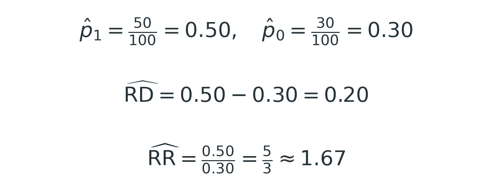

*式（1）｜率差与风险比的点估计，比较方向均为新方案相对于对照。*

RD = 0.20表示**达标率高20个百分点**。RR约为1.67，表示新方案的达标概率估计为对照的1.67倍，**相对提高约66.7%**。后一个百分数以对照的30%为基数：0.20/0.30约为66.7%。

优势比OR比较的是另一种量。先定义**优势（odds）**：事件发生的概率除以不发生的概率，即p/(1−p)。样本中可以用达标人数除以未达标人数估计。

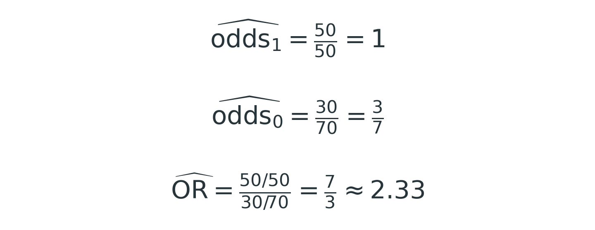

*式（2）｜OR是两组优势之比。*

本例OR约为2.33，表示新方案组“达标相对于未达标”的优势为对照组的2.33倍。**它不能解释成达标概率为对照的2.33倍。** 两组达标率已经是50%和30%，概率比明明是1.67。

这些点估计来自一次样本。换一批患者，人数会变，RR和OR的估计也会变。接下来要描述的，就是这种抽样波动。

## 二、为什么先走到对数尺度？

比值的“没有差别”对应1。例如RR = 1表示两组达标概率相同。RR = 2与RR = 0.5分别表示两倍与一半，是一对互为倒数的比较。

在原尺度上，2距离1是1，0.5距离1却只有0.5；取自然对数后，log 2约为0.693，log 0.5约为−0.693，恰好位于0的两侧。

这里及后文的log均指自然对数。它把“乘除多少倍”改写成“加减多少”，并把无差异值1改写成0。

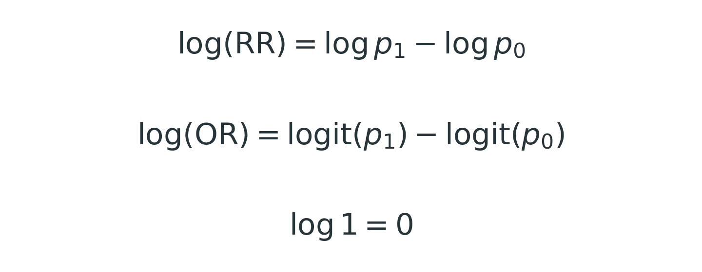

*式（3）｜对数把比值变为差，便于分别处理两组的波动。*

其中logit(p)是log[p/(1−p)]的简写，也就是概率p对应的log优势。第六节再展开它的导数和方差。

两组总体概率都在0与1之间时，RR与OR都为正。对数尺度允许我们在整条实数轴上构造区间，再用指数函数还原为正的比值。

这还需要一个统计依据：**在两组样本足够大、总体概率处于0与1之间等条件下，对数估计量经过适当中心化和标准化后，可以使用正态近似。** 后面会从样本率的近似正态性和平滑函数的局部直线近似解释它。取对数本身不保证任何样本量下都能得到可靠区间。

## 三、先把本例的两个区间完整算出来

理论标准误是估计量抽样分布的标准差，衡量它在重复抽样中的波动。总体概率未知时，标准误也需要用样本来估计。下文把log RR估计量、log OR估计量的估计标准误，分别简写为SE(log RR)、SE(log OR)；公式图中的帽子明确标出样本估计。

先给出本例的两个数，稍后再推导来源：SE(log RR)约为0.1826，SE(log OR)约为0.2960。

**这两个数衡量的是对数估计量的抽样波动，不能直接当成RR、OR原尺度上的标准误。**

对数尺度的双侧95% Wald区间仍沿用熟悉的“点估计±分位点×估计标准误”。用θ暂时代指RR或OR，θ̂表示相应估计，ℓ表示log θ̂，s表示其估计标准误；CI是置信区间的英文缩写。

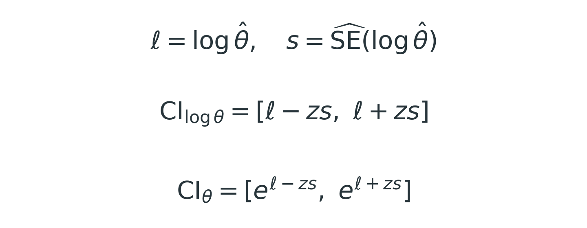

*式（4）｜先构造log θ的区间，再得到θ的区间。*

双侧95%在左右两端各留2.5%，所以z取标准正态分布左侧累计概率0.975的分位点。R中用`qnorm(0.975)`计算，约为1.9600，通常写作1.96。本文数值展示最多保留小数点后四位，计算仍使用完整精度。

**先算RR。** 本例RR估计为5/3，其自然对数约为0.5108。误差限为z × SE(log RR)，用未舍入的分位点和标准误计算，约为0.3578。

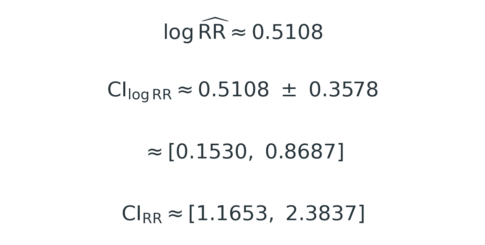

*式（5）｜RR的对数区间与原尺度95%区间。*

因此，新方案相对于对照的达标概率比估计为1.67，95% log-Wald区间约为[1.17，2.38]。

**再算OR。** OR估计为7/3，自然对数约为0.8473。误差限为z × SE(log OR)，用未舍入的分位点和标准误计算，约为0.5802。

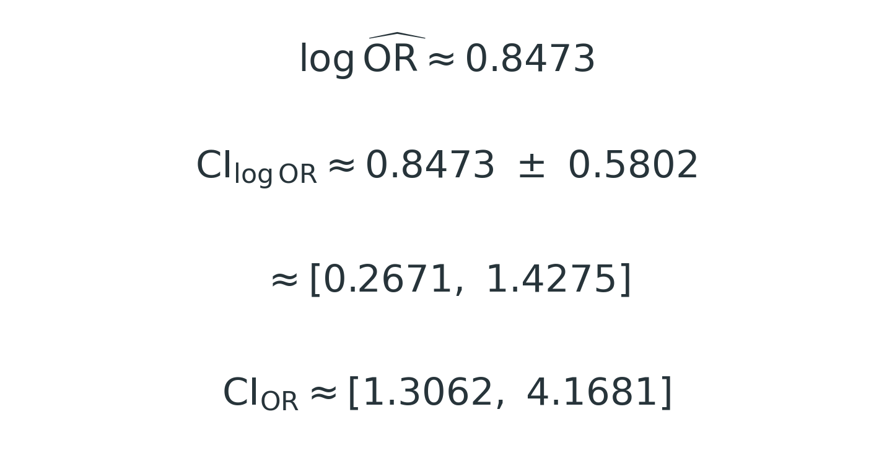

*式（6）｜OR的对数区间与原尺度95%区间。*

OR的95% log-Wald区间约为[1.31，4.17]。它描述优势比的不确定范围，与RR区间估计的是不同参数。

两个区间均不含1，表示按各自对应的双侧Wald检验，在0.05水平拒绝该比值等于1的假设。换成其他区间或检验方法时，需要重新核对方法之间的对应关系。

还原后的区间通常不再关于点估计左右对称。以RR为例，下端点距离1.67约为0.50，上端点距离1.67约为0.72。

原因就在指数函数中：对数尺度上加减同一个误差限h，回到原尺度就成为乘以或除以同一个倍数。

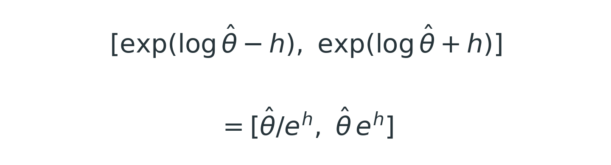

*式（7）｜对数尺度上的加减对称，对应原尺度上的倍数关系。*

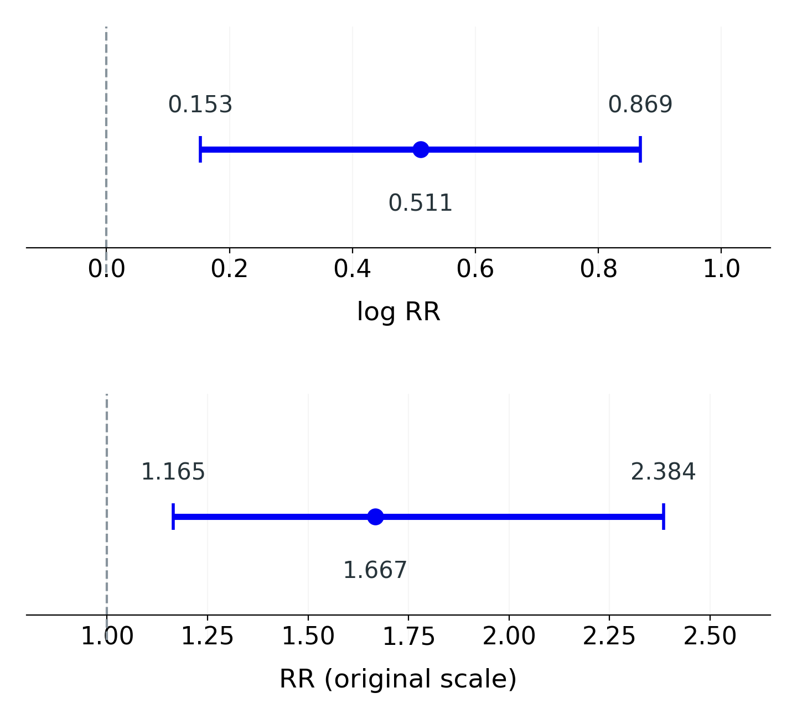

*图1｜本例RR区间。上半幅使用log RR刻度，中心为log(5/3)；下半幅使用RR原尺度，中心为5/3。两幅的虚线分别标出无差异值0和1。线段与圆点表示同一组区间和点估计。*

接下来回到尚未回答的问题：这两个标准误究竟从哪里来？

## 四、函数的局部斜率，怎样改变抽样波动？

先回到已学的样本率。设一组的达标人数为X，样本量为n，总体达标概率为p；在二项模型下，X服从Binomial(n,p)，样本率p̂ = X/n，其方差为：


*式（8）｜二项模型下样本率的精确方差。*

如果把样本率换成log p̂，波动会怎样变？

先用一个小变化看直觉。p从0.50增加到0.51，增加了0.01；log p从log 0.50增加到log 0.51，增加约0.0198，接近0.02。因为log函数在0.50处的斜率是1/0.50 = 2，小范围内，输入变化0.01，输出就大约变化2 × 0.01。

p从0.30增加到0.31时，同样增加0.01，log p增加约0.0328，接近(1/0.30) × 0.01。局部斜率越大，同样大小的输入变化，带来的输出变化也越大。

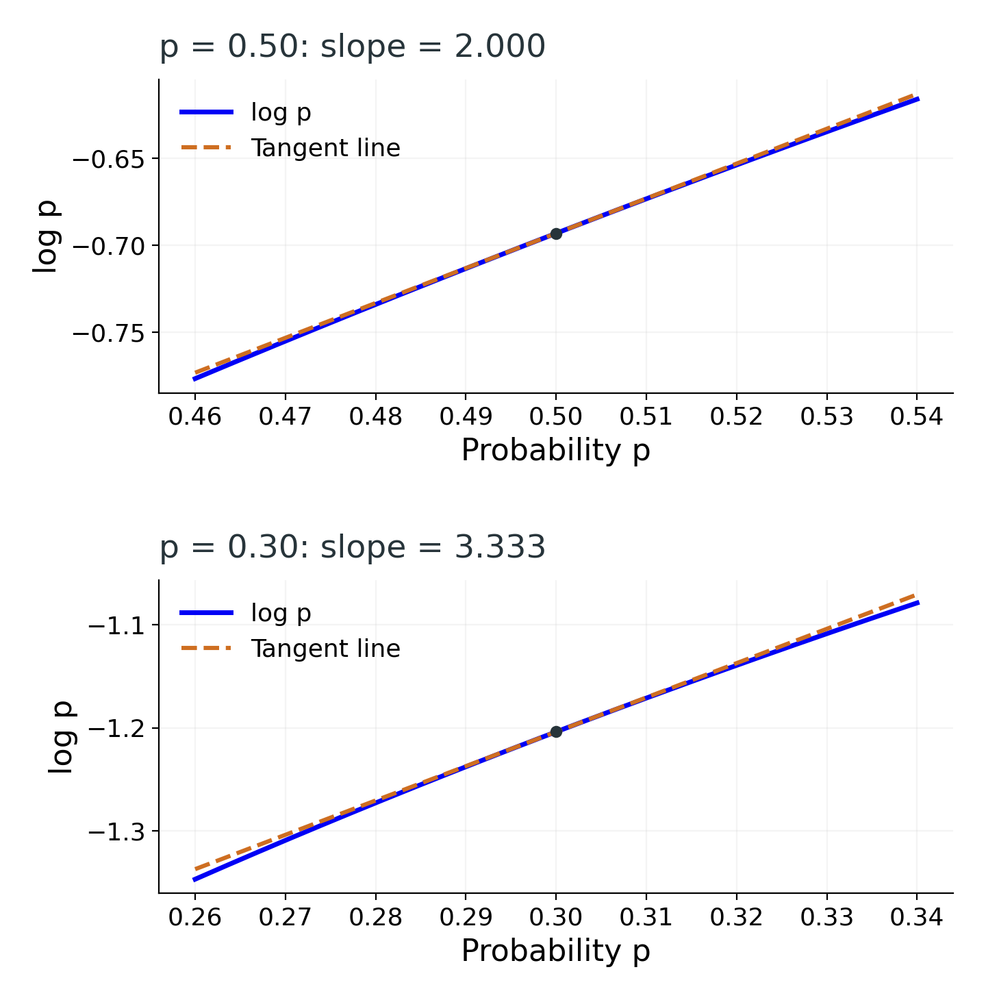

*图2｜蓝线为log p，橙色虚线为中心点处的切线。两幅都显示中心点左右0.04的范围，横轴为概率p，纵轴为log p；纵轴显示范围分别设置。小范围内，切线可近似曲线。*

先复习一下Taylor（泰勒）展开。设h是自变量相对于p的一小段变化。对于本篇的平滑函数g，在p处展开，可以依次写出常数项、一次项和二次项；其中g″(p)是二阶导数，R₂(h)表示保留到二次项之后的余项。

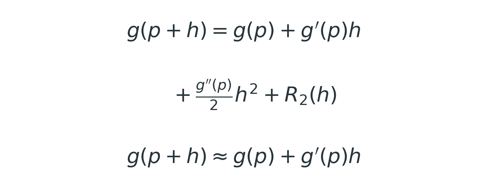

*式（9）｜Taylor展开与一阶近似。一次项对应函数在p处的切线。*

当h足够小、函数在附近变化平稳时，二次项及余项的影响可以较小。**只保留常数项和h的一次项，就得到一阶Taylor近似，也就是用切线近似附近的曲线。**

以g(p) = log p为例，求导得g′(p) = 1/p，g″(p) = −1/p²。在p = 0.50、h = 0.01时，一阶近似给出的变化是2 × 0.01 = 0.0200；二次项为−0.0002。加上二次项，变化约为0.0198，与前面直接计算的log 0.51−log 0.50一致到小数点后四位。

回到抽样问题，把h换成p̂−p：这段变化会随样本而变，p仍是固定的总体概率。式（9）的一阶近似于是写成：


*式（10）｜在p附近保留一阶项的Taylor近似。*

式（10）把变换后的随机偏离，近似写成了样本率偏离p的大小乘以g′(p)。其中p、g(p)和g′(p)都是固定量，随机变化来自反复抽样得到的p̂。

**这里求导的对象是变换函数g(p)。** 式（8）的p(1−p)/n是前面已得到的样本率方差公式，后面直接代入；其中p仍是未知但固定的总体概率。先对式（10）右侧的近似表达式求方差：加减固定量不改变方差，乘以固定的g′(p)，方差就乘以[g′(p)]²。因此：

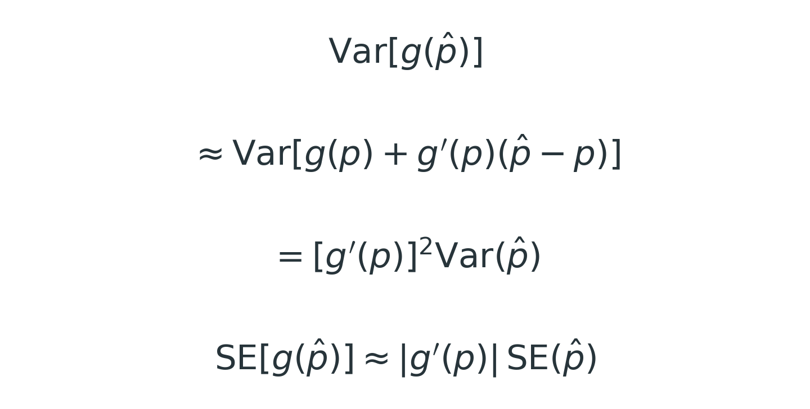

*式（11）｜局部直线近似给出的方差与标准误近似。*

**标准误按斜率的绝对值缩放，方差按斜率的平方缩放。** 这种用Taylor近似传递抽样波动的办法，称为Delta方法<sup>[1]</sup>。

样本量增大时，样本率通常更集中在总体p附近，局部直线近似才更有依据。对本篇的log和logit变换，还需要p处在0与1之间，避开函数的边界。

正态近似也由这里衔接起来：大样本下，样本率的标准化抽样波动趋近标准正态；一阶近似把这种波动乘以固定斜率，于是变换后的估计量也能使用相应的大样本正态近似<sup>[1]</sup>。

**原始患者记录仍是“达标/未达标”的0/1数据。这里取对数的是样本率及其比值，并没有把每个0/1观察取log后变成正态数据。**

## 五、从一个率的方差，推到log RR的标准误

先将导数g′(p) = 1/p代入式（11），得到原方差乘以1/p²；再将式（8）的Var(p̂) = p(1−p)/n代入，并约去分子、分母中的一个p：

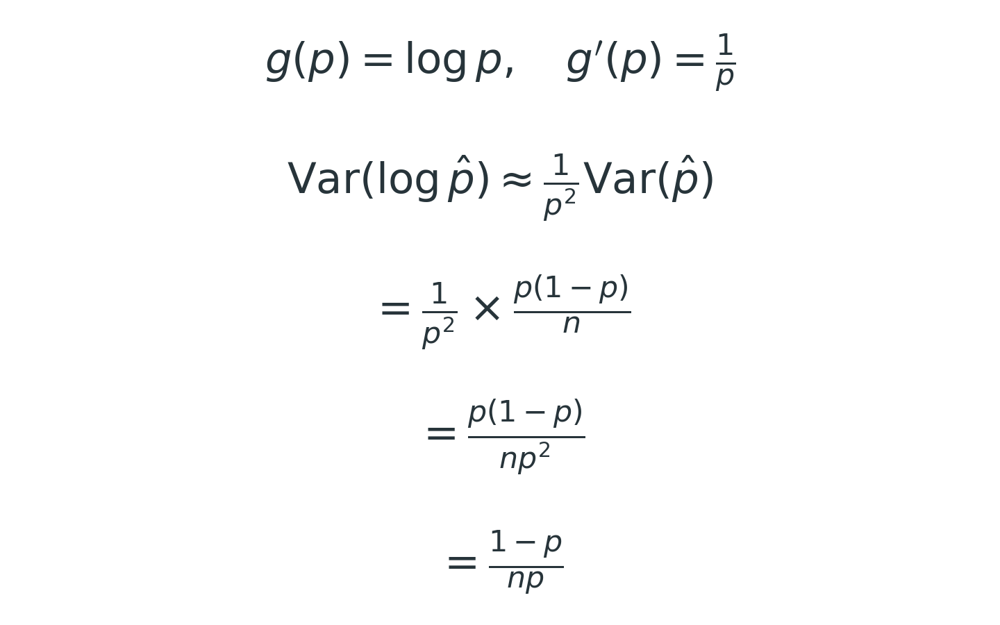

*式（12）｜逐步代入二项样本率方差，再约分得到log样本率的大样本方差近似。*

RR的对数估计量等于log p̂₁−log p̂₀。两组样本独立，各自的函数也独立，所以这个差的方差是两项方差相加。

这里容易出现一个疑问：既然是作差，为什么方差仍然相加？因为独立的U、V协方差为0，Var(U−V) = Var(U)+(−1)²Var(V)，负号平方后变为正号。

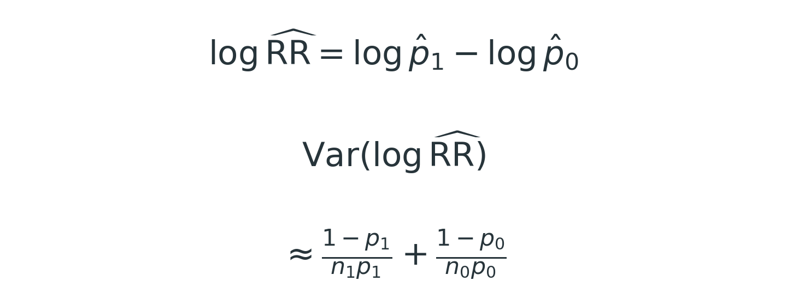

*式（13）｜两组独立时，log RR估计量的两项方差相加。*

式（13）仍含未知的总体概率。实际计算时，用各组样本率代替相应的总体概率。

为了与四格表常见记号对应，把新方案组的达标、未达标人数记为a、b，对照组记为c、d。本例a = 50、b = 50、c = 30、d = 70；n₁ = a+b = 100，n₀ = c+d = 100。

例如新方案组的方差项，用p̂₁ = a/n₁代入后，(1−p̂₁)/(n₁p̂₁)就化为1/a−1/n₁。对照组同样处理，最后将估计方差开平方。

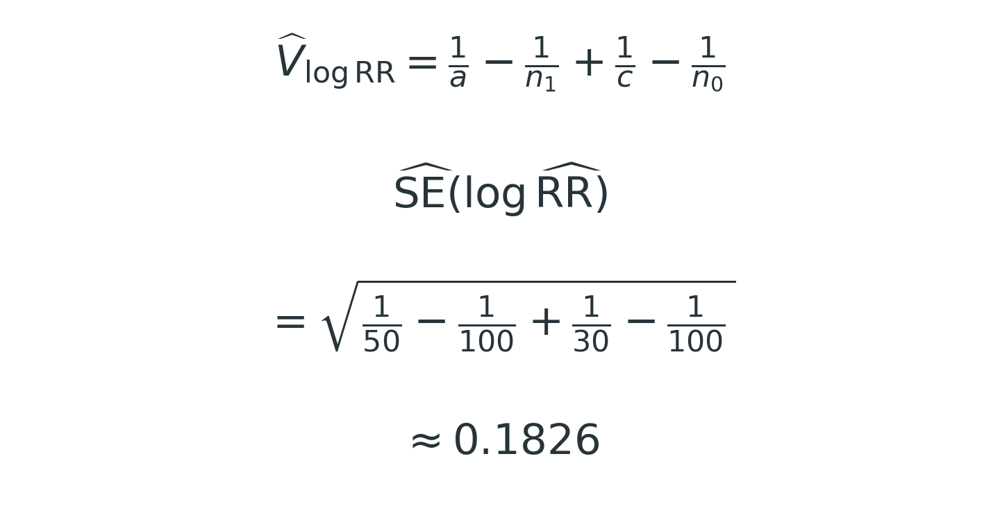

*式（14）｜本例SE(log RR)的来源。V̂表示用样本率代入后得到的估计方差。*

现在，区间计算中用到的第一个标准误就有了来路：**二项样本率方差 → log函数的局部斜率 → 两组独立方差相加 → 代入样本率并开平方。**

## 六、为什么log OR的标准误里，有四个人数的倒数？

OR比较两组优势，因此先展开一个组的log优势函数：logit(p) = log[p/(1−p)] = log p−log(1−p)。

对p求导，log p的导数为1/p；−log(1−p)求导时，外面的负号与里面1−p求导产生的负号抵消，得到+1/(1−p)。两项相加为1/[p(1−p)]。再将局部斜率的平方乘以样本率方差：

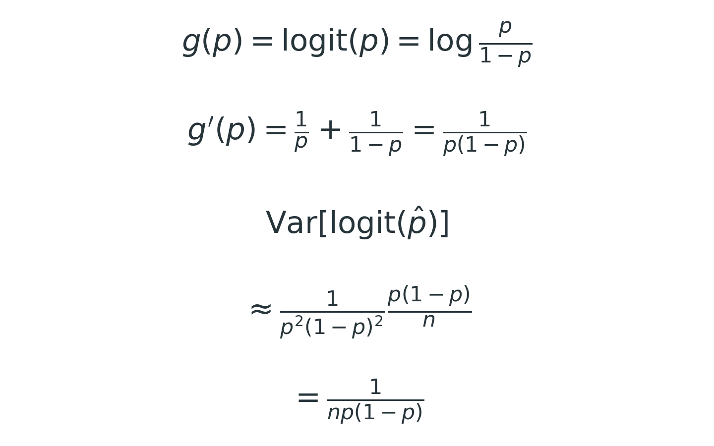

*式（15）｜一个组的log优势及其大样本方差近似。*

用新方案组的p̂₁ = a/n₁代入式（15），且b = n₁−a，可以得到：


*式（16）｜一个组的log优势方差项，包含达标与未达标人数的倒数。*

式（16）为什么同时出现a和b？因为优势由达标人数与未达标人数共同决定。**我们把它们看成同一个p的函数，已在logit的斜率中一并处理；a、b不是两个独立计数，它们的和固定为n₁。**

接着，把两组的log优势相减，就得到log OR的估计量：


*式（17）｜log OR是两个log优势之差。*

两组独立，方差相加。新方案组贡献1/a+1/b，对照组贡献1/c+1/d，再开平方，就得到熟悉的四项公式<sup>[2]</sup>。

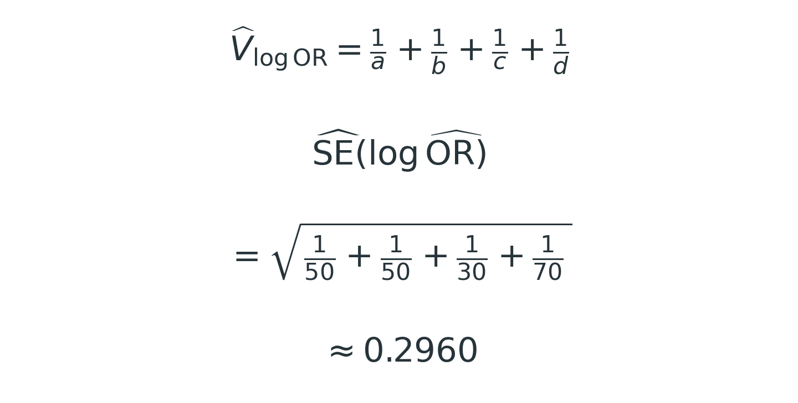

*式（18）｜本例SE(log OR)的来源。*

这与log RR的推导遵循同一套思路，只是变换函数不同：RR用log p，OR用logit(p)，因此局部斜率不同，最后得到的方差项也不同。

## 七、用R核对时，参数要与推导一致

先按表格原来的方向建立矩阵。`matrix()`生成矩阵；`byrow=TRUE`表示把给出的人数按行放入，第一行新方案、第二行对照，第一列达标。

```r
tab <- matrix(
  c(50, 50, 30, 70),
  nrow = 2, byrow = TRUE,
  dimnames = list(
    group = c("new", "control"),
    outcome = c("success", "failure")
  )
)
tab
#          outcome
# group     success failure
#   new          50      50
#   control      30      70

# qnorm输入左侧累计概率，返回标准正态分位点。
z <- qnorm(0.975)
round(z, 4)
# [1] 1.96
```

`DescTools::RelRisk()`根据四格表计算RR，`DescTools::OddsRatio()`计算OR。`conf.level=0.95`指定95%置信水平；`method="wald"`指定本篇使用的对数尺度Wald构造。返回向量依次给出点估计、区间下限和上限。`round(结果, 4)`只将显示值四舍五入到小数点后四位，原变量保留完整精度。

RR还需要显式指定`delta=0`，才能与式（14）一致。**这里的参数`delta`与前面介绍的Delta方法是两回事**<sup>[3]</sup>。

```r
rr_ci <- DescTools::RelRisk(
  tab, conf.level = 0.95,
  method = "wald", delta = 0
)
round(rr_ci, 4)
# rel. risk   lwr.ci   upr.ci
#    1.6667   1.1653   2.3837

or_ci <- DescTools::OddsRatio(
  tab, conf.level = 0.95,
  method = "wald"
)
round(or_ci, 4)
# odds ratio   lwr.ci   upr.ci
#     2.3333   1.3062   4.1681
```

`RelRisk()`默认使用`method="score"`；改用`method="wald"`时，默认仍有`delta=0.5`。本次运行的DescTools 0.99.60会把该常数加到Wald方差计算中的达标计数a、c上。本例要复现式（14），请明确写`delta=0`；否则区间约为[1.1700，2.3742]。

OR这里显式使用`method="wald"`，与式（18）及指数还原步骤对应<sup>[4]</sup>。

还有一个常见的比较：把同一张表交给`fisher.test()`，R给出的OR估计约为2.3232，95%区间约为[1.2562，4.3515]。

这些数值与2.3333及本例OR区间略有不同，因为`fisher.test()`使用条件最大似然估计，并在固定边际合计数的条件下构造精确区间；本篇使用样本交叉乘积比ad/(bc)和对数尺度Wald近似。它们的估计与区间构造不同<sup>[5]</sup>。

软件结果有差别时，先确认比较的是同一个参数、同一个方向，以及同一种估计与区间方法。

## 八、这套推导在什么条件下使用？

本文以**两个独立二项样本**为基础：不同患者的观察独立，两组独立，各组内采用共同的达标概率。对数与logit处的局部近似还要求总体概率在0与1之间，实际样本不能过分稀疏。

本例四格人数为50、50、30、70，均远离0。作为便于入门的经验筛查，可以先查看每组达标和未达标人数是否都至少为10；本例满足。这个计数检查不保证区间的实际覆盖率恰好等于95%，也不能替代研究设计和模型条件的判断。

RR的达标计数a或c为0时，本文的log RR计算及对应倒数项失效；仅未达标计数b或d为0时，RR公式仍可能算出数值，但边界下的近似需要重新判断。OR的四格中任一格为0，本文的log OR及四项倒数公式就无法直接使用。

计数很小时，即使能算出数值，对数尺度的正态近似也可能不够好。需要根据研究设计和所估计的参数选择得分、似然或适当的精确区间等方法，不能把加0.5当作所有稀疏表都适用的统一处理。

同一批患者的前后资料属于配对设计，不能直接套用这里“两组独立，方差相加”的推导。

本文的方差式是总体概率位于内部时的一阶大样本近似，不是log变换后统计量的有限样本精确方差。有限样本仍可能抽到零计数，这正是上述边界问题需要单独处理的原因。

同样，95% log-Wald区间中的“95%”是这种近似构造在相应模型下的长期覆盖率目标。它不表示算出区间后，固定的总体参数有95%的概率落入这个已固定区间。

## 本篇讲了哪些知识？

- **RD、RR、OR比较的量不同。** RD比较概率差，RR比较概率比，OR比较优势比；OR的倍数不能直接解释成概率的倍数。
- **对数把比值变为差，也把无差异值1变为0。** 在满足大样本近似条件时，可对log RR、log OR构造Wald区间，再将端点取指数；原尺度区间通常不关于点估计左右对称。
- **变换后的抽样波动取决于局部斜率。** 一阶Taylor近似使方差约乘以斜率的平方，标准误约乘以斜率的绝对值。这是本文使用Delta方法的关键。
- **两个标准误公式来自不同变换。** log p的斜率为1/p，推到式（14）；logit(p)的斜率为1/[p(1−p)]，推到式（18）。两式都依赖两组独立，并用各组样本率代入未知概率。
- **logit是概率的变换函数。** 本文利用局部直线近似传递抽样波动，区间依据的是相应估计量的大样本正态近似。
- **计算尺度与软件方法需要一致。** 本文使用对数估计量的估计SE和标准正态0.975分位点，RR设`method="wald", delta=0`，OR设`method="wald"`；零计数或稀疏资料要重新判断方法。

回到开头的问题：标准误里的那些人数倒数，是从二项样本率方差经函数变换一步步推出来的；对数尺度让比值成为差，并为满足条件时的正态近似和区间构造提供了便利。

## 配套练习与资料

和前面的统计课堂一样，这次准备了R、Python和MATLAB三套脚本。用自己熟悉的一种跑通即可。

第一次先核对本例的点估计、两个对数标准误，以及还原后的区间。第二次交换两组的顺序，看看为什么比值变为倒数，区间端点也要倒过来取倒数。还可以将四格人数同时乘以4：样本率和两个比值不变，标准误应怎样改变？

R入口为`代码/rr_or_log_wald.R`，Python入口为`代码/rr_or_log_wald.py`，MATLAB入口为`代码/rr_or_log_wald.m`。下载后先读README，再按分节顺序运行。

本篇完整项目（代码、共享数据、运行结果与文章配图）：https://github.com/fuyuming/statistics-classroom/tree/main/stats_classroom/rr_or_log_wald

系列仓库：https://github.com/fuyuming/statistics-classroom

仓库ZIP下载：https://github.com/fuyuming/statistics-classroom/archive/refs/heads/main.zip

下载仓库ZIP并解压后，进入`statistics-classroom-main/stats_classroom/rr_or_log_wald/`，先读本篇README，再选择一种语言按节运行。

这里是“明哥的微生物世界”。我们继续把统计课堂里没讲透的地方，慢慢讲清楚。

## 参考资料

1. UC Berkeley，Stat 135：Functions of Estimators and the Delta Method，Taylor近似、方差传播与渐近正态性。https://stat135.berkeley.edu/fall-2026/Modules/11-DeltaMethod.html
2. Mills，STAT5602课程讲义，Two-Way Contingency Tables，RR、OR及Delta方法推导。https://people.math.carleton.ca/~smills/2015-16/STAT5602/pdf/Lecture2B-revised-2015.pdf
3. DescTools官方说明：RelRisk。https://andrisignorell.github.io/DescTools/reference/RelRisk.html
4. DescTools官方说明：OddsRatio。https://andrisignorell.github.io/DescTools/reference/OddsRatio.html
5. R官方说明：fisher.test。https://stat.ethz.ch/R-manual/R-devel/library/stats/html/fisher.test.html
