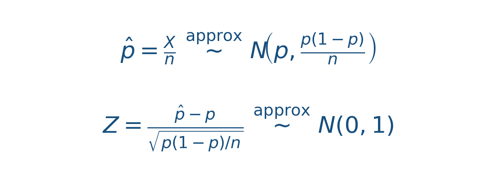
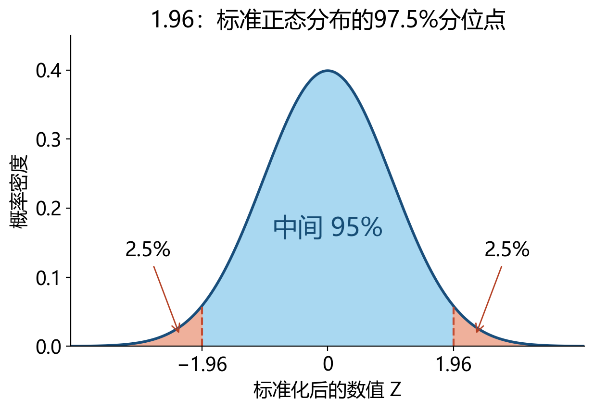
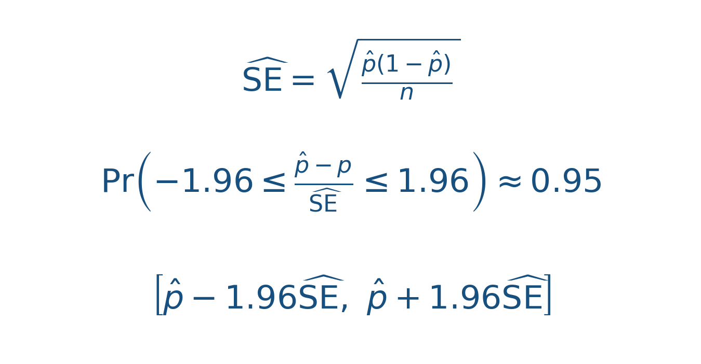
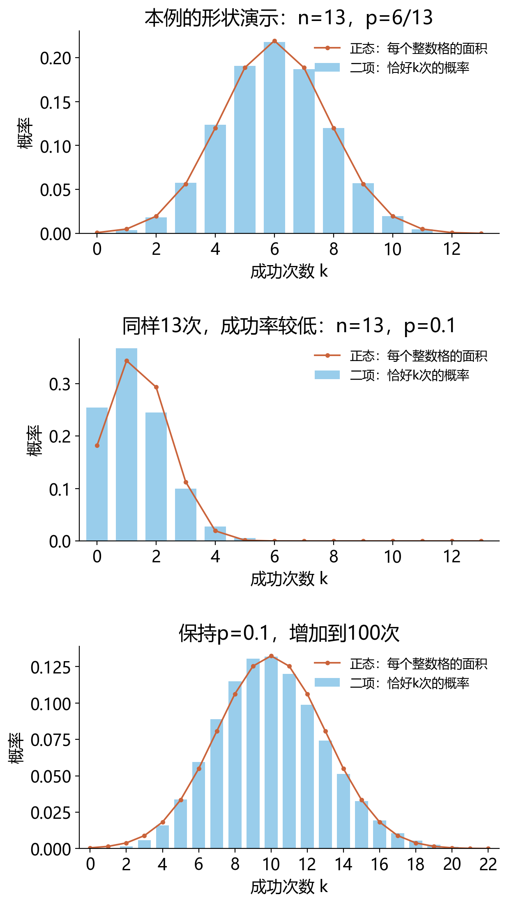
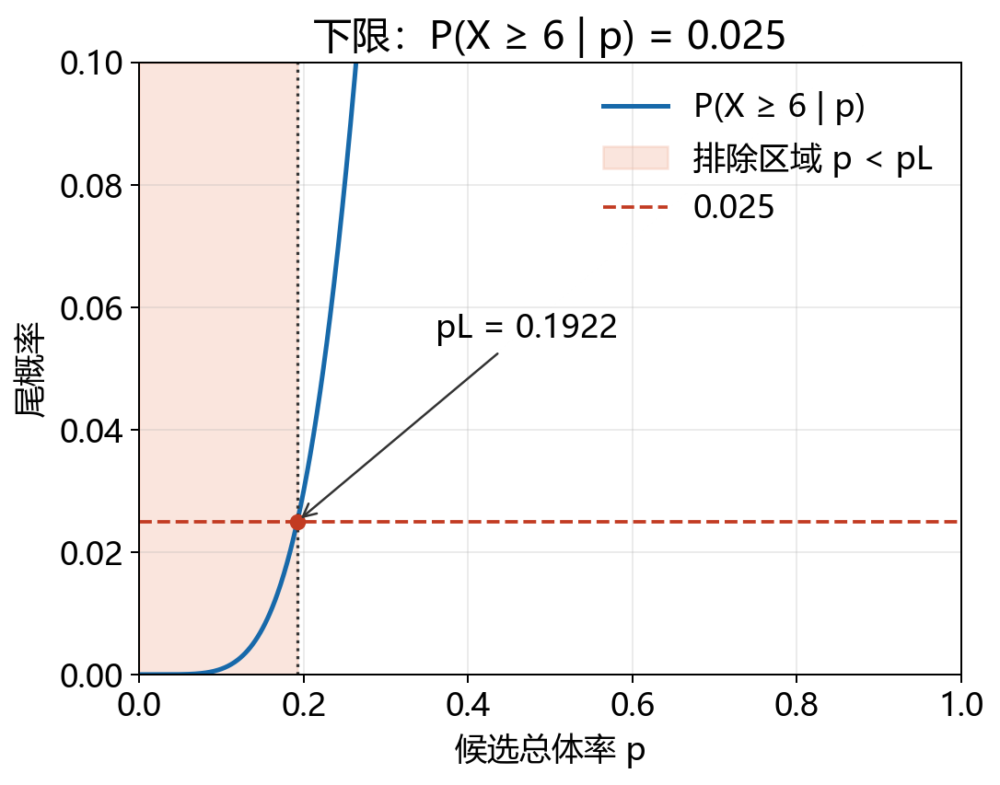
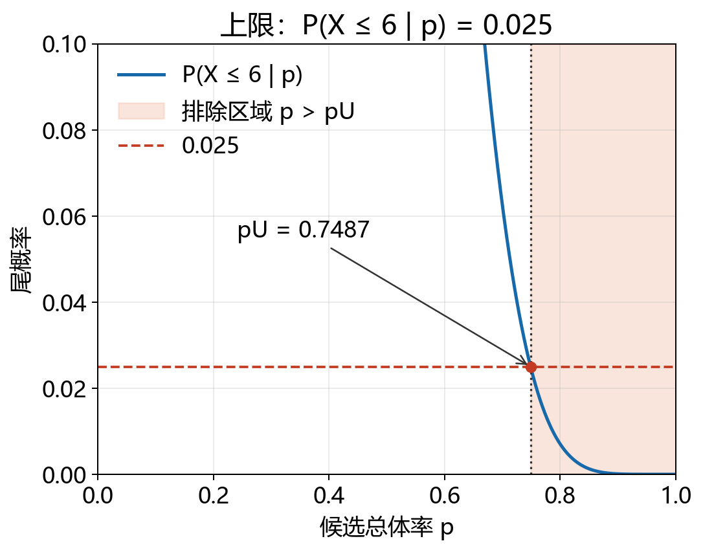
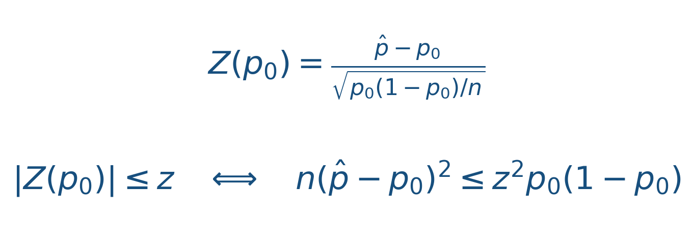
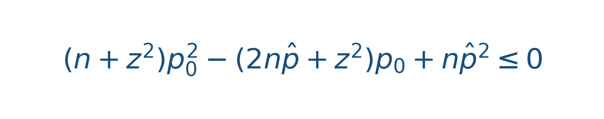

# 小样本率的置信区间从哪里来？从6/13一步步找到上下限

> 明哥的微生物世界 · 统计课堂 14
>
> 摘要：从课堂上“调p找区间”和课后“1.96从哪来”两个问题出发，回顾样本率的正态近似与Wald推导，再用6/13演示Clopper–Pearson区间的扫描求解；最后补充Wilson原理及连续性校正的作用。


大家好，我是明哥。

第9课讲小样本率的置信区间时，我说，可以不断调整候选的总体率 p，直到相应的二项尾概率接近0.025，就找到了区间的一个端点。尾概率在这里指的是，在候选p下出现“6人或更多”或“6人或更少”的概率，两侧分开计算。这里“试”的是候选总体率；已经观察到的人数和样本率都不再改变。

课后还有同学问：大样本近似公式里的1.96究竟从哪里来？这篇就从这里补起，先回顾样本率的正态近似和Wald区间，再把课上“调 p 找上下限”的过程画出来。最后单独补充Wilson区间的原理，这部分课上没有展开。

仍用教材里的例子：13名妇女接受壶腹部吻合术后，观察到6人受孕。资料来自颜艳《医学统计学》第5版例6-2、例6-5（第92—94页）。这里把“受孕”记为成功，先看6/13怎样变成一个区间。

## 一、先回顾：样本率的正态近似与1.96

**（一）样本率围绕什么波动？**

本例观察到 x=6、n=13，样本率 p̂=6/13≈46.15%。这个数是本次观察的结果。我们想估计的总体率记为 p；换一批13人，成功人数可能改变，样本率也会跟着改变。

在独立、每人成功概率同为p、试验次数n固定的二项模型下，成功人数 X 的均数为 np、方差为 np(1−p)。样本率是 X/n，因此它的均数为p，方差为p(1−p)/n。两类期望计数 np 和 n(1−p) 都足够大时，才进一步使用下面的正态近似：



这里 N 后面两个位置分别写均数和方差。**样本率本身近似服从以p为中心的正态分布；减去p、再除以标准误之后，才近似服从标准正态分布 N(0,1)。** 标准误描述换一批同样大小的样本时，样本率会有多大波动。

**（二）1.96是怎样查出来的？**

95%双侧区间把中间的95%留下，外面还剩5%，左右各留2.5%。对标准正态分布，右端点左边的累计概率是97.5%，查这个分位点就得到1.959964，通常写成1.96；左端点相应为−1.96。



*图1｜阴影表示曲线下的面积，也就是概率。−1.96与1.96之间约占95%，不是曲线在这两个位置的高度等于0.025。*

```r
qnorm(0.975)
# [1] 1.959964

pnorm(1.96) - pnorm(-1.96)
# [1] 0.9500042
```

`qnorm()`输入累计概率、返回横轴上的分位点；`pnorm()`输入横轴上的数值、返回它左边的累计概率。1.96是95%双侧区间对应的标准正态分位点，不是由这13人的数据算出来的。

**（三）从这一步得到Wald区间**

总体p未知，标准误也就未知。Wald方法用观察到的样本率p̂代替标准误里的p，得到估计标准误 SÊ。再利用标准化统计量近似落在−1.96与1.96之间这一关系，把不等式改写为关于p的区间：



先乘回正的标准误，得到“样本率与总体率的差在正负1.96个标准误内”；再移项，把p放到中间，就得到上下限。这里的95%依赖大样本近似，并不是所有样本量下都恰好达到95%。

```r
x <- 6
n <- 13
p_hat <- x / n
se_hat <- sqrt(p_hat * (1 - p_hat) / n)
z <- qnorm(0.975)
p_hat + c(-1, 1) * z * se_hat
# [1] 0.1905457 0.7325312
```

本例估计标准误为0.138264，Wald 95%区间约为 **19.05%—73.25%**。注意，推导中把未知p代成p̂，也是近似的一部分。

**（四）为什么小样本时还要谨慎？**

常用的检查是两类期望计数 np、n(1−p) 至少为5，有时采用更保守的10。估计区间时p未知，常用n p̂和n(1−p̂)作粗略检查；本例是6和7。达到某个计数门槛，并不能保证Wald区间在所有p下都有接近95%的覆盖率。

下面固定不同的n和p，直接画二项概率。第一幅令p=6/13只是形状演示，不是在认定真实总体率就是6/13。



*图2｜蓝柱为恰好出现k次成功的二项概率；橙点为正态分布在k−0.5到k+0.5之间的面积，即连续性校正后的近似概率。两者比较的都是概率，不把密度高度当概率；前两幅显示0—13次，第三幅只显示0—22次，右侧极小尾部未画出；三个面板的横轴范围不同。*

n=13、p接近0.5时，分布已较对称，但成功数仍只能取整数；同样n=13，把p改为0.1，分布明显右偏；保持p=0.1而把n增加到100，正态近似的形状更接近二项分布。这说明不能只看“样本小不小”，还要看成功与失败的期望计数，以及p离0、1有多近。图中用了连续性校正来便于逐格比较，它并不等于上面未经校正的Wald区间。

Wald的对称区间还可能越过0或1。例如9/10的Wald区间上限会超过1；若0/10，代入的标准误会变成0，区间退化成[0,0]。都没有成功，并不意味着总体成功率已被证明为0。接下来使用二项概率直接找端点，看看如何处理这些问题。

## 二、先把问题写成二项分布

令 X 表示13名妇女中受孕的人数。在给定一个候选总体率 p 后：

> X ∼ Binomial(n = 13, p)。

这里的 p 是“如果总体率真的是这个数，重复抽取13人时每个人成功的概率”；X是重复抽样时可能变化的成功人数；小写x=6是本次已经观察到的人数，固定不动。我们要做的是改变候选的 p，看看在这个候选值下观察到6人受孕是否太不寻常。

这个模型有几个容易被一句“二项分布”遮住的条件。每名妇女只贡献一次结果；结果只有成功或失败两类；在研究设定下每个人的成功概率可视为同一个p；不同人的结果相互独立；13这个试验次数是在看数据前确定的。若同一名妇女被重复计数、不同人的手术条件差异很大，或者样本是根据已经看到的结果才决定何时停止，下面的覆盖率保证就不能直接照搬。精确计算并不会自动修复研究设计问题。

还要分清“95%覆盖率”的含义。它说的是：如果在同样规则下反复抽样、每次都这样构造区间，至少95%的区间会覆盖真实p（长期覆盖比例）。它不是说本次算出的区间中，真实p有95%的概率随机移动；本次数据给出的端点仍然是确定的两个数。

这一步很容易被写反：不是让X在6、7、8之间寻找一个临界计数，而是保留已经观察到的6，沿着0到1之间的候选 p 逐个检查。对每一个候选 p，都可以计算二项分布的尾概率。

## 三、下限：太小的p会让“至少6人受孕”变得罕见

假设候选总体率是 p。若 p 很小，13人里还能观察到6人或更多成功就不太容易。随着候选p从小往大增加，下限 pL 是这条右尾概率恰好升到0.025的位置：

> Prₚ(X ≥ 6) = 1 − Prₚ(X ≤ 5) = 0.025。

写成R的二项分布函数，就是：

> `right = 1 - pbinom(5, size = 13, prob = p)`。

把它展开，实际计算的是：

> Prₚ(X ≥ 6) = Σ<sub>k=6</sub><sup>13</sup> C(13,k) p<sup>k</sup>(1−p)<sup>13−k</sup>。

每一项对应“恰好有k人受孕”的概率，所有k = 6到13的互斥结果相加，才是“至少6人”的概率。随着候选p增大，这个右尾概率单调增大，因此只会有一个穿过0.025的下限交点；这也是二分法能够稳定工作的原因。

用1减去Pr(X≤5)，留下的正是X≥6的概率，观察到的X=6也在其中；如果误写成`1 - pbinom(6, ...)`，就把已经观察到的6排除了。解这个方程得到：

> pL = 0.192232 ≈ 19.22%。

当候选 p 小于pL时，观察到6人或更多的概率小于2.5%，这个候选值落入下方的排除区域；当 p 大于pL时，右尾不再小于2.5%。所以这条边界从“观察到的6”向下排除了过小的总体率。



*图3｜横轴是候选总体率p，纵轴是Prₚ(X≥6)。图中纵轴局部放大到0—0.10，水平线是0.025；交点给出pL。交点左侧的候选值使“至少6人成功”过于罕见，因此被排除。*

## 四、上限：太大的p会让“至多6人受孕”变得罕见

如果候选 p 很大，13人里只观察到6人或更少又不太容易。上限 pU 用另一条尾概率定义：

> Prₚ(X ≤ 6) = 0.025。

对应的R写法是：

> `upper = pbinom(6, size = 13, prob = p)`。

同样地，

> Prₚ(X ≤ 6) = Σ<sub>k=0</sub><sup>6</sup> C(13,k) p<sup>k</sup>(1−p)<sup>13−k</sup>。

候选p越大，落在0到6之间的概率越小，所以这一次的排除区域在右边。下限用“右尾至少6”，上限用“左尾至多6”；两边的计数阈值都包含观察到的6，正是等尾反演的关键。

这一次要把X = 6包含在左尾里，所以参数是6而不是5。解方程得到：

> pU = 0.748655 ≈ 74.87%。

当候选 p 大于pU时，观察到6人或更少的概率小于2.5%，候选值落入上方的排除区域；p小于pU时，这个左尾还没有小到需要排除。



*图4｜横轴是候选总体率p，纵轴是Prₚ(X≤6)。图中纵轴局部放大到0—0.10，水平线是0.025；交点给出pU。交点右侧的候选值使“至多6人成功”过于罕见，因此被排除。*

把两边放在一起，95% Clopper–Pearson区间就是：

> **0.192232 ≤ p ≤ 0.748655**，即 **19.22%—74.87%**。

这里的“95%”来自两侧各排除0.025。区间保留的是没有被这两个等尾单侧检验排除的候选总体率。

## 五、端点不是凭空出现的：先扫描，再二分

这就是课上说的“不断调p试出来”。更准确地说，Clopper–Pearson（CP）方法用二项尾概率定义端点；扫描和二分是寻找端点的计算办法。**“精确”指使用二项概率、不依赖正态近似，不是指扫描步长很小。** 固定步长只能先找到一段范围，之后还可以继续求根；软件也能利用Beta分布分位数直接计算同样的端点。

程序可以直接解端点，但手工看几步更能理解它的来源。先每隔0.001扫描候选 p，找到尾概率位于0.025两侧的相邻位置。下表只列出便于核对的两对点：

| 目标 | 候选p | 对应尾概率 | 怎样看 |
| --- | ---: | ---: | --- |
| 下限Pr(X≥6) | 0.19 | 0.02367214 | 低于0.025，仍在排除侧 |
| 下限Pr(X≥6) | 0.20 | 0.03003532 | 高于0.025，已经越过交点 |
| 上限Pr(X≤6) | 0.74 | 0.02994004 | 高于0.025，尚未进入上方排除侧 |
| 上限Pr(X≤6) | 0.75 | 0.02429014 | 低于0.025，越过交点 |

上表用两位小数的候选值先看方向；真正按步长0.001扫描时，较紧的相邻夹逼是下限0.192—0.193、上限0.748—0.749。配套脚本从这两段夹逼开始二分，每一轮只保留仍可能含有端点的那一半区间。

下表展示20轮二分中的5个节点：

| 轮次 | 下限候选p | Pr(X≥6) | 上限候选p | Pr(X≤6) |
| ---: | ---: | ---: | ---: | ---: |
| 1 | 0.1925000 | 0.02516264 | 0.7485000 | 0.02508250 |
| 5 | 0.1922188 | 0.02499170 | 0.7486563 | 0.02499908 |
| 10 | 0.1922334 | 0.02500058 | 0.7486553 | 0.02499960 |
| 15 | 0.1922325 | 0.02500001 | 0.7486545 | 0.02500000 |
| 20 | 0.1922324 | 0.02500000 | 0.7486545 | 0.02500000 |

继续增加轮数，候选p和尾概率会分别逼近上面的端点和0.025。二分法不是另一种统计方法，它只是把“解尾概率等于0.025的方程”做成了初学者可以逐轮观察的数值过程。

## 六、“精确”指什么？和R的双侧P值不是同一个定义

这里的精确，是指直接使用二项分布的概率质量和尾概率，不用Wald的正态近似。在独立、每次成功概率相同且试验次数固定的二项模型下，Clopper–Pearson方法保证实际覆盖率至少达到名义的95%。由于二项分布是离散的，覆盖率通常会略高；这并不意味着它总是区间最短或最优。

R的`binom.test(6, 13)`会返回这个Clopper–Pearson区间。它的双侧`p.value`先找出：在原假设下，哪些计数结果的概率不大于观察结果的概率；再把这些结果的概率相加。本篇区间的两个端点则分别反演两个等尾单侧检验。两者在许多例子中方向一致，却不能笼统说成“把R的双侧P值反演一下”。

换个角度看，置信区间可以被读成一张“候选p的清单”：对清单里的每个p，假设它就是总体率，分别检查两侧尾概率；两侧都没有小到0.025以下，就留下这个p。这个过程不需要先把每一个可能的X模拟出来，也不需要把样本率当成服从正态的连续数。二项分布的概率质量正好保留了“只能取0、1、……、13”的离散结构。

例如观察到9/10成功，检验总体率是否为0.7，R给出的双侧P值为 **0.2996**；对应的95% Clopper–Pearson区间约为 **55.50%—99.75%**，0.7落在区间内。这个例子可以帮助我们把“检验某个预先给定的p”与“给所有合理p组成区间”联系起来，同时保留两种尾部定义的区别。

## 七、边界案例提醒我们：单侧和双侧要说清楚

如果10人中没有1人受孕，x = 0，样本率是0%，但总体率并不因此被证明为0。95%双侧Clopper–Pearson区间的上限为：

> 1 − 0.025<sup>1/10</sup> = 0.308497，约30.85%。

若问题从一开始就是“总体率的95%单侧上限”，只在一个方向排除5%，上限改为：

> 1 − 0.05<sup>1/10</sup> = 0.258866，约25.89%。

两个数字不同，是因为双侧95%把α=0.05分成两边各0.025；单侧95%把全部0.05放到一边。看到“0人成功”时，先看研究问题是双侧区间还是单侧上限。

实际报告时，可以把方法和条件一并写出来：“13例中6例成功，样本率46.15%；按独立同p的二项模型计算，95% Clopper–Pearson区间为19.22%—74.87%。”这句话把观察比例、模型和区间分开了。它没有把区间说成13名妇女各自的未来概率，也没有暗示教材案例本身已经代表所有接受该手术的人群。外推到目标人群，还需要研究对象、随访时间和纳入标准相符。

## 八、课外补充：Wald与Wilson究竟差在哪里？

到这里，课上“调p找CP区间”的问题已经解释完了。Wilson区间作为课外补充，下面说明它与Wald、CP的区别。

两种方法都用正态近似，也都用约1.96作95%双侧区间的界值，看起来确实很像。**区别在标准误：Wald用观察到的样本率计算，Wilson用正在检验的候选总体率计算。**

先看本例的Wald：样本率是6/13≈0.4615，用它算出的标准误为0.138264。接下来无论考察总体率是20%、30%还是50%，Wald都使用这个标准误，最后在0.4615两边加减1.96×0.138264。

Wilson则逐个考察候选值。假设总体率真是20%，就在20%这个假设下计算标准误；假设总体率是30%，标准误也随之重新计算。这样做，是在问：“如果这个候选值为真，这次观察偏离它多少个标准误？”

**用“总体率能否是20%”来比一次，就能看出差别。** 两种方法的分子都是0.461538−0.20=0.261538；下面都暂不作连续性校正，只比较标准误的取法：

| 方法 | 标准误怎么计算 | 标准化后的差值 | 与1.96比较 |
| --- | --- | --- | --- |
| Wald | 用样本率6/13：标准误0.138264 | 0.261538÷0.138264=1.892 | 未超过1.96，保留20% |
| Wilson对应的得分检验 | 用候选总体率0.20：标准误0.110940 | 0.261538÷0.110940=2.357 | 超过1.96，排除20% |

所以，**20%在Wald区间[19.05%, 73.25%]内，却不在标准Wilson区间[23.21%, 70.86%]内。** 两者不是同一个公式换个名字；分母采用不同的p，会改变哪些候选总体率被保留下来。这里选择20%只是演示这种区别，不是另外提出一个研究假设。

Wald的区间围绕样本率对称。Wilson的标准误随候选p₀变化，不能再用一个固定标准误在样本率两边直接加减；需要把符合下面条件的p₀找出来。



这个统计量叫得分统计量（score statistic）。这里仍用标准正态近似，令z=qnorm(0.975)≈1.96。依次检查候选p₀，把满足|Z(p₀)|≤z的候选值都留下，它们组成Wilson区间。把不等式两边平方、乘回分母，再展开整理，就得到一个关于p₀的二次不等式：



这个二次式开口向上，满足条件的p₀位于两个根之间，所以求出两个根就得到区间。上面推导的是**标准的、未作连续性校正的Wilson区间**，因此代码明确写`correct=FALSE`，让软件计算与推导一致。R默认设置则是`correct=TRUE`，两种结果应分开报告：

```r
prop.test(6, 13, correct = FALSE)$conf.int
# [1] 0.2320607 0.7085620
# attr(,"conf.level")
# [1] 0.95

# R默认采用连续性校正；这里显式写出参数，便于比较
prop.test(6, 13, correct = TRUE)$conf.int
# [1] 0.2040175 0.7387967
# attr(,"conf.level")
# [1] 0.95
```

**R默认的连续性校正**

二项成功数只能取整数，正态分布却是连续的。用正态分布近似二项尾概率时，连续性校正把整数格的边界考虑进去。例如，用连续变量Y近似成功人数X，计算Pr(X≤6)时把边界放在Y=6.5，便把“6这一格”包含进来。前面的二项对照图用的也是这种半格边界。

在单样本率的得分检验中，Yates校正相当于在计数尺度上从观察数与假设期望数的绝对差中减去半个单位，最小减到0；换成率的尺度，这半格是1/(2n)。反演相应的校正检验，就得到带连续性校正的区间。本例校正后的区间为 **20.40%—73.88%**，比未校正Wilson区间更宽。

报告时注明`correct`的设置，就能知道使用的是哪个版本。本文的小样本例子仍以CP区间为主。

同一数据的区间比较如下，差异来自构造方式及是否校正：

| 方法 | 怎样计算 | 本例95%区间 |
| --- | --- | --- |
| Wald | 用p̂估计标准误，再在p̂两边加减z倍标准误 | 19.05%—73.25% |
| 标准Wilson（未校正） | 反演未校正得分检验；`correct=FALSE` | 23.21%—70.86% |
| Wilson（连续性校正） | 在计数差中考虑半格校正后反演；`correct=TRUE` | 20.40%—73.88% |
| Clopper–Pearson | 用二项尾概率，分别找到等于0.025的端点 | 19.22%—74.87% |

Wilson仍是正态近似检验的反演，不具有CP那种在二项模型下覆盖率至少95%的保证。R官方文档明确说明，单样本率的`prop.test()`区间通过反演得分检验计算；`correct=FALSE`与这里推导的未校正Wilson区间对应：https://stat.ethz.ch/R-manual/R-devel/library/stats/html/prop.test.html

## 九、把一次计算变成可检查的练习

配套项目提供R、Python和MATLAB三套入口，三种语言都固定x = 6、n = 13、α = 0.05，先核对1.96的来源，计算Wald、Wilson和Clopper–Pearson区间，再导出扫描表与20轮二分表；Python脚本同时生成正态面积图、二项近似对照图和公式图。课堂内容先核对1.96、Wald和CP扫描过程；Wilson部分可作为选读。用自己熟悉的一种语言跑通即可；第二次可以把x改成0、n改成10，比较边界为何变化。

项目目录：

https://github.com/fuyuming/statistics-classroom/tree/main/stats_classroom/small_sample_proportion_intervals

完整仓库ZIP：

https://github.com/fuyuming/statistics-classroom/archive/refs/heads/main.zip

下载并解压后，进入`stats_classroom/small_sample_proportion_intervals`目录；README中说明了三种脚本的运行方式和结果位置。

本篇的关键不在于记住某个软件按钮，而在于看见区间的两端各自回答什么问题：p太小时，6人或更多是否罕见；p太大时，6人或更少是否罕见。区间内部的两个尾概率都不低于0.025，两个端点处分别恰好等于0.025；这样，6/13才从一个观察比例变成了一个可以解释、可以核对的总体率区间。

参考资料：

- R官方文档，`binom.test`：https://stat.ethz.ch/R-manual/R-devel/library/stats/html/binom.test.html
- NIST方法说明（Wilson与精确二项区间）：https://www.itl.nist.gov/div898/handbook/prc/section2/prc241.htm
- Clopper CJ, Pearson ES (1934). The Use of Confidence or Fiducial Limits Illustrated in the Case of the Binomial. *Biometrika*, 26(4), 404–413：https://doi.org/10.1093/biomet/26.4.404

我是明哥，和你一起把统计学讲得更清楚。
