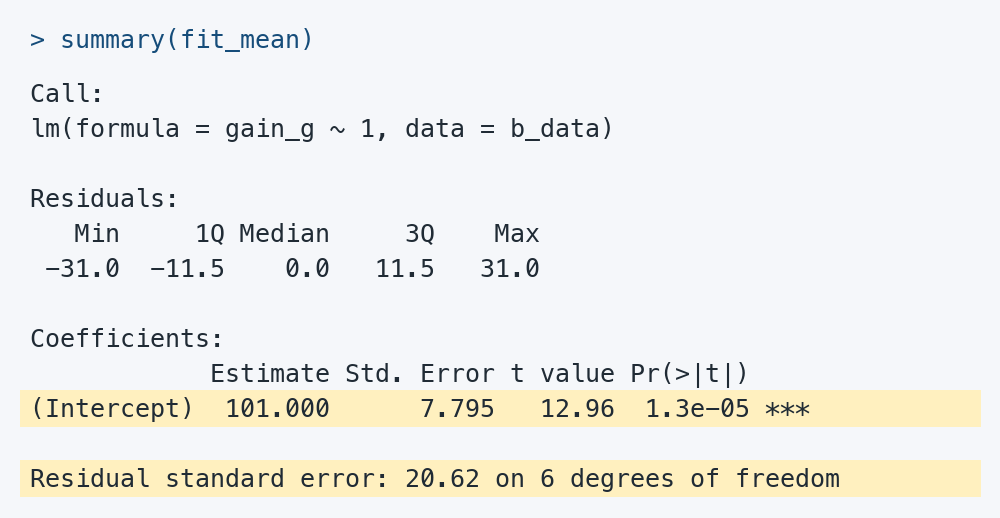
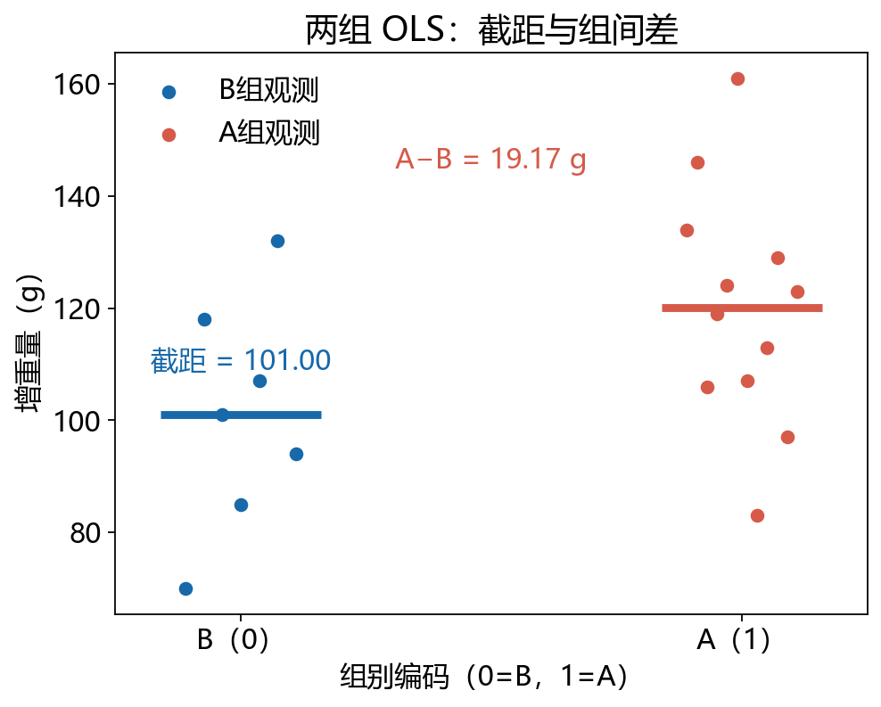
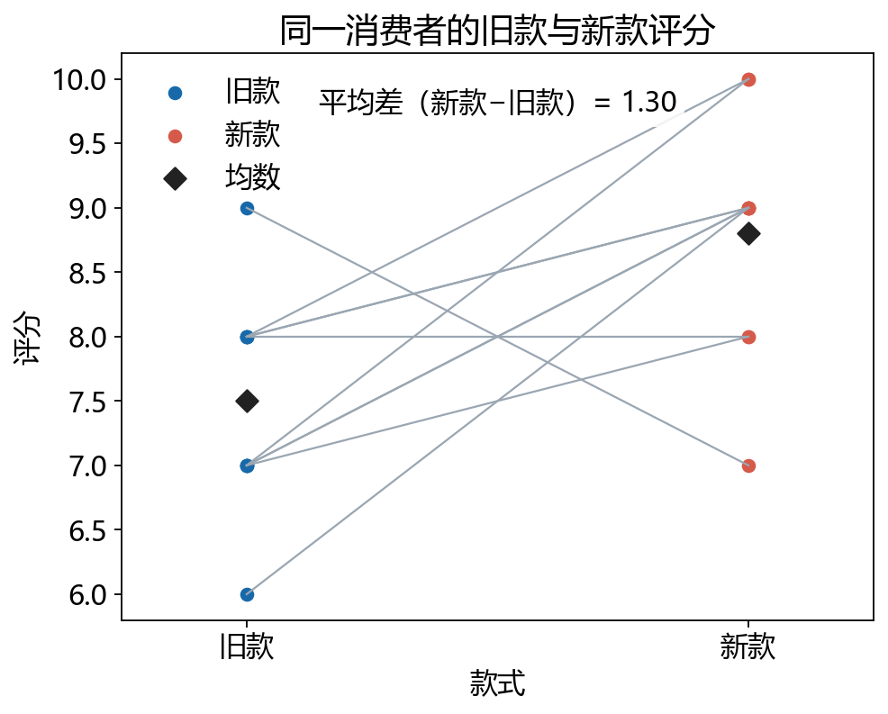

# t检验，原来也是回归：从均数比较到 y ~ group

> 明哥的微生物世界 · 统计课堂 13
>
> 摘要：R的独立两样本t检验既能输入两组向量，也能用长数据写成“响应变量 ~ 分组变量”。从课堂上这两种写法出发，我们进一步看清t检验与回归的联系，以及单样本、独立样本和配对设计各自对应什么模型。


大家好，我是明哥。

第9课讲独立两样本t检验时，我们在R里用了两种写法：一种把两组数据分别交给 `t.test()`，另一种先整理成长数据，再用公式告诉R“比较哪一列、按哪一列分组”。以合并方差t检验为例：

```r
# 常规写法：A、B分别保存两组增重量
t.test(A, B, var.equal = TRUE)

# 公式写法：长数据中，gain_g是增重量，group是分组
rat$group <- factor(rat$group, levels = c("A", "B"))
t.test(gain_g ~ group, data = rat, var.equal = TRUE)
```

两种写法回答的是同一个问题。第二种写法中，`~`左边是要分析的响应变量，右边是分组变量；长数据每行对应一只大鼠，同时记录它的增重量和所属组。这里约定 `group` 的两个水平依次为A、B，让两种写法都按A−B报告均数差。

课上展示了这两种写法，但没有把它们背后的联系讲得很细：为什么两组均数比较也能写成“响应变量 ~ 分组变量”？这个形式与回归里的 `lm(gain_g ~ group, data = rat)` 又有什么关系？

这里要留意方向：`t.test()` 按两个水平的先后计算第一组减第二组，而 `lm()` 的组系数通常是另一组减参考组。因此，后文统一用 `group01`（B=0、A=1），让回归系数明确表示 A−B。

这正是本篇的起点。沿着“数据格式—公式接口—模型”往下看，会发现：在共同方差模型下，两独立样本t检验可以写成带组变量的线性回归；单样本t检验、配对t检验也能找到相应的模型形式。我们仍用课堂上的数据，看看模型系数怎样对应均数和均数差，以及为什么它的区间和P值能与t检验对上。

## 一、先把数据摆对：一行记录一个对象

先看大鼠增重量。题干设定为1月龄开始用高、低蛋白饲料饲养，3月龄测定增重量；A 组是高蛋白饲料，12 只；B 组是低蛋白饲料，7 只，单位都是 g。数据来自李春喜《生物统计学》第6版例4-8，pp.97–98。两组的样本均数分别是：

| 组别 | 样本量 | 样本均数（g） |
| --- | ---: | ---: |
| A 高蛋白 | 12 | 120.1667 |
| B 低蛋白 | 7 | 101.0000 |

项目里的 `rat_gain_long.csv` 是一张长表：一行是一只大鼠，列里有 `id`、`group`、`group01` 和 `gain_g`。这里把 A 编码为 `group01=1`，B 编码为 `group01=0`。长表的好处是，观测值、分组和个体编号在同一行，软件可以直接按公式识别谁属于哪个组。

把一列增重量记为 y，把 0/1 组变量记为 x，最简单的模型是：

> `y = β₀ + β₁x + ε`

当 x=0 时，模型均数是 β₀；当 x=1 时，模型均数是 β₀+β₁。因此，若 0 代表 B、1 代表 A，β₀ 就是 B 组均数，β₁ 就是 A−B。

模型里的 ε 表示个体观测围绕其总体组均数的波动。那么，拿到样本后，怎样估计 β₀ 和 β₁ 呢？

先用一组候选系数，给每个对象算出预测值。“实际观测值−预测值”叫作**残差**。把每个残差平方后加起来，再调整系数，让这个总和尽可能小，这种估计方法就叫**普通最小二乘法**（ordinary least squares，简称 **OLS**）。

> 最小二乘：寻找一组系数，使“残差的平方和”最小。

平方可以避免正、负残差相互抵消，也会让较大的偏离受到更大的惩罚。本例中，这样找到的两组预测值恰好就是各自的样本均数，因此截距估计 B 组均数，组系数估计 A−B。下面先从更简单的“只有一个均数”开始，看这个方法怎样与 t 检验联系起来。

## 二、单样本 t：只有截距的模型

先只取 B 组的 7 个增重量。没有任何解释变量时，模型写成：

> `y = β₀ + ε`

三种语言都可以把“只有截距”直接写成公式：

```r
# R：dat中有一列名为y的观测值
fit <- lm(y ~ 1, data = dat)
```

```python
# Python：dat是含有y列的DataFrame
import statsmodels.formula.api as smf
fit = smf.ols("y ~ 1", data=dat).fit()
```

```matlab
% MATLAB：tbl是含有y变量的table
fit = fitlm(tbl, 'y ~ 1');
```

Python 的 `smf.ols()` 使用公式指定模型，后面的 `.fit()` 执行拟合。三种写法里的 `y ~ 1` 含义相同：只估计一个截距。这里的 `1` 不是把每个观测值都乘以 1，而是告诉软件：模型里保留一个截距，不放入其他预测变量。β₀ 的估计值就是样本均数。

可以先这样想：现在只看 B 组的 7 只大鼠，想用一个数概括它们的增重量。它们的样本均数是 101 g，`lm(y ~ 1)` 算出的截距也正是 101 g。

为什么模型会选中 101？如果用 100 g 概括，就算出每只大鼠的增重量与 100 的差，把这些差平方后加起来；换成 101 g，再算一遍。按最小二乘法的规则，把所有可能的数都考虑进去，101 g 对应的平方和最小。所以，这个只有截距的模型，最终就是用样本均数来概括这组数据。

但每只大鼠并不都增重 101 g。比如，一只增重 70 g，比均数少 31 g；另一只增重 118 g，比均数多 17 g。这两个差值 −31 g 和 17 g，就是它们各自的**残差**。

因此，`y ~ 1` 可以理解为：**先用一个总体均数描述 y，再看各个观测围绕这个均数怎样波动。** 它没有纳入具体的解释变量，并不意味着现实中没有其他因素影响 y。这里的 `1` 是 R 公式中“保留截距”的记号，截距估计的也不是数值 1。

先运行模型，把结果显示出来：

```r
b_data <- subset(rat, group == "B")
fit_mean <- lm(gain_g ~ 1, data = b_data)
summary(fit_mean)
```



*图｜由本题数据的实际 R 输出排版，省略显著性星号图例。黄色标出了系数行和残差自由度所在行。*

看 `(Intercept)` 这一行：`Estimate` 是均数估计 101.000，`Std. Error` 是标准误 7.795，`t value` 显示 12.96，`Pr(>|t|)` 显示 1.3e−05，即双侧 P 值 0.000013。最后一行的 `on 6 degrees of freedom` 给出自由度 6，也就是样本量 7 减去 1。

默认输出把 t 值显示为 12.96；如果希望看到更多小数，可以运行：

```r
coef(summary(fit_mean))["(Intercept)", "t value"]
# [1] 12.95704
```

但 `summary()` 中这个截距的默认检验是 β₀=0，也就是总体均数是否为 0。对增重量而言，这通常不是有实际意义的比较问题。B 组均数是 101 g，检验 0 g 会得到 `t=12.957`、自由度 6、`P=1.30×10⁻⁵`；这个结果只说明它远离 0，并没有回答我们真正想问的参照值。

如果教学问题是“B 组总体均数是否与 100 g 有差异”，可以先把参照值移到 0：

> `lm(I(y - μ₀) ~ 1)`，其中 `μ₀=100`

这时截距估计的是 `均数−100`。结果是：差值估计 1.000 g，标准误 7.795 g，自由度 6，`t=0.128`，双侧 `P=0.902`；差值的 95% 区间为 `[−18.074, 20.074]` g。换回均数尺度，B 组均数的区间是 `[81.926, 120.074]` g。

100 g 是本项目人为提出的课堂参照，不是教材例4-8原题的假设。参照值要由研究问题来定，不能因为软件方便，就把默认的 0 当成有生物学意义的零点。

## 三、两独立样本：0/1 组变量就是均数差

把 A、B 两组放回同一张长表，拟合：

> `gain_g = β₀ + β₁ × group01 + ε`

因为 B 组的 `group01=0`，截距 β₀=101.000 g；A 组的 `group01=1`，所以 A 组均数是 β₀+β₁。运行下面的代码，再看系数表：

```r
fit_group <- lm(gain_g ~ group01, data = rat)
summary(fit_group)
```

下面保留输出中与两组比较有关的两行：

| 模型项 | 它回答的问题 | 估计值 | 标准误 | t | 自由度 | P值 |
| --- | --- | ---: | ---: | ---: | ---: | ---: |
| 截距 | B 组均数 | 101.000 | 7.951 | 12.702 | 17 | <0.001 |
| `group01` | A−B | 19.167 | 10.005 | 1.916 | 17 | 0.0724 |

结果表中的 t 值又是怎么来的？以 `group01` 这一行为例，我们要检验的是“两组总体均数差是否为 0”。先用估计的均数差减去假设值 0，再除以它的估计标准误：

> `t = (19.167 − 0) / 10.005 ≈ 1.916`

也就是说，观测到的均数差距离 0 约有 1.916 个标准误。这样，表中的“估计值—标准误—t 值”就连起来了；再依据原假设下的 t 参考分布和自由度，才能计算 P 值。

这里的普通 OLS 推断使用共同的误差方差，也就是两独立样本 t 检验中的合并方差版本。A−B 的 95% 区间是 `[−1.943, 40.276]` g。点估计是正的，但区间从略小于 0 的值一直延伸到较大的正值；它没有把方向的不确定性藏起来。

这里需要把“算出系数”和“进行检验”分开。最小二乘法可以先算出均数和均数差；要让上面的 t 检验及后面的 F 检验在小样本下具有精确的参考分布，还需要研究单位独立、两组具有共同方差，而且各组误差服从正态分布。误差只是近似正态时，推断也相应是近似的。独立性要从研究设计判断，方差和分布则结合各组数据与残差检查，不能只靠一条回归命令确认。

这不是 Welch t。对同一份数据，Welch 版本的 `t=1.932`，自由度约 13.016，`P=0.0754`，95% 区间为 `[−2.264, 40.597]` g。两种方法的点估计相同，标准误和自由度不同，因为它们对两组方差的处理不同。什么时候采用哪一种，要由设计、方差假设和课程约定决定；看到 `lm(y ~ group01)` 时，应知道它对应的是普通同方差 OLS 推断，不能把输出自动叫成 Welch。

合并方差版本的计算也可以用来核对软件。令 `sₐ²`、`sᵦ²` 为两组样本方差，合并方差是：

> `sₚ² = [(nₐ−1)sₐ² + (nᵦ−1)sᵦ²] / (nₐ+nᵦ−2)`

于是 A−B 的标准误为 `sₚ × sqrt(1/nₐ + 1/nᵦ)`，t 值就是 `(均数A−均数B) / 标准误`，自由度是 `nₐ+nᵦ−2=17`。这几步帮助我们理解 `lm()` 的输出，但不要求学生手算或手写矩阵逆；代码应让数据结构和比较目标先说清楚，手算只用于抽查关键数字。



*图1｜B 组的均数显示为截距，A−B 的均数差标注为 `group01` 系数；散点是原始大鼠观测值。图由配套脚本按固定参数生成。*

## 四、两组时的整体 F：是均数模型的 F，不是方差比的 F

先把同一份长数据交给 R，看看回归结果里，t 和 F 分别出现在哪里：

```r
fit_group <- lm(gain_g ~ group01, data = rat)
summary(fit_group)
```

实跑输出节选（B=0，A=1）：

```text
Coefficients:
            Estimate Std. Error t value Pr(>|t|)
(Intercept)  101.000      7.951  12.702  4.2e-10
 group01      19.167     10.005   1.916   0.0724

Residual standard error: 21.04 on 17 degrees of freedom
F-statistic: 3.67 on 1 and 17 DF, p-value: 0.07238
```

**先看 `group01` 这一行，再看最后一行。** 组系数的 t=1.916、P=0.0724，检验 A−B 是否为 0；最后的整体 F=3.67、P=0.07238，检验加入分组变量是否改善只有均数的模型。这里两个 P 值只因显示位数不同而略有区别。截距那一行很小的 P 值检验的是 B 组均数是否为 0，不能用来回答两组是否有差异。

这个两组模型只有一个非截距系数。整体 F 检验的原假设是：`β₁=0`，也就是两组总体均数相等。此时有一个精确的数值关系：

> 整体 F 统计量 = 组差系数的 t 统计量的平方。
>
> 在独立、正态、同方差的零假设模型下：T² ∼ F(1, 17)。

本例中 `t=1.915663`，所以整体 `F=3.669765`，分子自由度 1，分母自由度 17，`P=0.072383`。它和组系数的双侧 t 检验给出同一个 P 值。

这里的 F 比较的是“加入组变量后，均数模型解释的变异相对于残差变异”，回答的是均数差问题。教材里另有一种方差比 F 检验，用 `S₁²/S₂²` 检验两个总体方差是否相等。两者都写成 F，但原假设、统计量构造和使用场景不同；不能因为看到一个 F，就把它解释成总体方差比检验。

## 五、配对 t：先按 ID 作差，再用截距模型

再看两款饮料评分。10 位消费者各有 old 和 new 两个评分，分别代表旧款和新款：同一消费者对两款的评分不能当成两个独立对象。项目里的 `paired_drinks.csv` 一行是一位消费者，脚本按 `id` 计算：

> `delta = new − old`

本例 10 个差值为 `[1, 2, 3, 2, 1, 0, 2, 1, 3, −2]`，平均差是 1.3 分。现在只对这 10 个差值拟合：

> `delta = α₀ + ε`

这就是只有截距的模型，检验 α₀=0 与配对 t 检验完全对应。结果为 `t=2.751`，自由度 9，双侧 `P=0.02245`；新减旧的 95% 区间是 `[0.231, 2.369]` 分。

这里的配对关系是信息的一部分。若把 old 的 10 个数和 new 的 10 个数打散成两组独立样本，模型就不再利用“同一位消费者对两款的对应关系”，标准误和自由度也会改变。配对 t 的第一步不是选择另一个按钮，而是按照研究设计生成正确的差值。



*图2｜每条灰线连接同一位消费者对 old 与 new 款的评分；黑色菱形是两款的均数。配对分析关注每条线的差值，再检验平均差是否为 0。*

现在，单样本、两独立样本和配对设计都讲到了，可以把三者的对应关系放在一起看：

| 研究设计 | 先整理什么 | 只有截距或组变量 | 主要系数 |
| --- | --- | --- | --- |
| 单样本 | 保留一列 y；比较 μ₀ 时先减去 μ₀ | `y ~ 1` 或 `I(y−μ₀) ~ 1` | 分别估计均数或均数−μ₀ |
| 两独立组 | 长表，一行一个对象；组变量 0/1 | `y ~ group01` | 0 组均数与（1 组−0 组）的均数差 |
| 配对 | 按 ID 计算 `new−old` | `delta ~ 1` | 平均配对差 |

单样本 t 分析的是每个对象的观测值；配对 t 分析的是每个对象两次测量的差值。例如，饮料评分这道题要先算出每个人的新款减旧款，再对这 10 个差值求均数、做检验。因此，配对 t 也可以看作对“配对差值”做单样本 t 检验。

## 六、不显著，不等于相同，也不等于等效

A−B 的点估计是 19.167 g，看起来有差别；但 95% 区间包含 0，普通 OLS 的双侧 `P=0.0724`，在 0.05 水平下没有拒绝“均数差为 0”的零假设。合适的表述是：在这组数据和这个模型下，证据还不足以拒绝零差异。不能改写成“两个饲料效果相同”，也不能改写成“已经证明等效”。

再把第二节的 B 组单样本模型输出展开。**下面的 `[81.926, 120.074]` 是 B 组总体均数的区间，来自只使用 B 组 7 个观测的模型。**

```r
b_data <- subset(rat, group == "B")
fit_mean <- lm(gain_g ~ 1, data = b_data)
summary(fit_mean)
confint(fit_mean)
```

实跑输出节选：

```text
Coefficients:
            Estimate Std. Error t value Pr(>|t|)
(Intercept)  101.000      7.795   12.96  1.3e-05

Residual standard error: 20.62 on 6 degrees of freedom

               2.5 %   97.5 %
(Intercept) 81.92634 120.0737
```

读这份结果：估计的均数是 101 g，95% 置信区间约为 **[81.926, 120.074] g**。它包含 100 g；但系数行的 `P=1.3e-05` 检验的是“均数为 0”，并不是“均数为 100”。要回答后一个问题，先减去 100，再看模型输出：

```r
fit_difference <- lm(I(gain_g - 100) ~ 1, data = b_data)
summary(fit_difference)
confint(fit_difference)
```

实跑输出节选：

```text
Coefficients:
            Estimate Std. Error t value Pr(>|t|)
(Intercept)    1.000      7.795   0.128    0.902

                2.5 %   97.5 %
(Intercept) -18.07366 20.07366
```

把两份输出并排理解，就不会把区间和 P 值配错：

| 看哪一个量 | 估计值（g） | 95% 置信区间（g） | 与哪个参照值比较 |
| --- | ---: | --- | --- |
| B 组总体均数 | 101.000 | [81.926, 120.074] | 区间包含 100 |
| B 组总体均数−100 | 1.000 | [−18.074, 20.074] | 区间包含 0；P=0.902 |

第二行的区间，就是第一行的两个端点分别减去 100。**“均数区间包含 100”和“差值区间包含 0”表达的是同一件事。** P=0.902 表示这组数据没有提供足够证据拒绝“总体均数为 100 g”，不能说总体均数已经被证明等于 100 g。区间仍从约 82 g 延伸到 120 g，说明估计的精度有限。

这里不要套用第四节两组回归的截距区间：那里的 B 组均数估计也是 101 g，但标准误使用两组合并的残差方差，自由度为 17，区间约为 [84.224, 117.776] g；本节单独分析 B 组，自由度为 6。因此，报告区间时必须说明它来自哪个模型。

若研究目标真的是等效，需要事先给出具有实际意义的等效界值，并使用相应的等效性方法；普通 t 检验的非显著结果不能替代它。

这也是我们在课堂上一直强调的：**汇报结果不能只有 P 值，还要交代用了什么样本、各组多少个观测、采用什么方法，并给出效应量及其置信区间。** 同行需要知道差异有多大、估计有多精确，才能结合专业知识判断它的实际意义。只写“P>0.05，差异无统计学意义”，这些信息就都丢了。本例的均数差本身就是效应量，保留 g 这个单位，更方便理解。

区间还能帮助我们看清估计的精度，但不能仅凭区间宽就断定问题只在样本量。A−B 的区间很宽，既容许接近 0 的差异，也容许几十克的正差异；这更像是精度有限，而不是已经知道两种饲料完全一样。配对差值的区间整体在 0 以上，说明这组课堂数据的方向较为明确，但它仍然描述的是这次样本和模型下的不确定范围。若要谈推广到总体，仍要结合抽样方式、测量质量和研究设计。

## 七、从公式接口到结果对象

三种语言的写法不同，模型含义保持一致。R 的核心代码可以压缩成：

```r
lm(gain_g ~ 1, data = b_data)
lm(I(gain_g - 100) ~ 1, data = b_data)
lm(gain_g ~ group01, data = rat)
lm(delta ~ 1, data = paired)
```

Python 用 `statsmodels.formula.api.ols("gain_g ~ group01", data=rat).fit()`，单样本也可用 `smf.ols("gain_g ~ 1", data=b_data).fit()`，配对差值可用 `smf.ols("delta ~ 1", data=paired).fit()`（`smf` 的导入见第二节）。配套 Python 脚本也采用这些公式写法；MATLAB 用 `fitlm(tbl, 'gain_g ~ group01')` 或 `fitlm(tbl, 'delta ~ 1')`。这些接口都让软件处理残差平方和、标准误、自由度和参考分布，我们需要先确认数据行的含义和公式中的参考组。

对于 `lm()` 这样的模型，easystats 系列中的 **`report` 包很适合生成结果报告初稿**：拟合模型以后，直接把结果对象交给 `report()`，就能得到模型及系数的文字说明；`report_table()` 则提供结构化结果。函数写法见 report 官方文档：https://easystats.github.io/report/reference/report.lm.html。

```r
# 第一次使用时安装；以后不用重复安装
# install.packages("report")

# A=1、B=0，因此group01的系数是A减B
fit_group <- lm(gain_g ~ group01, data = rat)

# 核对模型实际使用的样本，避免把缺失值剔除前的人数写进报告
used_data <- model.frame(fit_group)
table(used_data$group01)
# 0  1
# 7 12

# 本例优先报告原单位的均数差，不额外输出标准化系数
report::report(fit_group, include_effectsize = FALSE)
report::report_table(fit_group, include_effectsize = FALSE)
```

这里的 `include_effectsize = FALSE` 是关闭额外的标准化系数，不是省略效应量：模型中 `group01` 的系数，已经是我们要报告的原单位均数差。默认 `report(fit_group)` 也可以使用，只是还会给出标准化系数；不要把它与以 g 为单位的均数差混在一起。

本机使用 `report` 0.6.4 实跑后，组系数报告的关键数字为：均数差 19.17，95%CI [−1.94, 40.28]，t(17)=1.92，P=0.072。结合题干和样本信息，可以整理成下面这段中文：

> 本例分析了高蛋白饲料组 12 只、低蛋白饲料组 7 只大鼠的增重量。两组样本均数分别为 120.17 g 和 101.00 g。采用共同方差的线性模型进行比较，等价于合并方差两独立样本 t 检验。高蛋白组减低蛋白组的均数差为 19.17 g，95% 置信区间为 [−1.94, 40.28] g，t(17)=1.916，双侧 P=0.0724。该区间包含 0，现有数据尚不足以确认两组总体均数有差异，也不能据此认定两组效果相同。

对应的英文可以写为：

> Weight gain was analyzed in 12 rats fed a high-protein diet and 7 rats fed a low-protein diet. The respective sample means were 120.17 g and 101.00 g. The groups were compared using a linear model assuming a common variance, equivalent to a pooled-variance independent-samples t-test. The estimated mean difference (high-protein minus low-protein) was 19.17 g (95% CI: −1.94 to 40.28 g; t(17) = 1.916; two-sided P = 0.0724). The confidence interval included zero, and the data did not provide sufficient evidence of a difference in population mean weight gain between the groups. This finding does not establish that the two diets have equal effects.

这段报告同时交代了样本、方法、效应量、置信区间和 P 值，同行才有依据作专业解读。`report()` 帮我们整理模型结果，样本来源、组别含义、单位和研究背景仍要自己补齐。若请大模型精炼中文，应同时提供题干、代码和原始输出，核对每个数字及其含义后再使用。


## 八、带着三个问题练习

和前面的统计课堂一样，这次准备了 R、Python 和 MATLAB 三套脚本。用自己熟悉的一种跑通即可。第一次先核对 `all_key_results.csv`；第二次改一个有明确含义的参数，再观察系数、区间和 P 值怎样变化。

可以试着回答：

1. 把单样本参照值从 100 g 改成 110 g，截距、t 和区间怎样移动？
2. 为什么 `group01=0` 的那一组决定了截距？如果把 0/1 编码反过来，A−B 的系数会怎样写？
3. 配对差值里最后一位是 −2；暂时删去这位后，平均差和区间怎样变化？这只是敏感性练习，不是挑选数据来追求显著。

配套项目目录：https://github.com/fuyuming/statistics-classroom/tree/main/stats_classroom/t_tests_as_regression

配套项目 ZIP：https://github.com/fuyuming/statistics-classroom/archive/refs/heads/main.zip。下载并解压后，进入 `stats_classroom/t_tests_as_regression`，按 README 打开项目。仓库里还会保留共享 CSV、三种语言入口和两张图的生成代码。

核对公式和函数时，优先看官方文档：R `lm`：https://stat.ethz.ch/R-manual/R-devel/library/stats/html/lm.html；R `t.test`：https://stat.ethz.ch/R-manual/R-devel/library/stats/html/t.test.html；statsmodels `OLS`：https://www.statsmodels.org/stable/generated/statsmodels.regression.linear_model.OLS.html；MATLAB `fitlm`：https://www.mathworks.com/help/stats/fitlm.html。

回到开头的问题：t 检验和回归并不是两套互不相干的技巧。只要数据格式、参考组和比较目标说清楚，单样本 t 对应截距，合并方差的独立样本 t 对应 0/1 组变量的系数，配对 t 是差值的截距。公式变短了，问题本身并没有变简单；真正需要认真核对的，始终是每一行代表谁、系数比较谁，以及区间允许哪些方向。

我是明哥，我们下次统计课堂再见。
